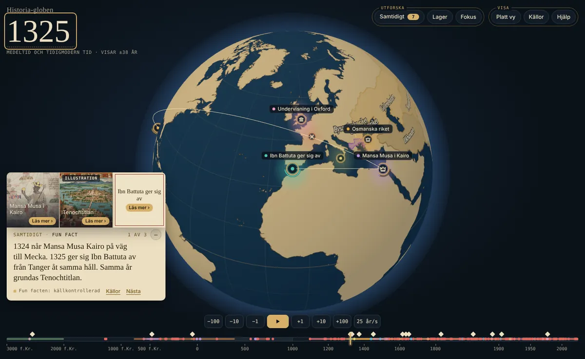
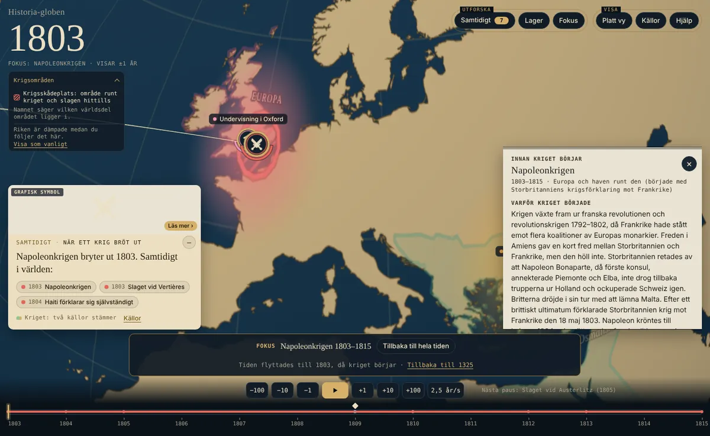
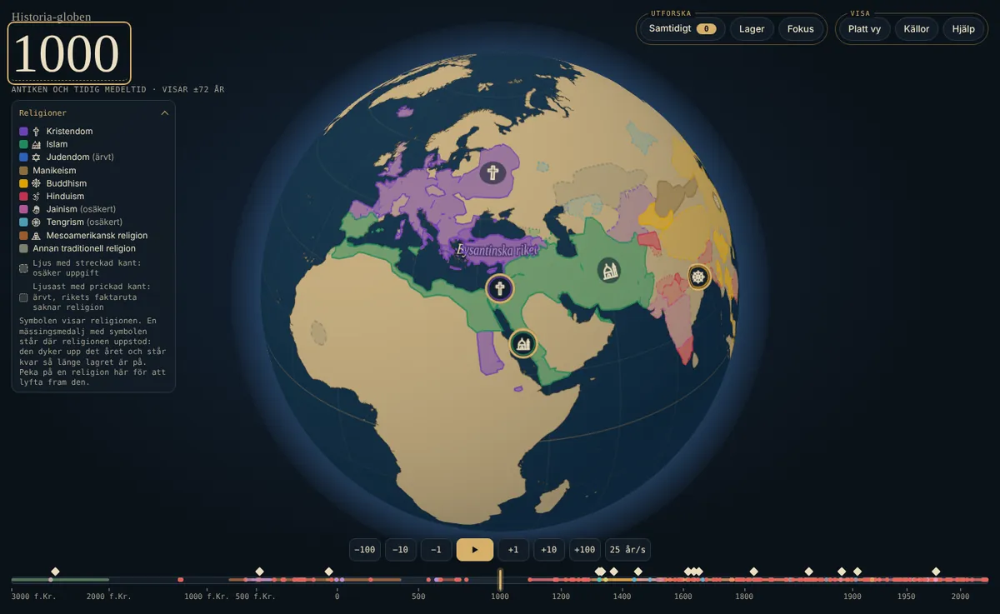
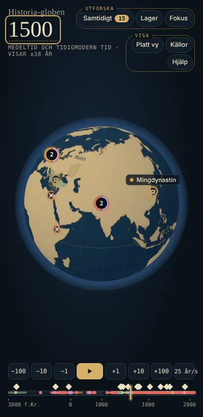

<p align="center">
  
</p>

<h1 align="center">Historia-globen</h1>

<p align="center"><strong>Dra i tiden och se vad som hände samtidigt i hela världen.</strong><br>
Pyramiderna byggs medan de sista mammutarna lever på Wrangelön. Oxford undervisar redan när Tenochtitlan grundas.</p>

<p align="center"><a href="https://historiagloben.se"><strong>Prova globen på historiagloben.se →</strong></a></p>



## Det här får du

- **En snurrbar jordglob genom 5 000 år.** Dra i tidslinjen från 3000 f.Kr. till i dag, eller tryck ▶ och se världen förändras.
- **Samtidigt-kortet.** Oväntade samband dyker upp av sig själva, till exempel att Mansa Musa och Ibn Battuta var på väg mot Mecka med ett års mellanrum.
- **Krig och slag att följa.** Över 50 krig från alla världsdelar, från Kadesh och perserkrigen till Ukraina i dag. Varje krig har en berättelse: varför det började, vilka som stred, hur det slutade och hur många som dog, som spann och med vem som har räknat.
- **Riken som växer och krymper,** från Romarriket och Handynastin till Mongolriket och Brittiska imperiet.
- **Religioner över tid,** med egna symboler och faktarutor, och med en symbol där varje religion uppstod.
- **Platt vy.** Världen som en platt karta som fyller skärmen, med zoom och panorering, medan tiden spelas upp.
- **Fungerar i mobilen,** utan installation.

| Följ ett krig | Religioner år 1000 | I mobilen |
|---|---|---|
|  |  |  |

## Varje uppgift har en källa

Inget på globen är skrivet ur minnet. Varje händelse pekar på minst en källa, och de flesta är jämförda med en andra, oberoende källa. När källorna är oense står det öppet, i stället för att en siffra väljs i tysthet. Under **Källor** på sidan går det att se varifrån allt kommer.

Just nu finns 469 händelser, 655 källor, 8 riken och 22 religioner. Allt är öppen källkod och öppna data.

## Om projektet

Historia-globen är ett hobbyprojekt med öppen källkod. På sikt kan samma innehåll visas på en fysisk glob. historiagloben.se visar den senaste releasen; bilderna ovan är tagna från utvecklingsversionen i `main` den 30 oktober 2026.

---

**För utvecklare:** resten av den här sidan beskriver hur projektet körs och är uppbyggt.

## Kör lokalt

Sidan är vanliga HTML-, CSS- och JavaScript-filer utan byggsteg. Datan läses med `fetch`, så den måste köras via en webbserver, inte genom att öppna filen direkt:

```
python3 -m http.server 8000
```

Öppna sedan http://localhost:8000.

## Struktur

```
index.html
AGENTS.md             regler för Codex och andra agenter; pekar på CLAUDE.md
_headers              Cloudflare Pages cache-regler (no-cache, så att en release inte blandas med gamla filer)
css/style.css
js/main.js            startar allt och kopplar ihop registret, tidslinjen och panelerna
js/state.js           det gemensamma tillståndet som lagren läser (år, fokus, filter, valda lager, #338)
js/layers/registry.js lagerregistret: rader i Lager, ritordning, dämpning i fokus, teckenförklaring (#338)
js/layers/index.js    lagerlistan: alla lager som anmäler sig i registret (#338)
js/model.js           språk, kategorier, tidsformat, laddning av data
js/globe.js           3D-globen (three.js), ekvirektangulär rendering
js/timeline.js        tidsreglage, segmenterad tidsskala, nuvarande år
js/layers/events.js   lager: händelser som punkter
js/layers/areas.js    lager: riken som områden som ändras över tid
js/layers/area-style.js  mjuk kant för osäkra gränser och prickat inflytande (lydriken)
js/layers/area-transition.js  mjuk övergång när ett rike byter period, delas eller slås ihop (#78)
js/layers/borders.js  lager: dagens landsgränser (av som standard)
js/layers/religions.js lager: religioner som områden, med symboler i områdena (#271)
js/layers/origins.js  religionens symbol där den uppstod, som klickbar markör (#271)
js/layers/empiremarks.js rikenas symboler mitt i områdena, som klickbara markörer (#301)
js/layers/wars.js     lager: krigsområden runt krigets slag
js/layers/lines.js    lager: vägar och resor som ritas fram över tiden (#38)
js/layers/discovery.js lager: upptäcktsvyn med dimma som resorna lyfter, havsmonster och kompassrosor (#101)
js/ui/panel.js        "Samtidigt i världen" per världsdel, kategorifilter och detaljvy
js/ui/funfact.js      Samtidigt-kortet (fun facts, när ett krig bröt ut) och bågar på globen
js/ui/sources.js      sidan Om källorna (knappen Källor)
js/ui/help.js         kort hjälp i tre steg för nya besökare (knappen Hjälp)
js/ui/flatmap.js      Platt vy: platt karta med zoom och panorering (knappen Platt vy)
js/ui/feedback.js     formuläret Lämna förslag / Rapportera faktafel (avstängt som standard, docs/feedback.md)
js/feedback-rules.js  förslagens kategorier, gränser och validering (delas med serverfunktionen)
js/ui/layers.js       lagerväljaren: slå av och på lager
js/ui/clusters.js     klustring av händelser som ligger nära varandra
js/ui/zoomlevels.js   vad som syns på vilken zoomnivå: tre nivåer och tröskelvärden (#358)
js/ui/focusmenu.js    fokusmenyn: välj ett krig, rike eller en religion att följa
js/ui/routepop.js     klickrutan för vägar och resor
js/ui/sheet.js        faktarutan som ark nedifrån i mobilen (litet, halvt, helt)
js/ui/viewmenu.js     menyn Visa i mobilen (Platt vy, Källor, Hjälp)
img/icons/            ikoner för händelser och religionernas symboler (egna SVG-teckningar, till exempel treaty.svg för fredsavtal, cross.svg och dharma-wheel.svg, #271)
img/favicon.svg       sidans ikon i webbläsarfliken (och PNG-versioner för äldre webbläsare och hemskärm)
images/events/        bilder till händelser (historiska bilder och märkta illustrationer)
images/karta/         upptäcktsvyns detaljer ur gamla kartor (havsmonster och kompassros, public domain)
images/incoming/      nya bilder innan de konverteras
tools/                hjälpskript som körs för hand (Python): riken, religioner, bildpromptar och bildkonvertering
docs/                 dokumentation: arkitektur, datamodell, beslutslogg, källarbete, bildpromptar; docs/bilder/ har skärmbilderna i README; docs/granskningar/ tar emot externa granskningar
.orchestra/           arbetsflödet dirigenten och orkestern (MIT-licens)
data/events.json      händelser
data/funfacts.json    fun facts, kopplade till händelser
data/sources.json     källregister
data/land.json        grundkarta (Natural Earth)
tools/riken.py        bygger rikesfilerna ur Cliopatria
tools/dela_data.py    delar upp events.json och empires/index.json i data/genererat/ (körs efter varje ändring i dem)
tools/tackningsrapport.py  skriver docs/tackningsrapport.md med täckningen per världsdel, århundrade och kategori
tools/religioner.py   bygger religionslagret (data/religions.json) ur Cliopatria och faktarutornas texter, med arv av religion
tools/religioner_riken.py  bygger rikenas gränser för religionslagrets klickruta ur Cliopatria
data/empires/         riken med utbredning per period, en fil per rike och index.json (Cliopatria)
data/borders.json     dagens landsgränser (Natural Earth)
data/routes/          vägar och resor (lagertyp linje): index.json och en fil per resa eller väg
data/genererat/       händelser och riken uppdelade i mindre filer som sidan laddar (genereras, redigeras inte)
data/upptackt.json    upptäcktsvyn: perspektivraden, den åldrade kartstilen, dimmans täckning och korridorens bredd, dekorationernas platser
data/vyer.json        grupperna och de förinställda vyerna i Lager (#357)
data/religions.json   religioner över tid: varje rikes religion (Cliopatria + Wikipedia)
data/religions-polities.json  varje rikes gräns i religionslagret, för klickrutan (Cliopatria)
data/styles.json      bildstilar efter tidsålder och plats
data/utkast/          utkast från massimport som inte är källkontrollerade; appen läser dem inte
tools/hced.py         gör om Historical Conflict Event Dataset till utkast i data/utkast/hced.json
scripts/build-site.sh kopierar webbplatsens filer till dist/ för publicering och kör kontrollerna (docs/DEPLOYMENT.md)
scripts/validate-site.py  kontrollerar dist/: JSON, filreferenser och att inga interna filer följer med
functions/api/feedback.js  Cloudflare Pages Function för besökarnas förslag (publiceras från repots rot, inte via dist/)
tests/                tester för serverfunktionen (node --test 'tests/*.test.mjs') och webbläsartestet tests/webblasare.mjs (Playwright, #339)
.github/workflows/    GitHub Actions: bygger och kontrollerar dist/ vid push till main och PR mot main och production; browser-test.yml öppnar sidan i Chromium; release.yml skapar tagg och GitHub Release
```

## Principer

- **Data skild från kod.** All data ligger i `data/`.
- **Ett år styr allt.** Tidsreglaget äger nuvarande år, lager och paneler lyssnar.
- **Ekvirektangulär rendering.** Lagren ritas på en platt världsbild som läggs på klotet. Knappen "Platt vy" visar samma bild som en platt karta, och bilden kan också skickas till en fysisk globskärm.
- **Lager som moduler.** Lagertyperna är punkt, linje, område, bildlager och tur.

Mer i [docs/arkitektur.md](docs/arkitektur.md). Besluten bakom finns i [docs/beslut.md](docs/beslut.md).

## Datamodell i korthet

- **År** lagras som heltal med astronomisk årsräkning (ISO 8601): `0` = 1 f.Kr., `-1` = 2 f.Kr.
- **Osäkerhet** anges som en [EDTF](https://www.loc.gov/standards/datetime/)-sträng: `~` betyder ungefär och `/` betyder spann.
- **Precision** följer Wikidatas skala: 7 = århundrade, 9 = år, 11 = dag.
- **Plats** anges som GeoJSON `[longitud, latitud]` i WGS 84.
- **Texter** lagras per språk (`sv`, `en`, `fr`, `de`, `es`). Saknas ett språk visas engelska, sedan svenska.

Alla fält och filer beskrivs i [docs/datamodell.md](docs/datamodell.md).

## Källpolicy

1. Varje uppgift har minst en källa i `data/sources.json`, med länk och datum då den kontrollerades.
2. Varje uppgift har en granskningsstatus: `draft`, `source-checked` eller `two-sources`. Utkast visas inte. Är källorna oense står det öppet.
3. Uppgifter som föreslås av AI är utkast tills källan är öppnad och stämmer.
4. Osäkerhet visas öppet, till exempel "cirka" eller ett spann.
5. En fun fact som jämför två saker har källa för båda leden.

Hur kontrollen går till står i [docs/kallor.md](docs/kallor.md).

## Bidra

Hittar du ett faktafel, öppna ett issue och ange vilken uppgift det gäller och en källa som visar det rätta. Nya händelser tas emot på samma sätt: med källa, plats och årtal.

## Licenser

- **Koden** är licensierad under [GNU GPL v3.0](LICENSE). Du får använda, ändra och sprida den, men det du sprider vidare måste också vara öppet under GPL.
- **Datan** i `data/` (händelser, fun facts och källregister) är licensierad under [CC BY 4.0](data/LICENSE). Ange "Historia-globen" som källa vid användning.
- **Grundkartan** i `data/land.json` och **dagens landsgränser** i `data/borders.json` bygger på [Natural Earth](https://www.naturalearthdata.com/) (public domain) via world-atlas.
- **Rikenas utbredning** i `data/empires/` är ett förenklat utdrag ur [Cliopatria](https://github.com/Seshat-Global-History-Databank/cliopatria) från Seshat Global History Databank, licensierat under [CC BY 4.0](https://creativecommons.org/licenses/by/4.0/). Ändringar: bara de riken som listas i `data/empires/index.json` är med, geometrin är förenklad och perioder med nästan samma gräns är sammanslagna (`tools/riken.py`).
- **Nattljus 2016** i `images/lager/nattljus-2016.jpg` kommer från [NASA Earth Observatory: Black Marble](https://science.nasa.gov/earth/earth-observatory/earth-at-night/maps/) och är **public domain i USA enligt NASA:s riktlinjer för bilder**. NASA:s logotyp och märken är skyddade; bilden innehåller ingen NASA-logotyp. Bilden är NASA:s globala JPEG i 3600 × 1800, utan innehållsliga ändringar.
- **Faktarutorna om riken** (`facts` i `data/empires/index.json`) är egna korta sammanfattningar av Wikipedias artiklar om rikena (CC BY-SA). Medeltidens riken (#69) är dessutom kontrollerade mot World History Encyclopedia (CC BY-NC-SA, bara länkad, ingen text kopierad), och de tidigmoderna rikena (#70) mot World History Encyclopedia eller Wikidata (CC0). Kolonialvälden och moderna imperier (#71) bygger på Wikipedia, för det nederländska och tyska väldet, Japan och Etiopien kompletterat med World History Encyclopedia (bara länkad). Artiklarna länkas från rutorna och från källregistret.
- **Religionerna** i `data/religions.json` använder gränser från samma Cliopatria-data, sammanslagna per religion och förenklade. Varje rikes religion kommer från faktarutan på rikets Wikipedia-sida (CC BY-SA), och sidorna listas i filen. Årtalen för när en del riken blev kristna kommer från Wikipedia och länkas från källregistret. Ändringar: varje rikes religion räknas fram ur faktarutans text, och ett område behåller sin religion när riket som följer saknar religion i faktarutan (`tools/religioner.py`). Klickrutan använder varje rikes egen, förenklade gräns ur samma Cliopatria-data (`data/religions-polities.json`, `tools/religioner_riken.py`).
- **Utkasten om slag** i `data/utkast/hced.json` kommer från [Historical Conflict Event Dataset](https://whgazetteer.org/datasets/1415/places) (Charles Miller, 2022, Harvard Dataverse, https://doi.org/10.7910/DVN/6ZFC0V) via World Historical Gazetteer. Datasetet har licensen [CC0 1.0](https://creativecommons.org/publicdomain/zero/1.0/), och WHG:s egna tillägg har [CC BY 4.0](https://creativecommons.org/licenses/by/4.0/). Ändringar: ett urval, omräknade årtal och egna texter (`tools/hced.py`). Utkasten visas inte på globen förrän de är källkontrollerade.
- **Dödssiffror i krigens berättelser** kommer delvis från [UCDP Battle-related Deaths Dataset](https://ucdp.uu.se/downloads/) (Uppsala Conflict Data Program, version 26.1; Davies, Pettersson och Öberg 2026, *Journal of Peace Research* 63(4)), licensierat under [CC BY 4.0](https://creativecommons.org/licenses/by/4.0/). Ändringar: summerade per krig och återgivna i egna texter.
- **Krigens år och intensitet före 1989** (till exempel Algeriet och Biafra) kommer delvis från [UCDP/PRIO Armed Conflict Dataset](https://ucdp.uu.se/downloads/) (Uppsala Conflict Data Program och PRIO, version 26.1; Gleditsch m.fl. 2002, *Journal of Peace Research* 39(5); Davies, Pettersson och Öberg 2026), licensierat under [CC BY 4.0](https://creativecommons.org/licenses/by/4.0/). Ändringar: start, slut och intensitet återgivna i egna texter.
- **Ikonerna** i `img/icons/` och sidans ikon (`img/favicon.svg` med PNG-versioner) är egna teckningar för projektet och licensieras som koden (GPL v3.0).
- **Bilder i faktarutan** (`images/events/`):
  - **Historiska bilder** kommer från [Wikimedia Commons](https://commons.wikimedia.org/) (public domain, CC0, CC BY eller CC BY-SA) och från [Library of Congress](https://www.loc.gov/pictures/) (poster märkta "No known restrictions on publication"). Varje bild behåller sin egen licens, som står i bildtexten tillsammans med upphov och länk till filsidan eller arkivposten. Filsidan eller arkivposten finns i källregistret.
  - **Illustrationer** i en tidsålders bildtradition är tydligt märkta "inte en historisk bild" i bildtexten. Verktyg, datum och prompt sparas i `data/events.json`. De licensieras under CC BY 4.0 som övrig data, i den mån de alls omfattas av upphovsrätt.
  - **Platshållare** märks "Platshållare" tills den riktiga bilden finns.
- **Upptäcktsvyns kartbilder** (`images/karta/`) är beskurna detaljer ur Olaus Magnus *Carta marina* (1539) och Guillaume Brouscons världskarta (1543, Huntington Library), via [Wikimedia Commons](https://commons.wikimedia.org/), public domain. Ändringar: beskurna med mjuk oval kant och förminskade. Filsidorna finns i källregistret, och krediten står i teckenförklaringen när upptäcktsvyn är på.
- **Dirigenten och orkestern** i `.orchestra/shared/` kommer från [solwation/dirigenten-och-orkestern](https://github.com/solwation/dirigenten-och-orkestern) och har MIT-licens. Det är instruktioner för AI-agenter, inte en del av sidan.
- **three.js** laddas från jsDelivr och har MIT-licens. Typsnitten kommer från Google Fonts (SIL Open Font License).
- Händelsetexterna är egna sammanfattningar. Källorna, ofta Wikipedia (CC BY-SA), länkas från varje uppgift.

Namnet "Historia-globen" omfattas inte av licenserna ovan.

Copyright © 2026 Rikard och projektets bidragsgivare.
