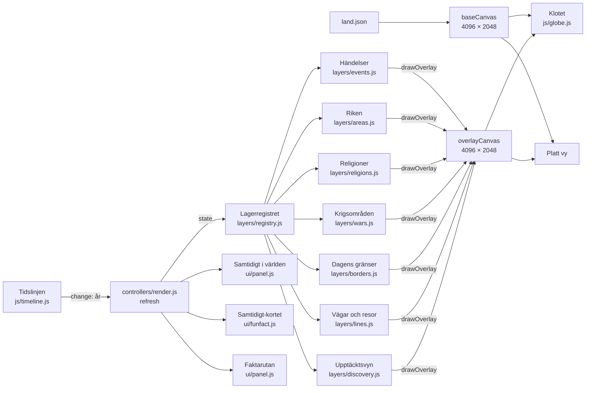

# Arkitektur

> **Samtidigt-listan (#508):** Världsdelarna behålls. Panelen visar fem rangordnade träffar per världsdel och *Visa fler* behåller sitt val. Öppna EDTF-spann som startat minst 100 år före valt år ligger sist i en hopfälld grupp. `isLongRunning()` används också av händelselagret, så markören saknas på globen och i Platt vy tills posten väljs.
>
> **Tidslinjemärken (#378):** Lagerregistret samlar synliga lagers valfria `marks(state)` efter lager- och kategorifilter. Händelser är cirklar, Samtidigt romber och resors start och slut korta lodräta streck; när en resa följs läggs dess befintliga, källbelagda stopp till som cirklar. Tangentbordsfokus eller tryck visar märkets text. Upptäcktsprickar väntar på #377.
Hur Historia-globen är uppbyggd och varför. Den här filen uppdateras i samma pull request som koden när något av det här ändras. De bindande principerna står också i [CLAUDE.md](../CLAUDE.md#arkitektur-beslutad-ändra-inte-utan-att-fråga), och besluten bakom dem i [beslut.md](beslut.md).

## Kort sammanfattning

Läs detta först och sök sedan upp det avsnitt du behöver.

- **Inget byggsteg:** ES-moduler direkt i webbläsaren, inga ramverk, ingen server. Enda undantaget är `functions/api/feedback.js`.
- **Data skild från kod:** allt innehåll ligger i `data/`.
- **Ett år styr allt:** tidslinjen äger året och skickar `change`; allt annat lyssnar och ritar om.
- **Platt bild först:** grundkartan och lagren ritas på ekvirektangulära bilder (4096 × 2048) som läggs på klotet och visas i Platt vy. På en stående mobil använder själva klotet 2048 × 1024 tills Platt vy öppnas.
- **Lager som moduler:** `update(state)` och `drawOverlay(ctx, W, H)`, anmälda i lagerregistret.
- **Ett externt beroende:** three.js 0.160.0.

**Avsnitt**
- Principer – de sex principerna ovan, utförligare.
- Hur delarna hänger ihop – flödesbild från tidslinjen via lagren till klotet och Platt vy.
- Moduler – tabell över filerna och deras ansvar.
- Mindre trängsel på kartan (#358) – zoomnivån styr vad som får namn och medalj.
- Lagerregistret (#338) – hur lager anmäler sig, ritordning, grupper och förinställda vyer.
- Laddning av data – vad som laddas vid start och vad som laddas senare (#337).
- Hoppa i tiden (#140) – stegknappar, årtal och datum i samma ruta; `YYYY`, `YYYYMMDD`, `YYMMDD` och `YYYY-MM-DD` ger samma direktiva flöde som ett år.
- Tangentbord och skärmläsare (#139) – Tab, Enter och tangenter på globen.
- Mobilen (#361) – layouten i smal skärm.
- Låg höjd och 200 % zoom (#1310) – längst ned i `css/style.css`: under 880 px höjd i datorbredd får faktarutan mer höjd och en lägre bild, och under 600 px höjd (200 % zoom, liggande telefon) räknas turkortets plats ur turraden (`--pause-top`) i stället för ett fast avstånd, kortet rullar och Nästa och Avsluta står fast längst ned. Stor skärm och stående mobil är oförändrade.
- Pekskärmar och zoom (#191) – webbläsarens zoom avstängd, globens egen zoom.
- Fokusläget – följa ett krig, ett rike, en religion, en resa eller ett tema, och dämpning av andra lager.
- Faktarutan om en religion (#90) – när och hur religionens ruta visas.
- Faktarutan om ett rike (#170) – samma ruta för riken.
- Rikets berättelse (#171) – nyckelår som kort under uppspelningen.
- Hjälpskript – skripten i `tools/` som körs för hand.
- Publicering – `scripts/build-site.sh`, `dist/` och kontrollerna.
- Besökarnas förslag (2026-10-30) – serverfunktionen för formuläret.
- Testa – hänvisning till testerna i CLAUDE.md.
- Uppspelning (#163, #164) – hastigheter och pauser.

## Principer

1. **Inget byggsteg.** Vanliga ES-moduler som webbläsaren läser direkt. Inga ramverk, ingen bundler och ingen server. Det räcker med `python3 -m http.server`. Enda undantaget är serverfunktionen för besökarnas förslag, `functions/api/feedback.js` (beslut 2026-10-30, se [Besökarnas förslag](#besökarnas-förslag-2026-10-30)).
2. **Data skild från kod.** Allt innehåll (händelser, fun facts, källor, riken, religioner, bildstilar) ligger i `data/`. Koden innehåller inga händelser, texter eller årtal.
3. **Ett år styr allt.** Tidslinjen äger det nuvarande året och skickar `change`. Allt annat lyssnar och ritar om.
4. **Allt ritas på en platt bild först.** Grundkartan och lagren ritas på ekvirektangulära bilder (4096 × 2048) som läggs på klotet. På en stående mobil får klotet 2048 × 1024 för mindre minne; när Platt vy öppnas ritas samma bilder åter i 4096 × 2048 för karta och framtida export (#390). "Platt vy" visar dem som en platt karta för skärmar, med zoom och panorering (#292). Bilderna kan också skickas till en fysisk globskärm senare.
5. **Lager som moduler.** Varje lager har samma gränssnitt: `update(state)` väljer vad som syns, och `drawOverlay(ctx, W, H)` ritar det på den platta bilden. Lagertypen linje med rörelse över tid (`layers/lines.js`, #38) ritar vägar och resor på samma bild, så att en resa går att följa i tiden både på klotet och i Platt vy.
6. **Ett enda externt beroende:** three.js 0.160.0 från jsDelivr.

## Hur delarna hänger ihop



Varje gång året ändras körs `refresh()` i `js/controllers/render.js` (före #402 i `main.js`). Den fyller i det gemensamma tillståndet `state` (`js/state.js`: år, fokus, filter, valda lager med mera) och låter lagerregistret göra resten (se [Lagerregistret](#lagerregistret-338)):

1. Samtidigt-kortet väljer vilka fun facts och krigskort som gäller. Kort som jämför flera händelser visas först, sedan det som började senast.
2. Alla lager väljer vad som syns med `update(state)`, i lagerlistans ordning (`registry.update`): händelser, riken, religioner, vägar och resor, upptäcktsvyn, dagens gränser och krigsområden. Listan Samtidigt i världen ritas om med de synliga händelserna.
3. Registret räknar ut vilka lager som dämpas i fokusläget, teckenförklaringen sätts ihop av lagrens delar (`registry.legend`) och lagrens 3D-markörer uppdateras (`registry.markers`).
4. Lagren ritas i ordning nedifrån och upp på den platta lagerbilden (`registry.draw`, efter `Z` i `layers/registry.js`): upptäcktsvyns papperskarta (när den är på), riken, religioner, dagens gränser, upptäcktsvyns dimma, portolanlinjer och dekorationer (när den är på), vägar och resor, krigsområden och händelsernas sken.
5. Lagerbilden läggs på klotet, och på platta vyn om den är öppen.
   Rikesnamnen ritas mindre i bilden vid kraftig zoom (`areas.labelScale`, storlek ≈ förstoring^-0,7 men högst ned till 0,25, och `labelAlpha` tonar ut dem mot max zoom; omritning 150 ms efter att zoomandet stannat) så att de inte dominerar skärmen eller täcker markörer; i platta vyn följer storleken zoomnivån (`flatScale` i `ui/zoomlevels.js`, #358).
6. Pauser kontrolleras: fun facts, när ett krig bryter ut, krigets stora händelser, religionens grundande och, när man följer en plats eller ett tema, platsens eller temats händelser (de med `top` eller `major`, annars alla; valet `data-pause="theme"`, #1255). I fokusläget pausar Samtidigt-kortet bara med valet "även i fokusläget", Samtidigt-pausen räknas ned och fortsätter själv om valet "Fortsätt själv" är på (#578), och efter slutkortet heter spelknappen "Spela igen".

Klickbara markörer, etiketter och bågar ligger ovanpå klotet som 3D-objekt och HTML, inte på den platta bilden. Etiketter som ligger nära varandra slås ihop till kluster (`ui/clusters.js`). I Platt vy ritas samma markörer, klungor, etiketter och bågar som ett lager ovanpå kartan (#313). Etiketterna hålls inom skärmen och läggs aldrig ovanpå andra markörer eller klusterbrickor (#142), och inte heller på rikesnamn och rikesmedaljer; är det upptaget ovanför markören läggs etiketten under den (#358). De läggs aldrig under knapparna och raderna längst ner (`UI_BOTTOM` i `main.js`, #318), och i smal skärm inte heller under rubriken, årtalet, knappgrupperna eller teckenförklaringen (`UI_OVER_GLOBE`, #289).

## Moduler

**CSS-lagerordning (#894, #1065):** `z-index` över 4 i `css/style.css` anges med `var(--z-…)` från `:root`. Lokala värden 0–4 inne i en yta får vara siffror. `tests/zindex.test.mjs` kontrollerar detta i det befintliga Node-testjobbet; ett fel anger väljare och radnummer. Kommentarer och strängar räknas inte som deklarationer. Ingen tillåtelselista behövs efter namngivningen i #1064. Lägg inte till nya undantag för nya ytor: välj ett befintligt lagernamn eller dokumentera ett nytt i [beslutet om lagerordning](beslut/2026-11-09-lagerordning.md).

**CSS-variabler (#1471):** varje `var(--x)` i `css/style.css` utan reservvärde måste ha en deklaration av `--x`, annars blir egenskapen ogiltig och till exempel en `outline` med `var(--x)` försvinner (fokusringen saknades där `--brass-light` användes utan att vara definierad). `tests/css-variabler.test.mjs` kontrollerar detta i Node-testjobbet; ett fel anger radnummer och variabel. Variabler som sätts inline i JS står i en namngiven undantagslista i provet, som också faller när en post inte längre behövs. Skriv `var(--x, reserv)` eller definiera variabeln i `:root`; lägg inte till nya undantag för färger och mått.

| Fil | Ansvar |
|---|---|
| `js/main.js` | Startar allt och kopplar ihop registret, tidslinjen, panelerna och controllerna: skapar delarna, lyssnar på klick, menyer och tangenter. Själva ansvaret ligger i `js/controllers/` (#402) |
| `js/surfaces.js` | Stängregistret för ytor (#894): Lager, Fokus och Samtidigt-panelen anmäler sig i grupperna `meny` och `sidopanel`, och en öppnad yta stänger sin grupp (`opened(id)`, `closeGroup(grupp)`). Gruppen `popover` (#1141) har årshoppet och intervallformuläret, som stänger varandra; `closeAll({ narrow })` stänger menyerna och, när `narrow` är sann (standard), sidopanelen, och ersätter paret `closeGroup('meny')` + `closeGroup('sidopanel')`. Ersätter handskrivna `close()`-anrop; nya ytor anmäler sig här. Rena funktioner utan DOM, provas av `tests/surfaces.test.mjs` |
| `js/controllers/` | Uppdelningen av main.js (#402, del av #389), vanliga ES-moduler utan ramverk. Varje fil har en funktion `createX(app)` som får det delade underlaget `app` (komponenterna och de andra controllernas funktioner) och returnerar sina funktioner. Det man följer läses ur `state.focus`, `state.focusWar` och `state.focusRoute`. `selection.js`: val av händelse och vändningen mot Samtidigt-listan (#515). `facts.js`: faktarutorna om riken och religioner och religionslagrets laddning. `focus.js`: `startFocus`, `endFocus`, raden "Tiden flyttades" och Fokus-menyns listor. `render.js`: `refresh()`, lagerbilden, namnens storlek efter zoom och rikets berättelse. `playback.js`: köerna med krigets och resans stopp, Spela klart, huvudknappen i fokusraden och pauserna; köerna ägs bara här, och `refresh()` anropar `playback.check()` efter ritningen (därför flyttades omritningen och uppspelningen tillsammans). `story.js`: krigets kapitel och markeringar på tidslinjen och resans stoppdatum (rena funktioner). `labels.js`: etiketternas text, hovring och placering i varje bildruta. `address.js`: tillståndet i adressen och knappen Dela (#501, #64). `link-notice.js`: raden om en trasig länk (#1324). `jump-back.js`: tillfällig återgång till sparat år och kameraläge efter ett uttryckligt hopp (#997). `presentation.js`: presentationsläget (#488): `?presentation=1` i adressen eller knappen i För lärare (#1315), som skriver parametern med `history.replaceState` utan omladdning; Avsluta stänger läget på stället utan omladdning (länken finns kvar som reserv för Ctrl- och mittenklick). Läget gäller bara från 761 px (#1457): adressparametern är läget och bredden avgör om det ritas, så i smal skärm sätts ingen klass och ingen Avsluta visas (ingenting täcker årtalet), parametern står kvar i adressen, och när fönstret passerar 761 px ritas läget om efter adressen (ingen halvfärdig klass). Läget sparas aldrig |
| `js/state.js` | Det gemensamma tillståndet (#338), och tidslinjens gränser `MIN_YEAR`/`MAX_YEAR` (#1141; `timeline.js` exporterar dem vidare, så att `url-state.js` inte importerar tidsreglaget; `eventTags(e)` och `OVERVIEW_TAG` bor på samma sätt i `model.js` och exporteras ur `layers/events.js`): `createState()`, `snapshot()`, och sedan #403 `createStore()` med åtgärder och prenumeration samt `toJSON()`/`fromJSON()`, se [Lagerregistret](#lagerregistret-338) |
| `js/layers/registry.js` | Lagerregistret (#338): `LayerRegistry`, ritordningen `Z` och dämpningen `FADE`, se [Lagerregistret](#lagerregistret-338) |
| `js/layers/index.js` | Lagerlistan (#338): alla lager som anmäler sig, i radernas ordning i Lager |
| `js/focus/registry.js` | Fokustypernas register och kontrakt (#1327), se [Fokustyper som poster](#fokustyper-som-poster-1327) |
| `js/focus/index.js` | Fokustyperna i menyns ordning; en fil per typ bredvid: `war.js`, `empire.js`, `religion.js`, `route.js`, `theme.js`, `place.js`, och `util.js` med det de delar |
| `js/model.js` | Språk (`t()`), kategorier (fjorton i `CATEGORIES`; `katastrofer` för natur- och teknikkatastrofer och svält sedan #554, medan `klimat` nu bara heter Klimat), granskningsnivåer, tidsformat, världsdelar, bildstilar (`styleFor()`), laddning av data |
| `js/i18n.js` | Språket i gränssnittet (#63): väljer språk (`?lang=`, sparat val `hg-lang`, webbläsarens språk om språket är `auto`, annars svenska), laddar `data/ui/<språk>.json` med top-level await, `ui('nyckel', värden)` för texter som JavaScript bygger, `applyStatic()` som byter sidans fasta texter (`data-i18n`, `data-i18n-aria-label` …) och språkväljaren `setupLangPicker()`, som sparar valet och laddar om sidan med året kvar. `model.js` hämtar `LANG` härifrån, så att `t()` och `ui()` följer samma språk. `textLang()` och `langAttr()` säger vilket språk en text per språk faktiskt visas på, så att text på reservspråket får `lang` (Samtidigt-listan och faktarutan, #1308). Efter ett byte till en ofärdig översättning visar `setupLangPicker()` en gång upplysningen `lang.beta` (#1308). I datorbredd ankras den vid knappradens underkant och inte vid språkknappen, så att den inte täcker knappar när raden blir två rader på de, es och fr (#1378) |
| `js/url-state.js` | Adressformatet (#501, #64): `encodeHash()`, `decodeHash()`, `decodeProblems()` (felkanalen, #1324) och `isNewStep()`, utan beroenden på webbläsaren (testas i `tests/url-state.test.mjs`). Se [Tillståndet i adressen](#tillståndet-i-adressen-och-delbara-länkar-501-64) |
| `js/search-index.js` | Sökningens index och matchning (#570): `normalize()`, `buildIndex()` och `search()`, utan beroenden på webbläsaren (testas i `tests/search.test.mjs`). Se [Sök](#sök-570) |
| `js/place-search.js` | "Vad hände här?" (#15): `placeSuggestions()` (platsnamn ur händelsernas `place`), `eventsNear()` (händelser inom `RADIUS_KM` = 300 km, storcirkelavstånd, äldst först, `approximate` för `locationPrecision`) och `distanceKm()`, utan beroenden på webbläsaren (testas i `tests/place-search.test.mjs`) |
| `js/route-steps.js` | Stegningen mellan en resas stopp (#1380, steg B i #231): rena funktioner som delas med nodeprovet (`stepTarget`, `stepState`, `stopIndexAt`, `followersAtSameTime`). **Resefokus och stopp:** `routeStops()` (`layers/lines.js`) ger resans källbelagda stopp i tidsordning. Pausraden (`#pause-note`) visar ett stopp när uppspelningen pausar där, och får då **Föregående stopp** och **Nästa stopp** bredvid Fortsätt (`controllers/playback.js`, `stepStop`): året och kameran flyttas till stoppet (Lugn rörelse hoppar), kön med stopp och de visade stoppen följer det man stegade till så att Fortsätt går vidare därifrån, och första respektive sista stoppet döljer sin knapp med fokus flyttat till den som finns kvar. Knapparna syns bara medan raden visar ett resestopp (`pausenote` från `timeline.js` säger när raden byter text) och aldrig i en tur eller lektion, som avslutar eller stoppar Fokus (`MODE_RULES`). En resa utan stopp visar inga knappar. Ingen ny yta, inget eget läge och ingen ny fokustyp, och adressen får inget nytt fält: stoppet är året `y` med `f=route:<id>`, och varje steg är en egen post i historiken (`address.flush({ push: true })`), så Bakåt går till föregående stopp; en länk eller Bakåt som landar på ett stopps år visar stoppet igen (`restoreStop`). På en resa i årstakt kan flera stopp ha samma år (Palembang och Nanjing 1407); adressen ger då det första av dem. Escape lämnar resan som ett tema (`controllers/focus.js`) |
| `js/date-events.js` | Rent, återanvändbart urval av händelser för ett år eller ett exakt datum (#483). Öppet slut som redan har pågått minst 100 år räknas som bakgrund; affischen återanvänder samma årsregel (#485), och #489 kan återanvända datumurvalet. `selectEventsForRange` (#754) väljer händelser vars spann överlappar ett intervall och märker dem som börjar före eller slutar efter med `partial`; ingen UI använder den än (#755) |
| `js/globe.js` | Klotet (three.js), kamera, styrning, de platta bilderna, bågar. I smal, stående skärm (högst 760 px bred) får klotet nästan hela bredden (`_resize()`, marginal 1,1 i stället för 1,32, #361) och använder 2048 × 1024 canvasar så länge Platt vy är stängd; `setFlatView()` växlar till 4096 × 2048 när kartan öppnas (#390). `invalidate()` gör att WebGL bara ritar när klotet eller texturen ändras, rör sig eller roterar; dold flik ritas inte. `setViewLift(py)` lyfter bilden av klotet uppåt med en mjuk övergång (`setViewOffset`, i `_tick()`; Lugn rörelse: direkt) när faktarutan står som ark nedtill. `centerY()` ger klotets mitt utan lyftet. Datorn är oförändrad |
| `js/globe-detail.js` | Skarpt utsnitt vid inzoomning (docs/beslut/2026-11-07-skarpt-utsnitt-vid-inzoomning.md): när en bildpunkt i helbilden blir mer än 1,5 gånger större på skärmen ritas det som syns om i högre upplösning (2048 × 2048) på två extra bilder, med `paintBase()` för grundkartan och `registry.draw()` för lagren, och läggs som en liten klotbit ovanpå helbilden. Ritas om 220 ms efter att rörelsen stannat; lagerbilden döljs direkt när den ritas om och kommer tillbaka när det blir stilla. Helbildens lagerbild får ett hål under utsnittet. Kusten ritas ur `data/land-10m.json` (1:10m, laddas första gången utsnittet används; saknas den används 1:50m). Används inte i Platt vy |
| `js/timeline.js` | Tidsreglaget med segmenterad skala (fem segment sedan #1088: 100 000–3000 f.Kr. på 10 %, tre mellansegment på 21⅔ % var och 1800– på 25 %, enligt mätningen i #1087; modern tid har samma täthet som förut), fokusspann, uppspelning, hastighet och "Hoppa till år" (årtalet `#year-jump` är knappen; vid hovring och fokus visas en diskret penna `.year-pen` bredvid, utanför flödet så att inget flyttar sig, #310). Reglagets markeringar (`setMarks`) kommer från lagerregistrets filtrerade `marks(state)`: cirkel för händelse, romb för Samtidigt och kort lodrätt streck för resas start/slut; märkets etikett visas vid fokus eller tryck (#378). Krigets kapitel och stora händelser ritas dessutom först i fokusläget (#298). Årtal på skalan som skulle krocka med ett viktigare årtal döljs (`_hideOverlaps()`, #63), eftersom etiketternas längd beror på språket. **Synlig tidsskala (#1313):** `SEAMS` (en skarv per gräns mellan segmenten) ritas som `.seam` i `#track-segments`, och skalraden `#timeline-scale-note` visar hur många år en tiondel av tidslinjen är vid året (`yearsPerTenth(segment)`, `scaleText()`) och vid en skarv att skalan ändras. Talen räknas ur `SEGMENTS`; raden visas när året flyttas av besökaren, vid tangentbordsfokus och när uppspelningen passerar en skarv, och skärmläsaren får samma sak i statusraden (`takeStepNote`). Se [beslutet](beslut/2026-11-13-synlig-tidsskala-1313.md) |
| `js/layers/events.js` | Punktlager: händelser som mässingsmedaljer och sken. Händelserna i det öppna Samtidigt-kortet visas alltid, också när lagret Händelser är avslaget eller kategorin bortfiltrerad, så att kortets bågar har markörer i båda ändar; de räknas inte i listan Samtidigt. **Ikonfamiljen (#242):** alla markörer är samma medalj (`medalTexture`, canvas 128 px som sprite): mörk botten, mässingsring, inre cirkel i kategorins färg och symbolen ur `img/icons/` i mitten (med något kraftigare linjer, ändras vid laddning); utan `icon` en prick i kategorins färg. Medaljen kodar tidsläge (nedre bågen är en liten tidslinje: hela bågen = pågår vid året, vänster del = har redan hänt, höger del = kommer senare; `state.when`), betydelse (mässingspunkt uppe till höger för `top`/`major`) och osäkerhet (streckad båge när `edtf` har `~` eller `?` eller `note` heter "Källorna skiljer sig"), se `markerInfo()`. Samma sak i ord står i etikettens `aria-label` och `title` (`describeMarker()`). **Progressiv detalj:** `frame()` körs varje bildruta och räknar markörens storlek på skärmen (`medalSize()`, samma regel i Platt vy, #313): minst 16–26 px (även i mobilen), högst cirka 48 px vid stark zoom; under 30 px ritas medaljen med symbol och punkt, från 30 px hela medaljen med tidsbågen. Etiketten för markören under muspekaren visas alltid (hovring, `hoverId` i `main.js`), och etiketterna läggs ovanför markören efter dess storlek (`userData.px`). Klick fungerar som förut |
| `js/layers/areas.js` | Områdeslager: riken som ändras över tid. Riken med symbol (`symbol` eller `polityFacts.<rike>.symbol` i `empires/index.json`, #301; `symbolOf` sätts i lagrets post i registret) får en mässingsmedalj på `label`-punkten (`drawMedal()` i `religions.js`, samma som religionernas ursprung), och namnet under den bara när `showNames` är sant (nära zoom på globen och i Platt vy). En nutida stat (`modernState` i gruppen, #1193) får sin flagga bara när `modernFlags` är sant (nära zoom på globen, i Platt vy från nivån Inzoomat, `render.js`) eller när man följer landet; annars ger `markOf` inget märke och landet ritas med namnet som ett rike utan symbol. Villkoret ingår i nyckeln för `_layout()`, så att flaggan dyker upp när man zoomar förbi gränsen utan att byta år. `marks()` ger medaljerna till 3D-markörerna. I ett utspritt välde ritas moderlandet (`period.homeland`, #74) med tätare fyllning, kraftig kant och en mässingsstjärna (`--brass`), och namnet står ovanför stjärnan; har väldet en symbol står medaljen där i stället för stjärnan. Ett försvunnet land utan gräns i Cliopatria (`vanished.point`, #72) ritas som en ring med prick och namn. En liten stat med `polity.point` (#722) ritas som område och dessutom som en fylld punkt i landets färg med pergamentring på `label` (huvudstaden); punkten tas först i `_layout()`, och namnet står till höger eller vänster från zoomnivån världsdel när det finns plats. Vilka namn och medaljer som syns och var de står räknas i `_layout()` efter zoomnivån och rikets yta (`setView()`, `placedBoxes()`, #358). **Huvudstäder (#474):** när man följer ett rike i Fokus visas huvudstaden som gällde året (`capitals` i gruppen, `setCapitals`, `activeCapitals`) som en liten fyrkant i pergament med stadens namn; en huvudstad med `polity` bara när den delen syns. Fyrkanten står alltid på staden, men namnet placeras i `_layout()` (#616): till höger, och annars till vänster, ovanför eller under, en bit ut förbi händelsemarkörer (`setView({ markers })`, alla markörer som syns med sin storlek på skärmen), etiketter och rikesnamn. |
| `js/layers/empiremarks.js` | Rikenas symboler (#301) som 3D-markörer ovanpå klotet, en per synligt rike med symbol, på rikets `label`-punkt (flyttar med den). Samma medalj och storleksregel som religionernas ursprung (`frameMedals()` i `origins.js`). En osynlig knapp (`.gorigin.gempire`) har namnet som `title` och `aria-label`; klick öppnar rikets faktaruta, eller den egna rutan i `polityFacts` (Bysantinska riket). Döljs när rikeslagret är av eller dämpat |
| `js/layers/area-style.js` | Hjälp till områdeslagret: ett rike med osäker gräns (`polity.uncertainBorder`, #73) ritas med mjuk kant, tre breda och svaga linjer i stället för en skarp. Inflytande (`polity.influence`, #75), lydriken och vasaller enligt Cliopatria, ritas efter rikenas egna områden med glesa prickar i rikets färg och streckad kant, så att ett annat rike på samma plats syns igenom. Prickar, eftersom krigsområdena redan är snedstreckade. Prickmönstret skapas en gång per färg. Banorna läggs med `traceRing` (#1097): en ring som korsar datumlinjen (180°) vecklas ut som linjerna i `lines.js` (`unwrap`) och läggs vid båda kanterna av den platta bilden, i stället för som ett band tvärs över kartan. Cliopatrias data är redan delad vid ±180°, så det gäller framför allt nya områden som Beringia (#1094). **Alla lager som lägger områden använder `traceRing` (#1227):** riken (`areas.js`), religionernas områden (`religions.js`), platsernas konturer (`places.js`) och upptäcktsvyns upplyfta områden (`discovery.js`). Data som delats vid ±180° (#1268) har en söm, segment där båda ändpunkterna ligger på ±180; fyllningen går ända fram, men `strokeEdge` (och `traceRing` med `skipSeams`) lägger strokningen som öppna linjer utan sömmen, så att ingen kort linje (på globen en prickad linje längs 180°-meridianen) syns längs kartans kant. Geometrier utan söm strokas ur den lagda banan som förut, och platslagret sparar en egen kantbana per plats och storlek. Tester: `tests/area-style.test.mjs` och webbläsarkontrollerna "över datumlinjen"; skärmbilder före och efter i `docs/ux-review/traceRing-1227/` |
| `js/layers/area-transition.js` | Mjuk övergång när ett rike byter period, delas eller slås ihop (#78), se Rikenas övergångar nedan |
| `js/layers/religions.js` | Områdeslager: rikenas religion, och religionens symbol i en mässingsmedalj där religionen uppstod (`facts.origin`, #271; `ORIGIN_R`). Ärvda områden (`snapshot.inherited`, #269) ritas ljusast med prickad kant och prövas sist vid klick. **Symboler i områdena (#271):** `centersOf()` räknar en gång per ögonblicksbild ut en inre punkt per sammanhängande område (varje polygon), den som ligger längst från kanten i ett rutnät som förfinas, och symbolen (`symbol`, ur `glyph()` i `events.js`) ritas där på en mörk, genomskinlig skiva när området har plats för den; ljusare i osäkra och ärvda områden. Storleken följer riksnamnen (`labelScale`), så att fler områden får symbol när man zoomar in. Vid nära zoom (`showNames`, förstoring från 2,4 i `main.js`, aldrig i Platt vy) står religionens namn med versaler under symbolen när det ryms. `highlight` (religionens id) lyser upp religionens områden och tonar ner de andra |
| `js/layers/origins.js` | Symbolen där religionen uppstod (#271) som 3D-markör: samma mässingsmedalj som händelserna (`medalTexture` i `events.js`) med religionens färg och symbol, 26–46 px och alltid minst så stor att den täcker medaljen på lagerbilden. En osynlig knapp (`.gorigin` i `#labels`) ligger över den med `aria-label`, så att den går att nå med Tab; klick öppnar religionens faktaruta. Händelsens egen medalj döljs under symbolen, men etiketten står kvar |
| `js/layers/wars.js` | Krigsområden runt krigets och slagens platser, ett område per krigsskådeplats (platser inom cirka 2 000 km från varandra, #211), med världsdelen som etikett när man följer kriget (#236). Området ritas bara medan kriget pågår; i Fokus används krigets egen, eventuellt dagvisa, tidslinje. Egen rad i Lager sedan #357 (på som standard), men syns bara när Händelser är på; kriget man följer får sitt område även när raden är av |
| `js/layers/borders.js` | Dagens landsgränser (av som standard) |
| `js/layers/spread.js` | Människans spridning (#1094): antagna områden och vågor i förhistorien ur `data/spridning.json`, ritade på lagerbilden. **Istidens kust (#1565, [beslut 2026-11-14](beslut/2026-11-14-spridning-mot-istidens-kust.md)):** cirka 80 000–7 500 år sedan klipps alla områden (inte vågornas linjer) mot land utan is i modellen bakom bildlagret Istidens kust, för närmaste modellsteg. Masken är skivans fält `mask` i `data/bildlager.json` (2048 × 1024 WebP, alfa = land utan is, gjord med `tools/istidens_kust.py`), inte lagerbilden. Den tas ur raden `istidens-kust`, laddas bara när lagret är på och ett område syns i spannet och släpps annars, också när bildlagret är av. Vid stegbyte klipper den förra laddade masken tills den nya är klar (högst två samtidigt), så att ytorna inte blinkar ut över hav och is under uppspelning och dragning. Ett område ritas på en återanvänd arbetsduk i områdets ruta, och masken läggs på med `destination-in`, så att fyllning, snedstreck och kant följer kusten och isen. Innan någon mask har laddats, eller om den inte går att läsa, ritas som utan modell, och teckenförklaringen säger modellens kust bara när något klipps. Utanför spannet klipps bara områden med `clipLand` (Afrika) mot dagens land (`data/land.json`). Teckenförklaringen har en rad om vilken kust som gäller (`legend.spreadCoastModel` eller `legend.spreadCoastToday`). |
| `js/layers/images.js` | Bildlager (#54, #1325): varje rad i `data/bildlager.json` med `kind: lager` blir en egen post i lagerregistret och en egen rad i Lager (`entries` ger en lista; `js/main.js` anmäler varje post). Lagret väljer radens rasterskiva efter året (`areaYear`, i ett tidsintervall slutåret) och ritar den på lagerbilden, över hela världen eller i rutan `bounds`. Eftersom ritningen bara följer bildens bredd och höjd syns samma bild i Platt vy, på affischen och i det skarpa utsnittet (`registry.draw`). Flera rader får vara på samtidigt; en bild laddas först när den visas och släpps när raden stängs av eller året lämnar skivans period. Äldre lager-id (`aliases`, till exempel `images`) översätts i `js/controllers/address.js` när en länk läses. **Teckenförklaringen (#1096):** en skiva med `caveat` som syns står i teckenförklaringen (`legend.images`, `imageNotes`) med skivans rubrik, ett tecken som på kartan, osäkerheten i text och källorna; källregistret laddas första gången en sådan rad slås på. Rubriken står i knappen när bara bildlagret förklaras, så att "modell" syns också hopfälld i mobil. **Istidens kust (#1096):** raden `istidens-kust` har nio rasterskivor 10 000–80 000 år sedan (närmaste modellsteg ur PaleoMIST 1.0 via Wilmes m.fl.), gjorda i förväg med `tools/istidens_kust.py`. Bilderna är genomskinliga utom där det i dag är hav men inte var hav i modellen, så ett `lager` kan bara lägga till land; att ta bort land där havet stod högre kräver `kind: grund` (version 8). `format: vektor` och `kind: grund` läses inte ännu. |
| `js/layers/lines.js` | Linjelager (#38): vägar och resor ur `data/routes/`. En resa (`voyage`) ritas fram etapp för etapp: avslutade etapper hela, den pågående fram till platsen som svarar mot året (räknat längs vägens längd mellan `from` och `to`) med ett skepp (en prick i kategorins färg med mässingsring), senare etapper inte alls. Går flera etapper samtidigt får var och en ett skepp; mellan två etapper står skeppet där den senaste slutade. När resan är slut syns den svagt lika länge som händelserna (`timeline.windowYears`). En handelsväg (`trade`) syns tunnare och dämpad medan året ligger inom etappens `from`–`to` plus samma fönster. `uncertain` ritas streckat. Långa sträckor följer storcirklar (en punkt per högst 2 grader), och en linje över datumlinjen ritas också en bildbredd åt andra hållet. Utanför fokusläget är året ett heltal, och vägarna ritas då som de låg vid årets slut. Kategorifiltret och raden "Resor och handelsvägar" i Lager styr lagret. `hitTest(lon, lat)` hittar en synlig linje inom 1,5 grader I upptäcktsvyn (#101, `shipStyle = 'ship'`) ritas skeppen som små segelskepp (egen siluett på canvas, `drawShip()`), vända mot väst eller öst efter etappens riktning just där; `reached()` ger de delar av vägarna som har ritats fram till ett år, för upptäcktsvyns dimma |
| `js/layers/discovery.js` | Upptäcktsvyn (#101), ett bildlager som slås på i Lager (`data-layer="discovery"`, av som standard). **Papperskartan** (`drawPaper`, underst på lagerbilden): grundkartans land (`data/land.json`) ritas om som en åldrad karta med blekt pergament i haven, mörkare pergament på land, bläckkust, vattenlinjer, papperskorn (brus med frö), fläckar och mörkare kanter. Den ritas en gång på en egen bild i lagerbildens storlek och läggs sedan bara på; `baseCanvas` ändras inte, så utanför vyn ser allt ut som förut. **Dimman:** en i princip ogenomskinlig pergamentton (`--discovery-fog`, täckning `fog.opacity` cirka 0,97) med papperskorn och "Terra incognita" (82 % `--discovery-ink`, IM Fell English) över hela kartan, ritad på en egen bild i halv upplösning. Händelsernas markörer är 3D-objekt ovanpå och syns även i dimman. Kring varje etapp i `data/routes` som har börjat lyfts dimman med `destination-out` i en korridor med mjuk kant och skrafferad bläckkant längs den del som linjelagret har ritat (`LinesLayer.reached()`, oavsett kategorifilter och om linjelagret är på). Det som har lyfts förblir lyft senare år. **Källbelagd kartkunskap (#1072):** `knowledge` i `data/upptackt.json` lyfter dessutom dimman över den ungefärliga GeoJSON-yta som en samtida kartkälla återger. Den är tidsindelad och har sina egna källor i `sources.json`; den beskriver inte nutida gränser, politisk kontroll eller lokal kunskap. **Riken (#377, regel A):** när vyn är på laddas rikenas gränser (`loadEmpire`, samma filer som rikeslagret) för riken som har börjat. När en lyft korridor har nått ett rikes område, någon period i rikets karta (punkten ligger i området eller högst en halv korridorbredd från gränsen), lyfts dimman över hela riket för varje period som har börjat, med en smal mjuk och skrafferad kant. Kom resan fram innan riket fanns lyfts dimman när riket uppstår. **Hemriken (Rikards beslut 2026-11-06):** vyn ser världen från Europa, så dimman är lyft över de europeiska rikena i `home.empires` (Rom, Makedonien med Alexanders erövringar, senare de europeiska staterna och kolonialväldena) för varje period som har börjat, utan resor. Ett annat rike lyfts som granne från det första år då någon av dess perioder låg högst `home.neighborDeg` grader från ett hemrikes period som gällde samma år (`_neighbor`, räknas en gång när rikena laddas); grannarnas grannar räknas inte. Svaret om kontakt minns per rike, eftersom det lyfta bara växer med tiden, och glöms när vägarna laddas. Bilden görs bara om när året ändras (i fokusläget för korta krig högst var hundradels år) eller när vägarna har laddats. **Portolanlinjer:** bläcklinjer i 32 riktningar ut från varje kompassros (`rhumb: true`), ovanpå dimman. **Dekorationer:** havsmonster och kompassrosor ur gamla kartor (`images/karta/`) mitt i öppna hav; monster med `fade` tonas bort när en lyft korridor kommer innanför bildens radie. Allt (texter, platser, storlekar, kartstilens styrkor, dimmans täckning och korridorens bredd) står i `data/upptackt.json` och färgerna som CSS-variabler `--discovery-*`. När vyn är på ritar linjelagret skeppen som segelskepp (`shipStyle = 'ship'`), och teckenförklaringen (`legend.js`) visar perspektivraden, som syns även hopfälld i mobil, och krediten för kartbilderna med länkar till filsidorna. Kartbildernas och kartkunskapens källor listas under Kartdata i Om källorna |
| `js/ui/routepop.js` | Klickrutan för vägar och resor (#38), i samma stil som religionernas: namn, typ och tid (`formatEventTime`), etappens tid och om vägen är osäker, sammanfattning, `note` (till exempel "Källorna skiljer sig"), källorna som länkar, granskningsstatus och "Läs mer om …" till händelsen i `event`. Händelsemarkörer har företräde vid klick, sedan vägar, sedan religionsområden. I Platt vy fungerar klicket också (`FlatMap.onMapClick`). Escape stänger rutan |
| `js/ui/panel.js` | Samtidigt i världen per världsdel, kategorifilter (samma chips på två ställen, under Lager i `#filters` och ovanför listan i `#panel-filters`, #311: båda styr `panel.filters` och följs åt via `data-cat`; i smal skärm är panelens chips en rad som rullar i sidled), listan (raderna är `<button class="event-btn">` med `aria-label` av år, titel, världsdel och granskningsstatus, #238; är listan tom säger raden varför, `emptyCause()`: alla kategorier av eller några av ("kan dölja händelser", båda med knappen Visa alla kategorier, #886 och #1304) eller bara inget kring året), faktarutan med bild och ram, krigets berättelse, faktarutan om en religion eller ett rike (`showFacts`). Bredvid granskningsstatusen i faktarutan finns en (i)-knapp (`reviewRow()`, `bindReviewInfo()`, #310) som fäller ut vad Källkontrollerad och Två källor stämmer betyder (`REVIEW_HELP` i `model.js`) och en knapp till Om källorna (`panel.onSources`). Händelser med ungefärlig eller osäker datering, grov precision, ungefärlig plats eller oense källor får dessutom den separata datastyrda raden Historisk osäkerhet (#364). **Ordningen i händelsens faktaruta (#605–#608):** rubrik, datumrad (datum · plats · kategori), i mobil knappen *Visa på globen* (platsen står bara i datumraden, #607), bilden, sammanfattningen, anteckningen, raden Historisk osäkerhet, kopplingar, källor och granskningsstatus. Datumraden har en kort markering *osäkert* efter datumet eller platsen när just den är osäker (#606, texten i `uncertainty.mark` i `data/vyer.json`); den flyttar fokus till raden Historisk osäkerhet. Krigets kort före och efter har samma statusrad med (i) som händelserna (#608). Escape stänger först förklaringen och lämnar fokus på knappen Under granskningsmärket i faktarutan (`reviewRow`) står en kort rad, `review.explain`, som skiljer kontrollen av källorna från hur säker historien är (#786), så att "två källor stämmer" inte läses som "säker historia" bredvid raden Historisk osäkerhet. Under källistan finns den hopfällda raden **Hur vet vi det här?** (`howWeKnowRow()`, #937) med fyra frågor och svaret för just uppgiften: vem säger det (källorna med länk), hur vet vi (granskningsnivån, samma ord som `review.help.*`), finns det fler källor (antal) och är källorna överens ("Källorna skiljer sig" när `note.kind` är `disagreement`, "Källorna är överens" när nivån är *Två källor stämmer*, annars "Ingen oenighet är noterad", så att en enda källa inte påstås stämma med något). Samma rad för händelse, rike, religion och försvunnet land; längst ned en länk till turen *Hur vet vi det här?* (`panel.howTour`). Bara befintliga fält visas. Händelser som börjar före tidslinjens första år (`MIN_YEAR`, 100 000 f.Kr. sedan #1088, tidigare 3000 f.Kr.) får raden `.scale-note` under datumraden i faktarutan (`beforeTimelineStart`, #942): reglaget kan inte stå på deras första år. |
| `js/ui/areacurve.js` | Rikets yta över tid i faktarutan (#77): inline-SVG, UI och inte på klotet. `areaSegments()` lägger ihop `areaKm2` för alla polities i riket per år (Rom: republik, kejsardöme, Väst och Öst; Mongolriket: alla khanat), så kurvan visar hela riket. År utan period blir glapp, inte noll (till exempel mellan Egyptens riken). Axeln har runda årtal i f.Kr./e.Kr. (`formatYear`), toppen markeras med ytan och årtalet, och en lodrät linje med prick följer tidslinjen (`panel.setCurveYear()` anropas från `refresh()` i `main.js`). Kurvan fylls i av `panel.setCurve()` när rikets fil har laddats |
| `js/ui/funfact.js` | Samtidigt-kortet: fun facts, "När ett krig bröt ut" och rikets berättelse i fokus (`empireStory`, #171), kan fällas ihop. Händelsernas bilder visas alltid överst i kortet (#190), högst tre sida vid sida (`_renderPics`), med bilden från händelsens `image`, ramen från `styleFor()` och en knapp "Läs mer" som öppnar faktarutan (`ff.onSelect`) med full bildtext, kredit och licens. Under bilden står ingen text utom händelsens namn när det är flera; illustrationer får etiketten "Illustration" i hörnet. Har ingen händelse i kortet bild visas ingen bildrad, utom för krigskort (#237): de får en egenritad grafisk symbol (händelsens `icon`, annars kategorins ikon ur `CAT_ICON`, i stor storlek ur `img/icons/` på tidsålderns ram) märkt "Grafisk symbol" (`_renderSymbol`), aldrig "Illustration". Händelseknapparna under texten öppnar också faktarutan (och flyger globen dit). Kortet rullar inuti och går aldrig utanför skärmen. I smal skärm (≤760 px, #168) är bildraden låg (se Mobilpanel nedan), texten klipps efter två rader med bild (tre utan, tryck för hela), händelseknapparna döljs när bildrutorna finns och radbryts annars (ingen sidscroll, inget namn klipps), och alla kontroller har minst 44 × 44 px tryckyta. **Mobilpanel (#239):** i smal skärm är kortet en panel underifrån, med gutter på båda sidor, och ett handtag överst (`#ff-handle`, en knapp med `aria-expanded`, 36 px hög med 44 px tryckyta, #361). Panelen har tre lägen, klasserna `ff-s-closed` (handtaget och rubrikraden), `ff-s-half` (kompakt, bildraden 52 px; knappraden med Källor och Nästa står fast längst ned med `position: sticky` medan texten rullar ovanför, så att den syns även i 360 × 640, #706) och `ff-s-full` (allt syns, upp till cirka 100 px från överkanten, rullar inuti). Ett tryck på handtaget stegar stängd → halv → hel → stängd, pil upp och ner byter läge, och man kan dra: höjden följer fingret, och när man släpper väljs det läge vars höjd ligger närmast (`_measureSheet()` mäter de tre höjderna utan att något ritas). Att stänga med handtaget är samma sparade val som att fälla ihop kortet i datorn (`hg-ff-min`): ingen paus vid nya kort, och fliken `#ff-tab` och knappen − används inte i smal skärm. När man drar i globen (mer än 12 px, lyssnaren ligger i `main.js`) anropas `ff.autoClose()`: panelen stängs utan att valet sparas, och nästa nya kort öppnar den halvt igen och pausar som vanligt. Panelens underkant står i `--ff-b` (ovanför tidslinjen, pausraden och fokusraden, i fokus `--focus-top` från #183); faktarutans ark (#361) använder samma variabel. Handtaget har en liten pil (`.ff-chev`, uppåt, nedåt när panelen är hel), och första gången panelen visas står "Dra upp för mer" bredvid (`#ff-drag-hint`, #310). Texten försvinner vid första dragningen, tryck eller piltangent på handtaget, eller efter 6 sekunder, och visas inte igen (`hg-ff-drag-hint` i localStorage, i try/catch). Datorn är oförändrad |
| `js/ui/legend.js` | Teckenförklaring och klickruta för religionslagret (#166). Klickrutan förklarar en osäker uppgift (ljusare, streckad kant) och länkar till rikets sida på Wikipedia (fältet `wikipedia` i `religions.json`), i fokusläget också för krigsområden och dämpade lager (#235, #236): HTML över globen, inte i kartbilden. Teckenförklaringen listar religionerna som syns året (`ReligionsLayer.legendItems()`); ett klick på ett område (`Globe.pickLatLon` + `ReligionsLayer.hitTest`, punkt-i-polygon i lon/lat) visar religion och rike, och för en religion med `facts` en knapp "Läs mer om <religion>" som öppnar religionens faktaruta (#270). Överst i listan står knappen "Läs om religionerna" och första gången lagret slås på en tipsrad som går att stänga (#308, se Faktarutan om en religion). Händelsemarkörer har företräde. Teckenförklaringen ligger uppe till vänster under rubriken (inte nere till vänster där Samtidigt-kortet är): en hopfällbar ruta, öppen i dator och hopfälld i mobil, där den hopfällda knappen visar rubriken och religionerna som syns som en rad färgprickar (högst tio, sedan "+N", #309) och ett tryck fäller ut hela förklaringen med noterna; byter man fönsterbredd över 760 px gäller standardläget för den nya bredden. `fit()` kortar av listan så att den slutar ovanför Samtidigt-kortet, faktarutan, panelen och fokusraden (#193). I ett ärvt område (#269) säger rutan "(ärvt)" efter religionen och förklarar varför: rikets faktaruta saknar religion (eller anger en som inte gäller då, till exempel bara procent ur en senare folkräkning eller ett senare årtal), och området visas med religionen det hade på kartan fram till `inherited.until` under rikena i `inherited.from`. Teckenförklaringen markerar sådana religioner "(ärvt)". Fokusmenyns spann för en religion räknar bara områden där en faktaruta anger religionen. Rikets namn på just den platsen (#194) tas fram med `ReligionsLayer.polityAt` mot rikenas egna gränser i `data/religions-polities.json`: bara rikena i det träffade området prövas, enskilda skeden före Cliopatrias sammanslagningar inom parentes, och svenska namn hämtas ur `data/empires/index.json` där de finns. **Människans spridning (#1094, #1417, #1418):** avsnittet listar varje post i lagret med tecken (område: snedstreck och streckad kant; våg: streckad eller prickad linje), namn som `h3` och säkerhet, och sedan sammanfattning, not och källänkar (minst 24 × 24 px) i brödtextens typsnitt. I smal skärm (högst 760 px) är det senare hopfällt per post bakom en knapp i rubriken (`aria-expanded`, `aria-controls`, tangentbord) och i bred skärm står allt utfällt (`docs/beslut/2026-11-14-spridning-mobil-lista.md`) |
| `js/ui/layers.js` | Lagermenyn och valen för pauser. Raderna för lagren byggs av registret (`registry.buildMenu`) innan menyn skapas. `loadViews()` läser grupperna och de förinställda vyerna ur `data/vyer.json` (#357), och menyn visar vyerna överst, se [Grupper och förinställda vyer](#grupper-och-förinställda-vyer-i-lager-357) |
| `js/ui/focusmenu.js` | Fokusmenyn: följ ett krig, ett rike, ett försvunnet land, en religion eller en resa. Huvudet (sökruta, flikar, sortering) ligger still och listan rullar under det (#311). **Grupper (#507):** på fliken Alla är Krig, Riken, Försvunna länder, Religioner och Resor hopfällda med totalt antal; bara en öppnas åt gången och visar de åtta närmaste, med *Visa alla* för resten. Enter/mellanslag fäller och piltangenter flyttar mellan rubrikerna utan att fokus hoppar. Valet *Gruppera efter: Tidsålder* delar den öppna gruppen efter de globala, regionslösa intervallen i `data/styles.json`; etiketter ligger i `data/vyer.json`. **Sökning** i alla namn en post har (`terms` från `main.js`: svenska och engelska, för riken och försvunna länder även rikets delar i `polities`, så att "bys" hittar Rom via Bysantinska riket och "sver" hittar Sverige), delar av namn, flera ord (alla måste finnas), utan hänsyn till accenter (`norm()`); träffar på ett annat namn än rubriken visar "även …". **Aktiva val (#381):** när ett sökord, en annan flik än Alla eller en annan sortering än Relevans används visar listan resultatantal och de aktiva valen överst, med knappen *Rensa allt* som tömmer sökningen och återställer flik och sortering. **Flikarna** Alla, Krig, Riken, Försvunna länder, Religioner och Resor (#240); menyn öppnas alltid med Alla och fliken sparas inte (#709); gruppernas förklaringar visas bara på gruppens egen flik. **Sortering** (`hg-focus-sort`): Relevans (närmast året först), Kronologiskt och Alfabetiskt. **Tangentbord:** på dator (`hover: hover` och `pointer: fine`) får sökrutan fokus när menyn öppnas, med pekskärm menyn själv så att skärmtangentbordet inte fälls upp; pil ner går från sökrutan till rubrikerna, pil upp och ner flyttar mellan dem, Home och End flyttar i listan, Enter i sökrutan väljer första träffen, vänster och höger byter flik eller sortering, Escape stänger. Flikraden bryts inte: blir den för bred rullar den i sidled inuti menyn. Antalet träffar läses upp (`aria-live`) |
| `js/ui/help.js` | Kort hjälp (#245, #527): tre steg ("Dra globen", "Byt år", "Följ en berättelse"; texterna står i `index.html`). Den öppnas bara med knappen Hjälp under knapparna uppe till höger, försvinner vid första interaktionen någon annanstans (tryck, klick, hjul eller tangent utom Tab), med Stäng eller Escape (`aria-expanded`, fokus till Stäng och tillbaka till Hjälp). Den använder inte `localStorage`. Under stegen finns en hopfälld del "Markörer och klungor" (#242, #243) med små exempel på medaljen, tidsbågen, punkten, den streckade bågen och klungan. Sist står en kort rad om frivilligt stöd med länken "Stöd Historia Globen" till Ko-fi (vanlig länk i `index.html`, ny flik med `rel="noopener noreferrer"`, ingen widget, ingen JavaScript och ingen spårning) |
| `js/ui/teacher.js` | För lärare (#1315): kortet under Mer (och "Undervisar du?" i Hjälp) med lektionerna, utskriften, Quiz, Samtidighetsjakten och presentationsläget. Klassen utökar `Help` (samma kort, `aria-expanded`, Escape och fokus), anmäler sig som dialog i stängregistret och ligger i lagret `--z-meny`. Lektionslistan byggs ur turerna med lärarfält varje gång kortet öppnas (`TourPlayer.lessonMeta` och `startAsLesson` delas med Turer-menyn); quizrad och jaktrad döljs när de saknar data, och en förklarande rad visas när inga lektioner finns. Knappen för presentationsläget döljs i smal skärm. Texterna står i `index.html` (`teacher.*`, `top.teacher`, `help.teacher`) |
| `js/ui/tour.js` | Guidade turer (#47): spelar upp en tur ur `data/turer/` steg för steg. Se avsnittet Guidade turer. |
| `js/ui/lesson.js` | Lektionsläget (#795): `m=lektion` i adressen döljer menyerna, låser år och lager efter turens `lesson.lock` och visar bandet med "Visa hela globen". Turer med lärarfält märks i Turer-menyn (årskurs och tid) och har knappen "Starta som lektion", som ger samma läge som länken (#889). Se avsnittet Guidade turer. |
| `js/ui/intro.js` | Frivillig introduktion till samtidighet (#363, #516): `data/intro.json` väljer bara befintliga händelse- och fun-fact-id:n och dess startår. Knappen **Kom igång** (tidigare Ett år, en plats, #996) ligger under Mer; ingen popup visas automatiskt och introduktionen sparar ingenting i `localStorage`. Bredvid den finns ett engångstips vid tidslinjen, "Dra här för att byta år" (`#year-tip`, `js/main.js`), som försvinner efter första klicket i tidslinjen och inte visas igen (`hg-year-tip` i `localStorage`, i try/catch). När besökaren startar den går tidslinjen till startåret (1889), och året och vyn ligger kvar när rutan stängs eller hoppas över. Rutan har dialogfokus, fångar Tab, stängs med Escape och återställer fokus till öppnaren; dess animation stängs av av reducerad rörelse. |
| `js/ui/sheet.js` | Faktarutan som ark nedifrån i smal skärm (#361), se [Mobilen](#mobilen-361) |
| `js/ui/viewmenu.js` | Mobilmenyn i smal skärm (#361, #530): knappen Meny öppnar Vy, Utforska och raden Källor, Hjälp och Dela, se [Mobilen](#mobilen-361). I datorn syns knappen inte. `ExtraMenu` (#651) är knappen Mer i datorn med Källor, Hjälp och Dela. Språket väljs med knappen med jordglob och språkkod i översta raden (`setupLangPicker` i `js/i18n.js`, #1167), i alla bredder |
| `js/ui/viewmode.js` | Vyväljaren (#651): Glob, Platt karta och Upptäcktsresor i gruppen Vy, bara en åt gången. Upptäcktsresor slår på lagren discovery och Resor |
| `js/ui/flatmap.js` | Platt vy (#292): världen som en platt karta för skärmar. Ytan går från knapparna uppe till tidslinjens knappar nere i hela bredden (mäts i `_layout()`; pausraden och fokusraden ligger ovanpå så att kartan inte hoppar). Zoom 1 täcker ytan, så det blir inga tomma kanter; i höga och smala skärmar fylls höjden och man panorerar i sidled. Väst–öst går runt vid datumlinjen, nord–syd begränsas så att kartan alltid täcker ytan. Mushjul och nyp (pointer events) zoomar kring pekaren, dra panorerar, knapparna + och − och Återställ ligger uppe till höger, och med fokus på kartan panorerar pilarna, + och − zoomar och 0 återställer. Escape stänger Platt vy när inget annat är öppet. Varje gång ritas bara den synliga delen av `baseCanvas` och `overlayCanvas` i skärmens upplösning (`devicePixelRatio`), så att kartan är skarp vid zoom; lagren ritas inte om här utan av `refresh()` i `main.js`, som anropar `flatMap.draw()`. När den öppnas från en stående mobil växlar `Globe.setFlatView()` bilderna tillbaka till 4096 × 2048. Elementet ligger direkt efter globen i `index.html`, så att årtalet, korten, panelerna och tidslinjen ligger ovanpå kartan och fungerar som vanligt. **Markörerna (#313)** ligger som ett lager ovanpå kartan, som 3D-objekten på klotet. `refresh()` skickar samma urval som `EventsLayer.update` ger till `flatMap.setMarkers()` (markörernas `userData`: aktivitet, tidsläge, vald eller framhävd), och `ff.onArcs` skickar Samtidigt-kortets bågar till `flatMap.setArcs()` som till `globe.setArcs`. Medaljerna är samma bilder som på klotet (`medalTexture` i `events.js`) med samma storleksregel (`medalSize`, storleken räknas ur `baseScale` och kartans zoom) och ritas på kartans canvas i skärmens upplösning efter kartbilderna; vald händelse får en mässingsring (på klotet pulserar den). Bågarna är böjda linjer (`--parchment` på en mörk kant) den kortaste vägen runt jorden. Klungor (`cluster()`) och etiketter (`placeLabels()`, samma regel som på globen) är knappar `.gcluster` och `.glabel` i `#flat-labels`; klick på en klunga zoomar in kartan mot den. Klick på en medalj (tryckning som flyttas högst 6 px, annars är det att dra) eller på en etikett öppnar faktarutan via samma `select(id)` som på globen, med finger räcker det att träffa inom 22 px. Pekaren blir en hand över en medalj, och markören under musen får alltid sin etikett. Etiketterna och klungorna nås med Tab. Väljs en händelse som ligger utanför kartans yta flyttas kartan dit (`reveal()`). Allt ritas bara om när något ändras (året, lagren, zoom, panorering, hovring, bågarna eller en symbol som laddats klart). Religionernas ursprungssymboler (`origins.js`) ritas inte i Platt vy |
| `js/ui/poster.js` | Affisch från Platt vy (#485): komponerar `baseCanvas` och `overlayCanvas` till en A4-bild i liggande PNG (3508 × 2480) och lägger årtal, rubrik, förklaring, högst åtta aktiva händelser samt käll-, webbplats- och licensrad under kartan. Händelseetiketter i DOM kopieras inte; `selectPosterEvents(year, events)` är en ren lokal funktion som väljer aktiva händelser, med `top` före `major` och därefter datans stabila ordning, men utesluter öppna intervall som redan pågått minst 100 år. Varje rad formateras av `formatEventTime()` och har platsen under. `toBlob()` startar nedladdningen helt i webbläsaren med årsbaserat filnamn. Texterna kommer från `data/vyer.json`; PDF, A3 och källor per enskild händelse ingår inte. |
| `js/ui/feedback.js` | Formuläret för besökarnas förslag ([feedback.md](feedback.md)): panelen `#feedback` i `index.html` med Hjälp-kortets stil, öppnas från Hjälp ("Lämna förslag") och från faktarutan och krigets berättelse ("Rapportera faktafel", `panel.onReport`). Från faktarutan är faktafel förvalt och händelsens titel och tid visas skrivskyddat; bara `eventId` skickas. Avstängt så länge `data-sitekey` är tom eller `data-privacy` inte är `approved`: då visas länkar till issue-mallarna och inget externt skript laddas. Påslaget laddas Turnstile när formuläret öppnas. Knapparna Avbryt och Skicka förslag (`.fb-actions`) ligger fast nedtill i panelen (`position: sticky`) medan fälten rullar (#310). Escape stänger (utan att stänga faktarutan) och fokus går tillbaka till knappen som öppnade |
| `js/feedback-rules.js` | Förslagens kategorier, gränser och `validateFeedback()`, gemensamma för formuläret och `functions/api/feedback.js` |
| `js/ui/sources.js` | Sidan Om källorna (knappen Källor, #245): överst en sammanfattning "Så läser du statusen" med Kontrollerad källa, Två jämförda källor och att historien ändå kan vara osäker oavsett nivå (#517, texter i `sourcesSummary.*`, `sources.*` och `sourceVersion.*` i `data/ui/` sedan #672); källregistret grupperat efter användning, granskningsläge per grupp, sökning, ett statusfilter (Alla, de två nivåerna och utkast när sådana finns) som bara visar källor och "Används för"-uppgifter med vald status, och versionsrad med länk till releaserna (#552) Efter Källpolicy står avsnittet **Om urvalet** (#916, texterna `sources.urval.*` i `data/ui/`, alla fem språk): globen visar ett urval, gjort av en person, utan ställningstagande, med Sveriges hållning i omstridda frågor. Under Kartdata står också bildlagren: varje skiva som sidan visar (`imageRows()` i `js/layers/images.js`, inga utkast) med sina källor och sin granskningsstatus, till exempel nattljusets NASA-källa (#1410) |
| `js/ui/clusters.js` | Klustring av etiketter. `clusterContents()` (#243) räknar klungans händelser per kategori: ringen runt siffran blir en `conic-gradient` (CSS-variabeln `--ring`) med ett segment per kategori i kategorins färg och en smal springa mellan, och texten ("3 krigshändelser, 1 kulturhändelse", ord ur `count` i `CATEGORIES` i `model.js`) står i klungans `aria-label` och syns i en liten ruta under klungan vid hovring och tangentbordsfokus (`data-contents`, CSS `::after`); `title` listar händelsernas namn. Siffran står kvar i mitten. `placeLabels()` (#313) är regeln för etiketterna, delad av globen och Platt vy: högst 14 av de viktigaste markörerna får etikett ovanför markören, aldrig utanför ytan eller ovanpå andra etiketter, markörer eller klungor, och markören under musen får alltid sin |
| `js/ui/zoomlevels.js` | Vad som syns på vilken zoomnivå (#358): de tre nivåerna (`ZOOM_LEVELS`: hela världen, världsdel, inzoomat) med alla tröskelvärden på ett ställe. Nivån räknas ur skärmpixlar per bildpunkt (`pxPerImg`: Platt vys skala, eller mitt på klotet ur kamerans avstånd), alltså samma mått på globen och i Platt vy. `eventKeepouts()` ger händelserna som rikesnamnen viker för, `empireBlocks()`/`globeEmpireBlocks()` gör rikenas rutor till skärmrutor som händelseetiketterna viker för. Se [Mindre trängsel](#mindre-trängsel-på-kartan-358) |

### Tidsfönstret (#434)

Utanför Fokus syns händelser inom tidsfönstret som inte pågår vid årets val svagare (högst 45 procents opacitet) utan sken. Fönstret (`timeline.windowSpan`, #1319) är 1,2 procent av reglaget åt varje håll, räknat i reglagets läge: `windowEdges` i `js/timeline.js` tar läget minus och plus 1,2 procent och översätter varje kant till år för sig. Det blir därför olika långt i olika segment (cirka 140 år före 500 f.Kr., 80 år till år 1000, 40 år till 1800 och cirka 11 år därefter, och 11 640 år i förhistoriens glesa segment) och olika långt före och efter året vid en segmentgräns: vid 5000 f.Kr. cirka 11 600 år bakåt och 2 100 år framåt. Vid reglagets ändar används den kant som finns åt båda hållen. Tillståndet har `windowBefore` och `windowAfter` (`window` är den längre sidan), och händelselagret och linjelagret mäter det som ligger före året mot den ena sidan och det som ligger efter mot den andra. `timeline.windowYears` ger den längre sidan till det som bara behöver ett tal. I Fokus är fönstret lika långt åt båda hållen. Raden under årtalet och Samtidigt-panelen visar det avrundat (`roundWindow` i `js/model.js`: ±140, ±80, ±40, ±10), med "±" när de två sidorna blir lika långa efter avrundningen (`roundWindowSpan`) och annars i klartext ("12 000 år före, 2000 år efter": `time.windowYearsAsym`, `time.windowNoteAsym`, `time.withinYearsAsym`, `focus.windowAsym`), och i ord för yngre läsare (lektion för F-3 och 4-6, Samtidighetsjakten). Förklaringen att tonade markörer är nära i tid, inte samtida, står i radens `title` och i den dolda texten `#year-window-note` (#1191, beslut 2026-11-12). Etiketten anger `slut <år>` eller `börjar <år>` med ord från `data/vyer.json`; `model.js` formaterar året. Krigsområden ritas bara medan kriget pågår. I Fokus är redan utkämpade slag och krigets egen tidslinje oförändrade.

**Antal markörer (#1192):** vanligt läge har inget tak; det har bara tidsintervallet (300, `markersToHide`). `node tools/markortak.mjs` räknar år för år hur många markörer som syns i vanligt läge, med händelselagrets regler, och varnar när något år går över cirka 60 (i dag högst 49, år 1967). Då byggs taket med `top` och `major` som rangordning (beslut 2026-11-12).

## Mindre trängsel på kartan (#358)

Rikesnamn, rikesmedaljer och händelser trängdes i Europa när man såg hela kartan. Nu bestämmer zoomnivån hur mycket som syns, och inget rikesnamn eller ingen medalj ritas ovanpå en annan.

- **Tre nivåer** (`ZOOM_LEVELS` i `js/ui/zoomlevels.js`): hela världen (högst 14 riken får namn och medalj), världsdel (högst 40) och inzoomat (alla). Nivån räknas ur hur stor kartbilden ser ut på skärmen, skärmpixlar per bildpunkt: under 0,55 är det hela världen, från 1,1 inzoomat. På globen mäts det mitt på klotet (kamerans avstånd), i Platt vy är det kartans skala. Samma mått på båda ställena gör att det som ryms på skärmen avgör, så en mobil stannar längre på nivån hela världen.
- **Prioritet ur datan:** rikena går i ordning efter yta det året (`areaKm2` i perioden), störst först. Inga namn står i koden. Riket man följer i Fokus visas alltid, och den valda händelsen och Samtidigt-kortets händelser (med sina etiketter) har alltid företräde.
- **En lista med upptagna rutor**, som `placeLabels`: `AreasLayer._layout()` lägger först in rutor för händelserna som har företräde och för markörerna hos de 14 viktigaste händelserna, sedan rikena i prioritetsordning. En medalj som skulle täcka något flyttas lite inom riket (inom rutan runt området), ett namn flyttas under eller ovanför medaljen, eller uppåt eller nedåt med ett streck; ryms det ändå inte döljs namnet (och medaljen) tills man zoomar in. Försvunna länder utan gräns (#72) syns bara inzoomat. På globen räknas medaljens ruta med 3D-medaljens minsta storlek på skärmen och görs bredare mot polerna, där bilden pressas ihop på klotet.
- **Händelseetiketterna viker för rikena:** `AreasLayer.placedBoxes()` ger rikenas namn och medaljer som rutor, och `placeLabels` får dem som `soft` (i Platt vy via `flatMap.obstacles`, på globen varje bildruta via `globeEmpireBlocks`); fasta hinder som knappar är `blocked`. De pågående krigen (`kind: war` som pågår det året, högst `WAR_LABELS` = 3, #1022) placeras först och får lägga sin etikett över rikesnamn, och sist bredvid markören eller en rad längre bort, och därefter på markörens egen rad, steg för steg åt sidan bort från markören, tills en plats utan klungor, knappar, markörer och andra etiketter finns (#1538: Verdun och Versaillesfreden bildar en klunga intill Första världskriget 1916 i mobil), om inget annat ryms; de täcker aldrig klungor eller knappar, och bara om ingenting annat ryms (mobilbredd 1916, där markören ligger vid kanten) ligger etiketten över en grannmarkör. Annars tog rikesnamnen över Europa hela platsen så att första och andra världskriget saknade etikett. Ryms etiketten inte ovanför markören läggs den under.
- **Beslut 1:** namnen och medaljerna ritas fortfarande på den platta lagerbilden (`overlayCanvas`, 4096 × 2048), i en upplösning för hela jorden. Därför ritas lagerbilden om när zoomnivån byter nivå (`globe.onZoom` och `flatMap.onZoom` anropar `syncNameScale` i `main.js`, som ritar om 150 ms efter att zoomandet stannat), inte varje bildruta. Rikets 3D-medalj på globen (`empiremarks.js`) följer samma beslut: `AreasLayer.marks()` ger bara de medaljer som fick plats, på den plats de fick. I Platt vy är namnen och medaljerna mindre på bilden ju längre in man har zoomat (`flatScale`: 1, 0,7 och 0,4), så att fler ryms utan att täcka varandra.
- **Med lagerregistret (#338):** rikenas post (`entry(env)` i `areas.js`) väljer områdena i `registry.update(state)`. Direkt efter, när händelserna som syns är kända, sätter `refresh()` i `controllers/render.js` zoomnivån och händelserna som ska hållas fria (`areas.setView(...)`) och `flatMap.obstacles`. Namnens platser räknas först när lagerbilden och markörerna ritas (`_layout()` räknas om när året, vyn eller storleken har ändrats). `syncNameScale` jämför med `state.labels` och med `areas.view.level`.
- **Begränsningar:** närmast klotets kant, där bilden syns snett, kan två 3D-medaljer på globen fortfarande gå in i varandra. Inom en nivå räknas rutorna för händelsernas etiketter med den zoom som gällde när lagerbilden senast ritades. En fysisk glob utan zoom får nivån hela världen.

## Lagerregistret (#338)

Lagren kopplas inte in för hand i `main.js`. Varje lager anmäler sig i lagerregistret (`js/layers/registry.js`) med en post, som skapas av funktionen `entry(env)` i lagrets egen fil. `js/layers/index.js` listar posterna i radernas ordning i Lager, och `main.js` lägger in dem med `registry.add(...)` och bygger raderna i Lager med `registry.buildMenu()`.

En post är ett vanligt objekt. Bara `id` krävs:

| Fält | Betydelse |
|---|---|
| `id`, `name` | Lagrets namn i koden (samma som `data-layer` och nyckeln i `state.layers`) och raden i Lager |
| `group` | Gruppen i Lager (#357), ett id ur `groups` i `data/vyer.json`: `people`, `power`, `movement`, `perspective` eller `settings` |
| `menu` | Raden i Lager: `on` (standardläge), `note` (förklaringen efter namnet), `aria`, `sub` (en undermeny, som religionernas) |
| `layer` | Lagret självt (klassen), för det `main.js` gör utöver ritningen, till exempel klick |
| `enabled(state)` | Om lagret syns; registret sätter `layer.enabled` och `state.on[id]`. I fokusläget syns det man följer även om lagret är av |
| `apply(state)` | Körs när valen ändras (Lager, fokus, Lugn rörelse) |
| `update(state)` | Väljer vad som syns, samma gränssnitt som förut (beslut 2) |
| `z` och `drawOverlay(ctx, W, H)` | Platsen i ritordningen och ritningen på lagerbilden; `passes` för ett lager som ritar på flera ställen (upptäcktsvyn) |
| `fade` | `{ own(focus) }`: lagret dämpas i fokusläget när det inte hör till det man följer (#235) |
| `legend(state)` | Lagrets del av teckenförklaringen, till exempel `{ items }` för religionerna |
| `markers`, `frame`, `covers` | Lagrets 3D-markörer (rikenas och religionernas symboler): uppdatering, varje bildruta och vilka händelsemedaljer de täcker |
| `animating()` | Sant så länge lagerbilden behöver ritas om varje bildruta (rikenas övergångar, #78) |

En post utan `layer` är bara en rad i Lager, till exempel Samtidigt-kortet och "Behåll mina lager i fokus".

**Ritordningen** står på ett ställe, `Z` i `registry.js`, nedifrån och upp: papperskartan 0, riken 10, religioner 20, dagens gränser 30, upptäcktsvyns dimma 40, vägar och resor 50, krigsområden 60 och händelsernas sken 70. Luckorna gör att ett nytt lager kan läggas in mellan två andra.

**Det gemensamma tillståndet** (`js/state.js`) är det lagren läser i `update(state)`: `year` (decimaltal i fokusläget för korta krig), `wholeYear`, `fine`, `window`, `span`, `playing`, `focus` och `focusWar`, `layers` (valen i Lager), `on` (lager som faktiskt syns), `pause`, `calm`, `filters` (kategorierna), `selectedId`, `highlight` (Samtidigt-kortets händelser), `labels` (namnens storlek efter zoom), `faded` och `tag` (vyn med tagg, till exempel `framsteg`, eller `null`, #555). `snapshot(state)` plockar ut det besökaren har valt (år, fokus, lager, kategorier, Lugn rörelse) som vanliga värden, så att det går att spara i en delbar länk senare (#64).

**Åtgärder, prenumeration och JSON (#403).** `createStore()` ger `{ state, subscribe, mirror, setFocus, setSelected, setLayers, setFilters, setTag, setCalm }`. **Tidslinjen äger året** (punkt 3 i CLAUDE.md, Rikards val i #403): `state.year` ändras aldrig med en åtgärd, utan `refresh()` speglar tidslinjens år och de beräknade värdena med `mirror()`, som meddelar `year` bara när året faktiskt ändrades. Fokus, vald händelse, Lager, kategorier och Lugn rörelse ändras med åtgärderna, som meddelar prenumeranterna med `{ type, state }`. `toJSON(state, camera)` ger hela tillståndet som ett JSON-vänligt objekt med version (`v`), år, kamera (`Globe.view`: lat, lon och zoom, under en flygning målet), fokus (`typ:id`), lager, kategorier och Lugn rörelse; `app.snapshot()` i `main.js` gör det för sidan. `fromJSON()` läser tillbaka det, kontrollerar typerna, rättar kameran inom jordens gränser och kastar ett fel med förklaring på svenska om något är fel. Att lägga tillståndet i adressen och återställa det görs i #64/#501. Testerna står i `tests/state.test.mjs`.

**Lägga till ett lager:**

1. Skriv lagret som en klass i `js/layers/` med `update(state)` och `drawOverlay(ctx, W, H)` (beslut 2).
2. Lägg till `export function entry(env)` i samma fil. Den skapar lagret och returnerar posten (se tabellen). `env` har `globe`, `data`, `labelsEl`, `registry`, `refresh`, `refreshSoon` (en omritning per bildruta), `showReligionFacts` och `showEmpireFacts`.
3. Lägg till en plats i ritordningen i `Z` om lagret ritar på lagerbilden.
4. Lägg till en rad i `js/layers/index.js`. Ingenting behöver ändras i `main.js` eller `index.html`.
5. Ge posten en `group`. Ska lagret vara med i en förinställd vy, lägg till dess id i vyns `layers` i `data/vyer.json`; annars är det av i alla vyer.

### Grupper och förinställda vyer i Lager (#357)

Lager är indelat i grupper efter frågan man har: *Människor och händelser* (Händelser, Samtidigt-kortet), *Makt, tro och gränser* (Riken, Religioner, Dagens gränser, Krigsområden), *Rörelser och handel* (Resor och handelsvägar) och *Historiskt perspektiv* (Upptäcktsvy). Därefter kommer Kategorier och sist *Inställningar* ("Behåll mina lager i fokus", Lugn rörelse och pauserna). Gruppen anges av varje posts `group`; gruppernas namn och ordning står i `data/vyer.json`, inte i koden. `registry.buildMenu(menu, groups)` gör en rubrik och ett `role="group"`-element per grupp; finns ett element med `data-group="<id>"` i `index.html` (Inställningar, som innehåller de fasta raderna) läggs rubriken och lagrens rader först i det. En post utan känd grupp hamnar utan rubrik överst, som förut.

Överst i menyn står **de förinställda vyerna** ur `data/vyer.json` som knappar (`button.view-chip` med `aria-pressed`): Standard, Bara kartan, Utforska, Makt och gränser, Resor och handel (Perspektiv blev knappen Upptäcktsresor i Vy, #651). Första nivån visar vyerna och knappen *Anpassa själv*; knappen fäller ut nivå två med snabbvalen *Stäng av alla* och *Återställ* samt de enskilda lagren, kategorierna och inställningarna (#380, #574). Om nivå två är öppen sparas i `sessionStorage` under `hg-layer-customize`, så att den är kvar när menyn öppnas igen under besöket men inte blir ett bestående val. En vy slår på lagren i sin `layers` och slår av de andra lagren som vyerna styr (`registry.viewLayers(groups)`: alla rader utom de i en grupp med `"settings": true`). `LayerMenu.applyView()` anropar `onChange` för varje lager som ändras, så att det går samma väg som en hand-ändring (religionerna laddas, teckenförklaringen uppdateras). Efter varje ändring jämför `syncView()` valen med vyerna: stämmer de med en vy är den knappen nedtryckt, annars visas märket *Anpassad* (inte en knapp). `menu.dataset.view` säger vilken vy som gäller (`custom` för Anpassad). Vyn sparas inte mellan besök, precis som lagren. Standardläget ändrades inte: vyn Standard är de lager som är på från början (Händelser, Samtidigt-kortet, Riken, Resor och handelsvägar och Krigsområden). Knapparna nås med Tab och väljs med Enter eller mellanslag; Escape stänger menyn som förut. Saknas `data/vyer.json` visas Lager som en lista utan grupper och vyer.

Vyn **Bara kartan** stänger av alla lager som vyerna styr, så att bara grundkartan visas. Under *Anpassa själv* gör *Stäng av alla* samma sak och *Återställ* väljer Standard; snabbvalen har skärmläsarnamn och en statusrad. När händelselagret är avstängt visar Samtidigt-listan en knapp för att slå på bara Händelser igen och flyttar fokus till den synliga panelknappen när listan ritas om.

## Laddning av data

Vid start laddas bara det som behövs för att visa globen (#337): händelseindexet (`data/genererat/handelser.json`), fun facts, grundkartan, bildstilar, rikenas register utan faktarutor (`data/genererat/riken.json`) och upptäcktsvyns lilla fil. Händelseindexet har allt som tidslinjen, markörerna, listan Samtidigt i världen och Samtidigt-kortets text behöver, men inte de långa fälten.

Händelserna redigeras i `data/handelser/`, en fil per period (#394), och rikena i `data/empires/index.json`. `tools/dela_data.py` bygger `data/events.json` (alla händelser i en fil, för verktyg, tester och formulärets serverfunktion) och delar upp händelser och riken i `data/genererat/`, och `scripts/validate-site.py` stoppar publiceringen om de byggda filerna inte stämmer med redigeringsfilerna (se [datamodell.md](datamodell.md#genererat-uppdelade-filer-337)).

Det som bara behövs vid klick laddas när det behövs, och en gång (`model.js` håller ett löfte per fil):

- **Händelsernas långa fält** (sammanfattning, not, krigets berättelse, bild, källor, Wikidata-id) ligger i en fil per tidsperiod (`data/genererat/handelser-<period>.json`). `loadEventDetails(händelser)` laddar perioderna som händelserna hör till och lägger fälten i samma händelseobjekt (`mergeTexts`), som då får `_full = true`. Det görs strax efter att man har dragit tiden dit (för de synliga händelserna och Samtidigt-kortets, 0,4 s efter omritningen), när en faktaruta öppnas och innan man börjar följa ett krig.
- **Missuppfattningarna** (`data/missuppfattningar.json`, #838) laddas vid den första faktarutan (`loadMisconceptions()`, via `needDetails(…, { misconceptions: true })`). Kan filen inte laddas ritas faktarutan ändå, utan rutan om missuppfattningen. Bara poster som inte är `draft` behålls, och `misconceptionsFor(id)` ger posterna för en händelse.
- **Källregistret** (`data/sources.json`) laddas vid den första faktarutan, klickrutan för en väg, upptäcktsvyn eller Om källorna (`loadSources()`). `data.sources` och `data.srcById` är samma lista och objekt hela tiden och fylls i då, så att panelerna kan behålla sina referenser.
- **Texter per språk** (#675): grundfilerna i `data/genererat/` har bara svenska, och varje annat språk har en egen fil ovanpå (`handelser-<period>.en.json` …), listad i `translations` i `handelser.json`. På svenska laddas inga språkfiler; på ett annat språk laddas det språkets och engelskans fil samtidigt som grundfilen och läggs på med `mergeTexts()` (`languageFiles()` och `mergeLanguages()` i `js/model.js`). Se [datamodell.md](datamodell.md#texter-per-språk-675).
- **Rikenas faktarutor** (`data/genererat/riken-fakta.json`) laddas vid den första faktarutan om ett rike eller när man börjar följa ett rike (`loadEmpireFacts()`), eftersom rikets berättelse (#171) står i faktarutan. `hasFacts` i registret säger i förväg att riket har en faktaruta (knappen Fakta i fokusraden).
- **Dagens gränser** (`data/borders.json`) laddas när lagret slås på (`loadBorders()` i lagrets `apply`).
- **Om källorna** räknar källor för alla uppgifter och laddar därför allt ovan första gången den öppnas (`loadForSources()`); under tiden står "Laddar källorna…" i dialogen.
- **Ett rike** (`data/empires/<rike>.json`) laddas när året närmar sig rikets tid (inom 100 år) eller när man väljer det i Fokus. När en fil har kommit ritas sidan om med `refreshSoon`, högst en gång per bildruta: vid ett långt hopp kommer över hundra filer nästan samtidigt, och en hel omritning per fil gjorde att sidan inte svarade på 36 sekunder utan grafikkort (#692).
- **Religionerna** (`data/religions.json`) laddas när religionslagret slås på, när Fokus-menyn öppnas eller när Om källorna öppnas.
- **Rikenas gränser i religionslagret** (`data/religions-polities.json`, #194) laddas vid det första klicket på ett religionsområde. Rutan visar "Söker riket på platsen…" tills filen är laddad. Ritningen av lagret använder den inte.
- **Upptäcktsvyns Europa** (`data/upptackt-europa.json`, `home.regions`, #872) laddas första gången vyn slås på och är lyft från vyns början, före riken och resor.
- **Upptäcktsvyns bilder** (`images/karta/`, #101) laddas första gången vyn slås på; saknas `data/upptackt.json` fungerar sidan utan upptäcktsvyn.
- **Vägar och resor** (`data/routes/index.json` och filerna den listar, #38) laddas direkt efter starten utan att sidan väntar på dem (`loadRoutes()` i `model.js`). En fil som saknas eller inte går att läsa hoppas över med en varning i konsolen.
- **Bilder** i faktarutan laddas när kortet öppnas.

Rutorna ritas direkt med det som redan finns och en gång till när resten har kommit: faktarutan visar namn, tid och plats med "Laddar…" i stället för sammanfattningen (`Panel._whenLoaded`), Samtidigt-kortet ritar in bilderna, och klickrutan för en väg fyller i källorna. Visar rutan något annat när filen kommer, ritas ingenting om.

## Tillståndet i adressen och delbara länkar (#501, #64)

Vyn står i adressen efter `#`, så att en kopierad länk öppnar samma vy och Bakåt och Framåt i webbläsaren fungerar. Formatet byggs på `toJSON()`/`fromJSON()` i `js/state.js` (#403) och står i `js/url-state.js`:

```
#y=1325&c=34,-50,1.6&f=war:trettioariga-kriget&l=areas,events,funfacts&k=krig,kultur
```

| Fält | Betydelse |
|---|---|
| `y` | Året, astronomisk årsräkning; decimaltal i fokusläget för korta krig (#204). Det enda som krävs |
| `c` | Kameran: `lat,lon,zoom`, rättas inom jordens gränser och zoom 0,8–3,2 |
| `f` | Det man följer i Fokus: `war`, `empire`, `religion`, `route`, `theme` (#398) eller `place` (#579), kolon och id, till exempel `f=place:gronland`. En plats har inget eget fält: den är ett fokus som alla andra ([beslut 2026-11-13](beslut/2026-11-13-platsens-adress.md), #1162). Står både `y2` och `f` i samma länk gäller fokus och intervallet hoppas över |
| `l` | Lagren som är på (id i lagerregistret); `l=` betyder inga lager, saknas `l` behålls sidans val |
| `k` | Kategorierna som syns; saknas `k` syns alla, så att länken visar en ny kategori när den kommer till |
| `t` | En guidad tur som pågår (tur-id i `data/turer/`, #736). En länk med `t` startar turen; `#t=<id>` räcker |
| `s` | Turens steg (stegets id); saknas `s` börjar turen vid första steget |
| `g` | Händelseurvalet i en förinställd vy (#868), till exempel `g=oversikt`. **Saknas `g` visas alla händelser**; en bar länk (utan hash) börjar däremot i Översikt (`defaultView` i `data/vyer.json`). En lektion (`m=lektion`) visar alltid alla händelser oavsett `g` (#1139) |
| `m` | Läget (#795): bara `m=lektion` finns. Tillsammans med `t` startar länken en lektionstur i lektionsläge; utan `t`, eller för en tur utan lärarfält, gör `m` ingenting |
| `r` | Rollen (#885): bara `r=lararen` finns, och bara i en lektionslänk. Läraren får knappen "Skriv ut elev- och lärarblad" i bandet; eleven i den vanliga länken får ingen. Rollen läses bara vid start och skrivs **aldrig** tillbaka till adressen, så Dela, omladdning och Bakåt ger inte eleven knappen. "Starta som lektion" i Turer-menyn ger också läraren knappen |

**Reserverat (#397):** `d` är reserverat för tidsdomänen i version 8 (människans eller jordens historia, tillståndets fält `domain`). Det skrivs inte än, och en länk med `d` öppnas som om fältet saknades. `RESERVED_HASH_FIELDS` i `js/url-state.js` och `RESERVED_STATE_KEYS` i `js/state.js` listar namnen, och testet stoppar en ändring som använder dem till något annat ([beslut](beslut/2026-11-13-tidsdoman-reserverad.md)).

Lugn rörelse står inte i länken, eftersom det är besökarens egen inställning. Okända fält hoppas över, och en trasig länk (till exempel ett krig som inte finns) ger det vanliga startläget utan fel. Den äldre kortformen `?c=lat,lon,zoom` öppnar kameran vid startens år och skrivs sedan om till den vanliga hashen. **Trasig länk, felkanalen (#1324):** `decodeProblems(hash, search)` i `js/url-state.js` (ren funktion utan DOM, kastar aldrig) säger vad i en länk som inte gick att tolka, som en lista med `{ kind, why, value }`: `tour` (`t` eller `?tur=` med tecken som inget tur-id kan ha), `focus` (`f` som inte är `<typ>:<id>` med en typ ur `FOCUS_TYPES`, kontrollen delas via `parseFocusKey()` i `js/state.js`) och `year` (`y` som inte är ett tal; `y=` utan värde räknas som saknat). `decodeHash()` lägger listan i `problems` när något är trasigt (fältet saknas annars, så länkarkivet är oförändrat) och ersätter `focusError`; ett ogiltigt år ger fortfarande `null`. Det som bara datan kan avgöra lägger `js/controllers/address.js` till i samma lista: en tur som inte finns eller inte gick att hämta (`why: 'missing'` eller `'fetch'`, ur `app.lesson.whyNot`) och ett krig, rike, en religion eller resa som inte finns (typens `exists()`, eller att `startFocus` säger nej utan eget besked och utan att ett läge stod i vägen). Listan går till `js/controllers/link-notice.js`, som skriver en rad i `#link-notice` (`role="status"`, samma utseende som `#focus-notice`; över tidsreglaget i bred skärm och under årtalet i smal skärm, så att den inte döljer Samtidigt-arket; namnet ur adressen som `textContent`, kapat till 40 tecken): ett problem per slag, i ordningen tur, fokus, år. Länken öppnas som förut och adressen skrivs inte om till något annat än förut; tur- och lektionsläget rörs inte. En lektionslänk till en tur som saknas förklaras av lektionsbandet och får ingen andra rad, och en länk med en giltig tur läser inte resten. Raden stängs av Stäng, Escape, nästa handling, ett nytt år, uppspelning, Bakåt/Framåt, en öppnad yta och efter 30 sekunder, och är anmäld i stängregistret som gruppen `besked` (`js/surfaces.js`: den stänger inget, och varje annan grupp stänger den). Nästa adressdel, till exempel platsernas (#1162), lägger sina fel i samma lista. Beslut: [2026-11-14-trasig-lank-1324](beslut/2026-11-14-trasig-lank-1324.md).

En tur i adressen (`t`, eller den äldre formen `?tur=<id>`) går före resten av länken; finns turen inte gäller resten av länken som vanligt. `?tur=` flyttas in i hashen när turen har startat.

**Länkarkivet (#1326):** `tests/lankarkiv.json` har länkar som de släppta versionerna sedan v5.0.0 har skrivit (byggda med varje versions egen `encodeHash` ur git-taggen, och lektions- och lärarlänkarna), med det tillstånd de ska ge. `tests/url-state.test.mjs` läser varje länk med dagens kod och jämför med facit, och kräver att arkivet har minst en länk per släppt version, per adressdel i kommentaren överst i `js/url-state.js` (plus `p`, `r` och `?tur=`) och per fokustyp. **Arkivet byggs på vid varje ny adressdel och varje release:** lägg till länkar som den nya versionen skriver. Ett facit ändras bara efter ett beslut om att en gammal länk ska tolkas på nytt.

`js/controllers/address.js` läser hashen vid start och ställer in lagren, kategorierna, året, fokus och sist kameran. Därefter läses tillståndet var 0,7 sekund och skrivs med `history.replaceState`; en ny post i historiken (`pushState`) blir det bara vid ett nytt fokus, ändrade lager eller kategorier, eller ett årshopp som har stått still en stund (`isNewStep()`). Uppspelning och vridning av globen ersätter den nuvarande posten. `popstate` (Bakåt, Framåt eller en ändrad hash) ställer in vyn igen. Medan en tur pågår skrivs också `t` och `s`, och varje nytt steg blir en egen post, så att Bakåt går till steget innan och Dela ger en länk till steget; när turen avslutas försvinner `t` och `s` (och `m`, som ändras tillsammans med turen). Språkbytet (`setupLangPicker`, `js/i18n.js`) anropar `address.flush()` före omladdningen, så att steget i en tur eller lektion som just har bytts hinner skrivas i adressen (#882); annars skrivs det först när vyn har stått still. Knappen **Dela** under Mer kopierar länken, eller öppnar delningsmenyn på pekskärmar som har en.

**Återgång efter Visste du? (#997):** `FunFacts` förväljer nästa mål utan att förbruka regionbalans eller repetitionsskydd; först vid klick förbrukas valet och nästa mål visas. `createJumpBack(app).run(action, source)` sparar året och en kopia av `globe.view` (riktning och zoom), och skriver adressen före och efter hoppet med `address.flush()`. Raden under årtalet visar utgångsåret och **Tillbaka**, som återställer år och kamera med globens vanliga stöd för Lugn rörelse. Raden upphör efter tjugo sekunder (`JUMP_BACK_MS`, WCAG 2.2.1; var åtta, #1138), vid nästa handling utanför raden och hoppknappen, vid nytt år, uppspelning eller Bakåt/Framåt. Tab får användas för att nå återgången. Om raden döljs medan knappen har fokus flyttas fokus till årskontrollen. Controllern kan kopplas till andra uttryckliga hopp senare.

**Ordningen när adresser överlappar (#865, #893):** ett fokus i en länk hämtas först vid behov, så `apply()` väntar på `startFocus`. Varje inställning av vyen (start, länk, Bakåt/Framåt, en tur i adressen) får ett löpnummer (`version`), och bara den senaste får ställa in året och kameran efter väntan; medan en inställning pågår (`done !== version`) skrivs inget i adressen. Det ersätter den tidigare flaggan `applying`. Varje `apply()` tar också en biljett för Fokus (lägeskontraktet nedan), så att ett äldre fokus som laddas inte börjar när en nyare adress har tagit över, inte heller när den nyare adressen saknar fokus. `startFocus` ger `true` bara när fokuset faktiskt började. Beskedet om ett fokus som saknas (`focus-notice`) hör till länken som gav det: `apply()` tar bort det först (`app.clearFocusNotice`), och `startFocus` visar det igen om den nya länken också saknar något (#1162). Platsens adress, Dela, Bakåt/Framåt, intervallet och kapplöpningen prövas i webbläsartestet ("platsens adress"). Lyssnaren på `popstate` kopplas **före** startens egen `apply()`, så att en vy som byts medan ett fokus i länken laddas gäller (fyndet från #888). Ett byte av läge eller turens steg skrivs i adressen vid nästa avläsning, utan att vänta tills vyn står still.

## Lägen och övergångar (#893)

Besökaren är alltid i **Utforska**, och ovanpå det i noll eller flera lägen: **Fokus**, **Tur**, **Lektion**, **Jakt** och **Intervall** (tidsintervallet, #755). Lägena står i `state.modes` i `js/state.js` som `[{ mode, snapshot }]`, i den ordning de började, och ändras bara med `store.enter(läge, ögonblicksbild)` och `store.leave([...lägen], takenBy)`. Ögonblicksbilden (`app.modeSnapshot()` i `js/main.js`) har år, lager, fokus, kamera och kategorier från före läget. Beslut: [docs/beslut/2026-11-08-lagen.md](beslut/2026-11-08-lagen.md).

**Uteslutningstabellen** (`MODE_RULES` i `js/state.js`, prövas i `tests/state.test.mjs`). Raden är läget som börjar, kolumnen läget som redan pågår:

| Börjar ↓ / pågår → | Fokus | Tur | Lektion | Jakt | Intervall |
|---|---|---|---|---|---|
| **Fokus** | – | avslutar | stoppas | samtidigt | avslutar |
| **Tur** | avslutar | – | samtidigt | samtidigt | avslutar |
| **Lektion** | avslutar | samtidigt | – | villkor¹ | avslutar |
| **Jakt** | samtidigt | samtidigt | villkor² | – | avslutar |
| **Intervall** | avslutar | stoppas | stoppas | stoppas | – |

*avslutar*: det andra läget slutar först, genom den funktion som är anmäld med `store.onExit` (main.js). *stoppas*: läget börjar inte (`store.canEnter` ger `false`). *samtidigt*: båda pågår. ¹ En jakt som inte hör till lektionen avslutas: ett uppdrag för en annan lektion, eller ett uppdrag utan lektion vars år ligger utanför lektionens låsta år (`fitsLesson` i `js/uppdrag-rules.js`, anropas i `js/ui/lesson.js`, #1340). ² I en lektion börjar bara lektionens eget uppdrag (fältet `lesson` i `data/uppdrag.json`) eller ett uppdrag utan lektion inom lektionens år (`js/ui/uppdrag.js`). Lektionen börjar alltid före eller under sin tur och slutar med den. Uppspelning och dragning i tidslinjen är inga lägen, men de stänger intervallet och går tillbaka till ett år (se Tidsintervallet nedan).

**Vad en utgång återställer** (`exitRestore`): bara ur ögonblicksbilder från de lägen som själva slutar, aldrig ur ett annat läge. Bilden är den från läget som började först bland dem som slutar, och ett fält återställs bara när alla lägen som slutar tillåter det (det strängaste bestämmer). Året står alltid kvar.

| Läge | Utgången återställer | Tar över när det avslutar ett annat läge |
|---|---|---|
| Fokus | inget | fokus, kamera |
| Tur | lager, fokus, kamera, vyns urval (`tag`) | lager, fokus, kamera |
| Lektion | lager, kamera, vyns urval (`tag`) (aldrig fokus, eftersom fokus flyttar året och utgången behåller lektionens år, #881) | lager, fokus, kamera |
| Jakt | inget | inget |
| Intervall | inget | fokus |

**Tidslåset (#1322, [beslut 2026-11-13](beslut/2026-11-13-tidslas-i-lageskontraktet.md)).** Varje läge i `MODE_RULES` har ett fält `timeLock`, och `timeLock(modes, lessonYears)` i `js/state.js` ger vad besökaren får göra med reglaget: *Tur* låser det helt (`{ locked: true }`), *Lektion* håller det inom lektionens år (`{ from, to }`, turens `lock.years`), och det strängaste läget gäller, så en tur i en lektion låser helt. Övriga lägen låser inte. `Timeline` läser låset (`timeline.lock`, satt i `js/main.js`) vid drag, klick, tangenter, stegknappar, spelknapp och årshopp (`setByUser`); det som koden själv sätter (`timeline.year = …`, till exempel en turs steg) påverkas inte. `Timeline.syncLock()` visar låset (stegknapparna och spelknappen avstängda och tonade, `aria-disabled` på reglaget, årshoppet stängt) när ett läge börjar eller slutar, och tur och lektion har inga egna spärrar längre; `TourPlayer` ger bara förklaringen (`timeline.lockReason`) som hovertext på de låsta stegknapparna. Ett drag byter aldrig turens steg.

**Stängregistret: dialoger, Escape och fokus (#1323).** Registret (`js/surfaces.js`) har två nya grupper: `dialog` (Källor, Hjälp, Kom igång, Quiz och förslagsformuläret; bara en åt gången) och `uppdrag` (Samtidighetsjakten); `besked` (#1324) har raden om en trasig länk: den stänger inget, varje annan grupp stänger den, och Escape tar den efter dialog, popover och jakt. `surfaces.watch(id, el, grupp, close, { opener })` anmäler en yta som visas och döljs med `hidden` och märker öppnandet utan att ytans egen kod ändras. En öppnad dialog anropar `surfaces.onDialogOpen`, som pausar uppspelningen och nedräkningen (`timeline.pause()`, `playback.stopCountdown()`); de fortsätter inte av sig själva. **Escape** hanteras centralt i fångstfasen (`js/main.js`): `surfaces.escape()` stänger det senast öppnade i den första gruppen som har något öppet, i ordningen dialog, popover (årshopp och intervallformulär), uppdrag och de menyer som är anmälda som centrala (Turer-menyn), också när fokus ligger utanför ytan, och fokus går tillbaka till ytans knapp (`opener`). Menyerna, panelen och faktarutan har kvar sina egna Escape-lyssnare. En faktaruta som öppnas från en rad i Samtidigt-listan flyttar fokus till Stäng och tillbaka till raden (eller knappen Samtidigt, när panelen har stängts) när den stängs (`onDetailChange` i `js/main.js`). Kvar: Escape i turkortet avslutar fortfarande hela turen utan fråga.

Exempel: en vanlig tur som avslutas ger tillbaka lager, fokus, kamera och vyns urval; "Visa hela globen" i en lektion ger tillbaka lager, kamera och vyns urval men inte fokus; Fokus som börjar under en tur avslutar turen, och då blir bara lagren som innan.

**Lektionen visar alltid alla händelser i lektionens år (#1139, [beslut 2026-11-11](beslut/2026-11-11-oversikt-urval-och-lektion-1139.md)).** Vyns urval (`state.tag`, till exempel Översikt, #868) hör till vyn och inte till lektionen. När läget Lektion börjar släpper `LessonMode.enter` urvalet (`layers.setTag(null)`), och ögonblicksbilden från före lektionen bär urvalet (`tag` i `app.modeSnapshot`). Tabellen ovan säger att både Lektion och Tur återställer `tag`; Tur måste göra det, eftersom det strängaste läget bestämmer och lektionen alltid har en tur. `TourPlayer.end` sätter tillbaka urvalet efter lagren, eftersom ett lagerbyte annars lämnar vyn. Utan regeln fick en lektion bara alla händelser som en bieffekt av att den slog av ett lager; en lektion med exakt Översikts fem lager hade annars kvar ett urval om 3–5 händelser per år. Prövas i `tests/state.test.mjs` och i webbläsarkontrollen "lektionsläget från Översikt visar alla händelser och lämnar inget urval kvar (#1139)".

**En vy med smalt urval förklarar sig (#1379).** Vyn Framsteg (`tag: "framsteg"`) visar bara det källan själv beskriver som framsteg, och det är få händelser, så globen kan vara nästan tom. Därför säger både Lager och Samtidigt vad vyn är och hur många händelser den har: `tagViewNote(tag, count)` i `js/model.js` ger raden ur nyckeln `view.progressNote` (ental och flertal, `{count}` räknas ur datan, aldrig skrivet i texten) och är tom för taggar utan egen rad och när ingen händelse har taggen. Lager sätter raden i den befintliga statusraden under vyvalet (`.layer-view-status`, `role="status"`, bara när texten ändras, så att den inte läses upp igen), Samtidigt i urvalsraden överst (`#panel-tag-note`, samma rad och knapp "Visa alla" som Översikt, #1139). Tomläget för taggen (`empty` i `data/vyer.json`, och "Inga framsteg inom …" i listan) är oförändrat, och filtret ändras inte. Ingen ny yta, så stängregistret (`js/surfaces.js`) och lägeskontraktet berörs inte. Prövas i `tests/vy-framsteg-rad.test.mjs` och webbläsarkontrollen "vyn Framsteg förklarar det smala urvalet i Lager och Samtidigt (#1379)".

### Tidsintervallet (#569, #755)

Besökaren kan välja ett intervall i stället för ett år, till exempel 1914–1918 (beslut [2026-11-07-tidsintervall-569](beslut/2026-11-07-tidsintervall-569.md)). Ett år styr fortfarande allt: året (`state.year`, tidslinjens handtag) är intervallets början, och tillståndet får ett slutår, `state.range = { from, to }` (`store.setRange`). Allt som bara läser året fungerar som förut. Fun facts visar tills vidare intervallets första år, medan riken och religioner visar läget vid intervallets slut (#756, se nedan).

- **Urvalet** görs av `selectEventsForRange` i `js/date-events.js` (#754), anropad från händelselagret (`js/layers/events.js`, `update({ range })`). En händelse som bara delvis ligger inom intervallet får `partial` och ritas svagare. Inget tidsfönster runt året används i intervallet. Delar av krig följer kartans vanliga regel (utzoomat bara krigets `top`).
- **Riken och religioner (#756):** i intervallet ritas områdena för **slutåret** (alternativ A i förstudien). Omritningen räknar `state.areaYear` (`Math.floor(range.to)` i intervallet, annars `wholeYear`), och `js/layers/areas.js` och `js/layers/religions.js` läser det i stället för `wholeYear`. Rikena laddas för `areaYear` (`ensure`). En synlig rad under intervallet, "Områden visas för år 1918" (`#range-areas`, `range.areasAt`), visas när Riken eller Religioner är på; utan intervall finns raden inte. Fun facts, bildlagret (nattljus) och dagens gränser läser fortfarande `wholeYear` (intervallets första år).
- **Markörgränsen (#756):** i intervallet visas högst `EventsLayer.rangeMarkerLimit` markörer på globen (`js/layers/events.js`). Det är en inställning, inte ett fast tal i urvalet: förinställningen `DEFAULT_RANGE_MARKER_LIMIT` (300) står i `js/date-events.js` och kommer ur prestandarapporten (#752), som säger att ingen gräns behövs under cirka 250 markörer samtidigt och att 1900–1999 ska hållas under cirka 300; `Infinity` stänger av den. Vilka som visas väljer den rena funktionen `markersToHide`: valda och markerade händelser alltid, sedan `top`, `major` och övriga, och i varje grupp de som ligger helt inom intervallet före de som bara delvis gör det. De som döljs får varken markör eller sken men **finns kvar i listan** i Samtidigt, och raden under intervallet säger det ("Globen visar de 300 viktigaste av 1918 markörerna. Resten finns i listan.", `range.capped`). Utanför intervallet gäller ingen gräns. Mät om när datan har vuxit (#61, #452).
- **Mobil: träffytor, textstorlek och stängknapp (#1309):** i mobilbredd (≤ 760 px) är varje knapp minst 44 × 44 px, antingen själv eller med ett osynligt `::after`/`::before` (filter, förval, länkknappar, stegknappar, Tecken m.fl.; täta rader får verklig höjd 38–40 px så att förlängningarna inte krockar), och ingen text är under 12 px. Lager, Sök och följ och Turer har en synlig stängknapp (`.menu-x`, bara i mobil) som trycker på knappen som öppnade menyn (`js/main.js`). Kartans etiketter och klungor och de små märkena på tidsskalan (`.tff`) ingår inte än. Kontrollen i webbläsartestet mäter ytorna och texterna i fem lägen.
- **Statusraden för skärmläsare (#1419):** `#screen-reader-status` har en enda väg in, `js/ui/status.js` (`say`, `clearStatus`), och faktarutans rubrik, Samtidigt-kortet, tidslinjens pausrad och Dela skriver via den. Faktarutans rubrik har högre prioritet och skrivs inte över av kortet eller pausraden på 1,5 sekunder, och bara den som skrev sist får tömma raden. Förut kunde en pausrad som ritades om utan text tömma rubriken i samma stund som faktarutan öppnades (sågs i WebKit, mobil, kontrollen för #1138). Turkortets och panelens egna statusrader är andra element och rörs inte.
- **Samtidigt-knappens namn (#1387):** knappens tillgängliga namn börjar med den synliga texten, "Samtidigt, 10 träffar: …" (`Panel.accessibleName`, WCAG 2.5.3), på det språk knappen visas. Siffran på kortets flik (`.ff-tab .count`) använder `--ff-ink-soft`.
- **Listan** i Samtidigt (`js/ui/panel.js`, `labels.range`) säger "N händelser pågår under 1914–1918" och hur många som också pågår före eller efter intervallet. Raderna märks "delvis inom intervallet" och "osäkert datum" (samma regler som `uncertaintyRow`), så att mängden inte ser mer exakt ut än den är.
- **Valet** (`js/controllers/range.js`): länken "Välj ett tidsintervall" i årshoppet öppnar ett formulär med två årsfält (Från, Till), stegknappar (− och +, också pil upp och ned i fältet) och f.Kr.-knappar. Inga handtag på tidslinjen (mobil och pekskärm). Det aktiva intervallet syns som stort årtal ("1914–1918"), en rad under det ("1914–1918 · 23 händelser") med knappen **Tillbaka till ett år** (går till slutåret) och ett band på tidslinjen (`timeline.setRange`).
- **Epokknappar (#845 del 3, #965):** överst i formuläret ligger en grupp snabbknappar per indelning i `data/perioder.json` (Lgr22, Nordens forntid, antiken och industrialiseringen), med indelningens namn och förenklingstext (`simplification`) synlig under rubriken. Ett klick gör samma sak som att fylla i Från och Till och trycka på Visa: `range.set(från, till)`, formuläret stängs och fokus går till "Tillbaka till ett år". Epoken är alltså en genväg till ett intervall som redan finns, inte ett nytt läge, och lägeskontraktet gäller som förut: under en tur, en lektion eller en jakt är knapparna inaktiva och formuläret säger varför (`range.blocked`). `periodToRange` (`js/period-range.js`, ren funktion) klipper en period som börjar före tidslinjens början (nordisk stenålder, 12 000 f.Kr., blir 3000–1700 f.Kr. och knappen säger "börjar före tidslinjens början") och låter en öppen period ("från cirka 1900") sluta vid `MAX_YEAR` ("till i dag"). Filen laddas första gången formuläret öppnas (`loadPerioder()`), inte vid start; går den inte att ladda uteblir knapparna och årsfälten fungerar som förut. Epokens namn visas inte efter valet och adressen får inget epokfält: intervallet är bara `y` och `y2`. Formuläret rullar när det är högre än skärmen (mobil). Beslut: [2026-11-08-epokknappar](beslut/2026-11-08-epokknappar.md).
- **Plats under ett intervall (#1163):** en plats som börjar följas medan ett intervall pågår avslutar det (tabellen ovan) och börjar vid slutåret, som *Tillbaka till ett år* och områdena; kortet säger det. Ligger slutåret före platsens första eller efter dess sista händelse säger raden också varför platsen inte visas för slutåret (`place.rangeEndedBefore` och `place.rangeEndedAfter`, #1464): årtalet i raden räknas ur platsens egna händelser (`rangeEndSide` i `js/focus/place.js`, samma spann som fokuset börjar i), aldrig skrivet för hand. En länk med både `y2` och `f=place:…` öppnas som en plats vid `y` utan den raden (adressen stänger intervallet före Fokus). Andra fokustyper börjar vid intervallets början.
- **Lägeskontraktet:** intervallet är läget `intervall`. Det avslutar Fokus när det börjar och kan inte börja under en tur, en lektion eller en jakt; Fokus, en tur eller en jakt som börjar avslutar det. **Uppspelning, dragning i tidslinjen och ett hopp i årshoppet** går också tillbaka till ett år, så att det aldrig finns två rörliga tidsmodeller.
- **Adressen:** `y=1914&y2=1918` (`js/url-state.js`). `y2` är valfritt i `toJSON`/`fromJSON` (`yearEnd`); en äldre version hoppar över fältet och öppnar länken som året `y`, så `STATE_VERSION` är oförändrad. Båda åren klipps till tidslinjens `MIN_YEAR` och `MAX_YEAR` när länken läses (#976). Ett slutår som efter klippningen inte ligger efter året tas bort och länken öppnas som ett år. Även `range.set` begränsar åren innan intervallet sparas. Att välja eller stänga ett intervall är en egen post i historiken (`isNewStep`) och skrivs i adressen direkt.

**Biljetter för det som laddas:** `startFocus` tar en biljett (`store.ticket('fokus')`) innan riket, religionen eller resan hämtas, och börjar läget bara om biljetten fortfarande gäller (`store.current`): ingen nyare begäran om Fokus (en annan länk, Bakåt, Avsluta) och inget läge som inte är *samtidigt* med Fokus har börjat under tiden. Det ersätter de tidigare särskilda kontrollerna (`stale` från adressen och lektionsspärren i `startFocus`).

## Sök (#570)

Sökningen ligger i **Sök och följ** i gruppen Utforska (#651, tidigare en egen knapp Sök, #570), samma ruta som Fokus (`js/ui/focusmenu.js`). Det man kan följa (krig, riken, försvunna länder, religioner och resor) söks som förut i Fokus; händelserna söks med `js/search-index.js` och visas som gruppen Händelser när man har skrivit något (fliken Händelser visar bara dem). Indexet byggs första gången man söker och innehåller bara det som redan är publicerat: händelser som inte är `draft` (titel och plats), riken (rikets namn, delrikenas namn och huvudstäderna) och resor (titel). Handelsvägar, religioner och personer som egna träffar ingår inte än. Inga alias hittas på; sökningen jämför alla språkversioner av texterna, utan versaler, accenter och skiljetecken, och alla ord i frågan måste finnas. Namnträffar går före platsträffar, sedan krig, riken och resor före enskilda händelser, och det äldsta först. Högst 30 träffar visas.

En träff gör det man annars gör för hand: en händelse öppnas i faktarutan på sitt startår (lagret Händelser och händelsens kategori slås på om de är av, och ett pågående fokus avslutas), och ett krig, ett rike eller en resa börjar följas i Fokus. Ett riks spann visas som kartdata (#138). Träfflistan nås med Tab eller pil ned från sökfältet; Enter väljer den första träffen och Escape stänger rutan. I Sök och följ söks bara händelserna i indexet; krig, riken och resor finns redan i Fokus egna grupper.

**Fliken Plats (#15, "Vad hände här?"):** sista fliken i Sök och följ. Man skriver en plats och får förslag ur platsnamnen som redan finns i händelsernas `place` (på valt språk; en sökning på ett annat språk hittar också). Det finns ingen geokodning och inget externt beroende, så bara platser som står i datan går att hitta, och det står under sökrutan. När man väljer ett förslag används den första förekommande händelsens koordinater som mitt, och listan visar alla synliga händelser (`isVisibleReview`) inom 300 km, äldst först, med samma rad som Samtidigt-listan (tid, titel och plats). Händelser med `locationPrecision` (`region` eller `country`) tas med och märks "ungefärlig plats", så att listan inte låtsas vara exakt. Rubriken säger urvalet ("N händelser inom 300 km från <plats>"), och en tom lista föreslår en annan plats. Ett klick på en rad gör samma sak som en sökträff på en händelse (faktarutan öppnas och tiden flyttas). Klick direkt på globen väntar, eftersom det krockar med markörerna och ska delas med regionkorten (#579); intervalläget (#569) använder ännu inte platsvalet.

## Hoppa i tiden (#140)

Stegknapparna −100, −10, −1, +1, +10 och +100 syns på alla skärmbredder (i mobil är de smalare och lägre, med 44 px hög tryckyta, se [Mobilen](#mobilen-361)). **Reglagets upplösning (#1320, [beslut 2026-11-13](beslut/2026-11-13-reglagets-upplosning-1320.md)):** `stepAt` i `js/model.js` ger hur många år ett steg är (tusen före 10 000 f.Kr., hundra till 3000 f.Kr., annars ett), och det är den enda källan för avrundningen av året (`roundToStep`, rubriken, statusraden och `aria-valuetext`), var ett drag landar (`toYear`), stegknapparna och piltangenterna (`stepFrom`), uppspelningens fart (`yearsPerSecond`) och knapparnas texter (`_labelSteps`, `_labelSpeed`). I förhistorien blir knapparna alltså −1000, +10 000 och så vidare, och i mobil döljs de yttersta (klassen `prehistory` på `.controls`). Gamla länkar med exakta år öppnas oavrundade. Märket på Samtidigt räknar bara det som pågår. **Tangentbord och skärmläsare (#1089):** pilarna tar ett steg av upplösningen, Shift+pil tio, Home och End går till ändarna, och PageUp/PageDown tar hundra år i historisk tid men tio steg där upplösningen är grövre (10 000 år före 10 000 f.Kr., 1000 år till 3000 f.Kr.), så att ett tryck aldrig hoppar över hela tidslinjen. `aria-valuetext` (`timeline.valueText`) är årtalet, och före 10 000 f.Kr. också "för cirka N år sedan" avrundat till tusental (`time.yearsAgo`, ordlistan avsnitt 13.2). När ett drag, en tangent eller en stegknapp byter upplösning läser statusraden det tillsammans med året ("År 10 000 f.Kr.: 3 händelser. Nu är varje steg 100 år.", `takeStepNote`, `time.stepNow`). Årsfältet tar emot förhistoriska år ("70 000 f.Kr.", "70000 fkr") och säger till utanför gränserna. **Uppspelning och hopp (#1090):** uppspelningen går genom förhistorien på några sekunder (nivån gånger upplösningen), pauserna räknar "passerat sedan förra bilden" och hoppar därför inte över något vid stora steg, och Bakåt/Framåt fungerar mellan segmenten; prov och skärmbilder i `docs/granskningar/2026-11-13-uppspelning-forhistorien-1090/`. **Skalans texter på fem språk (#1101):** inga texter som besökaren ser är hårdkodade i `js/timeline.js` (provet `tests/reglagets-texter.test.mjs` läser filen och stoppar svenska bokstäver i strängar, och att varje nyckel finns på alla språk). Tal skrivs med språkets avgränsare (`groupDigits`) och decimaltecken (`formatDecimal`, Intl); stegbeskedet `time.stepNow` har singular och plural ("1 år", "100 år"). Årtalen på skalan konkurrerar om platsen (`_hideOverlaps`): skalans första årtal (hur långt bakåt den går) har företräde, sedan det senare före det tidigare, och nivå 1 före 2 och 3, så att franskans "100 000 av. J.-C." och "1 apr. J.-C." inte ligger över varandra i 400 px (årtalet som får vika är det lägst prioriterade, och står kvar som tom plats). Fokusskalans antal årtal räknar med det längsta årtalets bredd. I smal skärm står bara "/s" efter talet på hastighetsknappen i alla farter ("25/s"; enheten står i knappens namn och hovertext), eftersom "25 ans/s" och "25 años/s" är bredare än knappen. Årtalet i huvudet (`#year-big`) delar raden med knapparna överst och minskas i steg ner till 18 px när det inte ryms (`fitYear` i `js/controllers/render.js`, bara för långa årtal): "100 000" täcktes annars av språkknappen på franska i 400 px. Webbläsarprovet "tidsskalans texter ryms på fem språk i 400 och 768 px" mäter årtal, knappar, årtalet i huvudet, tidsfönstrets rad och snabbhoppens knappar på alla fem språk vid år 2000, 5000 f.Kr. och 100 000 f.Kr.; skärmbilder i `docs/ux-review/reglagets-texter-1101/`. Mätt 2026-11-13: skalans årtal har kontrasten 7,3:1 mot bakgrunden, 12 px i 400 px bredd och 10,5 px från 768 px; stegknapparna är 34 px höga i mobil med 44 px tryckyta och 32 px i 768 px. Årtalet uppe till vänster är en knapp: den öppnar en ruta där man skriver ett år, med två ömsesidigt uteslutande knappar för f.Kr. och e.Kr. (#1075), eller med eran direkt i texten ("2600 f.Kr.", "44 fkr", "1969"), eller väljer en tidsålder (skalans fyra segment och "Idag"). Knapparna anger tideräkningen när ingen era står i texten; e.Kr. är förvalt när rutan öppnas. Inledande minustecken avvisas, medan bindestreck i giltiga datum behålls. Inmatningen `0` blir internår 0 och normaliseras till fältet `1` med f.Kr. markerat. Datum och en era i texten uppdaterar knapparna till den tolkade eran. Tolkningen görs av `parseYearInput()` i `model.js`, som använder `parseYear()` för år med vald eller skriven era; rutan hör till `setupYearJump()` i `timeline.js`. Skriver man ett datum visas datumet på valt språk (`formatDate()`) och de första fem händelserna med det dagsdatumet. Varje rad är en knapp (`.jump-date-event`, Tab och Enter) som stänger rutan och öppnar händelsens faktaruta som en rad i Samtidigt (`onSelect` → `select(id, false)` i `main.js`, #590). I smal skärm döljs snabbhoppen till tidsåldrarna medan ett datumresultat visas (`.has-date-result`), så att rutan täcker mindre av globen. I fokusläge hålls året inom spannet och rutan säger till om man hamnar utanför. Efter ett uttryckligt hopp (inte vid uppspelning eller stegknappar), och när Samtidigt-listan öppnas, kan globen vända sig mot årets första panelrelevanta händelse (#515), enligt panelens nuvarande relevansordning. #508 ersätter senare denna ordning med en gemensam regel. `setupYearJump()` och `panel.onOpen` anropar `orientToPanelHighlight()` i `main.js`. Den flyger bara om markören ligger på klotets baksida (`globe.isPointVisible()`), och hoppas över i fokusläge, Platt vy, uppspelning, reducerad rörelse och om användaren vridit globen de senaste tre sekunderna (`globe.lastUserInput`). En manuell vridning avbryter alltid flygningen direkt. Globen skickar `hg:globe-flight` på sin canvas när ett flyg startar respektive når sin orientering; händelsen innehåller start-, mål- eller slutrotation. `hg:globe-orientation-request` anger den panelhändelse och synlighet som just bedömdes, för små gränssnittskopplingar och stabila regressionstester utan pixeljämförelse.

## Tangentbord och skärmläsare (#139)

Etiketterna och klustren på globen är `<button>` och nås med Tab; Enter öppnar händelsen (kluster zoomar in). Globens canvas har `tabindex="0"`, `role="region"` och `aria-roledescription="interaktiv jordglob"` (#386), så att den annonseras som en styrbar del av sidan utan att skärmläsare låses i ARIA:s application-läge. Den tar emot tangenter i `_initControls()` i `globe.js`: piltangenter snurrar (Skift = större steg), `+` och `−` zoomar, Enter följer platsen i mitten av vyn om den har ett kort (#1161; i Fokus på en plats öppnar den kortet igen, och i andra lägen säger statusraden varför ingenting händer, #1454) och Escape flyttar fokus till årskontrollen. Tab och Skift+Tab fångas aldrig, utan går vidare respektive tillbaka i sidan. Övriga tangenter fångas bara när canvasen själv har fokus, så de stör inte inputfält. Fokus visas med mässingsring (`:focus-visible`). Året är inte en live-region under uppspelning. I stället finns den alltid närvarande, visuellt dolda statusraden `#screen-reader-status`: den annonserar paustexten och Samtidigt-kortets rubrik och text, medan Fortsätt beskriver den synliga paustexten (#506). **Året vid årsbyte (#1305):** när året har bytts och stått still i 600 ms (`createRender` i `js/controllers/render.js`) säger raden "År 1335: 7 händelser." (antalet är det som står i Samtidigt-räknaren), hur året än byttes (+10 och −10, drag, årshopp, Visste du?). Det sker inte under uppspelning, i ett intervall, i en tur eller medan en pausrad syns; de har egna uppläsningar. Ett år utan Samtidigt-kort säger det ("Inget Samtidigt-kort för det här året."). Kortets text följer med bara om ett nytt kort lästes upp under tiden (`FunFacts.announcedKey`), så att raden inte skriver över den. Play-knappen har `aria-pressed` och ett namn som växlar: "Spela upp tiden", "Pausa", "Fortsätt" (efter automatisk paus, #163) och "Spela igen" (i slutet, #232). De två kryssrutorna Samtidigt-kortet har egna namn ("Visa …", "Pausa vid …"). Listan Samtidigt i världen är det tangentbordsvänliga alternativet till globen: varje rad är en riktig knapp (Tab, Enter och mellanslag) med mässingsring vid fokus och ett namn som läser upp år, titel, världsdel och granskningsstatus (#238).

**Intervall och platssökning (#977).** Intervallformulärets epokgrupper har rubriker, och öppningsknappen speglar läget med `aria-expanded`. När epoknamnet redan innehåller årtal döljs den upprepade årsraden för skärmläsare; övriga knappar behåller årsraden med förklaringar om klippning och öppet slut. Intervallets text är en atomär, artig live-rad. Under intervallet stängs Samtidigt-kortets uppläsningar av, även redan köade bildrutor, och de återupptas när intervallet avslutas. Platsfältet har ett eget namn på alla fem språk och återfår det vanliga söknamnet när fliken byts. En tom platssökning visar beskedet visuellt i listan och ger det en gång i tillgänglighetsträdet genom den dolda live-raden.

**Bildlösa Samtidigt-kort (#542).** `FunFacts._renderPics()` ger varje bildlös händelse en reservruta i samma bildrad och med samma höjd som bildkorten. Rutan använder händelsens befintliga kategorifärg från `CAT`, ikon och tidsålderns befintliga `frame-*`-stil, samt visar kategori, år, titel och Läs mer. Den är en vanlig knapp som bildkorten och har samma öppning av faktarutan; dess tillgängliga namn innehåller kategori, år och titel. Ingen generell platshållarbild eller ny global färg används.

**Kontrast, träffytor och rörelse (#406).** Kontrollramen `--control-line` har minst 3:1 kontrast mot panelernas mörka bakgrund, medan `--line` fortsätter att vara observatoriets diskreta avdelare. Små interaktiva etiketter, länkkontroller och (i)-knappar har minst 24 × 24 px träffyta på datorn; i mobilbredd utökas deras osynliga träffytor till minst 44 × 44 px. `prefers-reduced-motion: reduce` aktiverar Lugn rörelse automatiskt: globen snurrar inte själv, flygningar och utrullning efter drag hoppar direkt och CSS-animationer/övergångar stoppas. Besökaren kan välja Lugn rörelse själv i Lager.

**Fokus, namn och fel (#1138).** `#detail` är inte `aria-live`: hela kortet byts via `innerHTML`, så allt lästes om. I stället säger `#screen-reader-status` rubriken en gång per ny ruta (`panel.onDetailChange` i `main.js`). Kom besökaren från Samtidigt-kortet, som döljs medan faktarutan är öppen, går fokus till Stäng och tillbaka till samma knapp när rutan stängs (kortet läses inte upp igen: `_announcedKey` behålls medan faktarutan täcker det). f.Kr.-knappen i intervallformuläret heter `<fält>: f.Kr.` så att det synliga ordet ingår i namnet (WCAG 2.5.3). Årshoppets och intervallets fält får `aria-invalid` så länge deras felmeddelande står kvar. Teckenförklaringen har en osynlig träffyta (`::before`) på 24 px höjd och klipper bara i sidled (`overflow-x: clip`), så att fokusramen syns. Tidslinjens markeringar får ingen utökad träffyta: de stoppar `pointerdown`, så en yta på 24 px skulle stjäla drag och klick i reglaget intill dem (WCAG 2.5.8 godtar det som likvärdig kontroll, eftersom Samtidigt-listan har varje händelse). Engångstipset "Dra här för att byta år" (#996) ligger sedan #1302 över tidsradens nedersta rad och tar ingen höjd: som rad i flödet gjorde det tidsraden 22 px högre, så att stegknapparna täckte Samtidigt-kortet i mobil och fokusraden, som ligger på ett fast avstånd (`--ff-b`), låg över dem. Teckenförklaringen döljs medan tipset syns (de delar raden), och i smal skärm också årtalen, som ligger på samma rad; de kommer tillbaka vid första draget. Tipset visas inte i tur, lektion eller Fokus. Återgången efter ett hopp ligger kvar i 20 s (`JUMP_BACK_MS`).

Knapparna uppe till höger ligger i två grupper (#245), var och en en `div.action-group` med `role="group"` och gruppens namn som `aria-labelledby`: **Utforska** (Samtidigt, Lager, Fokus) och **Visa** (Platt vy, Källor, Hjälp). Grupperna har en tunn mässingsram med namnet i ramens överkant. I smal skärm (#530) står bara Samtidigt och knappen Meny bredvid årtalet; Meny öppnar en panel med resten av knapparna (se [Mobilen](#mobilen-361)). Menyerna Lager och Fokus, listan och hjälpen läggs under hela knappytan (`closest('.top-actions')`).

Dubbeltryck (#233): med finger eller penna zoomar två tryck inom 350 ms och 30 px globen ett steg (×1,6, samma `setZoom()` som hjul, nyp och `+`) mot den tryckta punkten (`pickLatLon` + `flyTo`) i `_initControls()`. På själva globytan zoomas inte sidan: `touch-action` och `gesturestart`-skyddet (#191, #404) är kvar där.

**Rikenas övergångar (#78).** När ett rikes område byter period, eller riket delas eller slås ihop (till exempel Romarriket som 395 blir Väst- och Östrom), tonas den gamla gränsen ut och den nya in under 450 ms (`DURATION_MS`, mjuk kurva). `AreaTransition` jämför vilka (rike, period) som syns före och efter `AreasLayer.update` och ger varje område en genomskinlighet: de som försvinner ritas med 1 − p, de nya med p och oförändrade som vanligt. Fyllning, kant och namn multipliceras med den, och allt ritas som förut direkt på lagerbilden (beslut 1), utan extra bilder i 4096×2048. Övergången startar bara när året har flyttats: under uppspelning, eller med högst 10 år (`MAX_JUMP_YEARS`) när man drar eller stegar. Ett längre hopp, Lugn rörelse, att lagret slås på eller att fokus byts visar nya läget direkt. Under en övergång ritar `drawOverlay()` i `main.js` om bara lagerbilden (och Platt vy) en gång per bildruta tills den är klar (`registry.animating()`, som frågar rikenas `animating`); därefter ritas inget förrän nästa `refresh`. Under uppspelning ritas lagerbilden ändå om varje bildruta, så övergången kostar då nästan inget extra. Kommer en ny ändring innan övergången är klar börjar en ny från det senaste läget.

Lugn rörelse (#246): en kryssruta i Lager (`data-calm`, sparas som `hg-calm` i localStorage med try/catch) som är på från början om webbläsaren har `prefers-reduced-motion: reduce`, och som ett sparat val övertrumfar. `LayerMenu.calm` sätter klassen `calm` på `html` (CSS stänger av animationer och övergångar, samma regel finns i `@media (prefers-reduced-motion)`) och `globe.calm`: ingen automatisk snurr, ingen utrullning efter drag, och `flyTo` hoppar direkt i stället för att flyga. Fokus flyttas in i Lager, Fokus, Samtidigt-listan och Källor (sidan Om källorna) när de öppnas och tillbaka till knappen när de stängs.

## Mobilen (#361)

**Surfplattans topprad (#992).** I bredder 761–1100 px ligger årtalsblocket under knappraden. `ViewMenu` mäter knappradens höjd med `ResizeObserver` och skriver den till sidhuvudets egen CSS-variabel `--tablet-actions-height`, så att även radbrytning, språkbyte och fontladdning får rätt utrymme. CSS-regeln gäller bara denna bredd och behåller lektionslägets placering under det egna bandet. Mobil och bred dator har samma placering som tidigare.

I smal skärm (högst 760 px) konkurrerade globen, knapparna, tidslinjen och korten om höjden. Allt nedan gäller bara smal skärm; datorn ser ut och fungerar som förut (skärmbilder i 1400 × 900 är pixel för pixel lika, utom animationer).

- **Raden överst (#530).** Årtalet (30 px, tideräkningen under siffrorna) till vänster och bara två knappar till höger: **Samtidigt** (med antalet) och **Meny**, i en rad som är 44 px hög. Århundradet och fönstret ("1300-talet · visar också det som hände 38 år före och efter", #994) står som en tunn rad under; i Fokus "Följer <namn> · visar N år före och efter", och epoknamnen ur `SEGMENTS` används inte längre i raden, avkortad med … om den inte ryms. Rubriken "Historia-globen" finns kvar för skärmläsare men syns inte. Knappen Meny (`#more-toggle`, `aria-expanded`, texten ur `menu.label` i `data/vyer.json`) öppnar en nedfällbar panel under sidhuvudet (`#more-menu`, `js/ui/viewmenu.js`) med Lager, Fokus och Ett år, en plats, och under rubriken Visa Platt vy, Källor och Hjälp. Menyn öppnas bara när man trycker på den. Enter och mellanslag öppnar, fokus flyttas till första knappen, och ett val, ett tryck utanför, Tab ut ur menyn eller Escape stänger den (Escape lämnar fokus på Meny). Panelen har ingen animation, så Lugn rörelse behöver inget eget. Knappen lyser i mässing när Platt vy är på. När en panel som öppnades från menyn stängs (Lager, Fokus, Hjälp, introduktionen) går fokus till Meny, eftersom knappen i den stängda menyn inte syns (`ViewMenu` styr om knapparnas `focus()`). Samtidigt ligger i gruppen Utforska i HTML och flyttas ut bredvid Meny i smal skärm (`ViewMenu.place()`), så att tabbordningen följer det man ser. I datorn är menyn `display: contents`, så grupperna Utforska och Visa står som förut. Vid högst 370 px är knapparna och årtalet lite mindre.
- **Globen** får nästan hela bredden (`globe.js`, se Moduler): i 400 × 800 är klotet 368 px i stället för 306.
- **Tidslinjen** är lägre: knapparna är 34 px synligt med en osynlig tryckyta (`::after`) på 44 px höjd som möts mitt i mellanrummen, bandet med årtalen 48 px. Hela tidslinjen tar cirka 100 px i stället för cirka 116. Fokusraden ligger direkt ovanför.
- **Faktarutan som ark** (`js/ui/sheet.js`), med samma tre lägen och samma handtag som Samtidigt-kortet (#239): litet (handtaget och rubriken), halvt (högst `min(40dvh, …)`, rubriken och texten först, bilden med sin bildtext syns i helt läge) och helt (upp till raden överst, rullar inuti). Läget står i `data-sheet` på `#detail`. Ett tryck på handtaget (`#detail-handle`, `aria-expanded` och namn med läget) stegar litet → halvt → helt → litet, pil upp och ner byter läge, och man kan dra; ett tryck på rubriken i litet läge öppnar halvt. Krysset ligger i handtagets rad. `panel.js` skriver om rutans innehåll för varje händelse, rike, religion och krigets berättelse; handtaget läggs tillbaka överst av en `MutationObserver`, och nytt innehåll öppnar arket halvt. Krigets berättelse i fokusläget och faktarutorna om riken och religioner använder samma ark.
- **Kartan finns kvar.** När arket står halvt lyfts klotet (`globe.setViewLift`, räknat i `main.js` när arket ändras och vid storleksändring) så att dess mitt, där den valda markören hamnar efter `flyTo`, ligger mitt i den fria ytan mellan raden överst och arket. Drar man i globen fälls arket ihop till litet läge (som Samtidigt-kortet), och ett tryck på en annan markör eller etikett öppnar den nya händelsen halvt. Litet läge och stängd ruta: inget lyft. I 400 × 800 syns 97 procent av klotet när en faktaruta står halvt (före: 8 procent).
- **Platsraden (#312)** överst i händelsens faktaruta: "Oxford, England · visa på globen" (`place-row`, platsen ur händelsens `place`). Ett tryck fäller ihop rutan till litet läge (rubriken står kvar, så att man kommer tillbaka) och flyger globen till markören (`panel.onShowPlace` i `main.js`); i Platt vy flyttas kartan dit. Raden finns bara i smal skärm.
- **Tryckytor.** Alla knappar i raden överst, tidslinjen, fokusraden, krysset, handtagen, (i)-knappen, Rapportera faktafel och händelseknapparna i Samtidigt-kortet har minst 44 × 44 px tryckyta i 400 px bredd, oftast med en osynlig `::after` så att utseendet blir kompakt. Samtidigt-kortets handtag är 36 px och når 8 px ned, så att bildernas Läs mer-knappar under det behåller 44 px. Undantag: i 375 px och smalare ryms inte åtta stegknappar à 44 px bredvid varandra, så de blir cirka 40 × 44 px.
- **Menyer.** Samtidigt i världen, Lager och Fokus är fortfarande menyer som fälls ned under raden överst (nu högre upp), inte ark: de är listor man väljer i och stänger, och Fokus-menyn byggs om i #311.

## Pekskärmar och zoom (#191)

Webbläsarens egen sidzoom är tillåten (#404): viewport begränsar inte skalan och sidans `touch-action: manipulation` tillåter nypzoom och panorering, men hindrar dubbeltryckszoom och tillhörande tryckfördröjning. Globen har en egen zoom med nyp, scroll och +/−, så globytan har `touch-action: none` och ett lokalt stopp för Safaris nypgest (`gesturestart`). Därmed kan besökaren zooma och omflöda gränssnittet från övriga delar av sidan utan att en nypning på globen samtidigt zoomar både glob och sida.

## Synlighet och indexering

Startsidan har en beskrivande titel, metabeskrivning, canonical-adress och motsvarande Open Graph- och Twitter-metadata (#467). `robots.txt` och `sitemap.xml` publiceras i roten och listar bara startsidan: Om källorna är en dialog, inte en egen adress. JSON-LD beskriver endast webbplatsens namn och språk samt datans CC BY 4.0-licens, dataadressen och kodens GPL-3.0-licens. Ingen `og:image` publiceras förrän det finns en riktig bild. `noscript` förklarar att globen behöver JavaScript och länkar till källregistret.

## Fokusläget

Fokus-knappen följer ett krig, ett rike, en religion, en resa eller ett tema (#398). Tidslinjen visar bara det spannet, globen riktas mot platsen och uppspelningen går långsamt.

**Fokusmenyns flikar (#543).** Varje flik visar bara sin egen grupp: Krig, Riken, Försvunna länder, Religioner, Resor eller Teman. På en vald flik visas hela gruppen, så antalet i rubriken motsvarar raderna som visas. Fliken Alla är i stället en hopfällbar översikt; varje grupprubrik räknar alla poster i gruppen och Visa alla öppnar resten. Det finns inga relaterade händelser under Religioner eller de andra enskilda flikarna.

- **Årtalen på fokusskalan (#1321):** skalan visar så många jämna årtal som får plats (`focusTickStep` i `js/timeline.js`: högst bredden delat med 90 px, minst tre). Steglistan är 1, 2, 5, 10, 20, 25, 50 och så vidare uppåt, med 25, 250 och 2500 mellan 20 och 50 i varje tiopotens, utan övre gräns, så ett tema eller en plats över 12 000 år ger 20 000-, 25 000- eller 100 000-årssteg. Listan slutade förut vid 1000 år och föll till 2000, vilket gav ett trettiotal överlappande årtal för 60 000 år. Spann upp till 1000 år gånger antalet årtal som ryms har samma steg som förut.
- **Krig:** ett kort med orsak och parter före start, paus vid krigets stora händelser (valbart) och ett kort med utgång och döda i slutet.
- **Det viktigaste att ta med sig (#500):** har kriget `story.takeaways` visar slutkortet (`Panel.showStory`, läget `summary`) en ruta under dödssiffrorna med punkterna under tre rubriker efter `status` (`takeawaysHtml()` i `js/ui/panel.js`), och varje punkt har sin egen källrad. Krig utan fältet får samma slutkort som förut. `scripts/validate-site.py` kontrollerar att varje punkt har källor som finns.
- **Pågående krig (#223):** ett krig med `ongoing: true` får `end` = innevarande år när datan laddas (`loadAll()` i `model.js`), så resten av koden behandlar det som ett krig som slutar i dag. `formatEventTime()` skriver "2022–pågår" i Fokus-menyn, fokusraden och faktarutan. Samma sak gäller andra händelser med öppet slut i `edtf` (`1096/..`, till exempel Oxford). Fokusspannet och slutkortet hålls inom tidslinjens sista år (`MAX_YEAR` i `timeline.js`), som är innevarande år enligt datorns klocka men aldrig före 2026; skalans sista segment, Modern tid, slutar där (#229). I slutet visas kortet "Läget i dag (kontrollerat <datum>)" med `story.outcome` som läget i dag och dödssiffrorna hittills, och pausraden säger "Pausad: läget i dag".
- **Korta krig (#204):** ett krig som ryms inom två år (`end − start ≤ 2`) och har datum med dag i `edtf` följs dag för dag. Fokusspannet går från krigets första dag till slutet av dess sista dag, och året är då ett decimaltal som avrundas till hela dagar (`Timeline` med `focus.fine`). `edtfSpan()` i `model.js` gör om `edtf` till [början, slut] i decimalår (en dag täcker hela dygnet, `~` och `?` ignoreras, och går `edtf` inte att läsa blir det hela år). Huvudet visar datumet stort ("22 jan") och året bredvid (i smal skärm mindre, med luft ned till fokusraden och skugga så att raden syns mot landet, #289), skalan visar månader (året vid den första och vid januari), prickarna hamnar på slagens datum, stegknapparna och piltangenterna går i dagar och farten anges i dagar per sekund (hela kriget på cirka en minut vid standardnivån). Händelser och krigsområdet använder datumen (`span` i `EventsLayer.update` och `WarsLayer.update`), medan riken, religioner och Samtidigt-korten får det hela året som förut. Uppspelningen pausar vid händelser med `major`, också den som inleder kriget på första dagen, och tiden stannar på händelsens dag. Slagens etiketter har datum framför namnet. Utanför fokusläget, och för längre krig, är året ett heltal som förut.
- **Resa (#376):** en `voyage` kan följas i Fokus. Resan är ensam i linjelagret, och pausar (valbart under Lager) bara vid platser med `stop: true`. Pausrutan bygger av platsens redan lagrade namn och datum samt resans namn; en befintlig `note` på resan syns där också. Dagtakt används bara när hela resans `edtf` har dagdatum, som Columbus första resa. För Zheng Hes första resa används årsvis skala: etappernas decimalår är inte belagda som dagar.
- **Rike:** bara rikets områden syns, och globen riktas mot riket när det var som störst. Har riket en faktaruta (`facts`) visas den när man börjar följa det. Rikets nyckelår visas som kort och pausar uppspelningen (valbart), se Rikets berättelse nedan.
- **Plats (#579):** ett kort om en platss historia (`data/platser.json`, format i docs/datamodell.md). En plats är fokus av typen `place` (`FOCUS_TYPES` i `js/state.js`, posten `js/focus/place.js`) och inget eget läge, och bygger på temat: postens `load()` laddar platserna (`loadPlaces()`), tar händelserna inom gränsen (`placeEvents()` i `js/place-geo.js`) och ger `state.focus.eventIds` och `themeEvents`, som händelselagret, Samtidigt-listan och tomläget redan läser för teman. Kortet är `Panel.showSelection`, samma som temats; har gränsen en `boundary.note` (Skåne, #1159: konturen är länet, inte landskapet) blir den en fast rad efter raden om dagens gräns, i Fokus och i turens steg. Konturen ritas av lagret `js/layers/places.js` på den ekvirektangulära lagerbilden (beslut 1), bara medan platsen följs, och utan rad i Lager. Gruppen och fliken heter Platser i Sök och följ; fliken Plats är "Vad hände här?" (#15). **Datumlinjen (#1268):** gränsernas ringar delas vid ±180° i datan (`tools/platser_gransar.py`), så att platslagrets enkla ritning punkt för punkt och jämn-udda-testet i `js/place-geo.js` klarar länder som Ryssland och Fiji. Körningsskyddet (`place-geo.js` viker upp ringen som `traceRing` och prövar punkten som lon och lon ± 360, och räknar inte sömmen som kust) finns också i kopian i `scripts/validate-site.py`; `tests/platser-granser-test.py` kör båda mot samma fall (`tests/fixtures/datumlinjen.json`) så att de inte glider isär.
- **Tryck på en plats (#1161):** ett tryck på konturen av en plats med kort startar `place:<id>`, på globen och i Platt vy. Ett kort finns när platsen är laddad (`loadPlaces()`, först när man har zoomat in eller trycker Enter, 165 kB) och har minst en synlig händelse, som i Sök och följ. `js/controllers/places.js` (`createPlaces(app)`, `app.places`) äger det: `placeAt()` i `js/place-geo.js` slår upp platsen under en punkt (bara dagens gräns, utan kustmarginalen; ligger punkten inom flera väljs den minsta), `tap()` startar fokus, och en hovring ger handen (`on-place` på canvasen). **Det som syns är det som går att trycka på:** lagret `js/layers/places.js` ritar tunna, prickade konturer med mörk kant runt platserna med kort när `state.labels.placeHints` är sant (`controllers/render.js`): i vanligt läge, alltså inte i Fokus, tur, lektion eller intervall (en jakt får pågå bredvid), och inzoomat (på globen samma nära zoom som religionernas namn, i Platt vy kartzoom från 1,2). Konturerna styrs av `hints`, inte av `enabled`, eftersom zoomen ändras utan att valen i Lager gör det; inget val i Lager. Markörer, vägar och religionsrutor har företräde: trycket kommer bara hit när inget av dem träffades (`globe.onClick` och `flatMap.onMapClick` i `main.js`). På touch väntar ett platstryck 380 ms, och `globe.onDoubleTap` avbryter det när det var första halvan av ett dubbeltryck som zoomar (#233). **Tangentbord och skärmläsare:** konturen är en genväg. Enter på globen eller kartan (`onActivate`) följer platsen i mitten av vyn, `place.noneHere` säger vad man kan göra när där ingen plats med kort ligger, och efter piltangenter eller `+`/`−` säger statusraden vilken plats med kort som ligger i mitten (`place.hereKey`, en gång per plats, när vyn har stått still 0,9 s). Sök och följ → Platser är kvar som huvudingång. **Enter när något annat följs (#1454):** följer man en plats öppnar Enter kortet igen (`app.showFocusFacts`, samma som knappen Fakta i fokusraden). Följer man något annat, eller pågår en tur, en lektion eller ett tidsintervall, händer ingenting med platserna och statusraden säger varför (`place.enterBusy.<läge>`; det strängaste läget först: lektion, tur, intervall, Fokus; prioritet 2, så att en rubrik som nyss lästes upp inte tystar svaret på tangenten). Samma text visas i 10 s i beskedraden `#link-notice` (`showText`, live-regionen av så att skärmläsaren inte hör den två gånger; CSS flyttar raden undan för fokusraden, faktarutan, lektionsbandet och intervallraden). En jakt hindrar inte. **Ledtråden om konturerna:** Hjälp har en fjärde rad (`help.s4`, `help.s4t` i `index.html` och språkfilerna) som säger att en prickad kontur runt en plats betyder att den har ett kort, och att man trycker på konturen eller flyttar vyn med piltangenterna och trycker Enter, samt att konturerna bara syns i vanligt läge. Raden står i Hjälp, inte i Lager, och konturen har inget namn och ingen förenklad linje än (beslut 2026-11-14, #1454). **Visa i Platt karta:** knappen i platskortet (`action` i `js/focus/place.js`, som `Panel.showSelection` ritar direkt efter inledningen; återanropet är `Panel.onPlaceFlat`) byter till Platt vy med `ViewMode.set('flat')` och ramar in platsen med `FlatMap.frame()` (`placeBounds()` viker longituderna kring platsens mitt, så att Aotearoa med Chathamöarna inte blir 340 grader bred). Kameran på globen flyger inte och inget läge börjar; på smal skärm fälls kortet ihop till litet läge och fokus går till dess handtag. Platt vys mitt och zoom står i `data-view` på `#flat-view` (renderingsstatus för webbläsartestet).
- **Platsen i turens steg, lektionsläget och tidsintervallet (#1163, [beslut 2026-11-13](beslut/2026-11-13-turens-stegfalt-place-1163.md)):** ett turs steg kan ha fältet `place` (id i `data/platser.json`, kontrollerat av `js/tour-format.js` och `scripts/validate-site.py`; ett steg har `open` eller `place`). `TourPlayer.go` anropar `app.places.openStep(id, { card, current })` (`js/controllers/places.js`): platsens kontur ritas som i Fokus (`PlacesLayer.step`) och kortet öppnas med samma `showPlaceCard` som Fokus (`js/focus/place.js`), men **utan att läget Fokus börjar**, eftersom ett fokus avslutar turen (`MODE_RULES`). Kortet har därför ingen *Avsluta platsen*, ingen *Visa i Platt karta* (turen styr kameran) och inte filternotisen. I smal skärm öppnas kortet av *Läs om platsen* i turkortet, som för en händelse. Platstrycket är av i tur och lektion som förut, så läraren öppnar kortet genom steget och eleverna inte fritt, och kortet ger ingen väg ut ur lektionens lås. `current()` (jämför steget, inte stegets nummer) hindrar att ett kort från ett steg som turen har lämnat öppnas när platserna har laddats. Kortet tar inte tangentbordsfokus i en tur (`showSelection({ focus: false })`), så fokus ligger kvar på Nästa, och skärmläsaren läser "Plats: …" (klassen `detail-selection`). **Uppläsning och namn (#1464):** på bred skärm läser statusraden stegets text och kortets rubrik som en enda uppläsning ("Steg 2 av 3. Platsen. Steget öppnar platsens kort. Plats: Grönland"), för ett händelsesteg på samma sätt med faktarutans rubrik ("…Om händelsen: …"); förut ersatte kortets rubrik (prioritet 2 i `js/ui/status.js`) stegets text. `TourPlayer.go` väntar in kortet (en plats laddas först, `showPlace` ger ett löfte) och läser sedan upp texten och rubriken tillsammans; i smal skärm öppnas kortet inte av sig självt, så stegets text läses ensam och rubriken läses när *Läs om platsen* öppnar kortet. Platskortet heter *Om platsen* och temakortet *Om temat* för skärmläsare (`Panel.showSelection({ ariaLabel })`, `place.cardLabel` och `theme.cardLabel`); `Panel.setDetailOpen(open, label)` sätter namnet vid varje öppning, så att ett kort aldrig ärver det förra kortets namn (andra kort heter *Om händelsen*, `detail.label`), och tar bort `data-i18n-aria-label` från `#detail`, så att `applyStatic()` inte kan ge tillbaka *Om händelsen* till ett öppet kort. Knapptexterna *Läs om händelsen* och *Läs om platsen* står båda i `data/turer/index.json` (`labels.read` och `labels.readPlace`), där alla turkortets knappar står. **Träffytor på touch:** raderna i platsens och temats kort (`.detail-selection .theme-event`) är minst 44 px höga i smal skärm och på pekskärm, och krysset når 44 px även på en bred skärm med touch (`css/style.css`, bara `.detail-selection`). En rad i kortets lista öppnar händelsen utan att hoppa året i en tur (`select(id, false)`); händelsekortet ersätter då platskortet. `PlacesLayer.step` är en utlåning från turen: lagret nollställer den själv när läget Tur inte pågår (skyddsnät, `js/layers/places.js`). **Tidsintervall:** intervall och plats utesluter varandra enligt tabellen (ingen ändring i `MODE_RULES` eller `js/state.js`). En plats som följs under ett intervall börjar vid intervallets **slutår** (fältet `startsAtRangeEnd` i fokustypens post, `js/focus/registry.js`; styrningen i `js/controllers/focus.js` lägger intervallet i `f.closedRange`), och kortet säger att intervallet avslutades. Andra fokustyper börjar som förut vid intervallets början.
- **Tema (#398):** ett namngivet urval av befintliga händelser (`data/teman.json`, format i docs/datamodell.md). Ett tema är fokus av typen `theme` (`FOCUS_TYPES` i `js/state.js`, posten `js/focus/theme.js`) och inget eget läge, så läget är `fokus` och `MODE_RULES` är oförändrad. Postens `load()` laddar temana (`loadThemes()` i `model.js`, bara teman som inte är draft), tar de händelser som syns och sätter fokusets spann från den tidigaste till den senaste, inom `MIN_YEAR`/`MAX_YEAR`; globen zoomar ut och vrids mot den tidigaste. Urvalet ligger i `state.focus.eventIds`: händelselagret (`themeOf()` i `layers/events.js`: lagret, markörerna och tidslinjens prickar), Samtidigt-listan (`panel.render` får bara de synliga) och Samtidigt-korten (`FunFacts.update`, kort vars händelser alla ingår) visar bara temats händelser. Kategorierna och vyns tagg gäller inte under temat, men `panel.filters` ändras aldrig och gäller igen när temat slutar. Har temat `view` slås den på med `LayerMenu.applyView` och lagren står kvar efteråt. Introduktionskortet (`Panel.showTheme`) visar texten och händelserna i tidsordning som knappar som öppnar faktarutan; en händelse före tidslinjens början märks. Okänt id i länken, eller ett tema utan synliga händelser, ger det vanliga startläget.
- **Samtidighetsjakten och ett urval (#893, #1439):** Fokus och jakten kan pågå samtidigt (`MODE_RULES`). Ett urval, tema eller plats, begränsar vad som syns, så uppdraget kan sakna världsdelar. Kontrollen är en gemensam funktion i `js/focus/util.js` (`huntImpossible()` räknar världsdelarna i urvalets händelser inom uppdragets år, `warnHuntImpossible()` säger det i jaktens meddelanderad, en live-region), som `start()` i både temats och platsens post anropar. Varje typ har egen text i `data/ui/` (`theme.huntImpossible`, `place.huntImpossible`) eftersom texten säger vad eleven ska avsluta, och båda har du-form (elevtext). Kontrollen görs bara när urvalet börjar följas medan jakten pågår; startar jakten efteråt, eller en länk har både `f=` och `u=`, sägs ingenting (jakten tömmer meddelanderaden när den börjar).
- **Religion:** börjar vid religionens grundande, stannar vid grundhändelserna och visar sedan religionens spridning som statsreligion. Har religionen en faktaruta (`facts`) visas den först; det sker i `startFocus()` och hänger inte på att religionslagret slås på (#308).

### Fokustyper som poster (#1327)

Det man kan följa kopplas inte in med en gren per typ i `startFocus()`. Varje typ anmäler sig med en post från sin egen fil i `js/focus/`, som skapas av funktionen `entry(app)`, på samma sätt som lagren (se [Lagerregistret](#lagerregistret-338)). `js/focus/index.js` listar posterna i den ordning grupperna står i Sök och följ, och `createFocus()` i `js/controllers/focus.js` lägger dem i registret (`createFocusTypes()` i `js/focus/registry.js`, som `app.focusTypes`). Registret kastar ett fel när sidan startar om en post bryter mot kontraktet. Beslut: [2026-11-13-fokustyper-som-poster](beslut/2026-11-13-fokustyper-som-poster.md).

| Fält | Krav | Betydelse |
|---|---|---|
| `type` | ja | Adressens namn: `f=<type>:<id>`. Måste stå i `FOCUS_TYPES` i `js/state.js`, som är adressens vitlista |
| `selectsBy` | ja | `'events'`, `'geometry'` eller `null`. Ett namngivet urval väljer med en händelselista (tema) eller en geometri (plats). `null` = man följer något som redan finns i datan (krig, rike, religion, resa). Ett tidsspann är aldrig ett fokus, det är läget intervall |
| `load(id)` | ja | Laddar det som behövs och ger fokusets fält: `title`, `short`, `from`, `to`, `center` (`[lat, lon]`), `zoom`, valfritt `fine` och typens egna fält (`route`, `theme`, `place`). **Här räknas spannet.** `null` = inget fokus börjar; `{ unavailable: '<ui-nyckel>' }` = urvalet saknas eller inget av det syns, och raden visas i menyn. En urvalstyp ger alltid `themeEvents` (i tidsordning) och `eventIds` |
| `menu()` | ja | Gruppen eller grupperna i Sök och följ: `title` (flikens id i `js/ui/focusmenu.js`), `note`, `items`, `loading`, `all`. Anropas redan när sidan startar |
| `menuLoad()` | nej | Hämtar det `menu()` behöver första gången menyn öppnas. Menyn ritas om en gång, när alla poster är klara |
| `exists(id)` | nej | Synkron kontroll för gamla länkar (krig och riken). Utan den avgör `load()` |
| `follows(f)` | nej | `{ war }` eller `{ route }`: det som ska stå i `state.focusWar` eller `state.focusRoute` |
| `prepare(f)` | nej | Körs när läget Fokus har börjat, före `store.setFocus` (temats vy i Lager) |
| `start(f)` | nej | **Vad kortet säger** när man börjar följa: krigets inledning, rikets eller religionens faktaruta, urvalets kort. Körs sist, efter omritningen |
| `facts` | nej | `{ has(f), show(f) }`: knappen Fakta i fokusraden |
| `startsAtRangeEnd` | nej | `true` när typen börjar vid slutåret om ett tidsintervall pågick (bara platsen, #1163). Styrningen lägger intervallet i `f.closedRange` och året fokuset börjar på i `f.startYear`, så att kortet kan säga att intervallet avslutades |
| `movedKey` | nej | ui-nyckeln för orsaken i "Tiden flyttades till …" (kriget har en egen); annars `focus.movedStart` med namnet |
| `empty` | urvalstyper | `{ year, next }`: ui-nycklarna för ett år utan händelser i urvalet |

**Ordningen i `startFocus(key)` är en del av kontraktet.** (1) Biljetten tas (`store.ticket('fokus')`, #865) och raden i menyn döljs. (2) `load(id)` körs. Den får lägga till data (rikets gränser i områdeslagret, religionerna) men inte ändra vyn, eftersom fokuset kanske aldrig börjar. (3) Vid `unavailable` visas beskedet (`focus-notice`) om biljetten fortfarande gäller, annars inget (ett besked om en plats som besökaren redan har gått vidare från ska inte visas, #1162), och inget mer händer. (4) Biljetten och `canEnter('fokus')` kontrolleras; något annat kan ha tagit över under laddningen. (5) Ett fokus som pågår slutar, och läget börjar (`store.enter('fokus')`). (6) Året jämförs med spannet (stannar eller flyttas). Har ett tidsintervall pågått och typen har `startsAtRangeEnd`, är året det jämförs med intervallets slutår om det ligger i spannet, annars intervallets början om den gör det, annars spannets start (ingen tilldelning till `timeline.year` före steg 8, så det finns inget mellanläge). (7) `prepare(f)`, sedan `store.setFocus(f, follows(f))`. (8) Det som är lika för alla: lagren, globen, fokusraden, tidslinjens spann, krigets kapitel på tidslinjen (styrt av `state.focusWar`, inte av typen), startåret, "Tiden flyttades" och omritningen. (9) `start(f)`.

**Vem läser vad.** `startFocus`, Fokus-menyn och knappen Fakta läser posten. `render.js` läser `empty` för tomläget, och `address.js` läser `exists` för gamla länkar. Det som gäller *alla urval* frågar fokuset, inte typnamnet: `state.focus.eventIds` (händelselagret, Samtidigt-korten, och att Escape och Avsluta lämnar urvalet och lägger fokus på Fokus-knappen) och `state.focus.themeEvents` (tomläget och uppspelningens paus vid urvalets händelser). `selectsBy` är alltså en deklaration; `checkLoaded()` i registret kontrollerar att en urvalstyp verkligen ger de två fälten och att de andra typerna inte gör det.

**Utanför kontraktet.** Lagren avgör själva när de syns för det man följer (`enabled(s)` i lagrets post, till exempel `s.focus?.type === 'empire'`), och pauserna per typ i uppspelningen (krigets stora händelser och slut, resans stopp, religionens grundande, rikets nyckelår) ligger kvar i `js/controllers/playback.js`, där stoppköerna delar inre tillstånd.

**En ny typ.** Fråga först om den behövs: ett nytt namngivet urval är en händelselista (då är det ett tema i `data/teman.json`), en geometri (en plats i `data/platser.json`) eller ett tidsspann (en epok i `data/perioder.json`), och får inget eget format. Behövs en ny typ ändå krävs: en fil med `entry(app)` i `js/focus/`, en rad i `js/focus/index.js`, ordet i `FOCUS_TYPES`, och en flik i `js/ui/focusmenu.js` (`TABS`) om gruppen är ny. En typ som behöver eget tillstånd som lagren läser (som `focusWar` och `focusRoute`), egna pauser eller ett eget lager kräver dessutom ändringar i `store.setFocus`, `playback.js` och lagret. `tests/focus-types.test.mjs` kräver exakt en post per typ i `FOCUS_TYPES` och prövar varje post; länkarkivet (`tests/lankarkiv.json`) kräver en länk per typ.

**Känd begränsning.** Plats plus intervall (#1163) och region plus tidsspann (#971) går inte att uttrycka: Fokus och intervall utesluter varandra i lägeskontraktet. Det är ett beslut för sig.

Året styr: ligger nuvarande år inom det man följer stannar tiden där (`startFocus` i `controllers/focus.js`). Annars flyttas den till starten, och en rad i fokusraden säger "Tiden flyttades till …" med knappen "Tillbaka till <året>", som lämnar fokus och går till det året (det ligger ju utanför spannet). Krigets berättelse och faktarutorna visas som förut.

Har det man följer en faktaruta (riken och religioner med `facts`, och alltid ett tema med dess introduktionskort) finns knappen Fakta i fokusraden, som öppnar rutan igen.

**En huvudåtgärd (#360):** fokusraden visar namnet, aktuellt år och om tiden spelar eller står still. Där finns en primär knapp för uppspelning: *Spela*, *Pausa*, *Fortsätt*, *Spela klart* efter ett visat krigsstopp eller *Spela igen* när fokusets slut är nått. Den vanliga spelknappen i tidsraden döljs medan Fokus är aktiv, så Fakta och Tillbaka är de enda sekundära åtgärderna. År- och statusdelen är inte en live-region, eftersom den uppdateras vid varje årsbyte under uppspelning; automatiska pauser meddelas i stället av den befintliga `#pause-note`.

**Andra lager dämpas (#235).** I fokusläget ritas påslagna lager som inte hör till det man följer dämpat: riken och religioner när man följer ett krig, religioner när man följer ett rike och riken när man följer en religion (tidigare gömdes riken och religioner för varandra, #113). Lager med `fade` i sin post i registret dämpas (`registry.fadable()`), och `Globe.drawFaded()` ritar dem först på en egen bild som sedan läggs på lagerbilden med genomskinligheten `FADE` (0,35, så att religionernas fyllning blir cirka 18 procent och rikenas cirka 11). Det sker på den platta bilden, så Platt vy visar samma sak. Ett dämpat religionslager har ingen teckenförklaring och ingen klickruta. Valet "Behåll mina lager i fokus" i Lager (`data-layer="keep"`) visar lagren som vanligt; teckenförklaringen säger vilka lager som är dämpade och har knapparna "Visa som vanligt" och "Dämpa", som ändrar samma val (`LayerMenu.set`). Utanför fokus ritas allt som förut.

**Krigsskådeplatsernas namn och teckenförklaring (#236).** När man följer ett krig får varje krigsskådeplats en kort etikett i versaler ovanför området, ritad på lagerbilden (`WarsLayer`, `focusId`). Namnet räknas fram ur platserna och hittas inte på: världsdelen eller världsdelarna där krigets och slagens platser ligger enligt `region()` i `model.js`, den med flest platser först (till exempel "EUROPA och ASIEN" för första världskrigets västfront, östfront och Gallipoli). Flera skådeplatser kan få samma namn, till exempel tre "OCEANIEN" i Stilla havet under andra världskriget. Etiketterna krymper med zoomen som rikenas namn. Teckenförklaringen (`legend.js`, samma ruta som religionernas) får då avsnittet Krigsområden: skraffering med hel kantlinje = krigsskådeplats, område runt kriget och slagen hittills, och att namnet är världsdelen.

## Faktarutan om en religion (#90)

Faktarutan visas för religioner som har `facts` i `religions.json`, i samma kort som händelsernas faktaruta. **Bara på begäran (#308):** att slå på religionslagret, eller bocka i en religion i undermenyn, ändrar bara lagret: Lager-menyn står kvar öppen och ingen ruta öppnas (tidigare stängdes menyn och kristendomens ruta öppnades, #90). Knappen "Läs om religionerna" överst i undermenyn och överst i teckenförklaringen (`showAboutReligions()` i `main.js`) öppnar rutan för den första synliga religionen som har `facts`, i Fokus för religionen man följer; menyn stängs då så att kortet och punkten syns. Första gången lagret slås på visar teckenförklaringen tipsraden "Klicka på ett färgat område för att se religion och rike." (`ReligionLegend.setHint`, utanför den hopfällbara listan så att den syns även i mobil). Den sparas som visad i localStorage (`hg-rel-tip`, med try/catch) och kommer inte igen; den stängs med × (eller Escape när fokus är i den) och försvinner när lagret slås av. Rutan visas också med knappen Fakta i undermenyn, med knappen "Läs mer om <religion>" i klickrutan för ett religionsområde (#270) och när man följer religionen i Fokus. Kortets ram följer tidsåldern för händelsen där religionen uppstod. Nyckelåren i rutan hoppar i tiden. Där religionen uppstod står religionens symbol i en klickbar mässingsmedalj ovanpå klotet (`origins.js`, #271), och samma medalj ritas på lagerbilden (beslut 1), så att den också syns i Platt vy. Den dyker upp det år händelsen börjar och står kvar så länge religionen syns i lagret. **Symbol och markering (#271):** religionens symbol (`symbolImg()`/`symbolUrl()` i `model.js`) står bredvid färgen i undermenyn, i Fokus, i teckenförklaringen, i klickrutan och i faktarutans rubrik. Element med `data-religion` (undermenyns rader, Fokus-menyns religioner och teckenförklaringens rader) lyser upp religionen på kartan när musen eller tangentbordets fokus är på dem (`setHighlight` i `main.js`, en omritning per bildruta). I teckenförklaringen väljer ett tryck, klick eller Enter religionen så att markeringen ligger kvar (`relLegend.pinned`), vilket är sättet i mobilen. Pekar man med musen på ett religionsområde visas symbol och namn i en liten ruta (`#religion-tip`, `ReligionLegend.showTip`) innan man klickar. Teckenförklaringen och Hjälpen säger vad symbolerna betyder.

## Faktarutan om ett rike (#170)

Riken och religioner använder samma ruta (`Panel.showFacts` i `js/ui/panel.js`) och samma format för `facts`. Rikets ruta visas när man börjar följa riket i Fokus och med knappen Fakta i fokusraden. Kortets ram följer rikets tidsålder och platsen globen riktas mot. För riken är **Kortfattat** öppet först; **Hur riket förändrades** (ytkurva, nyckelår och krig) och **Källor och karta** är hopfällbara, så att det mobila arket börjar med sammanfattningen (#359). Under Källor och karta ligger rutan **Om kartan**: gränserna kommer från Cliopatria (med kartdatans spann), fakta kommer från rutans källor, och `facts.mapNote` säger hur källornas årtal skiljer sig från kartdatan (#138). Där förklaras också att mjuk kant betyder osäker gräns i källorna (#73), och att glesa prickar med streckad kant är lydriken eller vasaller enligt Cliopatria, inte rikets kärnområde (#75). Rutans källor räknas in under Riken i Om källorna.

**Teckenförklaring för riken (#437).** Knappen **Vilket rike?** vid Riken i Lager öppnar en separat, hopfällbar ruta. Den tar sina rader från rikeslagrets aktiva grupper det aktuella året: grupper vars aktiva kartperiod har `homeland` står först som kolonialvälden med namnet `Rike · kolonier`, medan övriga ligger under **Fler riken**. En rad visar färg och gruppens befintliga symbol, eller en mässingsstjärna när symbol saknas. Muspekning, tangentbordsfokus och tryck lyfter fram gruppens områden och dämpar övriga; ett andra tryck avmarkerar den. I smal skärm är rutan först hopfälld med färgprickar. Den öppnas aldrig automatiskt när Riken är på, så förklaringar om mjuk kant och inflytande i fokusläget (#427–#428) behåller sin egen ruta.

**Krig och riken (#76):** krig anger sina riken i `empires` (grupp-id). `loadAll()` i `model.js` kopplar ihop dem: kriget får `_empires` (grupperna) och varje grupp `_wars` (krigen i tidsordning). Rikets ruta listar krigen under "Krig" med årtal (bara krig som syns enligt granskningsstatusen); ett klick följer kriget i fokusläget (`panel.onFocus`). Krigets kort i fokusläget (`showStory`, både före start och vid slutet) och krigets faktaruta visar "Riken i kriget" med rikets färg, och slagen visar sitt krigs riken; ett klick öppnar rikets ruta (`panel.onEmpire` → `showEmpireFacts` i `main.js`, eller följer riket om det saknar ruta).

## Rikets berättelse (#171)

När man följer ett rike i Fokus blir rikets nyckelår (`facts.milestones`) kort i Samtidigt-kortet med typen "Rikets berättelse". `empireStory()` i `js/ui/funfact.js` bygger korten: varje kort visas från nyckelåret till året före nästa nyckelår (högst 25 år), med rubrik, text, raden "Om kartan" när kartdatan avviker från källan och knappar för länkade händelser (`events`). Korten visas först i kortet och även när Samtidigt-lagret är avslaget, eftersom de hör till fokusläget. När uppspelningen passerar ett nyckelår pausar `refresh()` i `main.js` med `timeline.pause('Pausad vid <år>: <rubrik>')`, om valet "Nyckelår när man följer ett rike" är på i Lager (på som standard, sparas som de andra pausvalen). Korten själva pausar inte via `onNew`, så Samtidigt-valet och rikets val styr var för sig. När pausraden syns flyttas fokusraden upp ovanför den, och korten ligger ovanför fokusraden.

Menyn visar det som pågår nära året man står på. Resten finns bakom "Visa alla".

## Hjälpskript

Skripten i `tools/` körs för hand, inte av sidan, så principen om inget byggsteg gäller fortfarande.

| Skript | Gör |
|---|---|
| `tools/dela_data.py` | Bygger `data/events.json` ur redigeringsfilerna i `data/handelser/` (#394) och delar upp händelser och `data/empires/index.json` i mindre filer i `data/genererat/` (#337). Körs efter varje ändring i källfilerna; stoppar händelser i fel periodfil och dubbla id; `--check` kontrollerar utan att skriva, och `scripts/validate-site.py` gör samma kontroll. Skriver svenskan i grundfilerna och övriga språk i egna filer (#675) |
| `tools/oversattning.py` | Spärren mot oöversatt innehåll och kontrollen av inaktuella översättningar (#675, beslut 2026-11-06): räknar oöversatta texter per fil och språk mot baslinjen i `data/oversattning.json` och jämför kontrollsummor av svenskan och översättningen. Körs efter ändringar i innehållet; `--check` körs i GitHub Actions och `--lista` visar varje oöversatt text |
| `tools/tackning.py` | Skriver täckningsrapporten `docs/granskningar/tackning-ÅÅÅÅ-MM-DD.md` (#563): händelser per period, världsdel och kategori med tomma och nästan tomma celler, per sekel från 1000, balansen krig mot övrigt (och framsteg när #555 finns), andel med bild, fun fact och två källor, osäkert datum och ungefärlig plats, krigsbalansen också utan slag som bara syns i Fokus (`partOf` utan `"top": true`, #1341), riken per period och världsdel och andelen av landytan inom något rike för fasta provår (rutnät om en grad; jämförelsen mot Cliopatria bara med `--cliopatria <fil>`, som aldrig hämtas från nätet, annars "inte mätt"), och de tio största luckorna vägda efter periodens längd och världsdelens landyta (räknad ur `data/land.json`). Mäter bara, skriver inga fakta; `--datum` ger samma rapport för samma indata. Testas av `tests/tackning-test.py` |
| `tools/tackningsrapport.py` | Skriver `docs/tackningsrapport.md` med händelser per världsdel, århundrade och kategori (#484). Världsdelarna följer `region()` i `js/model.js`; `--check` kontrollerar att rapporten är uppdaterad. Geografin går före politiken: Mikronesien (öster om 130° Ö och söder om 22° N) och östra Polynesien med Rapa Nui räknas till Oceanien (#630, `docs/beslut/2026-11-06-varldsdelar-geografi-630.md`). Grönlands östkust (norr om 68° N och väster om 10° V) räknas till Amerika; gränsen ligger mellan Islands nordspets (66,5° N) och Grönlands fastland öster om 25° V (69° N) enligt Natural Earth 1:10m (#1135). Västra Anatolien öster om en ungefärlig kustlinje från Dardanellerna till Knidos räknas till Asien och öarna i Egeiska havet till Europa; Azorerna räknas till Europa, Kap Verde, Maskarenerna, Seychellerna och norra Somalia till Afrika (#1334). `tools/hced.py` läser samma funktion, och `tests/region.test.mjs` kontrollerar att JavaScript och Python delar in lika |
| `tools/rutter_land.py` | Kontrollerar att sjöetapperna i `data/routes/` inte korsar land (#332). Kräver numpy och Pillow |
| `tools/riken.py` | Bygger rikesfilerna ur Cliopatria |
| `tools/tackning_riken.py` | Täckningsanalys (#556): hur stor del av Cliopatrias land rikena täcker över tid och vilka stater som saknas, som Markdown. Ändrar inga datafiler |
| `tools/religioner.py` | Bygger `data/religions.json` ur Cliopatria och registret med faktarutornas texter: varje rikes religion år för år, arv av religion där rikets faktaruta saknar religion (#269), sammanslaget per religion i ögonblicksbilder |
| `tools/religioner_riken.py` | Bygger `data/religions-polities.json` (varje rikes gräns, för klickrutan) efter `religioner.py` |
| `tools/matning_hopp.mjs` | Mäter med Playwright hur länge sidan inte svarar när man börjar följa andra världskriget från 3000 f.Kr. med Resor på (#692): längsta glapp för en timer var 50:e ms, och de långa uppgifterna. `STRYPNING=4` ger CPU-strypning och `GPU=1` startar Chromium med grafikkort. Körs för hand, inte i CI |
| `tools/bildpromptar.py` | Skriver promptar för illustrationer till `docs/bildpromptar.md` |
| `tools/bilder_in.py` | Konverterar bilder från `images/incoming/` till `images/events/` och fyller i `image` i händelsens fil i `data/handelser/` från bildloggen `images/incoming/bildlogg.json`. Fältet fylls i för händelser på flera rader, på en rad (före händelsens `"sources"`) och med en befintlig `image` (byts ut); ligger `"sources"` på flera ställen på samma rad skriver skriptet att det måste göras för hand (#1288, `tests/bilder-in-test.py`). Undermappar, till exempel `images/incoming/vantar/` för bilder som ska göras om, hoppas över |

## Publicering

`scripts/build-site.sh` kopierar de filer som sidan läser när den körs till `dist/` och kör `scripts/validate-site.py`. Inget skrivs om, så sidan fungerar fortfarande direkt från repots rot. GitHub Actions kör samma kontroll vid push till `main` och vid pull requests mot `main` och `production`. Se [DEPLOYMENT.md](DEPLOYMENT.md).

## Besökarnas förslag (2026-10-30)

`functions/api/feedback.js` är en Cloudflare Pages Function som tar emot formulärets `POST /api/feedback`, kontrollerar Turnstile och skapar ett issue i ett privat GitHub-repo. Den är det enda som körs på serversidan, och den är avstängd tills miljövariablerna finns i Cloudflare. Sidan i övrigt fungerar som förut utan den (formuläret visar då länkar till GitHub). Cloudflare Pages publicerar `functions/` från repots rot; den kopieras inte till `dist/`. Allt om flödet, säkerheten och hur den slås på står i [feedback.md](feedback.md).

## Testa

Se [CLAUDE.md](../CLAUDE.md#testa-innan-du-är-klar): starta `python3 -m http.server 8000`, kontrollera att konsolen är fri från fel, testa dator- och mobilbredd och kontrollera all JSON. Serverfunktionen för förslagen testas med `node --test 'tests/*.test.mjs'` (inga beroenden, alla externa anrop mockade), som också körs i GitHub Actions.

**Kombinationsmatrisen (#891):** isolerade prov missar fel som uppstår mellan lägen, och `isVisible()` godkänner en knapp som ligger bakom ett annat element. Kontrollen "kombinationsmatris: menyer och verktyg ovanpå öppna ytor" i `tests/webblasare.mjs` tar varje yta som kan vara öppen (Samtidigt, faktaruta, tur) mot varje meny och verktyg (Lager, Sök och följ, Hjälp, Källor, Quiz, Samtidighetsjakten). Varje par får en ny sida, så att inget ärvs från föregående par. Först mäts vad som ligger överst mitt på knappen med `document.elementFromPoint` (felet säger vad som täcker, med tagg, id och klass), sedan klickas knappen med riktig pekning utan `force`, och det som ska öppnas kontrolleras. U1 (#887: Samtidigt-panelen täckte Mer/Meny) är ett fel som ett sådant prov hade fångat. Kontrollen körs i ett eget jobb (`matris` i `tests/jobb.json`, båda breddarna) och hålls utanför de andra jobben med `utan: "kombinationsmatris"`; `node scripts/kontrolltackning.mjs` visar att den ligger i exakt ett jobb per bredd. Ytor och knappar läggs till i listorna `SURFACES` och `CONTROLS` i kontrollen. **Del 2 (#891): fel mitt i en session och skolflödet.** Två kontroller till i samma jobb. "kombinationsmatris: fel mitt i en session ger besked och sidan återhämtar sig" låter en fil svara 503 eller 404 *efter* att sidan har fungerat, i den övergång besökaren gör: källregistret (Om källorna ger besked och nästa öppning går igenom utan omladdning), en händelsebild i ett lektionssteg (raden "kunde inte laddas" syns och Stäng ger tillbaka turkortet) och den utfällda faktarutan i elevens och lärarens lektionsläge. Enskilda prov för bildfel (#884), källregister vid utskrift (#879) och turfil vid sidladdning (#877) finns kvar; turfilerna läses vid start, så ett fel i dem senare syns inte för besökaren och har inget eget prov. "kombinationsmatris: skolflödet fråga, underlag, svar och återgång med pekning" följer ett lektionssteg på mobil: frågan syns, "Läs om händelsen" öppnar underlaget ovanpå kortet, Stäng ger tillbaka samma steg, och Nästa och Föregående leder tillbaka dit man var. Alla tryck går genom hjälpfunktionen `tapReal`, som mäter vad som ligger överst mitt på elementet (`elementFromPoint`) och trycker med riktig pekning (`hasTouch`) utan `force`; felet säger vad som täckte. Provet hittade ett fel som de isolerade proven missade: i lektionsläget på mobil låg Mer/Meny över Stäng när faktarutan var helt utfälld (rättat i `css/style.css`, och kontrollen är röd utan rättningen). Nästa del av matrisen läggs till som nya poster i provens listor, inte som nya jobb.

## Uppspelning (#163, #164)

Hastigheten är i år per sekund: 1, 5, 25 (standard) och 100, så att den långsammaste går att följa år för år. `Timeline.yearsPerSecond` ger farten; i fokusläge är den en tiondel av nivån (och skalas upp för spann längre än 90 år), och knappens text visar den faktiska farten. För korta krig (#204) och resor vars hela tid har dagsdatum (#376) går hela spannet på cirka 60 sekunder vid nivån 25, och knappen visar dagar per sekund ("2,9 dagar/s", i smal skärm "2,9 d/s"). När den som lyssnar på `change` pausar (till exempel vid krigets slut) behåller pausen sin text. Sparat värde ligger under `hg-speed-ars`; den gamla nyckeln `hg-speed` (×-faktor) ignoreras. När man följer ett krig stannar uppspelningen vid varje stor händelse (`major`) i tur och ordning och visar slutkortet sist, också när flera av dem ligger samma år som kriget slutar (#217). Det som inte hinns med i ett steg ligger i en kö (`warStops` i `main.js`), och "Fortsätt" visar nästa stopp via händelsen `beforeplay` från `Timeline` i stället för att börja om. Resestoppen köas på samma sätt, så att flera stopp samma år visas i rätt ordning. Stoppen räknas också när ett nytt Samtidigt-kort pausade i samma steg, och händelser under fokusets första år räknas när uppspelningen startar där; tiden stannar då på händelsens år (#224). `timeline.pause(orsak)` med en text är en automatisk paus: knappen heter "Fortsätt" och raden `#pause-note` vid knappen visar varför, tills man spelar igen eller flyttar tiden (`pause()` utan orsak döljer raden).

**Krigets slut och "Spela igen" (#232):** kön `warStops` töms bara när tiden flyttas för hand, alltså i lyssnaren på `change` när året ändras utan uppspelning och inte av ett stopp (dra, stegknappar, hoppa, Spela igen). Omritningar när man klickar i faktarutan, på globen eller i listan rör inte kön. Stopp som redan visats i genomspelningen (`shownStops`) visas inte igen, och `endShown` säger om slutkortet har visats. Står tiden i krigets slut utan att slutkortet har visats, visar Fortsätt slutkortet i stället för att börja om (`queuedStop()` i `main.js`, via `timeline.hasMore`). `Timeline.atEnd` är sant när tiden står i slutet (fokusets slut eller sista året) och inget mer finns att visa; då heter spelknappen "Spela igen" (ikon med en pil runt, även `aria-label`), knappen i pausraden "↻ Spela igen", och först ett klick på den börjar om från början. **Nästa paus (#244):** när man följer ett krig visar `showNextPause()` nästa stopp (köat stopp, nästa stora händelse om pausen är vald, eller slutkortet) som "Nästa paus: …" till höger om knapparna (`#next-pause`, från 1100 px), och i smalare skärm som "Nästa: …" på andra raden i pausraden (`#pause-next`), så att tidsraden inte blir högre. **Samtidigt-pauser i fokus (#234):** i fokusläget pausar uppspelningen som standard bara vid det man följer (krigets stora händelser och slut, rikets nyckelår, religionens grundande). Samtidigt-kortet pausar där bara om valet "Samtidigt-kortet även i fokusläget" (`data-pause="focusFunfacts"`, av som standard, sparas i `hg-pause` som de andra pausvalen) är på. Utanför fokus gäller valet "Samtidigt-kortet" som förut. **Fortsätt själv (#578):** valet "Fortsätt själv efter Samtidigt-kortet" (`data-pause="ffAuto"`, på som standard, sparas i `hg-pause`) gör Samtidigt-pausen, i vanligt läge och i fokus, till en nedräkning: tiden följer textens längd (ett ord per tredjedels sekund, minst 3 och högst 15 sekunder, `readingSeconds()` i `playback.js`), siffran står i `#pause-countdown` i pausraden och uppspelningen fortsätter sedan av sig själv. Siffran är `aria-hidden`, så skärmläsaren får bara pausmeddelandet en gång med "Fortsätter själv om N sekunder", inte varje sekund. Nedräkningen avbryts, och uppspelningen står still tills man trycker Fortsätt, när man rör Samtidigt-kortet (pekare eller tangent), väljer en händelse, byter fokus, flyttar tiden eller stänger av valet. Av betyder pausen som förut. **Kapitel, markeringar och Spela klart (#244):** när man följer ett krig ritar `Timeline.setStory()` kapitel som band över linjen (`#track-chapters`, namnet ovanför bandet) och en markering per händelse i kriget (`#track-war`). `warStory()` i `main.js` räknar fram dem ur datan: finns `story.chapters` på kriget blir varje kapitel ett färgat band med sitt namn; annars blir det neutrala band mellan krigets stora händelser (`major` eller `top`), märkta bara med händelsens namn ("Fram till Slaget vid Waterloo", och "Efter …" för det sista bandet), så att inga kapitelnamn som "Upptrappning" hittas på. Band smalare än 1 procent ritas inte och namnet döljs när bandet är under 44 px. Markeringarna är större för stora händelser och får ett rött kryss för osäkert datum (samma regel som medaljerna, `markerInfo()`); händelser på samma år (i korta krig samma dag) blir en markering, och namn, datum och betydelse står i `title` och `aria-label`. Slutpunkten där slutkortet visas är en ring i krigets slut (bara för krig med `story`). Övriga händelsers prickar tonas ner och Samtidigt-rombernas plats flyttas under linjen. Raden `#war-play` till vänster om knapparna (från 1100 px) säger vilka pauser som är på (krigets händelser och Samtidigt i fokus, ur valen i Lager) och har knappen "Spela klart ▶"; i smalare skärm står knappen i pausraden (`#pause-finish`, på andra raden bredvid "Nästa: …") och pauserna i knappens namn, så att tidsraden inte blir högre. Spela klart (`playToEnd()`) hoppar över köade stopp och sätter `finishing`, som gör att uppspelningen inte pausar vid stora händelser eller Samtidigt-kort men visar slutkortet; det gäller tills uppspelningen startas på vanligt sätt, tiden flyttas för hand eller slutkortet visas. Knappen syns bara när nästa paus är något annat än slutkortet.

## Samtidighetsjakten (#741)

Ett elevuppdrag ur idésamlingen #250: "Hitta tre händelser på tre olika kontinenter omkring år 1500." Knappen **Samtidighetsjakten** under Mer (eller en länk med `u=<id>`) startar uppdraget, flyttar tiden till uppdragets år och visar en ruta under knapparna (som Hjälp). Medan jakten pågår har faktarutan knappen **Lägg till i jakten**.

- **Reglerna** står i `js/uppdrag-rules.js` och testas i `tests/uppdrag.test.mjs`: en händelse räknas när den syns, har en punkt på globen, den pågår uppdragets år eller ligger högst `window` år därifrån (`relationToYear` i `js/samtidighet.js`, samma definition av samtidigt och nära i tid som i fun facts och quizet, #1311) och dess världsdel (`region()`, samma indelning som Samtidigt) inte redan finns i jakten. Annars säger rutan varför (fel år, samma världsdel, redan tillagd).
- **Uppdragen** är data i `data/uppdrag.json` (se datamodell.md). De påstår inga fakta; sidan kontrollerar år och världsdel ur händelserna.
- **När jakten är klar** visas en fråga att fundera på och källorna för de tre händelserna. Ingen poäng sparas, inga konton.
- **Lektionens uppdrag (#1340):** ett uppdrag kan höra till en lektionstur (fältet `lesson`). Lektionens slutkort (`renderEnd` i `js/ui/lesson.js`) visar då en knapp med uppdragets titel efter sista steget; har lektionen inget eget uppdrag visas uppdrag utan lektion vars år ligger i lektionens år. Knappen Samtidighetsjakten under Mer startar det första uppdraget utan lektion.
- **Adressen** bär `u=<id>` medan jakten pågår; Bakåt till innan jakten avslutar den. **Escape** i rutan, × eller Avsluta jakten avslutar och lämnar fokus på knappen (eller på Mer).

## Quiz (#65)

Knappen **Quiz** under Mer öppnar en dialog med frågan "Vad hände samtidigt?". Frågorna byggs ur befintliga fun facts (Rikards beslut 2026-11-06), så inga nya fakta skrivs. Reglerna ligger i `js/quiz-rules.js` utan webbläsarberoenden och testas i `tests/quiz.test.mjs`; dialogen är `js/ui/quiz.js` med samma utseende som introduktionen. Var tredje fråga är **Sant eller myt?** (#846, beslut 2026-11-12): ett påstående ur `data/missuppfattningar.json` (#838, laddas med `loadMisconceptions` när quizet öppnas), svaren Sant och Myt, och sedan vad källorna säger (`truth`), varifrån myten kommer (`origin`) och postens källor. Eftersom alla poster är missuppfattningar räknas de frågorna inte i poängen. Reglerna är `quizMyths`, `isMythTurn` och `nextMyth` i `js/quiz-rules.js`. Den tredje sortens fråga är **tid** ur `data/quiz.json` ("Vad kom först?" och "Vad låg närmast i tid?", laddas med `loadQuizPosts`): frågan pekar bara på händelser, och svaret och avståndet räknas fram ur deras årtal (`timeQuestion`, `roundGap`). De tre sorterna turas om (`turnKind`); tidsfrågor räknas i poängen.

- **Frågan:** händelse A ur en synlig fun fact, med titel, tid (`formatEventTime`) och plats. Rätt svar är en annan händelse B i samma fun fact. A och B pågår minst ett gemensamt år, enligt definitionen av samtidigt i `js/samtidighet.js` (#1311, beslut 2026-11-13; förut godtogs 50 år isär). Fun facts som är nära i tid eller jämför avstånd (Kleopatra och månlandningen) blir därför inga sådana frågor, eftersom "samtidigt" vore fel i sak.
- **Felaktiga svar:** två händelser ur datan som syns, har `precision` ≥ 7 och ett spann på högst 50 år, vars start och slut båda ligger minst 200 år från både A och B, och som inte hör till samma fun fact eller samma krig (`partOf`). Finns inte två sådana hoppas fun facten över.
- **Svaren** visar bara titeln, så att årtalen inte avslöjar svaret. Efter svaret visas rätt eller fel, alla tre årtalen, fun factens text och händelsernas källor (fun facts ärver källorna från sina händelser), och knappen Nästa fråga. Fun facterna kommer i blandad ordning och upprepas inte förrän alla har kommit.
- **Poängen** räknas bara under besöket och sparas inte. Inga konton och inga topplistor (#250, #469).
- **Tangentbord:** fokus står på första svaret när frågan öppnas och på Nästa fråga efter svaret. Tab stannar i dialogen, och Escape stänger och lämnar fokus på knappen (eller på Mer när menyn är stängd).

## Guidade turer (#47)

En tur är data i `data/turer/` (datamodell.md) och spelas av `TourPlayer` i `js/ui/tour.js`, som skapas sist i `main.js`. Turen är **inte** ett lager i registret och ritar inget eget (Rikards beslut 2026-11-01): den styr det som redan finns.

- **Året:** `Timeline` äger året (CLAUDE.md punkt 3). Varje steg sätter `timeline.year` och pausar med `timeline.pause(orsak, true)`, så att pausraden visar turens namn och skärmläsaren läser steget.
- **Nästa är enda framåtknappen (#999):** medan en tur pågår döljer CSS Fortsätt i pausraden (`#pause-go`), den extra Avsluta-knappen i pausraden är borttagen (Avsluta finns i turkortet, plus ×), och steg- och spelknapparna i tidsraden är avstängda (tidslåset, `Timeline.syncLock()`, #1322). Pausraden visar bara var i turen man är. Mekanismen `beforeplay` nedan finns kvar i koden men nås inte med knapparna i en tur.
- **Fortsätt och spelknappen** (före #999) gick till nästa steg via `beforeplay`. Ligger nästa steg högst 4 sekunders uppspelning bort spelas tiden fram och turen stannar när året når steget (`change`); annars hoppar tidslinjen dit. `timeline.hasMore` säger att turen har fler steg, så att knappen heter Fortsätt.
- **Kameran:** `globe.flyTo` och `globe.setZoom`, och `FlatMap.setView` för samma mitt i Platt vy. I smal skärm lyfts klotet (`setViewLift`) så att stegets plats syns ovanför kortet.
- **Lagren** slås av och på genom Lager (`LayerMenu.set` och `onChange`), samma väg som när besökaren väljer, så att `state.js` och lagerregistret räknar fram vad som syns. Bara lagren som vyerna styr (`registry.viewLayers`) ändras; Inställningar rörs inte.
- **Faktarutan:** `open` öppnar händelsen med `select(id, false)` i bred skärm. I smal skärm markeras händelsen bara på globen (`mark`, så att också ett krigs händelser syns utzoomat), och faktarutan öppnas med knappen "Läs om händelsen", så att arket inte täcker kortet. Arkets lyft i `main.js` lämnar lyftet till turen medan en tur pågår (`tour.lift()`). Samtidigt-kortet döljs under turen (klassen `touring` på `#app`).
- **Avsluta** (×, Klar eller Escape i kortet) återställer besökarens lager, fokus och kamera som de var när turen startade och lämnar året där turen var.
- **Berättelseläget (#247):** stegets `chapter` visas ovanför rubriken och `question` i en egen ruta under texten ("Att fundera på:"), och båda läses upp med steget. En tur med `war` ger knappen "Följ berättelsen" i krigets första kort (`Panel.showStory`, läget `intro`, via `panel.tourFor` och `panel.onTour` i `main.js`). Turen avslutar då fokusläget och återställer det när turen avslutas.
- **Rikens fall (#499):** stegets `status` visas som en rad under rubriken med samma ord och markering som slutkortets punkter (#500). En tur med `empire` ger knappen "Följ fallet" i rikets faktaruta (`Panel.showFacts` med `empireId`, via `panel.empireTourFor` i `main.js`).
- **Turmenyn och turkortet (#1280):** i Turer-menyn står turerna om rikens fall (de med `empire`) sist under rubriken "Hur föll det?" (`labels.group-fall` i `data/turer/index.json`, en rad med `role="presentation"`, ingen ny yta); övriga turer kommer först i registrets ordning, och saknas rubriken står alla i registrets ordning. Turkortet har en stegindikator (`#tour-meter`, ett streck per steg, dolt för skärmläsare eftersom "Steg n av N" redan finns), statusmarkören är 12 px (ifylld, ring eller streckad ring, plus ordet), Nästa och Avsluta är minst 44 px, och `labels.locked` ("Turen styr tiden") står i pausraden och som hovertext på de låsta stegknapparna. Spelknappens hovertext rörs inte, eftersom tidslinjen och `playback.js` skriver om den vid varje paus.
- **Utskrift (#738):** en tur med lärarfält (`lesson`, #737) får knappen "Skriv ut elev- och lärarblad" i turens kort. `js/ui/print-sheet.js` ritar två eller tre blad i `#print-sheet` och öppnar webbläsarens utskrift; `@media print` i `css/style.css` visar bara bladen, svart på vitt, ett A4 per blad. **Elevbladet:** titel, plats för namn, stegens frågor med skrivrader, exit ticket och källorna för stegen med frågor (titel och adress). **Lärarbladet:** årskurs, tid, förkunskaper, länk till turen (`#t=<id>`, #736), lärarinstruktion, kopplingen till läroplanen med källa, och alla frågor med exit ticket. Har lektionen Källdetektiven (`lesson.sourceDetective`, #742) skrivs ett eget elevblad mellan de två, med plats för namn, stegen, frågorna med skrivrader och stegens källor, och lärarbladet får samma frågor. Elevbladet för turen får då fortfarande plats på ett A4. Bladen byggs ur samma data som turen, så de säger aldrig något annat. **Tillgänglighet och papper (#757):** varje blad är en märkt sektion (`aria-labelledby`) med en egen h1 ("Elevblad <titel>", "Källdetektiven <titel>" och "Lärarblad <titel>", bladets sort och turens titel i samma rubrik) följd av h2, skrivrader och namnrad är dekoration (`aria-hidden`), listorna har inga siffror som säger emot stegnumren, texten är minst 8 pt och allt är svart på vitt utan färgberoende, och frågor, exit ticket och källor delas inte av en sidbrytning. Länkar och källor står som text. Webbläsartestet mäter detta i utskriftsvyn och mäter bladens höjd (högst 97 % av A4:s tryckbara höjd) och papperets bredd i A4:s tryckbara bredd (680 px) och kontrollerar att antalet PDF-sidor (Chromium) och rubriker är lika med antalet blad (tre för en lektion med Källdetektiven, annars två); axe-core kördes en gång på utskriftsvyn utan fynd (inget nytt beroende i repot). Inget nytt beroende och ingen PDF-generering; läraren väljer "Spara som PDF" i utskriftsdialogen om hen vill ha en fil.
- **Start:** knappen Turer under Utforska öppnar listan, och adressen `#t=<id>` (med valfritt steg `&s=<steg-id>`, #736) eller den äldre `?tur=<id>` startar en tur direkt. En tur som inte klarar `tourProblems()` eller har `review: draft` visas inte; felen skrivs som varningar i konsolen.
