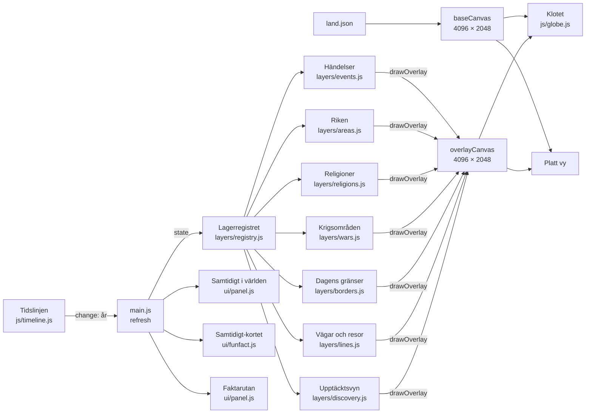

# Arkitektur

Hur Historia-globen är uppbyggd och varför. Den här filen uppdateras i samma pull request som koden när något av det här ändras. De bindande principerna står också i [CLAUDE.md](../CLAUDE.md#arkitektur-beslutad-ändra-inte-utan-att-fråga), och besluten bakom dem i [beslut.md](beslut.md).

## Kort sammanfattning

Läs detta först och sök sedan upp det avsnitt du behöver.

- **Inget byggsteg:** ES-moduler direkt i webbläsaren, inga ramverk, ingen server. Enda undantaget är `functions/api/feedback.js`.
- **Data skild från kod:** allt innehåll ligger i `data/`.
- **Ett år styr allt:** tidslinjen äger året och skickar `change`; allt annat lyssnar och ritar om.
- **Platt bild först:** grundkartan och lagren ritas på ekvirektangulära bilder (4096 × 2048) som läggs på klotet och visas i Platt vy.
- **Lager som moduler:** `update(state)` och `drawOverlay(ctx, W, H)`, anmälda i lagerregistret.
- **Ett externt beroende:** three.js 0.160.0.

**Avsnitt**
- Principer – de sex principerna ovan, utförligare.
- Hur delarna hänger ihop – flödesbild från tidslinjen via lagren till klotet och Platt vy.
- Moduler – tabell över filerna och deras ansvar.
- Mindre trängsel på kartan (#358) – zoomnivån styr vad som får namn och medalj.
- Lagerregistret (#338) – hur lager anmäler sig, ritordning, grupper och förinställda vyer.
- Laddning av data – vad som laddas vid start och vad som laddas senare (#337).
- Hoppa i tiden (#140) – stegknappar och att skriva in ett år.
- Tangentbord och skärmläsare (#139) – Tab, Enter och tangenter på globen.
- Mobilen (#361) – layouten i smal skärm.
- Pekskärmar och zoom (#191) – webbläsarens zoom avstängd, globens egen zoom.
- Fokusläget – följa ett krig, ett rike eller en religion, och dämpning av andra lager.
- Faktarutan om en religion (#90) – när och hur religionens ruta visas.
- Faktarutan om ett rike (#170) – samma ruta för riken.
- Rikets berättelse (#171) – nyckelår som kort under uppspelningen.
- Hjälpskript – skripten i `tools/` som körs för hand.
- Publicering – `scripts/build-site.sh`, `dist/` och kontrollerna.
- Besökarnas förslag (2026-10-30) – serverfunktionen för formuläret.
- Testa – hänvisning till testerna i CLAUDE.md.
- Uppspelning (#163, #164) – hastigheter och pauser.

## Principer

1. **Inget byggsteg.** Vanliga ES-moduler som webbläsaren läser direkt. Inga ramverk, ingen bundler och ingen server. Det räcker med `python3 -m http.server`. Enda undantaget är serverfunktionen för besökarnas förslag, `functions/api/feedback.js` (beslut 2026-10-30, se [Besökarnas förslag](#besökarnas-förslag-2026-10-30)).
2. **Data skild från kod.** Allt innehåll (händelser, fun facts, källor, riken, religioner, bildstilar) ligger i `data/`. Koden innehåller inga händelser, texter eller årtal.
3. **Ett år styr allt.** Tidslinjen äger det nuvarande året och skickar `change`. Allt annat lyssnar och ritar om.
4. **Allt ritas på en platt bild först.** Grundkartan och lagren ritas på ekvirektangulära bilder (4096 × 2048) som läggs på klotet. "Platt vy" visar samma bilder som en platt karta för skärmar, med zoom och panorering (#292). Bilderna kan också skickas till en fysisk globskärm senare.
5. **Lager som moduler.** Varje lager har samma gränssnitt: `update(state)` väljer vad som syns, och `drawOverlay(ctx, W, H)` ritar det på den platta bilden. Lagertypen linje med rörelse över tid (`layers/lines.js`, #38) ritar vägar och resor på samma bild, så att en resa går att följa i tiden både på klotet och i Platt vy.
6. **Ett enda externt beroende:** three.js 0.160.0 från jsDelivr.

## Hur delarna hänger ihop

Varje gång året ändras körs `refresh()` i `main.js`. Den fyller i det gemensamma tillståndet `state` (`js/state.js`: år, fokus, filter, valda lager med mera) och låter lagerregistret göra resten (se [Lagerregistret](#lagerregistret-338)):

1. Samtidigt-kortet väljer vilka fun facts och krigskort som gäller. Kort som jämför flera händelser visas först, sedan det som började senast.
2. Alla lager väljer vad som syns med `update(state)`, i lagerlistans ordning (`registry.update`): händelser, riken, religioner, vägar och resor, upptäcktsvyn, dagens gränser och krigsområden. Listan Samtidigt i världen ritas om med de synliga händelserna.
3. Registret räknar ut vilka lager som dämpas i fokusläget, teckenförklaringen sätts ihop av lagrens delar (`registry.legend`) och lagrens 3D-markörer uppdateras (`registry.markers`).
4. Lagren ritas i ordning nedifrån och upp på den platta lagerbilden (`registry.draw`, efter `Z` i `layers/registry.js`): upptäcktsvyns papperskarta (när den är på), riken, religioner, dagens gränser, upptäcktsvyns dimma, portolanlinjer och dekorationer (när den är på), vägar och resor, krigsområden och händelsernas sken.
5. Lagerbilden läggs på klotet, och på platta vyn om den är öppen.
   Rikesnamnen ritas mindre i bilden vid kraftig zoom (`areas.labelScale`, storlek ≈ förstoring^-0,7 men högst ned till 0,25, och `labelAlpha` tonar ut dem mot max zoom; omritning 150 ms efter att zoomandet stannat) så att de inte dominerar skärmen eller täcker markörer; i platta vyn följer storleken zoomnivån (`flatScale` i `ui/zoomlevels.js`, #358).
6. Pauser kontrolleras: fun facts, när ett krig bryter ut, krigets stora händelser och religionens grundande. I fokusläget pausar Samtidigt-kortet bara med valet "även i fokusläget", och efter slutkortet heter spelknappen "Spela igen".

Klickbara markörer, etiketter och bågar ligger ovanpå klotet som 3D-objekt och HTML, inte på den platta bilden. Etiketter som ligger nära varandra slås ihop till kluster (`ui/clusters.js`). I Platt vy ritas samma markörer, klungor, etiketter och bågar som ett lager ovanpå kartan (#313). Etiketterna hålls inom skärmen och läggs aldrig ovanpå andra markörer eller klusterbrickor (#142), och inte heller på rikesnamn och rikesmedaljer; är det upptaget ovanför markören läggs etiketten under den (#358). De läggs aldrig under knapparna och raderna längst ner (`UI_BOTTOM` i `main.js`, #318), och i smal skärm inte heller under rubriken, årtalet, knappgrupperna eller teckenförklaringen (`UI_OVER_GLOBE`, #289).

## Moduler

| Fil | Ansvar |
|---|---|
| `js/main.js` | Startar allt och kopplar ihop registret, tidslinjen och panelerna: fokusläget, pauser, klick och etiketter |
| `js/state.js` | Det gemensamma tillståndet (#338): `createState()` och `snapshot()`, se [Lagerregistret](#lagerregistret-338) |
| `js/layers/registry.js` | Lagerregistret (#338): `LayerRegistry`, ritordningen `Z` och dämpningen `FADE`, se [Lagerregistret](#lagerregistret-338) |
| `js/layers/index.js` | Lagerlistan (#338): alla lager som anmäler sig, i radernas ordning i Lager |
| `js/model.js` | Språk (`t()`), kategorier, granskningsnivåer, tidsformat, världsdelar, bildstilar (`styleFor()`), laddning av data |
| `js/globe.js` | Klotet (three.js), kamera, styrning, de platta bilderna, bågar. I smal, stående skärm (högst 760 px bred) får klotet nästan hela bredden (`_resize()`, marginal 1,1 i stället för 1,32, #361), och `setViewLift(py)` lyfter bilden av klotet uppåt med en mjuk övergång (`setViewOffset`, i `_tick()`; Lugn rörelse: direkt) när faktarutan står som ark nedtill. `centerY()` ger klotets mitt utan lyftet. Datorn är oförändrad |
| `js/timeline.js` | Tidsreglaget med segmenterad skala, fokusspann, uppspelning, hastighet och "Hoppa till år" (årtalet `#year-jump` är knappen; vid hovring och fokus visas en diskret penna `.year-pen` bredvid, utanför flödet så att inget flyttar sig, #310). Reglagets markeringar (`setMarks`): i översikten syns varje krig bara som en prick vid dess viktigaste händelse (`top`); krigets streck och slagen märkta `major` markeras först i fokusläget (#298) |
| `js/layers/events.js` | Punktlager: händelser som mässingsmedaljer och sken. Händelserna i det öppna Samtidigt-kortet visas alltid, också när lagret Händelser är avslaget eller kategorin bortfiltrerad, så att kortets bågar har markörer i båda ändar; de räknas inte i listan Samtidigt. **Ikonfamiljen (#242):** alla markörer är samma medalj (`medalTexture`, canvas 128 px som sprite): mörk botten, mässingsring, inre cirkel i kategorins färg och symbolen ur `img/icons/` i mitten (med något kraftigare linjer, ändras vid laddning); utan `icon` en prick i kategorins färg. Medaljen kodar tidsläge (nedre bågen är en liten tidslinje: hela bågen = pågår vid året, vänster del = har redan hänt, höger del = kommer senare; `state.when`), betydelse (mässingspunkt uppe till höger för `top`/`major`) och osäkerhet (streckad båge när `edtf` har `~` eller `?` eller `note` heter "Källorna skiljer sig"), se `markerInfo()`. Samma sak i ord står i etikettens `aria-label` och `title` (`describeMarker()`). **Progressiv detalj:** `frame()` körs varje bildruta och räknar markörens storlek på skärmen (`medalSize()`, samma regel i Platt vy, #313): minst 16–26 px (även i mobilen), högst cirka 48 px vid stark zoom; under 30 px ritas medaljen med symbol och punkt, från 30 px hela medaljen med tidsbågen. Etiketten för markören under muspekaren visas alltid (hovring, `hoverId` i `main.js`), och etiketterna läggs ovanför markören efter dess storlek (`userData.px`). Klick fungerar som förut |
| `js/layers/areas.js` | Områdeslager: riken som ändras över tid. Riken med symbol (`symbol` eller `polityFacts.<rike>.symbol` i `empires/index.json`, #301; `symbolOf` sätts i lagrets post i registret) får en mässingsmedalj på `label`-punkten (`drawMedal()` i `religions.js`, samma som religionernas ursprung), och namnet under den bara när `showNames` är sant (nära zoom på globen och i Platt vy). `marks()` ger medaljerna till 3D-markörerna. I ett utspritt välde ritas moderlandet (`period.homeland`, #74) med tätare fyllning, kraftig kant och en mässingsstjärna (`--brass`), och namnet står ovanför stjärnan; har väldet en symbol står medaljen där i stället för stjärnan. Ett försvunnet land utan gräns i Cliopatria (`vanished.point`, #72) ritas som en ring med prick och namn Vilka namn och medaljer som syns och var de står räknas i `_layout()` efter zoomnivån och rikets yta (`setView()`, `placedBoxes()`, #358). |
| `js/layers/empiremarks.js` | Rikenas symboler (#301) som 3D-markörer ovanpå klotet, en per synligt rike med symbol, på rikets `label`-punkt (flyttar med den). Samma medalj och storleksregel som religionernas ursprung (`frameMedals()` i `origins.js`). En osynlig knapp (`.gorigin.gempire`) har namnet som `title` och `aria-label`; klick öppnar rikets faktaruta, eller den egna rutan i `polityFacts` (Bysantinska riket). Döljs när rikeslagret är av eller dämpat |
| `js/layers/area-style.js` | Hjälp till områdeslagret: ett rike med osäker gräns (`polity.uncertainBorder`, #73) ritas med mjuk kant, tre breda och svaga linjer i stället för en skarp. Inflytande (`polity.influence`, #75), lydriken och vasaller enligt Cliopatria, ritas efter rikenas egna områden med glesa prickar i rikets färg och streckad kant, så att ett annat rike på samma plats syns igenom. Prickar, eftersom krigsområdena redan är snedstreckade. Prickmönstret skapas en gång per färg |
| `js/layers/area-transition.js` | Mjuk övergång när ett rike byter period, delas eller slås ihop (#78), se Rikenas övergångar nedan |
| `js/layers/religions.js` | Områdeslager: rikenas religion, och religionens symbol i en mässingsmedalj där religionen uppstod (`facts.origin`, #271; `ORIGIN_R`). Ärvda områden (`snapshot.inherited`, #269) ritas ljusast med prickad kant och prövas sist vid klick. **Symboler i områdena (#271):** `centersOf()` räknar en gång per ögonblicksbild ut en inre punkt per sammanhängande område (varje polygon), den som ligger längst från kanten i ett rutnät som förfinas, och symbolen (`symbol`, ur `glyph()` i `events.js`) ritas där på en mörk, genomskinlig skiva när området har plats för den; ljusare i osäkra och ärvda områden. Storleken följer riksnamnen (`labelScale`), så att fler områden får symbol när man zoomar in. Vid nära zoom (`showNames`, förstoring från 2,4 i `main.js`, aldrig i Platt vy) står religionens namn med versaler under symbolen när det ryms. `highlight` (religionens id) lyser upp religionens områden och tonar ner de andra |
| `js/layers/origins.js` | Symbolen där religionen uppstod (#271) som 3D-markör: samma mässingsmedalj som händelserna (`medalTexture` i `events.js`) med religionens färg och symbol, 26–46 px och alltid minst så stor att den täcker medaljen på lagerbilden. En osynlig knapp (`.gorigin` i `#labels`) ligger över den med `aria-label`, så att den går att nå med Tab; klick öppnar religionens faktaruta. Händelsens egen medalj döljs under symbolen, men etiketten står kvar |
| `js/layers/wars.js` | Krigsområden runt krigets och slagens platser, ett område per krigsskådeplats (platser inom cirka 2 000 km från varandra, #211), med världsdelen som etikett när man följer kriget (#236). Egen rad i Lager sedan #357 (på som standard), men syns bara när Händelser är på; kriget man följer får sitt område även när raden är av |
| `js/layers/borders.js` | Dagens landsgränser (av som standard) |
| `js/layers/lines.js` | Linjelager (#38): vägar och resor ur `data/routes/`. En resa (`voyage`) ritas fram etapp för etapp: avslutade etapper hela, den pågående fram till platsen som svarar mot året (räknat längs vägens längd mellan `from` och `to`) med ett skepp (en prick i kategorins färg med mässingsring), senare etapper inte alls. Går flera etapper samtidigt får var och en ett skepp; mellan två etapper står skeppet där den senaste slutade. När resan är slut syns den svagt lika länge som händelserna (`timeline.windowYears`). En handelsväg (`trade`) syns tunnare och dämpad medan året ligger inom etappens `from`–`to` plus samma fönster. `uncertain` ritas streckat. Långa sträckor följer storcirklar (en punkt per högst 2 grader), och en linje över datumlinjen ritas också en bildbredd åt andra hållet. Utanför fokusläget är året ett heltal, och vägarna ritas då som de låg vid årets slut. Kategorifiltret och raden "Resor och handelsvägar" i Lager styr lagret. `hitTest(lon, lat)` hittar en synlig linje inom 1,5 grader I upptäcktsvyn (#101, `shipStyle = 'ship'`) ritas skeppen som små segelskepp (egen siluett på canvas, `drawShip()`), vända mot väst eller öst efter etappens riktning just där; `reached()` ger de delar av vägarna som har ritats fram till ett år, för upptäcktsvyns dimma |
| `js/layers/discovery.js` | Upptäcktsvyn (#101), ett bildlager som slås på i Lager (`data-layer="discovery"`, av som standard). **Papperskartan** (`drawPaper`, underst på lagerbilden): grundkartans land (`data/land.json`) ritas om som en åldrad karta med blekt pergament i haven, mörkare pergament på land, bläckkust, vattenlinjer, papperskorn (brus med frö), fläckar och mörkare kanter. Den ritas en gång på en egen bild i lagerbildens storlek och läggs sedan bara på; `baseCanvas` ändras inte, så utanför vyn ser allt ut som förut. **Dimman:** en i princip ogenomskinlig pergamentton (`--discovery-fog`, täckning `fog.opacity` cirka 0,97) med papperskorn och "Terra incognita" (`--discovery-ink`, IM Fell English) över hela kartan, ritad på en egen bild i halv upplösning. Händelsernas markörer är 3D-objekt ovanpå och syns även i dimman. Kring varje etapp i `data/routes` som har börjat lyfts dimman med `destination-out` i en korridor med mjuk kant och skrafferad bläckkant längs den del som linjelagret har ritat (`LinesLayer.reached()`, oavsett kategorifilter och om linjelagret är på). Det som har lyfts förblir lyft senare år. Bilden görs bara om när året ändras (i fokusläget för korta krig högst var hundradels år) eller när vägarna har laddats. **Portolanlinjer:** bläcklinjer i 32 riktningar ut från varje kompassros (`rhumb: true`), ovanpå dimman. **Dekorationer:** havsmonster och kompassrosor ur gamla kartor (`images/karta/`) mitt i öppna hav; monster med `fade` tonas bort när en lyft korridor kommer innanför bildens radie. Allt (texter, platser, storlekar, kartstilens styrkor, dimmans täckning och korridorens bredd) står i `data/upptackt.json` och färgerna som CSS-variabler `--discovery-*`. När vyn är på ritar linjelagret skeppen som segelskepp (`shipStyle = 'ship'`), och teckenförklaringen (`legend.js`) visar perspektivraden, som syns även hopfälld i mobil, och krediten för kartbilderna med länkar till filsidorna. Kartbildernas källor listas under Kartdata i Om källorna |
| `js/ui/routepop.js` | Klickrutan för vägar och resor (#38), i samma stil som religionernas: namn, typ och tid (`formatEventTime`), etappens tid och om vägen är osäker, sammanfattning, `note` (till exempel "Källorna skiljer sig"), källorna som länkar, granskningsstatus och "Läs mer om …" till händelsen i `event`. Händelsemarkörer har företräde vid klick, sedan vägar, sedan religionsområden. I Platt vy fungerar klicket också (`FlatMap.onMapClick`). Escape stänger rutan |
| `js/ui/panel.js` | Samtidigt i världen per världsdel, kategorifilter (samma chips på två ställen, under Lager i `#filters` och ovanför listan i `#panel-filters`, #311: båda styr `panel.filters` och följs åt via `data-cat`; i smal skärm är panelens chips en rad som rullar i sidled), listan (raderna är `<button class="event-btn">` med `aria-label` av år, titel, världsdel och granskningsstatus, #238), faktarutan med bild och ram, krigets berättelse, faktarutan om en religion eller ett rike (`showFacts`). Bredvid granskningsstatusen i faktarutan finns en (i)-knapp (`reviewRow()`, `bindReviewInfo()`, #310) som fäller ut vad Källkontrollerad och Två källor stämmer betyder (`REVIEW_HELP` i `model.js`) och en knapp till Om källorna (`panel.onSources`). Escape stänger först förklaringen och lämnar fokus på knappen |
| `js/ui/areacurve.js` | Rikets yta över tid i faktarutan (#77): inline-SVG, UI och inte på klotet. `areaSegments()` lägger ihop `areaKm2` för alla polities i riket per år (Rom: republik, kejsardöme, Väst och Öst; Mongolriket: alla khanat), så kurvan visar hela riket. År utan period blir glapp, inte noll (till exempel mellan Egyptens riken). Axeln har runda årtal i f.Kr./e.Kr. (`formatYear`), toppen markeras med ytan och årtalet, och en lodrät linje med prick följer tidslinjen (`panel.setCurveYear()` anropas från `refresh()` i `main.js`). Kurvan fylls i av `panel.setCurve()` när rikets fil har laddats |
| `js/ui/funfact.js` | Samtidigt-kortet: fun facts, "När ett krig bröt ut" och rikets berättelse i fokus (`empireStory`, #171), kan fällas ihop. Händelsernas bilder visas alltid överst i kortet (#190), högst tre sida vid sida (`_renderPics`), med bilden från händelsens `image`, ramen från `styleFor()` och en knapp "Läs mer" som öppnar faktarutan (`ff.onSelect`) med full bildtext, kredit och licens. Under bilden står ingen text utom händelsens namn när det är flera; illustrationer får etiketten "Illustration" i hörnet. Har ingen händelse i kortet bild visas ingen bildrad, utom för krigskort (#237): de får en egenritad grafisk symbol (händelsens `icon`, annars kategorins ikon ur `CAT_ICON`, i stor storlek ur `img/icons/` på tidsålderns ram) märkt "Grafisk symbol" (`_renderSymbol`), aldrig "Illustration". Händelseknapparna under texten öppnar också faktarutan (och flyger globen dit). Kortet rullar inuti och går aldrig utanför skärmen. I smal skärm (≤760 px, #168) är bildraden låg (se Mobilpanel nedan), texten klipps efter två rader med bild (tre utan, tryck för hela), händelseknapparna döljs när bildrutorna finns och radbryts annars (ingen sidscroll, inget namn klipps), och alla kontroller har minst 44 × 44 px tryckyta. **Mobilpanel (#239):** i smal skärm är kortet en panel underifrån, med gutter på båda sidor, och ett handtag överst (`#ff-handle`, en knapp med `aria-expanded`, 36 px hög med 44 px tryckyta, #361). Panelen har tre lägen, klasserna `ff-s-closed` (handtaget och rubrikraden), `ff-s-half` (kompakt, bildraden 52 px) och `ff-s-full` (allt syns, upp till cirka 100 px från överkanten, rullar inuti). Ett tryck på handtaget stegar stängd → halv → hel → stängd, pil upp och ner byter läge, och man kan dra: höjden följer fingret, och när man släpper väljs det läge vars höjd ligger närmast (`_measureSheet()` mäter de tre höjderna utan att något ritas). Att stänga med handtaget är samma sparade val som att fälla ihop kortet i datorn (`hg-ff-min`): ingen paus vid nya kort, och fliken `#ff-tab` och knappen − används inte i smal skärm. När man drar i globen (mer än 12 px, lyssnaren ligger i `main.js`) anropas `ff.autoClose()`: panelen stängs utan att valet sparas, och nästa nya kort öppnar den halvt igen och pausar som vanligt. Panelens underkant står i `--ff-b` (ovanför tidslinjen, pausraden och fokusraden, i fokus `--focus-top` från #183); faktarutans ark (#361) använder samma variabel. Handtaget har en liten pil (`.ff-chev`, uppåt, nedåt när panelen är hel), och första gången panelen visas står "Dra upp för mer" bredvid (`#ff-drag-hint`, #310). Texten försvinner vid första dragningen, tryck eller piltangent på handtaget, eller efter 6 sekunder, och visas inte igen (`hg-ff-drag-hint` i localStorage, i try/catch). Datorn är oförändrad |
| `js/ui/legend.js` | Teckenförklaring och klickruta för religionslagret (#166). Klickrutan förklarar en osäker uppgift (ljusare, streckad kant) och länkar till rikets sida på Wikipedia (fältet `wikipedia` i `religions.json`), i fokusläget också för krigsområden och dämpade lager (#235, #236): HTML över globen, inte i kartbilden. Teckenförklaringen listar religionerna som syns året (`ReligionsLayer.legendItems()`); ett klick på ett område (`Globe.pickLatLon` + `ReligionsLayer.hitTest`, punkt-i-polygon i lon/lat) visar religion och rike, och för en religion med `facts` en knapp "Läs mer om <religion>" som öppnar religionens faktaruta (#270). Överst i listan står knappen "Läs om religionerna" och första gången lagret slås på en tipsrad som går att stänga (#308, se Faktarutan om en religion). Händelsemarkörer har företräde. Teckenförklaringen ligger uppe till vänster under rubriken (inte nere till vänster där Samtidigt-kortet är): en hopfällbar ruta, öppen i dator och hopfälld i mobil, där den hopfällda knappen visar rubriken och religionerna som syns som en rad färgprickar (högst tio, sedan "+N", #309) och ett tryck fäller ut hela förklaringen med noterna; byter man fönsterbredd över 760 px gäller standardläget för den nya bredden. `fit()` kortar av listan så att den slutar ovanför Samtidigt-kortet, faktarutan, panelen och fokusraden (#193). I ett ärvt område (#269) säger rutan "(ärvt)" efter religionen och förklarar varför: rikets faktaruta saknar religion (eller anger en som inte gäller då, till exempel bara procent ur en senare folkräkning eller ett senare årtal), och området visas med religionen det hade på kartan fram till `inherited.until` under rikena i `inherited.from`. Teckenförklaringen markerar sådana religioner "(ärvt)". Fokusmenyns spann för en religion räknar bara områden där en faktaruta anger religionen. Rikets namn på just den platsen (#194) tas fram med `ReligionsLayer.polityAt` mot rikenas egna gränser i `data/religions-polities.json`: bara rikena i det träffade området prövas, enskilda skeden före Cliopatrias sammanslagningar inom parentes, och svenska namn hämtas ur `data/empires/index.json` där de finns |
| `js/ui/layers.js` | Lagermenyn och valen för pauser. Raderna för lagren byggs av registret (`registry.buildMenu`) innan menyn skapas. `loadViews()` läser grupperna och de förinställda vyerna ur `data/vyer.json` (#357), och menyn visar vyerna överst, se [Grupper och förinställda vyer](#grupper-och-förinställda-vyer-i-lager-357) |
| `js/ui/focusmenu.js` | Fokusmenyn: följ ett krig, ett rike, ett försvunnet land eller en religion. Huvudet (sökruta, flikar, sortering) ligger still och listan rullar under det (#311). **Sökning** i alla namn en post har (`terms` från `main.js`: svenska och engelska, för riken och försvunna länder även rikets delar i `polities`, så att "bys" hittar Rom via Bysantinska riket och "sver" hittar Sverige), delar av namn, flera ord (alla måste finnas), utan hänsyn till accenter (`norm()`); träffar på ett annat namn än rubriken visar "även …". **Aktiva val (#381):** när ett sökord, en annan flik än Alla eller en annan sortering än Relevans används visar listan resultatantal och de aktiva valen överst, med knappen *Rensa allt* som tömmer sökningen och återställer flik och sortering. **Flikarna** Alla, Krig, Riken, Försvunna länder och Religioner (`hg-focus-tab`, #240); gruppernas förklaringar visas bara på gruppens egen flik. **Sortering** (`hg-focus-sort`): Relevans (det som pågår nära året först, resten bakom "Visa alla" (#121); Försvunna länder, `all`, alltid hel och i tidsordning, #72), Kronologiskt och Alfabetiskt (visar allt). **Tangentbord:** på dator (`hover: hover` och `pointer: fine`) får sökrutan fokus när menyn öppnas, med pekskärm menyn själv så att skärmtangentbordet inte fälls upp; pil ner går från sökrutan till listan, pil upp och ner, Home och End flyttar i listan, Enter i sökrutan väljer första träffen, vänster och höger byter flik eller sortering, Escape stänger. Flikraden bryts inte: blir den för bred rullar den i sidled inuti menyn. Antalet träffar läses upp (`aria-live`) |
| `js/ui/help.js` | Kort hjälp för nya besökare (#245): tre steg ("Dra globen", "Byt år", "Följ en berättelse"; texterna står i `index.html`). Visas första gången (`hg-help-seen` i localStorage, med try/catch; utan lagring vid varje besök) under knapparna uppe till höger, försvinner vid första interaktionen någon annanstans (tryck, klick, hjul eller tangent utom Tab), med Stäng eller Escape, och öppnas igen med knappen Hjälp (`aria-expanded`, fokus till Stäng). Under stegen finns en hopfälld del "Markörer och klungor" (#242, #243) med små exempel på medaljen, tidsbågen, punkten, den streckade bågen och klungan. Sist står en kort rad om frivilligt stöd med länken "Stöd Historia Globen" till Ko-fi (vanlig länk i `index.html`, ny flik med `rel="noopener noreferrer"`, ingen widget, ingen JavaScript och ingen spårning) |
| `js/ui/sheet.js` | Faktarutan som ark nedifrån i smal skärm (#361), se [Mobilen](#mobilen-361) |
| `js/ui/viewmenu.js` | Menyn Visa i smal skärm (#361): knappen Visa öppnar Platt vy, Källor och Hjälp, se [Mobilen](#mobilen-361). I datorn syns knappen inte |
| `js/ui/flatmap.js` | Platt vy (#292): världen som en platt karta för skärmar. Ytan går från knapparna uppe till tidslinjens knappar nere i hela bredden (mäts i `_layout()`; pausraden och fokusraden ligger ovanpå så att kartan inte hoppar). Zoom 1 täcker ytan, så det blir inga tomma kanter; i höga och smala skärmar fylls höjden och man panorerar i sidled. Väst–öst går runt vid datumlinjen, nord–syd begränsas så att kartan alltid täcker ytan. Mushjul och nyp (pointer events) zoomar kring pekaren, dra panorerar, knapparna + och − och Återställ ligger uppe till höger, och med fokus på kartan panorerar pilarna, + och − zoomar och 0 återställer. Escape stänger Platt vy när inget annat är öppet. Varje gång ritas bara den synliga delen av `baseCanvas` och `overlayCanvas` i skärmens upplösning (`devicePixelRatio`), så att kartan är skarp vid zoom; lagren ritas inte om här utan av `refresh()` i `main.js`, som anropar `flatMap.draw()`. Elementet ligger direkt efter globen i `index.html`, så att årtalet, korten, panelerna och tidslinjen ligger ovanpå kartan och fungerar som vanligt. **Markörerna (#313)** ligger som ett lager ovanpå kartan, som 3D-objekten på klotet; `baseCanvas` och `overlayCanvas` ändras inte (beslut 1). `refresh()` skickar samma urval som `EventsLayer.update` ger till `flatMap.setMarkers()` (markörernas `userData`: aktivitet, tidsläge, vald eller framhävd), och `ff.onArcs` skickar Samtidigt-kortets bågar till `flatMap.setArcs()` som till `globe.setArcs`. Medaljerna är samma bilder som på klotet (`medalTexture` i `events.js`) med samma storleksregel (`medalSize`, storleken räknas ur `baseScale` och kartans zoom) och ritas på kartans canvas i skärmens upplösning efter kartbilderna; vald händelse får en mässingsring (på klotet pulserar den). Bågarna är böjda linjer (`--parchment` på en mörk kant) den kortaste vägen runt jorden. Klungor (`cluster()`) och etiketter (`placeLabels()`, samma regel som på globen) är knappar `.gcluster` och `.glabel` i `#flat-labels`; klick på en klunga zoomar in kartan mot den. Klick på en medalj (tryckning som flyttas högst 6 px, annars är det att dra) eller på en etikett öppnar faktarutan via samma `select(id)` som på globen, med finger räcker det att träffa inom 22 px. Pekaren blir en hand över en medalj, och markören under musen får alltid sin etikett. Etiketterna och klungorna nås med Tab. Väljs en händelse som ligger utanför kartans yta flyttas kartan dit (`reveal()`). Allt ritas bara om när något ändras (året, lagren, zoom, panorering, hovring, bågarna eller en symbol som laddats klart). Religionernas ursprungssymboler (`origins.js`) ritas inte i Platt vy |
| `js/ui/feedback.js` | Formuläret för besökarnas förslag ([feedback.md](feedback.md)): panelen `#feedback` i `index.html` med Hjälp-kortets stil, öppnas från Hjälp ("Lämna förslag") och från faktarutan och krigets berättelse ("Rapportera faktafel", `panel.onReport`). Från faktarutan är faktafel förvalt och händelsens titel och tid visas skrivskyddat; bara `eventId` skickas. Avstängt så länge `data-sitekey` är tom eller `data-privacy` inte är `approved`: då visas länkar till issue-mallarna och inget externt skript laddas. Påslaget laddas Turnstile när formuläret öppnas. Knapparna Avbryt och Skicka förslag (`.fb-actions`) ligger fast nedtill i panelen (`position: sticky`) medan fälten rullar (#310). Escape stänger (utan att stänga faktarutan) och fokus går tillbaka till knappen som öppnade |
| `js/feedback-rules.js` | Förslagens kategorier, gränser och `validateFeedback()`, gemensamma för formuläret och `functions/api/feedback.js` |
| `js/ui/sources.js` | Sidan Om källorna (knappen Källor, #245): källregistret grupperat efter användning, granskningsläge per grupp och sökning |
| `js/ui/clusters.js` | Klustring av etiketter. `clusterContents()` (#243) räknar klungans händelser per kategori: ringen runt siffran blir en `conic-gradient` (CSS-variabeln `--ring`) med ett segment per kategori i kategorins färg och en smal springa mellan, och texten ("3 krigshändelser, 1 kulturhändelse", ord ur `count` i `CATEGORIES` i `model.js`) står i klungans `aria-label` och syns i en liten ruta under klungan vid hovring och tangentbordsfokus (`data-contents`, CSS `::after`); `title` listar händelsernas namn. Siffran står kvar i mitten. `placeLabels()` (#313) är regeln för etiketterna, delad av globen och Platt vy: högst 14 av de viktigaste markörerna får etikett ovanför markören, aldrig utanför ytan eller ovanpå andra etiketter, markörer eller klungor, och markören under musen får alltid sin |
| `js/ui/zoomlevels.js` | Vad som syns på vilken zoomnivå (#358): de tre nivåerna (`ZOOM_LEVELS`: hela världen, världsdel, inzoomat) med alla tröskelvärden på ett ställe. Nivån räknas ur skärmpixlar per bildpunkt (`pxPerImg`: Platt vys skala, eller mitt på klotet ur kamerans avstånd), alltså samma mått på globen och i Platt vy. `eventKeepouts()` ger händelserna som rikesnamnen viker för, `empireBlocks()`/`globeEmpireBlocks()` gör rikenas rutor till skärmrutor som händelseetiketterna viker för. Se [Mindre trängsel](#mindre-trängsel-på-kartan-358) |

## Mindre trängsel på kartan (#358)

Rikesnamn, rikesmedaljer och händelser trängdes i Europa när man såg hela kartan. Nu bestämmer zoomnivån hur mycket som syns, och inget rikesnamn eller ingen medalj ritas ovanpå en annan.

- **Tre nivåer** (`ZOOM_LEVELS` i `js/ui/zoomlevels.js`): hela världen (högst 14 riken får namn och medalj), världsdel (högst 40) och inzoomat (alla). Nivån räknas ur hur stor kartbilden ser ut på skärmen, skärmpixlar per bildpunkt: under 0,55 är det hela världen, från 1,1 inzoomat. På globen mäts det mitt på klotet (kamerans avstånd), i Platt vy är det kartans skala. Samma mått på båda ställena gör att det som ryms på skärmen avgör, så en mobil stannar längre på nivån hela världen.
- **Prioritet ur datan:** rikena går i ordning efter yta det året (`areaKm2` i perioden), störst först. Inga namn står i koden. Riket man följer i Fokus visas alltid, och den valda händelsen och Samtidigt-kortets händelser (med sina etiketter) har alltid företräde.
- **En lista med upptagna rutor**, som `placeLabels`: `AreasLayer._layout()` lägger först in rutor för händelserna som har företräde och för markörerna hos de 14 viktigaste händelserna, sedan rikena i prioritetsordning. En medalj som skulle täcka något flyttas lite inom riket (inom rutan runt området), ett namn flyttas under eller ovanför medaljen, eller uppåt eller nedåt med ett streck; ryms det ändå inte döljs namnet (och medaljen) tills man zoomar in. Försvunna länder utan gräns (#72) syns bara inzoomat. På globen räknas medaljens ruta med 3D-medaljens minsta storlek på skärmen och görs bredare mot polerna, där bilden pressas ihop på klotet.
- **Händelseetiketterna viker för rikena:** `AreasLayer.placedBoxes()` ger rikenas namn och medaljer som rutor, och `placeLabels` får dem som `blocked` (i Platt vy via `flatMap.obstacles`, på globen varje bildruta via `globeEmpireBlocks`). Ryms etiketten inte ovanför markören läggs den under.
- **Beslut 1:** namnen och medaljerna ritas fortfarande på den platta lagerbilden (`overlayCanvas`, 4096 × 2048), i en upplösning för hela jorden. Därför ritas lagerbilden om när zoomnivån byter nivå (`globe.onZoom` och `flatMap.onZoom` anropar `syncNameScale` i `main.js`, som ritar om 150 ms efter att zoomandet stannat), inte varje bildruta. Rikets 3D-medalj på globen (`empiremarks.js`) följer samma beslut: `AreasLayer.marks()` ger bara de medaljer som fick plats, på den plats de fick. I Platt vy är namnen och medaljerna mindre på bilden ju längre in man har zoomat (`flatScale`: 1, 0,7 och 0,4), så att fler ryms utan att täcka varandra.
- **Med lagerregistret (#338):** rikenas post (`entry(env)` i `areas.js`) väljer områdena i `registry.update(state)`. Direkt efter, när händelserna som syns är kända, sätter `refresh()` i `main.js` zoomnivån och händelserna som ska hållas fria (`areas.setView(...)`) och `flatMap.obstacles`. Namnens platser räknas först när lagerbilden och markörerna ritas (`_layout()` räknas om när året, vyn eller storleken har ändrats). `syncNameScale` jämför med `state.labels` och med `areas.view.level`.
- **Begränsningar:** närmast klotets kant, där bilden syns snett, kan två 3D-medaljer på globen fortfarande gå in i varandra. Inom en nivå räknas rutorna för händelsernas etiketter med den zoom som gällde när lagerbilden senast ritades. En fysisk glob utan zoom får nivån hela världen.

## Lagerregistret (#338)

Lagren kopplas inte in för hand i `main.js`. Varje lager anmäler sig i lagerregistret (`js/layers/registry.js`) med en post, som skapas av funktionen `entry(env)` i lagrets egen fil. `js/layers/index.js` listar posterna i radernas ordning i Lager, och `main.js` lägger in dem med `registry.add(...)` och bygger raderna i Lager med `registry.buildMenu()`.

En post är ett vanligt objekt. Bara `id` krävs:

| Fält | Betydelse |
|---|---|
| `id`, `name` | Lagrets namn i koden (samma som `data-layer` och nyckeln i `state.layers`) och raden i Lager |
| `group` | Gruppen i Lager (#357), ett id ur `groups` i `data/vyer.json`: `people`, `power`, `movement`, `perspective` eller `settings` |
| `menu` | Raden i Lager: `on` (standardläge), `note` (förklaringen efter namnet), `aria`, `sub` (en undermeny, som religionernas) |
| `layer` | Lagret självt (klassen), för det `main.js` gör utöver ritningen, till exempel klick |
| `enabled(state)` | Om lagret syns; registret sätter `layer.enabled` och `state.on[id]`. I fokusläget syns det man följer även om lagret är av |
| `apply(state)` | Körs när valen ändras (Lager, fokus, Lugn rörelse) |
| `update(state)` | Väljer vad som syns, samma gränssnitt som förut (beslut 2) |
| `z` och `drawOverlay(ctx, W, H)` | Platsen i ritordningen och ritningen på lagerbilden; `passes` för ett lager som ritar på flera ställen (upptäcktsvyn) |
| `fade` | `{ own(focus) }`: lagret dämpas i fokusläget när det inte hör till det man följer (#235) |
| `legend(state)` | Lagrets del av teckenförklaringen, till exempel `{ items }` för religionerna |
| `markers`, `frame`, `covers` | Lagrets 3D-markörer (rikenas och religionernas symboler): uppdatering, varje bildruta och vilka händelsemedaljer de täcker |
| `animating()` | Sant så länge lagerbilden behöver ritas om varje bildruta (rikenas övergångar, #78) |

En post utan `layer` är bara en rad i Lager, till exempel Samtidigt-kortet och "Behåll mina lager i fokus".

**Ritordningen** står på ett ställe, `Z` i `registry.js`, nedifrån och upp: papperskartan 0, riken 10, religioner 20, dagens gränser 30, upptäcktsvyns dimma 40, vägar och resor 50, krigsområden 60 och händelsernas sken 70. Luckorna gör att ett nytt lager kan läggas in mellan två andra.

**Det gemensamma tillståndet** (`js/state.js`) är det lagren läser i `update(state)`: `year` (decimaltal i fokusläget för korta krig), `wholeYear`, `fine`, `window`, `span`, `playing`, `focus` och `focusWar`, `layers` (valen i Lager), `on` (lager som faktiskt syns), `pause`, `calm`, `filters` (kategorierna), `selectedId`, `highlight` (Samtidigt-kortets händelser), `labels` (namnens storlek efter zoom) och `faded`. `snapshot(state)` plockar ut det besökaren har valt (år, fokus, lager, kategorier, Lugn rörelse) som vanliga värden, så att det går att spara i en delbar länk senare (#64).

**Lägga till ett lager:**

1. Skriv lagret som en klass i `js/layers/` med `update(state)` och `drawOverlay(ctx, W, H)` (beslut 2).
2. Lägg till `export function entry(env)` i samma fil. Den skapar lagret och returnerar posten (se tabellen). `env` har `globe`, `data`, `labelsEl`, `registry`, `refresh`, `refreshSoon` (en omritning per bildruta), `showReligionFacts` och `showEmpireFacts`.
3. Lägg till en plats i ritordningen i `Z` om lagret ritar på lagerbilden.
4. Lägg till en rad i `js/layers/index.js`. Ingenting behöver ändras i `main.js` eller `index.html`.
5. Ge posten en `group`. Ska lagret vara med i en förinställd vy, lägg till dess id i vyns `layers` i `data/vyer.json`; annars är det av i alla vyer.

### Grupper och förinställda vyer i Lager (#357)

Lager är indelat i grupper efter frågan man har: *Människor och händelser* (Händelser, Samtidigt-kortet), *Makt, tro och gränser* (Riken, Religioner, Dagens gränser, Krigsområden), *Rörelser och handel* (Resor och handelsvägar) och *Historiskt perspektiv* (Upptäcktsvy). Därefter kommer Kategorier och sist *Inställningar* ("Behåll mina lager i fokus", Lugn rörelse och pauserna). Gruppen anges av varje posts `group`; gruppernas namn och ordning står i `data/vyer.json`, inte i koden. `registry.buildMenu(menu, groups)` gör en rubrik och ett `role="group"`-element per grupp; finns ett element med `data-group="<id>"` i `index.html` (Inställningar, som innehåller de fasta raderna) läggs rubriken och lagrens rader först i det. En post utan känd grupp hamnar utan rubrik överst, som förut.

Överst i menyn står **de förinställda vyerna** ur `data/vyer.json` som knappar (`button.view-chip` med `aria-pressed`): Standard, Utforska, Makt och gränser, Resor och handel och Perspektiv. Första nivån visar vyerna och knappen *Anpassa själv*; knappen fäller ut nivå två med de enskilda lagren, kategorierna och inställningarna (#380). Om nivå två är öppen sparas i `sessionStorage` under `hg-layer-customize`, så att den är kvar när menyn öppnas igen under besöket men inte blir ett bestående val. En vy slår på lagren i sin `layers` och slår av de andra lagren som vyerna styr (`registry.viewLayers(groups)`: alla rader utom de i en grupp med `"settings": true`). `LayerMenu.applyView()` anropar `onChange` för varje lager som ändras, så att det går samma väg som en hand-ändring (religionerna laddas, teckenförklaringen uppdateras). Efter varje ändring jämför `syncView()` valen med vyerna: stämmer de med en vy är den knappen nedtryckt, annars visas märket *Anpassad* (inte en knapp). `menu.dataset.view` säger vilken vy som gäller (`custom` för Anpassad). Vyn sparas inte mellan besök, precis som lagren. Standardläget ändrades inte: vyn Standard är de lager som är på från början (Händelser, Samtidigt-kortet, Riken, Resor och handelsvägar och Krigsområden). Knapparna nås med Tab och väljs med Enter eller mellanslag; Escape stänger menyn som förut. Saknas `data/vyer.json` visas Lager som en lista utan grupper och vyer.

## Laddning av data

Vid start laddas bara det som behövs för att visa globen (#337): händelseindexet (`data/genererat/handelser.json`), fun facts, grundkartan, bildstilar, rikenas register utan faktarutor (`data/genererat/riken.json`) och upptäcktsvyns lilla fil. Händelseindexet har allt som tidslinjen, markörerna, listan Samtidigt i världen och Samtidigt-kortets text behöver, men inte de långa fälten.

Händelserna och rikena redigeras som förut i `data/events.json` och `data/empires/index.json`. `tools/dela_data.py` delar upp dem i `data/genererat/`, och `scripts/validate-site.py` stoppar publiceringen om de uppdelade filerna inte stämmer med källfilerna (se [datamodell.md](datamodell.md#genererat-uppdelade-filer-337)).

Det som bara behövs vid klick laddas när det behövs, och en gång (`model.js` håller ett löfte per fil):

- **Händelsernas långa fält** (sammanfattning, not, krigets berättelse, bild, källor, Wikidata-id) ligger i en fil per tidsperiod (`data/genererat/handelser-<period>.json`). `loadEventDetails(händelser)` laddar perioderna som händelserna hör till och lägger fälten i samma händelseobjekt (`mergeTexts`), som då får `_full = true`. Det görs strax efter att man har dragit tiden dit (för de synliga händelserna och Samtidigt-kortets, 0,4 s efter omritningen), när en faktaruta öppnas och innan man börjar följa ett krig.
- **Källregistret** (`data/sources.json`) laddas vid den första faktarutan, klickrutan för en väg, upptäcktsvyn eller Om källorna (`loadSources()`). `data.sources` och `data.srcById` är samma lista och objekt hela tiden och fylls i då, så att panelerna kan behålla sina referenser.
- **Rikenas faktarutor** (`data/genererat/riken-fakta.json`) laddas vid den första faktarutan om ett rike eller när man börjar följa ett rike (`loadEmpireFacts()`), eftersom rikets berättelse (#171) står i faktarutan. `hasFacts` i registret säger i förväg att riket har en faktaruta (knappen Fakta i fokusraden).
- **Dagens gränser** (`data/borders.json`) laddas när lagret slås på (`loadBorders()` i lagrets `apply`).
- **Om källorna** räknar källor för alla uppgifter och laddar därför allt ovan första gången den öppnas (`loadForSources()`); under tiden står "Laddar källorna…" i dialogen.
- **Ett rike** (`data/empires/<rike>.json`) laddas när året närmar sig rikets tid (inom 100 år) eller när man väljer det i Fokus.
- **Religionerna** (`data/religions.json`) laddas när religionslagret slås på, när Fokus-menyn öppnas eller när Om källorna öppnas.
- **Rikenas gränser i religionslagret** (`data/religions-polities.json`, #194) laddas vid det första klicket på ett religionsområde. Rutan visar "Söker riket på platsen…" tills filen är laddad. Ritningen av lagret använder den inte.
- **Upptäcktsvyns bilder** (`images/karta/`, #101) laddas första gången vyn slås på; saknas `data/upptackt.json` fungerar sidan utan upptäcktsvyn.
- **Vägar och resor** (`data/routes/index.json` och filerna den listar, #38) laddas direkt efter starten utan att sidan väntar på dem (`loadRoutes()` i `model.js`). En fil som saknas eller inte går att läsa hoppas över med en varning i konsolen.
- **Bilder** i faktarutan laddas när kortet öppnas.

Rutorna ritas direkt med det som redan finns och en gång till när resten har kommit: faktarutan visar namn, tid och plats med "Laddar…" i stället för sammanfattningen (`Panel._whenLoaded`), Samtidigt-kortet ritar in bilderna, och klickrutan för en väg fyller i källorna. Visar rutan något annat när filen kommer, ritas ingenting om.

## Hoppa i tiden (#140)

Stegknapparna −100, −10, −1, +1, +10 och +100 syns på alla skärmbredder (i mobil är de smalare och lägre, med 44 px hög tryckyta, se [Mobilen](#mobilen-361)). Årtalet uppe till vänster är en knapp: den öppnar en ruta där man skriver ett år, med knapparna f.Kr./e.Kr. eller direkt i texten ("2600 f.Kr.", "44 fkr", "1969"), eller väljer en tidsålder (skalans fyra segment och "Idag"). Utan angiven tideräkning räknas året som e.Kr. Tolkningen görs av `parseYear()` i `model.js`; rutan hör till `setupYearJump()` i `timeline.js`. I fokusläge hålls året inom spannet och rutan säger till om man hamnar utanför. Efter ett hopp (inte vid uppspelning eller stegknappar) flyger globen till årets viktigaste händelse (#165): händelsen i det första Samtidigt-kortet som ligger närmast i tid, annars i listan; vid lika vinner den med kortast spann (ett datum före ett spann som Oxford 1096–2026). `setupYearJump()` anropar `onJump`, och `flyToYearHighlight()` i `main.js` sköter flygningen. Den hoppas över i fokusläge och om användaren vridit globen de senaste tre sekunderna (`globe.lastUserInput`).

## Tangentbord och skärmläsare (#139)

Etiketterna och klustren på globen är `<button>` och nås med Tab; Enter öppnar händelsen (kluster zoomar in). Globens canvas har `tabindex="0"`, `role="region"` och `aria-roledescription="interaktiv jordglob"` (#386), så att den annonseras som en styrbar del av sidan utan att skärmläsare låses i ARIA:s application-läge. Den tar emot tangenter i `_initControls()` i `globe.js`: piltangenter snurrar (Skift = större steg), `+` och `−` zoomar och Escape flyttar fokus till årskontrollen. Tab och Skift+Tab fångas aldrig, utan går vidare respektive tillbaka i sidan. Övriga tangenter fångas bara när canvasen själv har fokus, så de stör inte inputfält. Fokus visas med mässingsring (`:focus-visible`). Play-knappen har `aria-pressed` och ett namn som växlar: "Spela upp tiden", "Pausa", "Fortsätt" (efter automatisk paus, #163) och "Spela igen" (i slutet, #232). De två kryssrutorna Samtidigt-kortet har egna namn ("Visa …", "Pausa vid …"). Listan Samtidigt i världen är det tangentbordsvänliga alternativet till globen: varje rad är en riktig knapp (Tab, Enter och mellanslag) med mässingsring vid fokus och ett namn som läser upp år, titel, världsdel och granskningsstatus (#238).

Knapparna uppe till höger ligger i två grupper (#245), var och en en `div.action-group` med `role="group"` och gruppens namn som `aria-labelledby`: **Utforska** (Samtidigt, Lager, Fokus) och **Visa** (Platt vy, Källor, Hjälp). Grupperna har en tunn mässingsram med namnet i ramens överkant. I smal skärm (#361) står de i en rad bredvid årtalet utan ramar och gruppnamn: Samtidigt, Lager och Fokus, och knappen Visa som öppnar en meny med Platt vy, Källor och Hjälp (se [Mobilen](#mobilen-361)). Menyerna Lager och Fokus, listan och hjälpen läggs under hela knappytan (`closest('.top-actions')`).

Dubbeltryck (#233): med finger eller penna zoomar två tryck inom 350 ms och 30 px globen ett steg (×1,6, samma `setZoom()` som hjul, nyp och `+`) mot den tryckta punkten (`pickLatLon` + `flyTo`) i `_initControls()`. Sidan zoomas inte: `touch-action` och `gesturestart`-skyddet (#191) är kvar.

**Rikenas övergångar (#78).** När ett rikes område byter period, eller riket delas eller slås ihop (till exempel Romarriket som 395 blir Väst- och Östrom), tonas den gamla gränsen ut och den nya in under 450 ms (`DURATION_MS`, mjuk kurva). `AreaTransition` jämför vilka (rike, period) som syns före och efter `AreasLayer.update` och ger varje område en genomskinlighet: de som försvinner ritas med 1 − p, de nya med p och oförändrade som vanligt. Fyllning, kant och namn multipliceras med den, och allt ritas som förut direkt på lagerbilden (beslut 1), utan extra bilder i 4096×2048. Övergången startar bara när året har flyttats: under uppspelning, eller med högst 10 år (`MAX_JUMP_YEARS`) när man drar eller stegar. Ett längre hopp, Lugn rörelse, att lagret slås på eller att fokus byts visar nya läget direkt. Under en övergång ritar `drawOverlay()` i `main.js` om bara lagerbilden (och Platt vy) en gång per bildruta tills den är klar (`registry.animating()`, som frågar rikenas `animating`); därefter ritas inget förrän nästa `refresh`. Under uppspelning ritas lagerbilden ändå om varje bildruta, så övergången kostar då nästan inget extra. Kommer en ny ändring innan övergången är klar börjar en ny från det senaste läget.

Lugn rörelse (#246): en kryssruta i Lager (`data-calm`, sparas som `hg-calm` i localStorage med try/catch) som är på från början om webbläsaren har `prefers-reduced-motion: reduce`, och som ett sparat val övertrumfar. `LayerMenu.calm` sätter klassen `calm` på `html` (CSS stänger av animationer och övergångar, samma regel finns i `@media (prefers-reduced-motion)`) och `globe.calm`: ingen automatisk snurr, ingen utrullning efter drag, och `flyTo` hoppar direkt i stället för att flyga. Fokus flyttas in i Lager, Fokus, Samtidigt-listan och Källor (sidan Om källorna) när de öppnas och tillbaka till knappen när de stängs.

## Mobilen (#361)

I smal skärm (högst 760 px) konkurrerade globen, knapparna, tidslinjen och korten om höjden. Allt nedan gäller bara smal skärm; datorn ser ut och fungerar som förut (skärmbilder i 1400 × 900 är pixel för pixel lika, utom animationer).

- **Raden överst.** Årtalet (30 px, tideräkningen under siffrorna) till vänster och knapparna Samtidigt, Lager, Fokus och Visa till höger, i en rad som är 44 px hög. Tidsåldern och fönstret ("Medeltid och tidigmodern tid · visar ±38 år") står som en tunn rad under, avkortad med … om den inte ryms. Rubriken "Historia-globen" finns kvar för skärmläsare men syns inte. Knappen Visa (`#more-toggle`, `aria-expanded`) öppnar en liten meny (`#more-menu`) med Platt vy, Källor och Hjälp (`js/ui/viewmenu.js`); ett val, ett tryck utanför eller Escape stänger den, och knappen lyser i mässing när Platt vy är på. I datorn är menyn `display: contents`, så knapparna står kvar i gruppen Visa som förut. Raden tar cirka 66 px i stället för cirka 141. Vid högst 370 px är knapparna och årtalet lite mindre.
- **Globen** får nästan hela bredden (`globe.js`, se Moduler): i 400 × 800 är klotet 368 px i stället för 306.
- **Tidslinjen** är lägre: knapparna är 34 px synligt med en osynlig tryckyta (`::after`) på 44 px höjd som möts mitt i mellanrummen, bandet med årtalen 48 px. Hela tidslinjen tar cirka 100 px i stället för cirka 116. Fokusraden ligger direkt ovanför.
- **Faktarutan som ark** (`js/ui/sheet.js`), med samma tre lägen och samma handtag som Samtidigt-kortet (#239): litet (handtaget och rubriken), halvt (högst `min(40dvh, …)`, rubriken och texten först, bilden med sin bildtext syns i helt läge) och helt (upp till raden överst, rullar inuti). Läget står i `data-sheet` på `#detail`. Ett tryck på handtaget (`#detail-handle`, `aria-expanded` och namn med läget) stegar litet → halvt → helt → litet, pil upp och ner byter läge, och man kan dra; ett tryck på rubriken i litet läge öppnar halvt. Krysset ligger i handtagets rad. `panel.js` skriver om rutans innehåll för varje händelse, rike, religion och krigets berättelse; handtaget läggs tillbaka överst av en `MutationObserver`, och nytt innehåll öppnar arket halvt. Krigets berättelse i fokusläget och faktarutorna om riken och religioner använder samma ark.
- **Kartan finns kvar.** När arket står halvt lyfts klotet (`globe.setViewLift`, räknat i `main.js` när arket ändras och vid storleksändring) så att dess mitt, där den valda markören hamnar efter `flyTo`, ligger mitt i den fria ytan mellan raden överst och arket. Drar man i globen fälls arket ihop till litet läge (som Samtidigt-kortet), och ett tryck på en annan markör eller etikett öppnar den nya händelsen halvt. Litet läge och stängd ruta: inget lyft. I 400 × 800 syns 97 procent av klotet när en faktaruta står halvt (före: 8 procent).
- **Platsraden (#312)** överst i händelsens faktaruta: "Oxford, England · visa på globen" (`place-row`, platsen ur händelsens `place`). Ett tryck fäller ihop rutan till litet läge (rubriken står kvar, så att man kommer tillbaka) och flyger globen till markören (`panel.onShowPlace` i `main.js`); i Platt vy flyttas kartan dit. Raden finns bara i smal skärm.
- **Tryckytor.** Alla knappar i raden överst, tidslinjen, fokusraden, krysset, handtagen, (i)-knappen, Rapportera faktafel och händelseknapparna i Samtidigt-kortet har minst 44 × 44 px tryckyta i 400 px bredd, oftast med en osynlig `::after` så att utseendet blir kompakt. Samtidigt-kortets handtag är 36 px och når 8 px ned, så att bildernas Läs mer-knappar under det behåller 44 px. Undantag: i 375 px och smalare ryms inte åtta stegknappar à 44 px bredvid varandra, så de blir cirka 40 × 44 px.
- **Menyer.** Samtidigt i världen, Lager och Fokus är fortfarande menyer som fälls ned under raden överst (nu högre upp), inte ark: de är listor man väljer i och stänger, och Fokus-menyn byggs om i #311.

## Pekskärmar och zoom (#191)

Webbläsarens egen zoom av hela sidan är avstängd: `touch-action: manipulation` på sidan, `maximum-scale=1` i viewport och ett stopp för Safaris nypgest (`gesturestart`). Globen har en egen zoom med nyp, scroll och +/−. Utan stoppet kunde en iPad zooma in hela sidan av misstag, och då gick den inte att zooma ut, eftersom globen fångar fingrarna.

## Fokusläget

Fokus-knappen följer ett krig, ett rike eller en religion. Tidslinjen visar bara det spannet, globen riktas mot platsen och uppspelningen går långsamt.

- **Krig:** ett kort med orsak och parter före start, paus vid krigets stora händelser (valbart) och ett kort med utgång och döda i slutet.
- **Pågående krig (#223):** ett krig med `ongoing: true` får `end` = innevarande år när datan laddas (`loadAll()` i `model.js`), så resten av koden behandlar det som ett krig som slutar i dag. `formatEventTime()` skriver "2022–pågår" i Fokus-menyn, fokusraden och faktarutan. Samma sak gäller andra händelser med öppet slut i `edtf` (`1096/..`, till exempel Oxford). Fokusspannet och slutkortet hålls inom tidslinjens sista år (`MAX_YEAR` i `timeline.js`), som är innevarande år enligt datorns klocka men aldrig före 2026; skalans sista segment, Modern tid, slutar där (#229). I slutet visas kortet "Läget i dag (kontrollerat <datum>)" med `story.outcome` som läget i dag och dödssiffrorna hittills, och pausraden säger "Pausad: läget i dag".
- **Korta krig (#204):** ett krig som ryms inom två år (`end − start ≤ 2`) och har datum med dag i `edtf` följs dag för dag. Fokusspannet går från krigets första dag till slutet av dess sista dag, och året är då ett decimaltal som avrundas till hela dagar (`Timeline` med `focus.fine`). `edtfSpan()` i `model.js` gör om `edtf` till [början, slut] i decimalår (en dag täcker hela dygnet, `~` och `?` ignoreras, och går `edtf` inte att läsa blir det hela år). Huvudet visar datumet stort ("22 jan") och året bredvid (i smal skärm mindre, med luft ned till fokusraden och skugga så att raden syns mot landet, #289), skalan visar månader (året vid den första och vid januari), prickarna hamnar på slagens datum, stegknapparna och piltangenterna går i dagar och farten anges i dagar per sekund (hela kriget på cirka en minut vid standardnivån). Händelser och krigsområdet använder datumen (`span` i `EventsLayer.update` och `WarsLayer.update`), medan riken, religioner och Samtidigt-korten får det hela året som förut. Uppspelningen pausar vid händelser med `major`, också den som inleder kriget på första dagen, och tiden stannar på händelsens dag. Slagens etiketter har datum framför namnet. Utanför fokusläget, och för längre krig, är året ett heltal som förut.
- **Rike:** bara rikets områden syns, och globen riktas mot riket när det var som störst. Har riket en faktaruta (`facts`) visas den när man börjar följa det. Rikets nyckelår visas som kort och pausar uppspelningen (valbart), se Rikets berättelse nedan.
- **Religion:** börjar vid religionens grundande, stannar vid grundhändelserna och visar sedan religionens spridning som statsreligion. Har religionen en faktaruta (`facts`) visas den först; det sker i `startFocus()` och hänger inte på att religionslagret slås på (#308).

Året styr: ligger nuvarande år inom det man följer stannar tiden där (`startFocus` i `main.js`). Annars flyttas den till starten, och en rad i fokusraden säger "Tiden flyttades till …" med knappen "Tillbaka till <året>", som lämnar fokus och går till det året (det ligger ju utanför spannet). Krigets berättelse och faktarutorna visas som förut.

Har det man följer en faktaruta (riken och religioner med `facts`) finns knappen Fakta i fokusraden, som öppnar rutan igen.

**Andra lager dämpas (#235).** I fokusläget ritas påslagna lager som inte hör till det man följer dämpat: riken och religioner när man följer ett krig, religioner när man följer ett rike och riken när man följer en religion (tidigare gömdes riken och religioner för varandra, #113). Lager med `fade` i sin post i registret dämpas (`registry.fadable()`), och `Globe.drawFaded()` ritar dem först på en egen bild som sedan läggs på lagerbilden med genomskinligheten `FADE` (0,35, så att religionernas fyllning blir cirka 18 procent och rikenas cirka 11). Det sker på den platta bilden, så Platt vy visar samma sak. Ett dämpat religionslager har ingen teckenförklaring och ingen klickruta. Valet "Behåll mina lager i fokus" i Lager (`data-layer="keep"`) visar lagren som vanligt; teckenförklaringen säger vilka lager som är dämpade och har knapparna "Visa som vanligt" och "Dämpa", som ändrar samma val (`LayerMenu.set`). Utanför fokus ritas allt som förut.

**Krigsskådeplatsernas namn och teckenförklaring (#236).** När man följer ett krig får varje krigsskådeplats en kort etikett i versaler ovanför området, ritad på lagerbilden (`WarsLayer`, `focusId`). Namnet räknas fram ur platserna och hittas inte på: världsdelen eller världsdelarna där krigets och slagens platser ligger enligt `region()` i `model.js`, den med flest platser först (till exempel "EUROPA och ASIEN" för första världskrigets västfront, östfront och Gallipoli). Flera skådeplatser kan få samma namn, till exempel tre "OCEANIEN" i Stilla havet under andra världskriget. Etiketterna krymper med zoomen som rikenas namn. Teckenförklaringen (`legend.js`, samma ruta som religionernas) får då avsnittet Krigsområden: skraffering med hel kantlinje = krigsskådeplats, område runt kriget och slagen hittills, och att namnet är världsdelen.

## Faktarutan om en religion (#90)

Faktarutan visas för religioner som har `facts` i `religions.json`, i samma kort som händelsernas faktaruta. **Bara på begäran (#308):** att slå på religionslagret, eller bocka i en religion i undermenyn, ändrar bara lagret: Lager-menyn står kvar öppen och ingen ruta öppnas (tidigare stängdes menyn och kristendomens ruta öppnades, #90). Knappen "Läs om religionerna" överst i undermenyn och överst i teckenförklaringen (`showAboutReligions()` i `main.js`) öppnar rutan för den första synliga religionen som har `facts`, i Fokus för religionen man följer; menyn stängs då så att kortet och punkten syns. Första gången lagret slås på visar teckenförklaringen tipsraden "Klicka på ett färgat område för att se religion och rike." (`ReligionLegend.setHint`, utanför den hopfällbara listan så att den syns även i mobil). Den sparas som visad i localStorage (`hg-rel-tip`, med try/catch) och kommer inte igen; den stängs med × (eller Escape när fokus är i den) och försvinner när lagret slås av. Rutan visas också med knappen Fakta i undermenyn, med knappen "Läs mer om <religion>" i klickrutan för ett religionsområde (#270) och när man följer religionen i Fokus. Kortets ram följer tidsåldern för händelsen där religionen uppstod. Nyckelåren i rutan hoppar i tiden. Där religionen uppstod står religionens symbol i en klickbar mässingsmedalj ovanpå klotet (`origins.js`, #271), och samma medalj ritas på lagerbilden (beslut 1), så att den också syns i Platt vy. Den dyker upp det år händelsen börjar och står kvar så länge religionen syns i lagret. **Symbol och markering (#271):** religionens symbol (`symbolImg()`/`symbolUrl()` i `model.js`) står bredvid färgen i undermenyn, i Fokus, i teckenförklaringen, i klickrutan och i faktarutans rubrik. Element med `data-religion` (undermenyns rader, Fokus-menyns religioner och teckenförklaringens rader) lyser upp religionen på kartan när musen eller tangentbordets fokus är på dem (`setHighlight` i `main.js`, en omritning per bildruta). I teckenförklaringen väljer ett tryck, klick eller Enter religionen så att markeringen ligger kvar (`relLegend.pinned`), vilket är sättet i mobilen. Pekar man med musen på ett religionsområde visas symbol och namn i en liten ruta (`#religion-tip`, `ReligionLegend.showTip`) innan man klickar. Teckenförklaringen och Hjälpen säger vad symbolerna betyder.

## Faktarutan om ett rike (#170)

Riken och religioner använder samma ruta (`Panel.showFacts` i `js/ui/panel.js`) och samma format för `facts`. Rikets ruta visas när man börjar följa riket i Fokus och med knappen Fakta i fokusraden. Kortets ram följer rikets tidsålder och platsen globen riktas mot. Rutan har alltid rutan "Om kartan": gränserna kommer från Cliopatria (med kartdatans spann), fakta kommer från rutans källor, och `facts.mapNote` säger hur källornas årtal skiljer sig från kartdatan (#138). Rutans källor räknas in under Riken i Om källorna.

**Krig och riken (#76):** krig anger sina riken i `empires` (grupp-id). `loadAll()` i `model.js` kopplar ihop dem: kriget får `_empires` (grupperna) och varje grupp `_wars` (krigen i tidsordning). Rikets ruta listar krigen under "Krig" med årtal (bara krig som syns enligt granskningsstatusen); ett klick följer kriget i fokusläget (`panel.onFocus`). Krigets kort i fokusläget (`showStory`, både före start och vid slutet) och krigets faktaruta visar "Riken i kriget" med rikets färg, och slagen visar sitt krigs riken; ett klick öppnar rikets ruta (`panel.onEmpire` → `showEmpireFacts` i `main.js`, eller följer riket om det saknar ruta).

## Rikets berättelse (#171)

När man följer ett rike i Fokus blir rikets nyckelår (`facts.milestones`) kort i Samtidigt-kortet med typen "Rikets berättelse". `empireStory()` i `js/ui/funfact.js` bygger korten: varje kort visas från nyckelåret till året före nästa nyckelår (högst 25 år), med rubrik, text, raden "Om kartan" när kartdatan avviker från källan och knappar för länkade händelser (`events`). Korten visas först i kortet och även när Samtidigt-lagret är avslaget, eftersom de hör till fokusläget. När uppspelningen passerar ett nyckelår pausar `refresh()` i `main.js` med `timeline.pause('Pausad vid <år>: <rubrik>')`, om valet "Nyckelår när man följer ett rike" är på i Lager (på som standard, sparas som de andra pausvalen). Korten själva pausar inte via `onNew`, så Samtidigt-valet och rikets val styr var för sig. När pausraden syns flyttas fokusraden upp ovanför den, och korten ligger ovanför fokusraden.

Menyn visar det som pågår nära året man står på. Resten finns bakom "Visa alla".

## Hjälpskript

Skripten i `tools/` körs för hand, inte av sidan, så principen om inget byggsteg gäller fortfarande.

| Skript | Gör |
|---|---|
| `tools/dela_data.py` | Delar upp `data/events.json` och `data/empires/index.json` i mindre filer i `data/genererat/` (#337). Körs efter varje ändring i källfilerna; `--check` kontrollerar utan att skriva, och `scripts/validate-site.py` gör samma kontroll |
| `tools/rutter_land.py` | Kontrollerar att sjöetapperna i `data/routes/` inte korsar land (#332). Kräver numpy och Pillow |
| `tools/riken.py` | Bygger rikesfilerna ur Cliopatria |
| `tools/religioner.py` | Bygger `data/religions.json` ur Cliopatria och registret med faktarutornas texter: varje rikes religion år för år, arv av religion där rikets faktaruta saknar religion (#269), sammanslaget per religion i ögonblicksbilder |
| `tools/religioner_riken.py` | Bygger `data/religions-polities.json` (varje rikes gräns, för klickrutan) efter `religioner.py` |
| `tools/bildpromptar.py` | Skriver promptar för illustrationer till `docs/bildpromptar.md` |
| `tools/bilder_in.py` | Konverterar bilder från `images/incoming/` till `images/events/` och fyller i `image` i `events.json` från bildloggen `images/incoming/bildlogg.json`. Undermappar, till exempel `images/incoming/vantar/` för bilder som ska göras om, hoppas över |

## Publicering

`scripts/build-site.sh` kopierar de filer som sidan läser när den körs till `dist/` och kör `scripts/validate-site.py`. Inget skrivs om, så sidan fungerar fortfarande direkt från repots rot. GitHub Actions kör samma kontroll vid push till `main` och vid pull requests mot `main` och `production`. Se [DEPLOYMENT.md](DEPLOYMENT.md).

## Besökarnas förslag (2026-10-30)

`functions/api/feedback.js` är en Cloudflare Pages Function som tar emot formulärets `POST /api/feedback`, kontrollerar Turnstile och skapar ett issue i ett privat GitHub-repo. Den är det enda som körs på serversidan, och den är avstängd tills miljövariablerna finns i Cloudflare. Sidan i övrigt fungerar som förut utan den (formuläret visar då länkar till GitHub). Cloudflare Pages publicerar `functions/` från repots rot; den kopieras inte till `dist/`. Allt om flödet, säkerheten och hur den slås på står i [feedback.md](feedback.md).

## Testa

Se [CLAUDE.md](../CLAUDE.md#testa-innan-du-är-klar): starta `python3 -m http.server 8000`, kontrollera att konsolen är fri från fel, testa dator- och mobilbredd och kontrollera all JSON. Serverfunktionen för förslagen testas med `node --test 'tests/*.test.mjs'` (inga beroenden, alla externa anrop mockade), som också körs i GitHub Actions.

## Uppspelning (#163, #164)

Hastigheten är i år per sekund: 1, 5, 25 (standard) och 100, så att den långsammaste går att följa år för år. `Timeline.yearsPerSecond` ger farten; i fokusläge är den en tiondel av nivån (och skalas upp för spann längre än 90 år), och knappens text visar den faktiska farten. För korta krig (#204) går hela kriget på cirka 60 sekunder vid nivån 25, och knappen visar dagar per sekund ("2,9 dagar/s", i smal skärm "2,9 d/s"). När den som lyssnar på `change` pausar (till exempel vid krigets slut) behåller pausen sin text. Sparat värde ligger under `hg-speed-ars`; den gamla nyckeln `hg-speed` (×-faktor) ignoreras. När man följer ett krig stannar uppspelningen vid varje stor händelse (`major`) i tur och ordning och visar slutkortet sist, också när flera av dem ligger samma år som kriget slutar (#217). Det som inte hinns med i ett steg ligger i en kö (`warStops` i `main.js`), och "Fortsätt" visar nästa stopp via händelsen `beforeplay` från `Timeline` i stället för att börja om. Stoppen räknas också när ett nytt Samtidigt-kort pausade i samma steg, och händelser under fokusets första år räknas när uppspelningen startar där; tiden stannar då på händelsens år (#224). `timeline.pause(orsak)` med en text är en automatisk paus: knappen heter "Fortsätt" och raden `#pause-note` vid knappen visar varför, tills man spelar igen eller flyttar tiden (`pause()` utan orsak döljer raden).

**Krigets slut och "Spela igen" (#232):** kön `warStops` töms bara när tiden flyttas för hand, alltså i lyssnaren på `change` när året ändras utan uppspelning och inte av ett stopp (dra, stegknappar, hoppa, Spela igen). Omritningar när man klickar i faktarutan, på globen eller i listan rör inte kön. Stopp som redan visats i genomspelningen (`shownStops`) visas inte igen, och `endShown` säger om slutkortet har visats. Står tiden i krigets slut utan att slutkortet har visats, visar Fortsätt slutkortet i stället för att börja om (`queuedStop()` i `main.js`, via `timeline.hasMore`). `Timeline.atEnd` är sant när tiden står i slutet (fokusets slut eller sista året) och inget mer finns att visa; då heter spelknappen "Spela igen" (ikon med en pil runt, även `aria-label`), knappen i pausraden "↻ Spela igen", och först ett klick på den börjar om från början. **Nästa paus (#244):** när man följer ett krig visar `showNextPause()` nästa stopp (köat stopp, nästa stora händelse om pausen är vald, eller slutkortet) som "Nästa paus: …" till höger om knapparna (`#next-pause`, från 1100 px), och i smalare skärm som "Nästa: …" på andra raden i pausraden (`#pause-next`), så att tidsraden inte blir högre. **Samtidigt-pauser i fokus (#234):** i fokusläget pausar uppspelningen som standard bara vid det man följer (krigets stora händelser och slut, rikets nyckelår, religionens grundande). Samtidigt-kortet pausar där bara om valet "Samtidigt-kortet även i fokusläget" (`data-pause="focusFunfacts"`, av som standard, sparas i `hg-pause` som de andra pausvalen) är på. Utanför fokus gäller valet "Samtidigt-kortet" som förut. **Kapitel, markeringar och Spela klart (#244):** när man följer ett krig ritar `Timeline.setStory()` kapitel som band över linjen (`#track-chapters`, namnet ovanför bandet) och en markering per händelse i kriget (`#track-war`). `warStory()` i `main.js` räknar fram dem ur datan: finns `story.chapters` på kriget blir varje kapitel ett färgat band med sitt namn; annars blir det neutrala band mellan krigets stora händelser (`major` eller `top`), märkta bara med händelsens namn ("Fram till Slaget vid Waterloo", och "Efter …" för det sista bandet), så att inga kapitelnamn som "Upptrappning" hittas på. Band smalare än 1 procent ritas inte och namnet döljs när bandet är under 44 px. Markeringarna är större för stora händelser och får ett rött kryss för osäkert datum (samma regel som medaljerna, `markerInfo()`); händelser på samma år (i korta krig samma dag) blir en markering, och namn, datum och betydelse står i `title` och `aria-label`. Slutpunkten där slutkortet visas är en ring i krigets slut (bara för krig med `story`). Övriga händelsers prickar tonas ner och Samtidigt-rombernas plats flyttas under linjen. Raden `#war-play` till vänster om knapparna (från 1100 px) säger vilka pauser som är på (krigets händelser och Samtidigt i fokus, ur valen i Lager) och har knappen "Spela klart ▶"; i smalare skärm står knappen i pausraden (`#pause-finish`, på andra raden bredvid "Nästa: …") och pauserna i knappens namn, så att tidsraden inte blir högre. Spela klart (`playToEnd()`) hoppar över köade stopp och sätter `finishing`, som gör att uppspelningen inte pausar vid stora händelser eller Samtidigt-kort men visar slutkortet; det gäller tills uppspelningen startas på vanligt sätt, tiden flyttas för hand eller slutkortet visas. Knappen syns bara när nästa paus är något annat än slutkortet.
