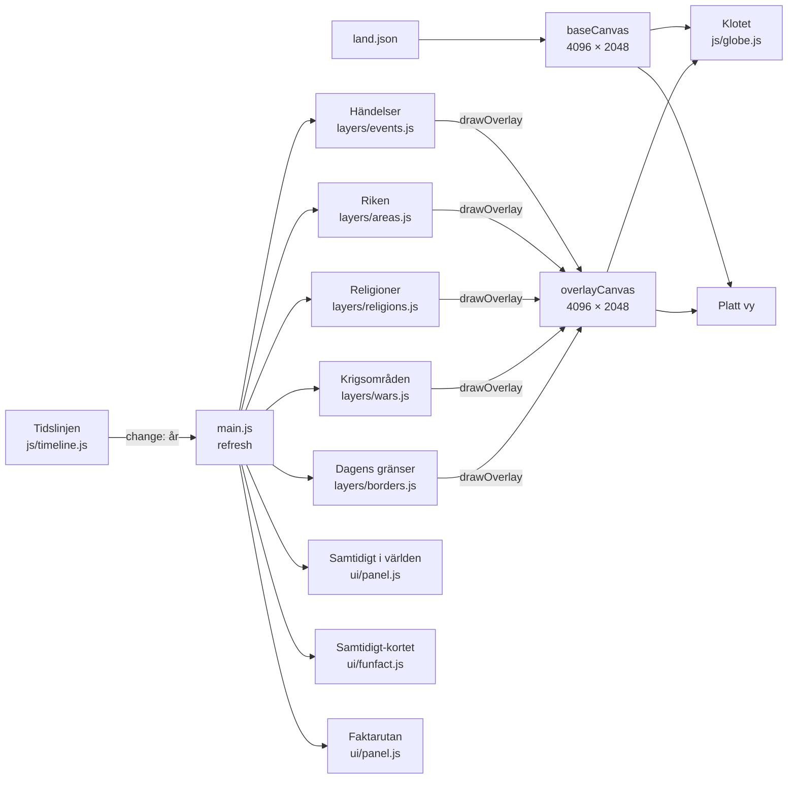

# Arkitektur

Hur Historia-globen är uppbyggd och varför. Den här filen uppdateras i samma pull request som koden när något av det här ändras. De bindande principerna står också i [CLAUDE.md](../CLAUDE.md#arkitektur-beslutad-ändra-inte-utan-att-fråga), och besluten bakom dem i [beslut.md](beslut.md).

## Principer

1. **Inget byggsteg.** Vanliga ES-moduler som webbläsaren läser direkt. Inga ramverk, ingen bundler och ingen server. Det räcker med `python3 -m http.server`.
2. **Data skild från kod.** Allt innehåll (händelser, fun facts, källor, riken, religioner, bildstilar) ligger i `data/`. Koden innehåller inga händelser, texter eller årtal.
3. **Ett år styr allt.** Tidslinjen äger det nuvarande året och skickar `change`. Allt annat lyssnar och ritar om.
4. **Allt ritas på en platt bild först.** Grundkartan och lagren ritas på ekvirektangulära bilder (4096 × 2048) som läggs på klotet. Samma platta bild kan skickas till en fysisk globskärm, och "Platt vy" visar den.
5. **Lager som moduler.** Varje lager har samma gränssnitt: `update(state)` väljer vad som syns, och `drawOverlay(ctx, W, H)` ritar det på den platta bilden.
6. **Ett enda externt beroende:** three.js 0.160.0 från jsDelivr.

## Hur delarna hänger ihop

Varje gång året ändras körs `refresh()` i `main.js`:

1. Samtidigt-kortet väljer vilka fun facts och krigskort som gäller. Kort som jämför flera händelser visas först, sedan det som började senast.
2. Händelselagret väljer synliga händelser, och listan Samtidigt i världen ritas om.
3. Riken, religioner, dagens gränser och krigsområden väljer vad som finns det året.
4. Lagren ritas i ordning nedifrån och upp på den platta lagerbilden: riken, religioner, dagens gränser, krigsområden och händelsernas sken.
5. Lagerbilden läggs på klotet, och på platta vyn om den är öppen.
   Rikesnamnen ritas mindre i bilden vid kraftig zoom (`areas.labelScale`, storlek ≈ förstoring^-0,7 men högst ned till 0,25, och `labelAlpha` tonar ut dem mot max zoom; omritning 150 ms efter att zoomandet stannat) så att de inte dominerar skärmen eller täcker markörer; platta vyn visar dem i grundstorlek (#154).
6. Pauser kontrolleras: fun facts, när ett krig bryter ut, krigets stora händelser och religionens grundande.

Klickbara markörer, etiketter och bågar ligger ovanpå klotet som 3D-objekt och HTML, inte på den platta bilden. Etiketter som ligger nära varandra slås ihop till kluster (`ui/clusters.js`). Etiketterna hålls inom skärmen och läggs aldrig ovanpå andra markörer eller klusterbrickor (#142).

## Moduler

| Fil | Ansvar |
|---|---|
| `js/main.js` | Startar allt, kopplar ihop delarna, fokusläget, pauser och etiketter |
| `js/model.js` | Språk (`t()`), kategorier, granskningsnivåer, tidsformat, världsdelar, bildstilar (`styleFor()`), laddning av data |
| `js/globe.js` | Klotet (three.js), kamera, styrning, de platta bilderna, bågar |
| `js/timeline.js` | Tidsreglaget med segmenterad skala, fokusspann, uppspelning, hastighet och "Hoppa till år" |
| `js/layers/events.js` | Punktlager: händelser med ikon och sken |
| `js/layers/areas.js` | Områdeslager: riken som ändras över tid |
| `js/layers/religions.js` | Områdeslager: rikenas religion, och en stjärna där religionen uppstod (`facts.origin`) |
| `js/layers/wars.js` | Krigsområden runt krigets och slagens platser |
| `js/layers/borders.js` | Dagens landsgränser (av som standard) |
| `js/ui/panel.js` | Samtidigt i världen per världsdel, kategorifilter, faktarutan med bild och ram, krigets berättelse, faktarutan om en religion eller ett rike (`showFacts`) |
| `js/ui/funfact.js` | Samtidigt-kortet: fun facts, "När ett krig bröt ut" och rikets berättelse i fokus (`empireStory`, #171), kan fällas ihop. Händelsernas bilder visas alltid överst i kortet (#190), högst tre sida vid sida (`_renderPics`), med bilden från händelsens `image`, ramen från `styleFor()` och en knapp "Läs mer" som öppnar faktarutan (`ff.onSelect`) med full bildtext, kredit och licens. Under bilden står ingen text utom händelsens namn när det är flera; illustrationer får etiketten "Illustration" i hörnet. Har ingen händelse i kortet bild visas ingen bildrad. Händelseknapparna under texten öppnar också faktarutan (och flyger globen dit). Kortet rullar inuti och går aldrig utanför skärmen. I smal skärm (≤760 px, #168) är bildraden 74 px hög, texten klipps efter två rader med bild (tre utan, tryck för hela), händelseknapparna döljs när bildrutorna finns och radbryts annars (ingen sidscroll, inget namn klipps), och alla kontroller har minst 44 × 44 px tryckyta |
| `js/ui/legend.js` | Teckenförklaring och klickruta för religionslagret (#166): HTML över globen, inte i kartbilden. Teckenförklaringen listar religionerna som syns året (`ReligionsLayer.legendItems()`); ett klick på ett område (`Globe.pickLatLon` + `ReligionsLayer.hitTest`, punkt-i-polygon i lon/lat) visar religion och rike. Händelsemarkörer har företräde |
| `js/ui/layers.js` | Lagermenyn och valen för pauser |
| `js/ui/focusmenu.js` | Fokusmenyn: följ ett krig, ett rike eller en religion |
| `js/ui/sources.js` | Sidan Om källorna: källregistret grupperat efter användning, granskningsläge per grupp och sökning |
| `js/ui/clusters.js` | Klustring av etiketter |

## Laddning av data

Vid start laddas det som behövs direkt: händelser, fun facts, källor, grundkartan, dagens gränser, bildstilar och rikenas register (`data/empires/index.json`).

Stora filer laddas först när de behövs:

- **Ett rike** (`data/empires/<rike>.json`) laddas när året närmar sig rikets tid (inom 100 år) eller när man väljer det i Fokus.
- **Religionerna** (`data/religions.json`) laddas när religionslagret slås på eller när Fokus-menyn öppnas.
- **Bilder** i faktarutan laddas när kortet öppnas.

## Hoppa i tiden (#140)

Stegknapparna −100, −10, −1, +1, +10 och +100 syns på alla skärmbredder (i mobil är de smalare). Årtalet uppe till vänster är en knapp: den öppnar en ruta där man skriver ett år, med knapparna f.Kr./e.Kr. eller direkt i texten ("2600 f.Kr.", "44 fkr", "1969"), eller väljer en tidsålder (skalans fyra segment och "Idag"). Utan angiven tideräkning räknas året som e.Kr. Tolkningen görs av `parseYear()` i `model.js`; rutan hör till `setupYearJump()` i `timeline.js`. I fokusläge hålls året inom spannet och rutan säger till om man hamnar utanför. Efter ett hopp (inte vid uppspelning eller stegknappar) flyger globen till årets viktigaste händelse (#165): händelsen i det första Samtidigt-kortet som ligger närmast i tid, annars i listan; vid lika vinner den med kortast spann (ett datum före ett spann som Oxford 1096–2026). `setupYearJump()` anropar `onJump`, och `flyToYearHighlight()` i `main.js` sköter flygningen. Den hoppas över i fokusläge och om användaren vridit globen de senaste tre sekunderna (`globe.lastUserInput`).

## Tangentbord och skärmläsare (#139)

Etiketterna och klustren på globen är `<button>` och nås med Tab; Enter öppnar händelsen (kluster zoomar in). Globens canvas har `tabindex="0"` och tar emot tangenter i `_initControls()` i `globe.js`: piltangenter snurrar (Skift = större steg), `+` och `−` zoomar. Tangenterna fångas bara när canvasen själv har fokus, så de stör inte inputfält. Fokus visas med mässingsring (`:focus-visible`). Play-knappen har `aria-pressed` och ett namn som växlar: "Spela upp tiden", "Pausa" och "Fortsätt" (efter automatisk paus, #163). De två kryssrutorna Samtidigt-kortet har egna namn ("Visa …", "Pausa vid …"). Listan Samtidigt i världen är det tangentbordsvänliga alternativet till globen.

## Pekskärmar och zoom (#191)

Webbläsarens egen zoom av hela sidan är avstängd: `touch-action: manipulation` på sidan, `maximum-scale=1` i viewport och ett stopp för Safaris nypgest (`gesturestart`). Globen har en egen zoom med nyp, scroll och +/−. Utan stoppet kunde en iPad zooma in hela sidan av misstag, och då gick den inte att zooma ut, eftersom globen fångar fingrarna.

## Fokusläget

Fokus-knappen följer ett krig, ett rike eller en religion. Tidslinjen visar bara det spannet, globen riktas mot platsen och uppspelningen går långsamt.

- **Krig:** ett kort med orsak och parter före start, paus vid krigets stora händelser (valbart) och ett kort med utgång och döda i slutet.
- **Rike:** bara rikets områden syns, och globen riktas mot riket när det var som störst. Har riket en faktaruta (`facts`) visas den när man börjar följa det. Rikets nyckelår visas som kort och pausar uppspelningen (valbart), se Rikets berättelse nedan.
- **Religion:** börjar vid religionens grundande, stannar vid grundhändelserna och visar sedan religionens spridning som statsreligion. Har religionen en faktaruta (`facts`) visas den först.

Året styr: ligger nuvarande år inom det man följer stannar tiden där (`startFocus` i `main.js`). Annars flyttas den till starten, och en rad i fokusraden säger "Tiden flyttades till …" med knappen "Tillbaka till <året>", som lämnar fokus och går till det året (det ligger ju utanför spannet). Krigets berättelse och faktarutorna visas som förut.

Har det man följer en faktaruta (riken och religioner med `facts`) finns knappen Fakta i fokusraden, som öppnar rutan igen.

## Faktarutan om en religion (#90)

När religionslagret slås på visas faktarutan för den första synliga religionen som har `facts` i `religions.json`, i samma kort som händelsernas faktaruta, och menyn stängs så att kortet och punkten syns. Rutan visas också när en sådan religion bockas i igen, med knappen Fakta i undermenyn och när man följer religionen i Fokus. Kortets ram följer tidsåldern för händelsen där religionen uppstod. Nyckelåren i rutan hoppar i tiden. Punkten där religionen uppstod ritas som en stjärna på lagerbilden (beslut 1), så att den också syns i Platt vy.

## Faktarutan om ett rike (#170)

Riken och religioner använder samma ruta (`Panel.showFacts` i `js/ui/panel.js`) och samma format för `facts`. Rikets ruta visas när man börjar följa riket i Fokus och med knappen Fakta i fokusraden. Kortets ram följer rikets tidsålder och platsen globen riktas mot. Rutan har alltid rutan "Om kartan": gränserna kommer från Cliopatria (med kartdatans spann), fakta kommer från rutans källor, och `facts.mapNote` säger hur källornas årtal skiljer sig från kartdatan (#138). Rutans källor räknas in under Riken i Om källorna.

## Rikets berättelse (#171)

När man följer ett rike i Fokus blir rikets nyckelår (`facts.milestones`) kort i Samtidigt-kortet med typen "Rikets berättelse". `empireStory()` i `js/ui/funfact.js` bygger korten: varje kort visas från nyckelåret till året före nästa nyckelår (högst 25 år), med rubrik, text, raden "Om kartan" när kartdatan avviker från källan och knappar för länkade händelser (`events`). Korten visas först i kortet och även när Samtidigt-lagret är avslaget, eftersom de hör till fokusläget. När uppspelningen passerar ett nyckelår pausar `refresh()` i `main.js` med `timeline.pause('Pausad vid <år>: <rubrik>')`, om valet "Nyckelår när man följer ett rike" är på i Lager (på som standard, sparas som de andra pausvalen). Korten själva pausar inte via `onNew`, så Samtidigt-valet och rikets val styr var för sig. När pausraden syns flyttas fokusraden upp ovanför den, och korten ligger ovanför fokusraden.

Menyn visar det som pågår nära året man står på. Resten finns bakom "Visa alla".

## Hjälpskript

Skripten i `tools/` körs för hand, inte av sidan, så principen om inget byggsteg gäller fortfarande.

| Skript | Gör |
|---|---|
| `tools/riken.py` | Bygger rikesfilerna ur Cliopatria |
| `tools/bildpromptar.py` | Skriver promptar för illustrationer till `docs/bildpromptar.md` |
| `tools/bilder_in.py` | Konverterar bilder från `images/incoming/` till `images/events/` och fyller i `image` i `events.json` från bildloggen `images/incoming/bildlogg.json`. Undermappar, till exempel `images/incoming/vantar/` för bilder som ska göras om, hoppas över |

## Testa

Se [CLAUDE.md](../CLAUDE.md#testa-innan-du-är-klar): starta `python3 -m http.server 8000`, kontrollera att konsolen är fri från fel, testa dator- och mobilbredd och kontrollera all JSON.

## Uppspelning (#163, #164)

Hastigheten är i år per sekund: 1, 5, 25 (standard) och 100, så att den långsammaste går att följa år för år. `Timeline.yearsPerSecond` ger farten; i fokusläge är den en tiondel av nivån (och skalas upp för spann längre än 90 år), och knappens text visar den faktiska farten. Sparat värde ligger under `hg-speed-ars`; den gamla nyckeln `hg-speed` (×-faktor) ignoreras. `timeline.pause(orsak)` med en text är en automatisk paus: knappen heter "Fortsätt" och raden `#pause-note` vid knappen visar varför, tills man spelar igen eller flyttar tiden (`pause()` utan orsak döljer raden).
