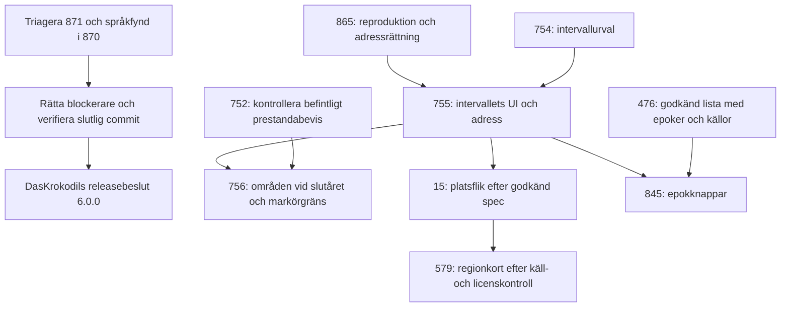

# Komplett analys av Historia-globen, 2026-11-08

**Bedömning: avvakta med v6.0.0.** Produkten har en tydlig kärna – samtidighet, en gemensam tidslinje och källanknutna berättelser – och en fungerande teknisk grund. Det som först behöver bli klart är skolans sammanhängande läsflöde, releasekontrollerna och den redan beställda språkgranskningen. Mer innehåll och fler funktioner löser inte de hindren.

Detta är ett underlag för Claude Codes triage och DasKrokodils beslut, inte byggorder. Inga historiska uppgifter, appfiler, etiketter eller issues har ändrats. Rapporten följer AGENTS.md, CLAUDE.md, .orchestra/project.md och granskningsmallen. Underlag: `main` vid `87ed68e271038a3ff74eabb6baa15078b1f22406`. GitHub-kön lästes 2026-11-08. Projektet fortsätter förändras; kontroller på en annan commit får inte användas som bevis för denna.

## Underlag och hur säkra slutsatserna är

- Lokal kod- och dataläsning, bygg/validering, Node-tester, översättningsspärr och webbläsarprov; slutresultaten redovisas i testbilagan.
- Öppna issues hämtades i två sidor, inklusive text och relevanta beslutskommentarer. Öppna PR:er vid avläsningen: #870 (release till production), #871 (blind-spots-rapport) och #874 (arbetsregler). Milstolpstillhörighet lästes ur issues; separat milstolpsmetadata gick inte att hämta med anslutningens tillåtna endpoint.
- [PR #871](https://github.com/DasKrokodil/historia-globen/pull/871) har redan en separat blind-spots-runda på **samma app-commit**, med tio fynd. Den återanvänds som tidigare granskningsbevis och ska triageras tillsammans med denna rapport. Fynd därifrån blir inte tio nya ärenden här.
- [Release-PR #870](https://github.com/DasKrokodil/historia-globen/pull/870) innehåller också en språkgranskning med en blockerande tysk betydelseändring och ett uttryckligt besked att språkattesten inte är fullständig. Detta är en annan granskares fynd, inte en ny extern faktakontroll från denna analys.
- `dev.historiagloben.se` skickar till Cloudflare Access. Ingen inloggning genomfördes. Produktionssidans publika HTML gick att läsa; den ersätter inte prov av releasekandidaten.
- Ingen ansluten funktion kan läsa GitHub Projects-fälten. **Projektvyns status och beroenderelationer är därför inte avstämda.** Kön nedan bygger på issues, kommentarer och PR:er. Claude Code behöver jämföra tabellen med projektvyn vid triage; påstå inte att vyn redan stämmer.
- Inte en full säkerhetsrevision, historisk faktagranskning, användarstudie eller skärmläsarattest. Skärmläsarbeteende kan inte bevisas med enbart DOM och ARIA.

Tidigare `handoff.json` pekade på [tyskagranskningen av #828](2026-11-07-tyska-828.md), med `ready_for_triage`. Den rapporten ska inte tappas bort när överlämningen nu pekar hit. Kontrollera dess tre språkfynd mot aktuell kod; godkänn inte gammal triage automatiskt.

## Produkten och arkitekturen

Behåll samtidighet som första fråga: vad pågår på andra håll när något väljs? Glob, platt karta, turer, quiz och utskrift använder redan samma data. Det är en fördel som bör förstärkas med fungerande övergångar och tydliga urval, före nya separata upplevelser.

ES-modulerna, lagerregistret, den gemensamma tiden och den ekvirektangulära ritningen passar projektets storlek och möjligheten till fysisk glob. Jag ser inget underlag för ramverksbyte eller bundler. `scripts/build-site.sh` är publiceringskopiering och validering, inte ett skäl att införa ett nytt byggsystem.

De tydligaste underhållsriskerna finns mellan komponenter: adressens asynkrona Fokus, turens sparade tillstånd, lektionslåset och språkbyte. `main.js` är 618 rader, panelen 615 och CSS 2 049; radantal är ingen bugg, men samma centrala filer återkommer i många ärenden. Prioritera tillståndskontrakt och verkliga övergångsprov framför en allmän omstrukturering.

Säkerhetsstickprovet visar en skarp CSP utan `unsafe-eval` för skript, begränsad Permissions-Policy, origin-kontroll och begränsad läsning av feedback-kroppen till 10 KiB. Utskrift bygger text med `textContent`, och källänkar i panelen escapear attribut och använder `noopener`. De 126 Node-testerna omfattar bland annat feedback och språk. Detta är positivt underlag, men inte bevis för hela den driftsatta funktionen, Turnstile-konfigurationen eller externa tjänsters inställningar.

Dokumentationsfynd med låg prioritet: `docs/arkitektur.md` upprepar utskriftsavsnittet, med olika uppgift om två respektive två eller tre blad. Det ökar risken för felaktiga framtida uppdrag. Rätta i ett avgränsat dokumentationsärende efter releasehindren.

Språknyckeltesterna bevisar inte att all gränssnittstext är översatt. Exempelvis innehåller `js/timeline.js` fortfarande den svenska feltexten ”Välj ett år mellan …” vid datum utanför tidsspannet. Detta hör redan till #672; lägg inte ett nytt dubblettärende. Översättningsspärrens återstående innehållsposter är 8 345 för de och 8 568 vardera för es/fr, summerat ur baslinjen. En nolla i ett nyckeltest är ingen fullständig språkattest.

## Prioriterade fynd och releasebeslut

| Prio | Underlag | Konsekvens | Rekommendation och ägare |
|---|---|---|---|
| P0 | #871 F7, samma app-commit | På 400 × 800 öppnas faktarutan bakom lektionskortet; läsning och Stäng blockeras. | Claude Code triagerar; Codex kan rätta en avgränsad UI-order. Bevisa öppna → läsa → stänga → fortsätta på samma steg, med pekning. |
| P0 | CI-körning 42445261787, nedan | Firefox och WebKit är röda i releasekontrollen. | Läs första felet per motor, skilj nät/typsnitt/testantagande från appfel och lämna konkret rättning eller dokumenterad spärr. Ingen generell attest utifrån grönt Chromium. |
| P0 | Språkkommentaren i #870, DE-1 | En tysk formulering har ändrat betydelse. Granskningen säger själv att den inte täcker samtliga påståenden. | Claude Code kontrollerar källa och rättning. Slutför den beslutade språkgrinden eller dokumentera uttryckligt begränsat releasebeslut. |
| P1 | #871 F1, F4, F5 | Lektionslänken gömmer utskriften; källbortfall kan ge tekniska id:n på papper; vissa översatta frågor kräver engelskt underlag. | Granska lärarens hela väg från delad länk till användbart blad. Käll- och innehållsdelar hos Claude Code. |
| P1 | #871 F6 och issue #865 | Gamla tillstånd kan flytta år/kamera vid utgång eller efter långsam Fokus-laddning. | Gör #865 med den beställda reproduktionen. Hantera lektionsutgångens återställning separat om den inte täcks av samma avgränsning. |
| P1 | #871 F2, F3, F9, F10 | Tyst laddningsreserv, slutsteg utan uppläsningssignal, tappat steg vid omedelbart språkbyte och fel tillgängligt sliderintervall. | Gemensam testmatris för tillståndsbyten. Låt inte en kontroll av att kortet finns räknas som bevis för läsbarhet eller uppläsning. |
| P2 | #871 F8 | En misslyckad bildhämtning lämnar normal bildyta och kredit. | Avgränsad reservpresentation efter kärnflödet; fakta ska fortfarande gå att läsa. |

**Releasegrind:** triagera #871 och språkkommentaren, rätta blockerare, kontrollera samma slutliga commit i releasekontrollerna och kör det sammanhängande lärar/elevflödet. Endast DasKrokodil beslutar om sammanslagning och publicering. En röd kontroll är inte automatiskt ett appfel, men den är ett olöst beviskrav tills orsaken är utredd.

### Vad loggarna faktiskt visar

[Körning 42445261787](https://github.com/DasKrokodil/historia-globen/actions/runs/42445261787), commit `87ed68e…`: Chromium godkänt, själva teststeget cirka 23 min 43 s. Firefox och WebKit misslyckades, inte `cancelled`.

- Firefox, jobb `128622733125`: första rapporterade felande kontrollen är A4-provet: **”webbtypsnitten laddades inte”**. Dessutom fyra konsolfel från `js/layers/areas.js` som loggas som `JSHandle@object`, och mobilens lektionsprov når inte synligt `#lesson-band`. Den riktiga felinformationen i objektet behöver hämtas före rotorsaksbedömning.
- WebKit, jobb `128622733328`: första rapporterade felet är tur-länken med okänd tur, **året 1325 i stället för 1500**. Därefter timeout på lektionsband och en typsnittsassertion i A4-provet. Inga konsolfel rapporteras där. Anta inte att samtliga följdfel har samma orsak.
- Bygg/validering för aktuell `main` är grön i körning `42445261876`. En grön separat push-körning av Chromium innebär inte att den röda releasekörningen med tre motorer är godkänd.

## Separat blind-spots-runda

Detta avsnitt prövar även granskarens antaganden. Den tidigare separata rundans praktiska bevis finns i #871; egna kompletterande prov redovisas i bilagan. Ett tidigare fynd märks inte som oberoende reproducerat bara för att koden ser rimlig ut.

| Antagande att utmana | Scenario som ska ingå | Vad underlaget säger |
|---|---|---|
| Öppet kort betyder läsbart kort | Mobil: öppna faktaruta från tur, läs anteckning och källor, stäng, fortsätt | #871 F7 visar varför DOM-närvaro missar ett blockerande överlapp. |
| Saknad bild och nätfel är samma sak | Händelse utan image, bild med 404, blandade steg | Ingen bild är normalt; angiven bild som inte laddas är ett annat tillstånd, #871 F8. |
| Tom lista betyder inget innehåll | Alla filter av, giltigt tomt år, misslyckad turfil och saknat källregister | Visa skillnaden mellan ett tomt urval och hämtfel. F2/F4 är redan rapporterade. |
| Turens steg är hela historien | Jämför stegantal, årsurval, närliggande händelser och full lista | Turen är ett pedagogiskt urval. Gör inte stegantal till täckningsmått; kommande intervall behöver egen etikett. |
| Ett läge kan testas isolerat | Fokus → lektion → utgång, långsam Fokus → ny tur, Nästa → språkbyte | F6/F9 och #865 beskriver tre olika övergångar. |
| Slutkort fungerar som övriga steg | Spela till slut, pausa, Tab, uppläsningssignal, nästa aktivitet | Slutkortets tomma uppdragsdel är delvis ett beslutat undantag; F3 gäller däremot en saknad signal. |
| Alla uppgifter i JSON kan väljas i tiden | Jämför startår med `MIN_YEAR` | Fem händelser börjar före −2999, se täckningen. Fler poster där ger inte automatiskt en bättre upplevelse. |
| Korrekt ARIA innebär fungerande hjälpmedel | Kontrollera min/max i låst läge och verklig uppläsning | F10 visar fel intervall. Riktig skärmläsare återstår. |

Metodändring: bevis för en skoluppgift måste omfatta **fråga → underlag → svarsmöjlighet → återgång**, i samma mobilvy. Lägg till felinjektion efter att sidan fungerat, och omedelbara användarbyten före adressens fördröjda skrivning. Den vanliga metoden att invänta korrekt hash före varje nästa steg döljer tidskapplöpningar.

## Täckning: vad finns och vad saknas?

Den maskinella rapporten [tackning-2026-11-08.md](tackning-2026-11-08.md) visar period × världsdel × kategori. Den kompletteras av [490 celler i CSV](2026-11-08-tackning-celler.csv) med antal händelser, unika fun facts, bilder, unika källor och händelser med minst två käll-id:n. En fun fact kan räknas i flera celler eftersom den länkar flera händelser. Summera inte cellernas unika källor/fun facts till ett globalt unikt antal.

| Mått | Resultat | Tolkning |
|---|---|---|
| Händelser | 827, inga draft i events-filen | Registerstatus, inte en ny kontroll av varje faktapåstående. |
| Krig/slag | 438, 53,0 % | Tidigmodern tid 65 %, 1800-talet 73 %, 1900-talet 66 %. |
| Bilder | 202, 24,4 % | 625 saknar bild; gränssnittet måste fungera med blandat innehåll. |
| Fun facts | 56; 98 olika händelser kopplade, 11,9 % | Samtidighetsidén har fortfarande betydligt mindre täckning än händelseregistret. |
| Källor | 1 699 registerposter; 1 083 används av händelserna | Inte samma sak som antal oberoende källorganisationer. |
| Minst två käll-id:n | 744, 90,0 % | Får inte kallas 90 % tvåkällsgranskat. `review: two-sources` gäller 420, 50,8 %. |
| Tomma celler | 311 av 490 | Tomt betyder observationslucka i datan; inte att varje kategori ska fyllas i varje tidsålder. |
| Framstegstagg | 0 | Negativt/positivt kan inte mätas tillförlitligt. Allt utanför krig är inte positivt. |

Högsta täckningsprioritet är att få innehållet nåbart och balanserat, inte att fylla alla nollor mekaniskt:

1. **Hög: förhistoria och tidsmodell.** Fem händelser före 3000 f.Kr., noll i Amerika/Oceanien. Alla fem startar före tidslinjens `MIN_YEAR = -2999`: `jordbrukets-borjan`, `kilskriften`, `egypten-enas`, `stonehenge`, `gobekli-tepe`. Koden klampar året vid init och val. Detta är ett kod-/datakontrakt, inte ett nytt historiskt påstående. #767 väntar redan på #396; besluta tillgänglig tidspresentation innan större påfyllning.
2. **Hög: icke-krig i modern tid och tidigmodern Asien.** Asien har 85 % krig under 1800-talet och 84 % under 1900-talet; tidigmodern Asien har noll vetenskap, religion och ekonomi. #766 täcker delvis detta, paketen #85/#86/#105 täcker framtida vetenskap/medicin. Börja med en liten källkontrollerad batch; inga nya kandidater ur minnet.
3. **Medel: 1100–1300-talen.** Europa har en händelse på 1100-talet och en på 1300-talet; Asien och Amerika en var på 1300-talet. #764/#765 har redan `behöver hjälp`: läs befintlig överlämning innan något arbete dupliceras.
4. **Medel: bilder och samtidighet.** Totalt 13 % bilder i Oceanien och 17 % i Afrika; tidigmodern Afrika 4 % och inga fun-fact-kopplade händelser. #771/#772 och övriga bildbatchar finns redan. Uppdatera gamla issueantal: #299:s ”437” beskriver inte dagens 625 bildlösa poster.

Den genererade rapportens viktning efter landyta och roten ur periodlängd är en sökhjälp, inte pedagogisk rättvisa eller krav på lika fördelning. Krigets underhändelser räknas som egna poster och påverkar balansen. Fem grova geografiska regioner är inte en kulturindelning. Inga nya namngivna historiska händelser föreslås utan öppnad källa; det befintliga källarbetet ska återanvändas av Claude Code.

### Rikenas landtäckning och avbrott

Ny geometrisk jämförelse använder **de faktiska periodpolygonerna i repot**, inte bara `GROUPS` i importskriptet. Referens: öppnad, registrerad källa `cliopatria`, [Cliopatria v0.2.1](https://github.com/Seshat-Global-History-Databank/cliopatria/tree/v0.2.1), fil `cliopatria_polities_only_v021.geojson`, hämtad 2026-11-08. POLITY jämförs, inte RELATION. Nutida gränser har projektbeslut som avsiktligt skiljer sig från källan; en geometrisk rest är därför en **utredningskandidat**, inte ett konstaterat faktafel.

[Sekelprov](2026-11-08-riken-sekel.csv) visar andelen av Cliopatrias yta som överlappar våra områden: år 1000 **55,01 %**, 1200 **51,81 %**, 1500 **43,39 %**, 1889 **92,49 %**, 2024 **98,89 %**. Detta är inte andelen av hela jordens land. Separat finns [landytemätningen per sekel och världsdel](2026-11-08-riken-landyta.csv), med Natural Earth-masken i `data/land.json` som nämnare, norr om 60° S.

| Provår | Täckning av landmasken | Överlapp av Cliopatrias yta |
|---|---:|---:|
| 1000 | 11,91 % | 55,01 % |
| 1200 | 12,45 % | 51,81 % |
| 1500 | 13,76 % | 43,39 % |
| 1889 | 70,52 % | 92,49 % |
| 2024 | 97,75 % | 98,89 % |

Ofärgat land betyder inte obebott land eller frånvaro av samhällen. Det kan ligga utanför både källans och projektets polygoner. Överlapp mot källan och täckning av landmasken besvarar därför olika frågor. Tidigare fynd om Sverige efter 1814 får inte återrapporteras oförändrade: dagens index har Sverige 980–2024, Norge 1905–2024 och Italien 1862–2024. Ett indexspann bevisar däremot inte att samtliga perioder är geometriskt sammanhängande.

[Lucklistan](2026-11-08-riken-luckor.csv) innehåller källans namn när mer än 80 % av en polygon med minst 10 000 km² ligger utanför våra områden. Exempel från datan: `Tibetans` och `Buyid Dynasty` år 1000; `Ghurid Dynasty` och `Great Jin` år 1200; `Ottoman Tripolitania` och `Sokoto Caliphate` år 1889. Dessa är stöd för #556/#645/#646, inte nya issueförslag eller källattester av namnen.

Metod: prov per sekel från −2999, därefter 100–2000 samt 1814, 1889, 1950 och 2024. Union av aktiva polygoner tar bort dubbelräkning. Referensgeometri förenklas 0,2°, ogiltig geometri repareras för analysen, ytor beräknas med repots `km2`. Landmasken använder samma jämn-udda-regel och 0,5° rutnät/cos(latitud)-vikt som täckningsverktyget. Världsdel i lucklistan följer polygonens representativa punkt. Små stater som visas med en punkt kan inte bedömas som kartluckor av ett areamått. Ingen slutsats om 2025–2026 dras ur en källa som slutar 2024.

Geometrihjälp: Shapely 2.2.0 i en tillfällig miljö, inget nytt appberoende. Referensfilens SHA-256: `fc6f0d1e4cc42f45da83522b3696db6f2cc85ec0d12259a85c89b31347b8fc0a`. CSV-underlaget innehåller 54 provår, 324 landyterader inklusive totaler och 1 460 geometriska luckkandidater. Samma stat kan förekomma vid flera provår; 1 460 är inte antalet saknade stater.

## Benchmark

Öppnade publika sidor 2026-11-08, utan inloggning. Observationerna gäller sidornas tillgängliga HTML och presenterade funktioner; inga fullständiga användbarhetsprov eller spelomgångar har genomförts. Bara idéer överförs, ingen kod, text, bild eller data.

| Rang | Källa och observation | Idé med vår egen data | Insats/risk och kökoppling |
|---|---|---|---|
| 1 | [World History Encyclopedia, Timeline](https://www.worldhistory.org/timeline/): från/till, BCE/CE, nyckelord och kategorier är samlade i ett avgränsat sökurval. | Visa aktivt intervall och antal tydligt, och skilj punkternas urval från områden vid slutåret. | Medel; UI-trängsel och datamängd. Redan #754–#756, inget nytt parallellt intervallprojekt. NC-SA-innehåll kopieras inte. |
| 2 | [Seterra](https://www.seterra.com/): geografiska grupper, quiz och separat ingång till utskrifter för lärare. Den alternativa GeoGuessr-adressen gav 403. | En tydlig lärarväg från samma lektionslänk till elev-/lärarblad. Gruppera befintliga uppdrag efter tillgängligt innehåll. | Liten–medel; fokus, mobil och utskrift. Prioritera #871 F1 framför ett större nytt spelläge. Inget antagande om hur poängsystemet fungerar. |
| 3 | [Gapminder, Worldview Upgrader](https://www.gapminder.org/test/): frågor kring vanliga missuppfattningar organiseras efter ämne och region. | Ett litet ”gissa, läs facit och öppna källan” ur befintliga granskade missuppfattningar. | Medel; risk att förenkla en omstridd uppgift till sant/falskt. Samla #846/#850, invänta beslut och källbedömning. |
| 4 | [TimeMaps](https://timemaps.com/): årnedslag, regioner, länder, uppslagsdel och lärarresurser binds ihop. | Återanvänd samma valda tid/plats mellan Plats och ett kurerat regionkort; visa att urvalet är begränsat. | Stor för regionkort, medel för befintligt platsurval. #15 före #579, källor/gränslicens först. Inga atlasbilder eller texter återanvänds. |
| 5 | [Our World in Data](https://ourworldindata.org/) visar ämnesingångar och resursstruktur; [TeachingHistory](https://teachinghistory.org/) skiljer lärarmaterial, historieinnehåll och metoder samt skolnivåer. | Visa vad som finns, för vilken skolnivå och vilka källbegränsningar som gäller innan lektionen väljs. | Liten för vägledning, stor för ny dataportal. Återanvänd turernas lärarfält och #786/#844; skapa inte egen statistikmotor. TeachingHistory anger NC-SA, inget material kopieras. |

Inga benchmarkkällor läggs till i händelseregistret: de används för produktidéer, inte historiska fakta. Förslagen triageras tillsammans med befintliga ärenden.

## Roadmap och beroenden

Versionsordningen är beslutad **6.0.0 först, därefter resten av 5.2**; versionsnumret är inte en automatisk kronologisk kö. Ingen ny klassrumspilot planeras nu enligt #862:s senaste text. Äldre planeringsrapporters 761 händelser och öppna skolimplementationer är historiskt underlag, inte dagens kö.

Pilarna skiljer inte automatiskt på hårda tekniska och organisatoriska beroenden: #754→#755→#756 är byggkedjan; #865 före #755 rekommenderas för att inte bygga ny URL-logik ovanpå en känd kapplöpning. #755 före Plats/epokknappar följer senaste samordningskommentarerna och gemensamma filer. #752 är inte öppen i den hämtade kön: **läs den stängda rapporten och använd mätningen**, behandla den inte som ett nytt blockerande bygge.

| Paket | Nästa konkreta steg | Ägare/modellnivå och grind | Krockar/test |
|---|---|---|---|
| Release #862/#758, PR #870/#871 | Triagera befintliga fynd, avgränsa rättningar; inte en tredje identisk rapport | Claude Code Sonnet high för UI, Opus för fakta/releasebedömning; Codex för avgränsad rättning och separat granskning | `tour.js`, `lesson.js`, `address.js`, panel/CSS/test. Sammanhängande mobilläsning, utskrift, tre motorer på slutlig commit. |
| #865, `redo` | Reproducera vanlig tur med fördröjd Fokus; adressversion efter await enligt ordern | Codex implementation, annan Codex-körning granskar, Claude Code Sonnet high slutbedömer | `address.js`, browser-test. Stale apply, år/kamera, Bakåt/Framåt. |
| #864 | Kontrollera grenskydd och dela test i tre jobb enligt beslutad order | Codex eller Claude Code Sonnet high; Opus granskar testdesign | Workflow och browser-test: kör inte parallellt med #865 eller UI-rättningar som ändrar samma svit. Bevisa full kontrolltäckning och jobbtider. |
| #754, `redo` | Isolerat urval med datadrivna Node-test; inga UI-ändringar | Codex, separat granskare | `date-events.js`; kan förberedas samtidigt som releaseutredning om ingen ägare hunnit ta det. Antal i gammal förstudie är inte fasta sanningar. |
| #755 | Efter #754 och utredning av #865: två årsfält, y2, uteslutning av Fokus/uppspelning | Codex; Claude Code Sonnet high | state, URL, timeline, panel, fem UI-filer. Full centralflödeskontroll dator/mobil. |
| #756 | Återanvänd #752:s prestandabevis; slutårsetikett och inställbar markörgräns | Codex; Claude Code Sonnet high | Lager, UI-filer och browser-test. Lista ska fortfarande innehålla bortvalda markörer. |
| #15 | Skriv/godkänn spec enligt senaste kommentar; behåll redan beslutad 300 km-storcirkelregel och tidsordning | Codex förberedelse/bygge; Claude Code samordnar med intervallet | focusmenu, ny urvalsmodul, UI-filer. Ingen extern geokodning. Tomt urval, ungefärlig plats, tangentbord. |
| #476/#845 | Claude Code öppnar Lgr22-källa, föreslår namn/gränser; DasKrokodil godkänner listan | Opus för källor/datamodell; Codex kan bygga godkänd UI-order | Timeline, modell, UI. Väntar på listbeslut, **inte** automatiskt på #396. Gränsår och regional reservation provas. |
| #786 | Förklara källjämförelse separat från ungefärlig datering | Codex; Claude Code språk/UX | Panel, CSS, UI-filer: samma redigeringsfönster som #755/#15. Riktad mobil/tangentbordskontroll. |
| #579 | Efter #15: välj tillåtna gränskällor, kontrollera licens och kurerat innehåll | Claude Code Opus; teknik kan avgränsas därefter | globe/flatmap, panel, nya data, sources och genererat. Full fakta/arkitekturkontroll; besluten i kommentarerna är redan tagna. |
| #672→#673→#674 | Slutför återstående UI-textflytt, sedan korsgranskning | Codex för mekanisk textflytt, Claude Code för språkbedömning | Fem `data/ui`-filer och browser-test: en i taget, efter central UI-batch. Nyckel/platshållartest och synlig text. |
| #776/#803/#839 och språkbatchar | Claude Code tar data även när etiketten är `redo` | Claude Code Opus när fakta ingår, separat språkgranskning | Periodfiler, sources, oversattning och genererat. UI-order ska inte återöversätta innehåll på eget initiativ. |
| #764/#765/#766/#767, #645/#646, #771–#774 | Hjälpärenden först; sedan en källkontrollerad innehållsbatch i taget | Claude Code Opus för fakta/licenser | Delade sources/genererat/översättningsregister. Täckningsmått före/efter och källbevis. |

**Kan börja efter anspråkskontroll:** #754:s isolerade tekniska arbete och #865:s reproduktion är märkta `redo`; detta analysuppdrag tar inget av dem. #839/#803/#776 är också `redo`, men är dataarbete och passar inte Codex enligt policyn. **Väntar på beslut:** #868, #866, #872/#873 samt quizidéerna #846/#850 och citeringsidén #844. Bygg inte på rekommendationerna i kommentarerna som om de vore godkända beslut.

## Samarbete, kostnad och veckoplan

En arbetare i taget för UI-kedjan; en andra, fristående dataförberedelse kan gå samtidigt om den inte skriver gemensamma register. Separata periodfiler gör inte data-PR:er oberoende när båda skriver `sources.json`, `data/genererat/` och `oversattning.json`. Max fyra öppna/pågående PR:er per konto kvarstår. Kontrollera aktuell kö före anspråk; tabellen är en ögonblicksbild.

Handoff ska innehålla krav, exakt commit, berörda filer, första felande kontroll, reproduktionslänk, synlig text/år/kamera före och efter, testresultat och begränsningar. Nästa agent ska slippa läsa hela kön igen. Byggaren granskar inte sin egen implementation som ”separat Codex-granskning”. Behåll samma bevisblock i PR och överlämning.

Nedan är **planeringsintervall i tusen modelltoken**, inte uppmätt förbrukning, offert eller tillgänglig kvot. De är osäkra uppskattningar för ett avgränsat issue/paket, inklusive normal rättningsrunda men inte stora nya beslut. Codex-förberedelse kan göras av en förberedande körning; modellnamnen Luna/Terra i policyn beskriver roller, ingen modell byttes i denna analys.

| Issue/paket | Codex förberedelse | Codex implementation + separat review | Claude Code triage/slutgranskning | Osäkerhet/kostnadsdrivare |
|---|---:|---:|---:|---|
| Triagera #871 och avgränsa releasefynd | 4–8 | 0 | 8–20 | Hög; vilka fynd som blir rättningar avgörs först. |
| En avgränsad mobilrättning för F7 | 2–4 | 10–22 | 3–7 | Medel; CSS-lägen och fokusåtergång. |
| #865 | 3–6 | 14–30 | 4–9 | Hög; reproduktion och asynkrona sidoeffekter. |
| #864 | 4–8 | 16–34 | 6–12 | Hög; testpartition, grenskydd och CI-tider. |
| #754 | 1–3 | 6–12 | 2–4 | Låg–medel; intervallkontrakt och datadrivna förväntningar. |
| #755 | 4–8 | 25–50 | 7–15 | Hög; tillstånd, URL, mobil, språk. |
| #756 | 2–4 | 12–24 | 4–8 | Medel–hög; mätbevis och markör/listkontrakt. |
| #15, spec och bygge | 3–6 | 15–30 | 4–9 | Medel; befintlig närhetsregel, filter/ungefärlig plats. |
| #476/#845, lista och en UI-leverans | 2–5 | 12–26 | 10–25 | Hög; källor och listbeslut före UI. |
| #786 | 1–2 | 6–12 | 2–5 | Medel; elevspråk, inga ändrade fakta. |
| En UI-textbatch, #672 eller #673 | 2–4 | 10–22 | 4–9 | Medel; synlig text, fem språk och reservvägar. |
| En innehålls-/språkbatch om högst 20 poster | 2–4 | 3–8, enbart separat kontroll | 15–35 inklusive innehållsarbete | Hög; källåtkomst, oenighet och licens. |

Föreslaget första veckopaket är endast release-triage, F7-rättning, #865, #864 och #754: **Codex förberedelse 14–29k, implementation/review 46–98k, Claude Code 23–52k**. Med ytterligare 25 % reserv: cirka **18–36k, 58–123k respektive 29–65k**. Resterande releasefynd och språkgrind är inte prissatta som ett färdigt helt släpp; de avgränsas efter triage. #755 startar i nästa paket för att undvika att release- och URL-fönstren överlappar.

Veckokvot och faktisk tokenförbrukning exponeras inte här. Det går därför inte att intyga att paketet ryms eller jämföra mot faktiskt utfall. Claude Code ska registrera faktisk förbrukning per avslutat issue där den finns och förklara större avvikelse. Skjut först upp regionkort, nya quizvarianter och epok-UI om kapaciteten är knapp; bryt inte en redan startad tillstånds-/testkedja för att börja fler spår.

Efter varje PR räcker kökontroll av status, filkrockar och nästa möjliga arbete. Full review görs vid sammanhängande batch, centralt tillståndsbyte eller release, inte efter varje liten dokumentationsändring. #864 kan minska väggtid men behöver inte minska total CPU- eller tokenkostnad. Mät båda och undvik att köra hela långsviten flera gånger på oförändrad appkod.

## Rekommendation till DasKrokodil

1. Prioritera releasehindren framför nya funktioner. Låt Claude Code triagera #871, språkkommentaren i #870 och de två röda webbläsarmotorerna tillsammans. Förslag på svar: **”Ja, avgränsa rättningarna först och redovisa kvarvarande risk före release.”**
2. Behåll nästa teknikordning: isolerat #754 och adressfelet #865, testdelningen #864 i eget testfönster, därefter #755→#756. Förslag: **”Ja, följ den ordningen efter releasebedömningen och kontrollera ägare före start.”**
3. Be om den källbelagda epoklistan, utan att öppna ytterligare quiz-/region-/religionsspår före besluten. Förslag: **”Ja, förbered listan; bygg inte nya beslutsspår nu.”**

Rapporten ska först triageras mot aktuell kod, issues och projektvy. Godkännande av rapportens arbetsordning är inte godkännande av alla framtida fakta-, licens- eller produktbeslut.

## Testbilaga

| Kontroll | Utfall |
|---|---|
| `bash scripts/build-site.sh` | Grönt: 721 filer, 59 JS-moduler och 76 ikoner validerade. |
| `node --test tests/*.test.mjs` | 126 godkända, 0 fel, 0 överhoppade. Kördes med åtkomst till lokal nätverksfunktion; en första sandboxkörning som fastnade avslutades och räknas inte som godkänt bevis. |
| `python3 tools/oversattning.py --check` | Grönt; det betyder inte att alla språk redan är färdiga. |
| `tests/dela-data-test.py`, `tests/tackning-test.py`, `tests/oversattning-test.py` | Alla tre gröna. |
| Full Chromium-svit på granskad commit | CI-körning 42445261787, jobb 128622733246: grön. En lokal full körning startades, tog grundvyer och flera funktionsbilder och avslutades för att återanvända CI-beviset och prioritera riktade prov. Den lokala fullkörningen är **inte** ett grönt slutresultat. |
| Firefox/WebKit | Releasekörningens fel redovisade ovan. Inga lokala omkörningar eller rättningar i detta rapportuppdrag. |
| Rapportlänkar, CSV-struktur och handoff-JSON | Kontrollerade; inga saknade lokala länkmål, konsekvent kolumnantal och giltig JSON. Inga app- eller faktadata ändras. |

### Egna riktade webbläsarprov

Chromium/SwiftShader, 1400 × 900 och 400 × 800, lokal server för `dist/`, three.js **0.160.0** routad till lokal kopia och Google Fonts avbrutna. Detta är en mjukvarurenderad testmiljö, inte ett prov av fysisk telefon, skolnät eller verklig skärmläsare.

- Öppnade `/?lang=sv#t=andra-varldskriget&m=lektion&s=storbritannien`. Steg 3 av 14 och år 1940 i båda bredderna; ingen horisontell scroll. Utskriftsknappen är inte synlig i någon av bredderna. Detta reproducerar #871 F1.
- Dator: faktarutans mitt går att träffa. Mobil: klick på ”Läs om händelsen” öppnar arket vid **x=16, y=292, bredd 368, höjd 338**. `elementFromPoint` mitt i faktarutan träffar **tour-question**, utanför faktarutan. Skärmbilden visar att turkortet täcker läsytan. Detta reproducerar #871 F7 oberoende; ingen ny dubblett föreslås.
- Kompletterande åtkomstprov på mobil: Stäng-knappen ligger vid **x=342, y=301, 30 × 30**. Dess mitt träffar `tour-text`; Playwrights åtkomstkontroll för ett vanligt klick ger timeout efter 2,5 s. Ingen `force` användes för att kringgå överlappet.
- Öppnade vikingalektionen och använde tangentbordets Home/End: år **793/1068** i båda bredderna. Samtidigt anger reglaget ARIA-min **−2999** och max **2026**. Detta reproducerar #871 F10. Inga `pageerror` registrerades i dessa riktade flöden; det är inte en fullständig konsol- eller hjälpmedelsattest.
- Blandad bildpresentation och grundvyn granskades visuellt i skärmbilderna. Saknad bild som data är inget fel i sig. Övriga blind-spots-fynd och felinjektioner återanvänds uttryckligen från #871; de har inte alla reproducerats på nytt här.

Inga historiska källnivåer höjdes. Geometriska mätningar och registerkopplingar ersätter inte källkontroll av enskilda påståenden. Efter ändringar behöver rättnings-PR:erna egna bevis på den nya app-committen.

## Fördjupning på nytt uppdrag

[Plan, backlog och ny UI/UX-runda 2026-11-08](2026-11-08-plan-backlog-uiux.md) kompletterar denna analys. Den innehåller en ny köinventering och ett nytt verifierat menyövergångsfel. Läs rapporterna tillsammans; den senare är nu ingången i handoff.json.
