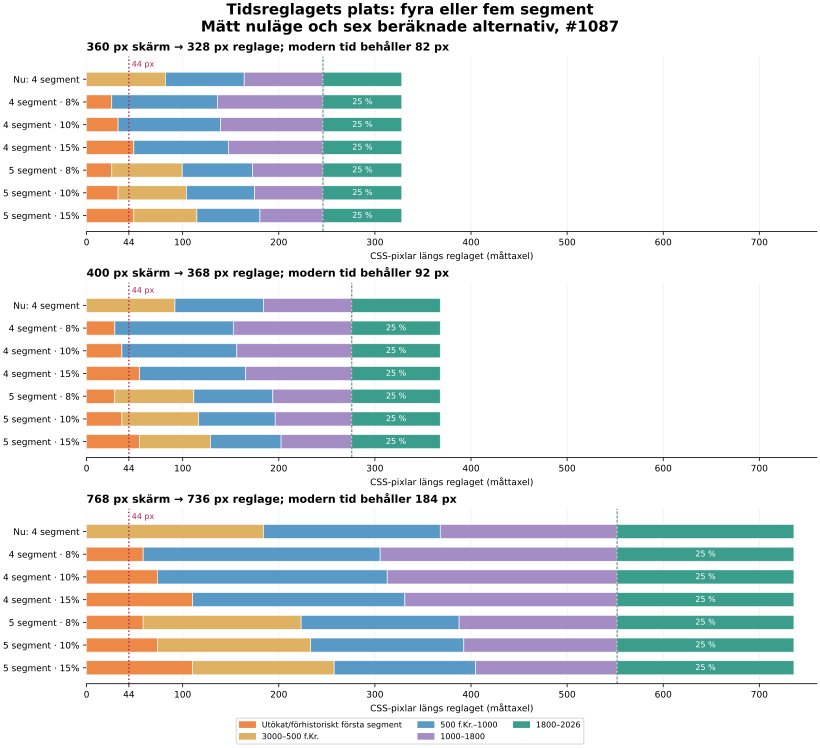

# Tidsreglagets plats på mobil och surfplatta (#1087)

2026-11-12. Underlag till #1088, del 1 av #49. Codex (Einzbeng).

**Rekommendation: fem segment, med 10 % till det nya första segmentet och fortsatt 25 % till 1800–2026.**
De tre mellanliggande segmenten får vardera 21⅔ %. Då behålls dagens gränser och modern tid får exakt samma
pixlar per år som nu. De 503 befintliga poster som börjar före 1800 får 13⅓ % mindre skala; 415 får oförändrad.
De fem poster som börjar före dagens vänstergräns räknas separat, eftersom de i dag kläms vid kanten.

10 % ger dock bara **36,8 px på en 400 px bred skärm**. Det är ett grovsegment, inte ett sätt att välja ett
enskilt förhistoriskt år med ett finger. Snabbhopp och den planerade reglagezoomen behöver därför finnas med
i bedömningen av #1088–#1091. Det här underlaget ändrar inga gränser eller beteenden i appen.

## Mätt nuläge

Chromium, 800 CSS-pixlars höjd, DPR 1, utan safe-area-insets. Bredd och höjd är hämtade med
`getBoundingClientRect()` från den byggda sidans `#track`. Ingen horisontell scroll eller något `pageerror`
upptäcktes vid de tre bredderna. Det är en webbläsarmätning, inte ett försök med finger på fysisk telefon.

| Skärmbredd | Reglagebredd | Reglagehöjd | 1800–2026, logisk bredd | CSS-rutans synliga bredd | px/år i modern tid | 44 px motsvarar där |
|---|---:|---:|---:|---:|---:|---:|
| 360 px | 328 px | 48 px | 82 px | 82,75 px | 0,3628 | cirka 121 år |
| 400 px | 368 px | 48 px | 92 px | 92,75 px | 0,4071 | cirka 108 år |
| 768 px | 736 px | 54 px | 184 px | 184,75 px | 0,8142 | cirka 54 år |

De 16 px marginalerna på vardera sidan ingår inte i reglaget. **Logisk bredd** är ytan som pekarens
årsomräkning använder: `track.width × 0,25`. De dekorativa segmentrutorna skiljer sig något på grund av
CSS-kantlinjerna och flexlayouten; därför används inte deras bredd som skala. Även dagens modernsegment
har mindre än en pixel per år vid dessa bredder. Kravet här är att bevara den tätheten, inte att utlova
att ett fingertryck väljer ett visst år. Årsfält och tangentbord ger andra vägar till ett exakt år.

## Sex uttryckligt definierade alternativ

Räkneantagande för vänstergränsen: `MAX_YEAR − 100000`, alltså kodår **−97974** med mättillfällets slutår 2026.
Det är inte ett nytt beslut om datans gräns. En ändrad gräns i #1088 ändrar antalet år per pixel och fönstret;
de fysiska bredderna och skyddet av modern tid beror däremot bara på andelarna.

- **Fyra segment:** första segmentet förlängs bakåt till räknegränsen och slutar fortfarande vid kodår −500.
  De två mellansegmenten slutar vid 1000 respektive 1800 och delar lika på det som återstår före modern tid.
  Här ryms alltså dagens äldsta segment i samma segment som den nya tiden bakåt.
- **Fem segment:** ett nytt segment slutar vid dagens vänstergräns −2999. Alla fyra gamla årsspann behålls.
  Lika många procentenheter tas från de tre äldsta segmenten; modern tid behåller 25 %.
- **15 %** är en jämförelse enligt issuet, men ligger över riktningens högst cirka 10 % och rekommenderas inte.

| Antal segment | Nytt/förlängt första | Mellansegmentens andelar | Modern tid |
|---|---:|---|---:|
| 4 | 8 % | 33,5 % + 33,5 % | 25 % |
| 4 | 10 % | 32,5 % + 32,5 % | 25 % |
| 4 | 15 % | 30 % + 30 % | 25 % |
| 5 | 8 % | 22⅓ % + 22⅓ % + 22⅓ % | 25 % |
| **5** | **10 %** | **21⅔ % + 21⅔ % + 21⅔ %** | **25 %** |
| 5 | 15 % | 20 % + 20 % + 20 % | 25 % |

Bildens axel anger CSS-pixlar; själva bilden kan skalas av dokumentvisaren. Den röda linjen markerar
44 px från vänsterkanten. Orange är det nya eller förlängda första segmentet. Den gröna delen har samma
bredd som i nuläget i samtliga alternativ. Bilden är beräknad från mätvärdena, inte en skärmbild av en ny app.

## Alla 18 kombinationer: bredd och fingerjämförelse

Varje cell visar **första segmentets px / cirka år per 44 px i segmentets skala**.
Åren är avrundade till tusental. 44 px är jämförelsemåttet i issuet, inte en uppmätt pekprecision.

| Segment / andel | 360 px skärm | 400 px skärm | 768 px skärm |
|---|---:|---:|---:|
| 4 / 8 % | 26,24 / 163 000 | 29,44 / 146 000 | 58,88 / 73 000 |
| 4 / 10 % | 32,80 / 131 000 | 36,80 / 117 000 | 73,60 / 58 000 |
| 4 / 15 % | 49,20 / 87 000 | 55,20 / 78 000 | 110,40 / 39 000 |
| 5 / 8 % | 26,24 / 159 000 | 29,44 / 142 000 | 58,88 / 71 000 |
| **5 / 10 %** | **32,80 / 127 000** | **36,80 / 114 000** | **73,60 / 57 000** |
| 5 / 15 % | 49,20 / 85 000 | 55,20 / 76 000 | 110,40 / 38 000 |

Formel: `44 × (tillår − frånår) / segmentbredd`. När segmentet är smalare än 44 px är detta en
**linjär ekvivalens**, som blir större än hela segmentets årsspann. En 44 px bred yta täcker då hela
första segmentet; en verklig förflyttning vidare åt höger korsar gränsen och följer nästa segments skala.
Det betyder inte att reglaget innehåller 114 000 förhistoriska år. Det femte segmentets nya spann är
94 975 år i räkneexemplet; det förlängda fyrsegmentsalternativets första spann är 97 474 år.

För det rekommenderade alternativet är förhistoriens täthet **0,0003454, 0,0003875 respektive
0,0007749 px/år** vid 360, 400 och 768 px. Modern tids värden i nulägestabellen gäller oförändrat för
alla 18 kombinationerna. Hela reglaget är den interaktiva ytan; segmenten är inte separata knappar.

## Tidsfönstret behöver en uttrycklig bedömning i #1088

`Timeline.windowYears()` använder `yearsAcross(year, 0.012)` i översikten. Det är en halvbredd:
segmentets årsspann delat med dess andel, multiplicerat med 0,012. Värdet är oberoende av skärmbredd.
Tabellen visar det råa beräkningsvärdet, avrundat till hela år, före gränssnittets textavrundning.

| Segment / andel | Fönster i första segmentet | Fönster direkt efter segmentgränsen | Poster vars spann berör fönstret vid gränsen |
|---|---:|---:|---:|
| 4 / 8 % | ±14 621 år | ±54 år | 923 |
| 4 / 10 % | ±11 697 år | ±55 år | 923 |
| 4 / 15 % | ±7 798 år | ±60 år | 923 |
| 5 / 8 % | ±14 246 år | ±134 år | 923 |
| **5 / 10 %** | **±11 397 år** | **±138 år** | **923** |
| 5 / 15 % | ±7 598 år | ±150 år | 923 |

Vid exakt gränsår väljer dagens segmentsökning det äldre segmentet (`year <= segment.to`).
Med fem segment och 10 % blir därför fönstret ±11 397 år vid −2999 men cirka ±138 år vid −2998.
I nuläget berör fönstret vid −2999 fyra poster. Med fyra segment är motsvarande gräns −500;
dagens fönster där berör 42 poster. **923 är ett räknat urval före kartans övriga filter**, inte ett
uppmätt antal markörer på globen. Beräkningen använder de befintliga posternas start och slut.

Rekommendationen om fem segment är därför inte ett godkännande av oförändrat tidsfönster. #1088 behöver
bedöma en begränsning/övergång av fönstret vid gränsen och prova tomt respektive tätt läge. Underlaget
bestämmer ingen ny fönsterregel. Fokus och intervall har egna regler och ingår inte i denna översiktsmätning.

## Hur befintligt innehåll påverkas

Alla 923 poster är `source-checked` eller `two-sources`. 918 börjar inom nuvarande reglage och fem före det.
Antalet nedan klassar pixelavståndet från startåret till nästa år; det mäter inte kortöverlapp eller läsbarhet.
Spann som går över en segmentgräns kan få olika skala i sina olika delar.

| Kodspann i nuläget | Poster efter startår | Fyra segment, 10 %: kvarvarande täthet | Fem segment, 10 %: kvarvarande täthet |
|---|---:|---:|---:|
| −2999…−500 | 67 | 1,03 % | 86,67 % |
| −500…1000 | 150 | 130 % | 86,67 % |
| 1000…1800 | 286 | 130 % | 86,67 % |
| 1800…2026 | 415 | 100 % | 100 % |

Tabellens spann grupperar startåren enligt kodens segmentsökning. Tätheten mäts mot nästa år även när
startåret är en segmentgräns; det skiljer sig från den äldre lutning som `yearsAcross()` väljer där.
Ingen post börjar vid 1800 i den här ögonblicksbilden.
Det gör att rekommendationens 503 trängre poster kan beskrivas som poster som börjar före 1800.
Fyra segment ger bara 67 trängre poster, men deras skala blir mindre än 2 % av dagens i alla tre
andelarna. Därför är antalet berörda poster ensamt ett missvisande urvalskriterium.

Fem segment med 8 % ger 10⅔ % mindre täthet i de tre gamla segmenten, jämfört med 13⅓ % för 10 %.
10 % ger i gengäld 25 % bredare förhistoriedel och 20 % färre år per pixel än 8 %. Det är skälet till
kompromissen 10 %: mer plats för grov navigering utan att röra modern tid eller slå ihop gamla spann.
Ingen av andelarna 8 eller 10 % gör första segmentet 44 px brett vid 360 eller 400 px.

## Källor, reproduktion och kontroll

- Beslut och krav: [Version 7-riktningen](../beslut/2026-11-10-version-7-riktning.md),
  [#1087](https://github.com/DasKrokodil/historia-globen/issues/1087) och
  [#1088](https://github.com/DasKrokodil/historia-globen/issues/1088).
- Kod och data: `js/timeline.js` (`SEGMENTS`, `yearToPos`, `yearsAcross`, `windowYears`),
  `js/state.js` (`MIN_YEAR`, `MAX_YEAR`), `css/style.css` (`.timebar`, `.track`, `.seg`) och `data/events.json`.
  [Frysta webbläsarmått](underlag/1087-webblasarmatt.json) anger exakt källcommit, mättid i UTC och SHA-256
  för dessa filer. Mätningen använde lokal three.js 0.160.0 och avbröt Google Fonts i molnmiljön.
- [Räkneskript](underlag/1087-matning.mjs) och [alla numeriska resultat](underlag/1087-resultat.json).
  Från repots rot: `node docs/granskningar/underlag/1087-matning.mjs`. Skriptet skriver JSON på stdout,
  kontrollerar källfilernas hash, kontinuitet och oförändrad modern skala samt jämför nulägets formler
  med appens exporterade funktioner. Det ändrar inga filer. Figuren är ritad från resultatfilen med Matplotlib.
- Sidbygge och validator är gröna på källcommitten. De tre Chromium-mätningarna är genomförda och
  skärmbilder av nuläget är granskade. Full lokal appsvit behövs inte för denna dokumentationsändring
  enligt testnivån Riktad i `.orchestra/project.md`.

Inga historiska uppgifter har lagts till eller källgranskats. Innehåll för den nya tiden och den slutliga
datagränsen behöver fortfarande hanteras i sina beslutade ärenden.
