# Förstudie: tidsreglaget i förhistorisk och historisk tid (#1878)

**Datum:** 2026-11-18. **Av:** Claude Code (DasKrokodil), underagent åt dirigenten, Opus. **Ingen kod eller data ändras.** Skisserna är gjorda genom att byta ut reglagets innehåll i en öppen sida (Playwright mot `python3 -m http.server`); inget av det är incheckat.

**Så gjordes expertgranskningen:** verktyget för att starta underagenter fanns inte i den här körningen (samma begränsning som i morgonrapporten på #1313). De sex linserna är därför genomgångna i samma tråd, var och en efter sin instruktion i `.claude/agents/<namn>.md` och med frågorna ur issuets tabell. Fakta om förhistoria och läroplan bygger på källsidor som öppnades 2026-11-18 (adresser vid varje påstående). Det är en svagare granskning än sex fristående experter, och dirigenten kan välja att låta `forhistoriker` och `larare` gå igenom rapporten innan rekommendationen postas.

## Kort sammanfattning

- **Rekommendation: alternativ A, med växlaren som en synlig knappgrupp vid reglaget och automatisk övergång vid gränsen.** Vilket reglage som visas räknas ur året (`y`), så adressen och gamla länkar fungerar oförändrade utan nytt fält.
- **Reglagen bör heta efter tid, inte efter begrepp:** "Före 3000 f.Kr." och "3000 f.Kr.–i dag". Förhistorien slutar inte samma år överallt (källorna nedan), och vårt eget `kilskriften` (cirka 3300 f.Kr.) skulle hamna i ett reglage som heter "före skriften".
- **A löser längden men inte trängseln i modern tid.** Historisk tid får cirka 11 % fler pixlar (1800– från 92 till 102 px på 400 px), vilket uppfyller #49 men inte gör 1950–2000 lätt att träffa. Det gör bara zoom (B, #1091). B föreslås därför som ett senare steg, inte som ersättning.
- **Ett mönster med version 8:** reglagen blir två skalposter (#1511) i domänen människans historia, och växlaren är samma komponent som lägesväxlaren i #1517, där Jordens historia är en domän (`d`) och dess nivåer är fler poster.
- **Det som kräver DasKrokodils beslut:** gränsens år (3000 eller 3500 f.Kr.), reglagens namn, växlarens plats i mobil, och hur brett Samtidigt-fönstret ska vara i förhistorien (det krymper kraftigt med A).

## 1. Mätningar (main `71e6d6d`, 2026-11-18)

### Reglaget i dag

Uppmätt i Chromium med Playwright. Reglagets bredd är skärmen minus marginalerna.

| Skärm | Reglagets bredd | 100 000–3000 f.Kr. (10 %) | 3000–500 f.Kr. | 500 f.Kr.–1000 | 1000–1800 | 1800– (25 %) |
|---|---|---|---|---|---|---|
| Dator 1280 px | 1248 px | 125 px | 270 px | 270 px | 270 px | 312 px |
| Liggande 800×360 | 768 px | 77 px | 166 px | 166 px | 166 px | 192 px |
| Mobil 400 px | 368 px | 37 px | 80 px | 80 px | 80 px | 92 px |

**År per pixel på 400 px:** förhistorien cirka 2 600 år/px, 3000–500 f.Kr. 31, 500 f.Kr.–1000 19, 1000–1800 10, 1800– 2,5.

### Händelser per segment (`data/events.json`, 1 481 händelser, alla med status över `draft`)

| Segment (startår) | Händelser | Per px vid 400 px | Per px vid 1280 px |
|---|---|---|---|
| 100 000–3000 f.Kr. | 158 (63 före 10 000 f.Kr., 95 efter) | 4,3 | 1,3 |
| 3000–500 f.Kr. | 139 | 1,7 | 0,5 |
| 500 f.Kr.–1000 | 270 | 3,4 | 1,0 |
| 1000–1800 | 358 | 4,5 | 1,3 |
| 1800– | 545 | 5,9 | 1,7 |

Tätast per 50 år: 1950-talet till 1990-talet (166), 1900–1949 (142), 1850–1899 (101). Elva händelser börjar före 100 000 f.Kr., och sju av dem (bland andra `jebel-irhoud`, `omo-kibish`, `herto`) slutar också före och syns inte på reglaget alls. Nitton händelser pågår över 3000 f.Kr. (bland andra `stonehenge`, `skara-brae`, `bantuexpansionen`, `hallristningarna-i-alta`), och 15 börjar de sista 500 åren före gränsen, bland dem `kilskriften` (−3299), `egypten-enas` (−3099) och `otzi` (−3358).

### Samma mått med alternativ A

Historiska reglaget behåller de fyra segmentens inbördes andelar (24,07 % ×3 och 27,78 %). Förhistoriska reglaget delas i 100 000–10 000 f.Kr. och 10 000–3000 f.Kr. på 50 % var (förhistorikerns förslag nedan).

| Skärm | 1800– i dag | 1800– med A | 100 000–10 000 f.Kr. | 10 000–3000 f.Kr. |
|---|---|---|---|---|
| 1280 px | 312 px | 347 px (+11 %) | 624 px (144 år/px) | 624 px (11 år/px) |
| 800 px | 192 px | 213 px | 384 px | 384 px |
| 400 px | 92 px | 102 px | 184 px (489 år/px) | 184 px (38 år/px) |

Kravet i #49 (modern tid får inte färre pixlar) är uppfyllt. På 400 px blir förhistorien tio gånger bredare (från 37 px till 368 px) och de 95 händelserna mellan 10 000 och 3000 f.Kr. hamnar på 184 px i stället för cirka 3 px.

### Samtidigt-fönstret ändras

Fönstret är 1,2 % av reglaget åt varje håll (`windowEdges(y, 0.012)`, `js/timeline.js:309`), så det följer reglagets skala.

| År | I dag | Med A |
|---|---|---|
| 1325 | cirka ±44 år | cirka ±40 år |
| 50 000 f.Kr. | cirka ±11 640 år | cirka ±2 160 år |
| 8000 f.Kr. | cirka ±11 640 år | cirka ±170 år |

I historisk tid är skillnaden liten. I förhistorien blir fönstret mycket smalare, och med glesa data kan Samtidigt bli tomt. Det är ett eget beslut (se Rekommendation, fråga 5).

### Observationen om teckenförklaringen (#1307)

- **Dator 1280 px, main i dag:** teckenförklaringen (y 786–800) ligger under årtalen (y 762–779) och täcker dem inte. Skärmbilden från 2026-11-16 visar i stället två ord ovanpå varandra längst till vänster i förklaringsraden ("Tecken" över ett annat ord). Det gick inte att återskapa på main, där #1942 (#1307, ihopslagen 2026-11-17) ändrade raden. Troligen är det rättat; kontrollera med samma skärmbredd som på bilden (cirka 2000 px).
- **Mobil 400 px:** förklaringsraden (y 847–864) ligger kant i kant med årtalen (y 831–849). Rutorna för "1800" och "ny skala" överlappar 2 px; i bilden syns ingen krock. Etiketten "100 000 f.Kr." är bredare (51 px) än förhistoriens segment (37 px) och sträcker sig in i nästa segment, så den ser ut att märka fel ställe.
- `.tl-item-seam` ska enligt CSS döljas vid högst 560 px, men "ny skala" syns vid 400 px. Det kan vara avsiktligt efter #1942; kontrolleras av den som bygger.

## 2. Skärmbilder

Alla skisser är märkta med en röd etikett "SKISS" i bilden. De är ritade genom att byta reglagets delar, årtal, täthetsband och Visste du?-rutor i en öppen sida. Globen, årtalet och resten är äkta. Uppspelning, tangentbord och skärmläsare är inte byggda och syns inte.

| | Dator 1280 px | Mobil 400 px |
|---|---|---|
| Nuläge | 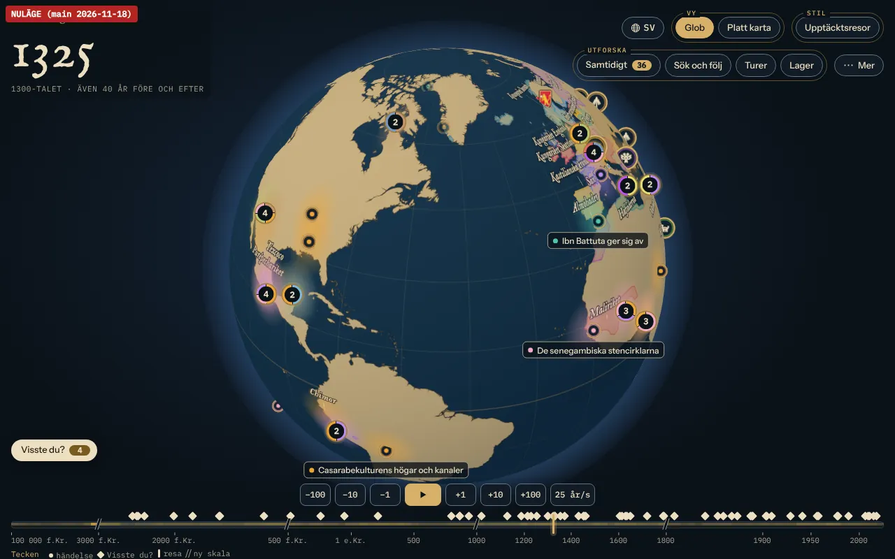 | 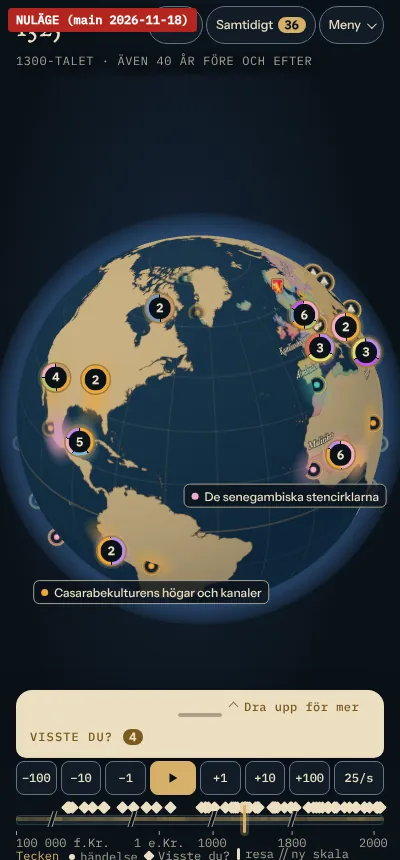 |
| A, historisk tid vald | 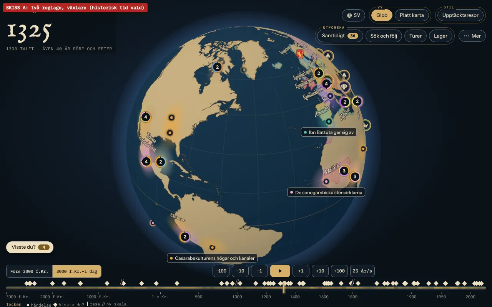 | 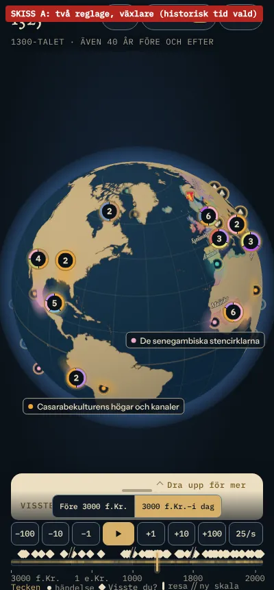 |
| A, förhistorien vald (8000 f.Kr.) | 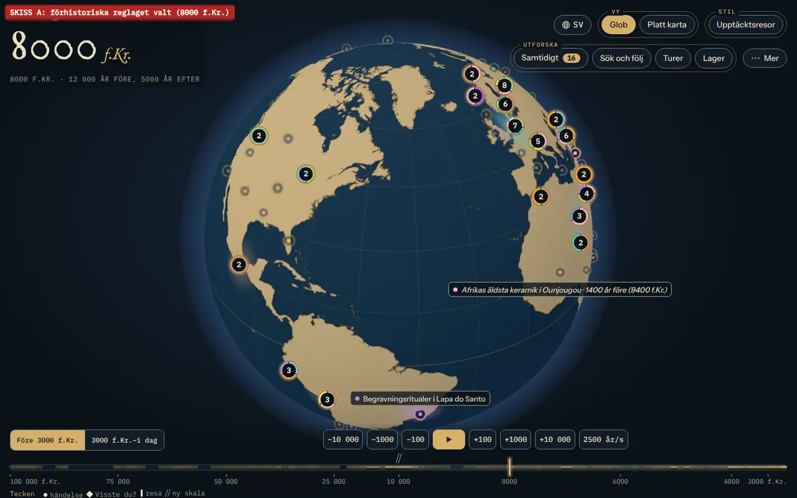 | 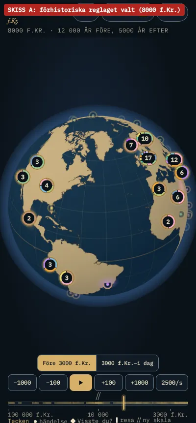 |
| B, zoom 1200–1500 | 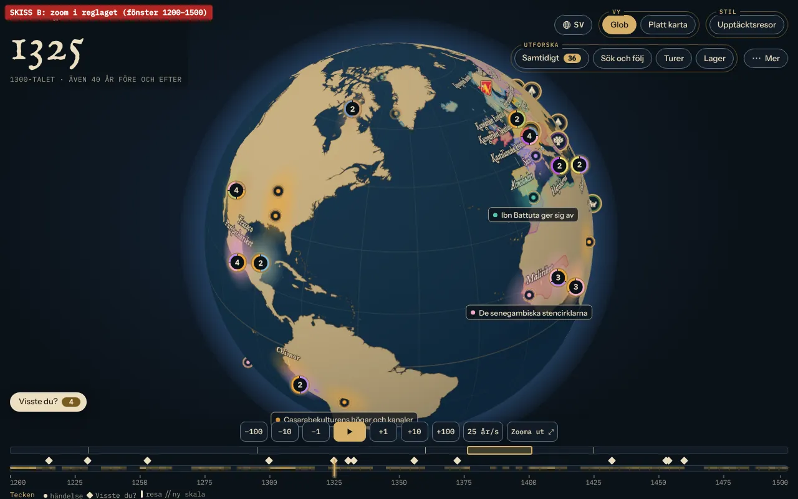 | 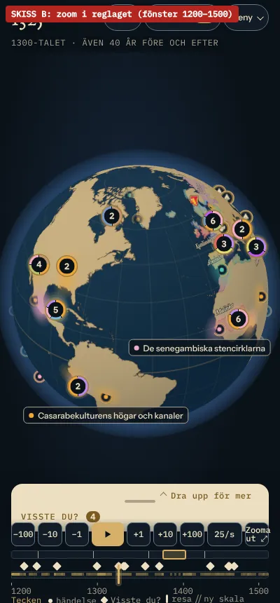 |
| C, knappen "Före skriften" | 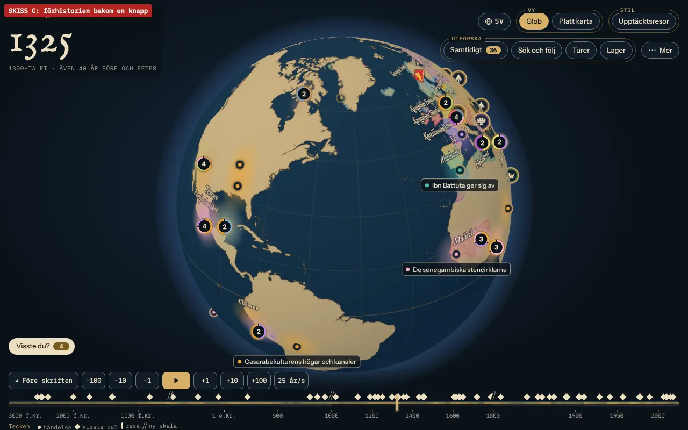 | 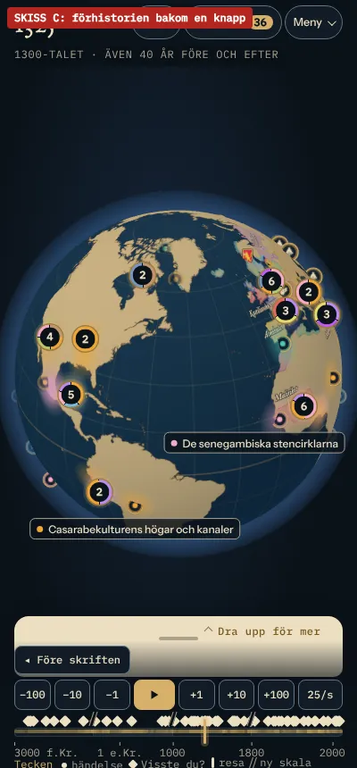 |
| D, dörr i reglagets ände | 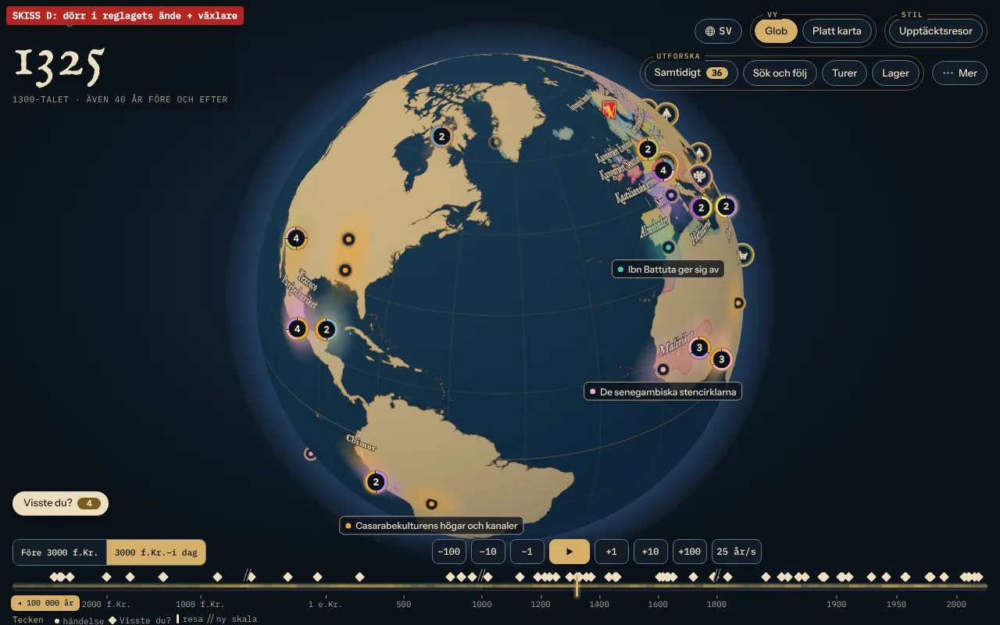 | 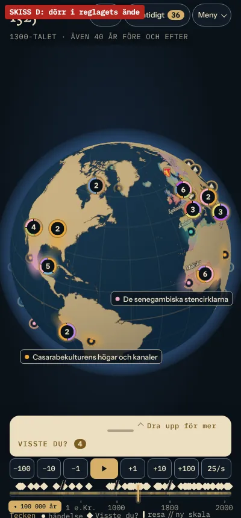 |
| D, förhistorien med dörr tillbaka | 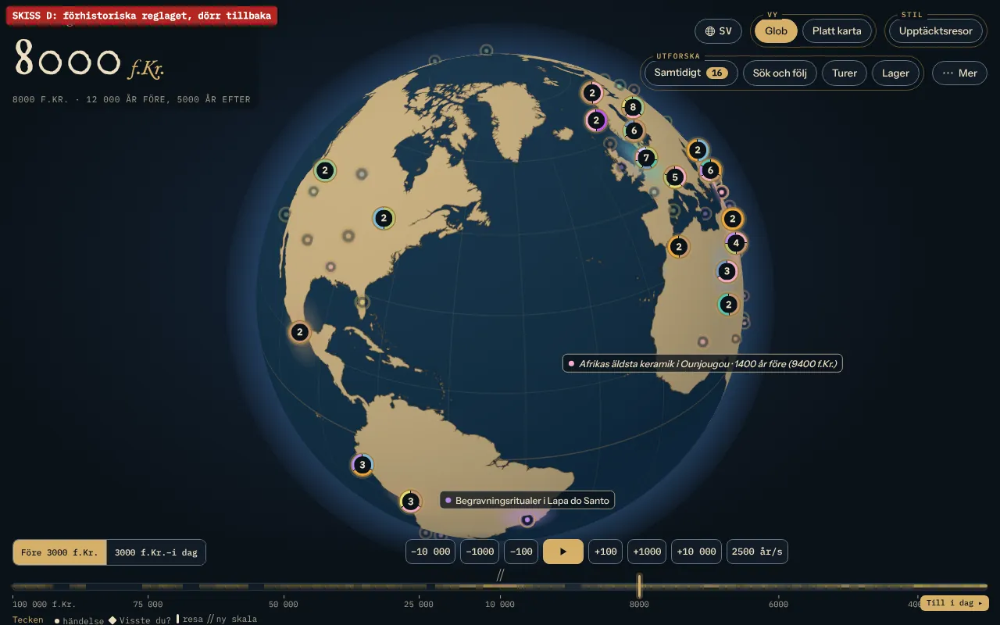 | 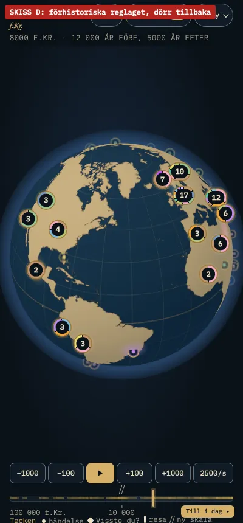 |

Liggande 800×360 är bara uppmätt, inte avbildad för alternativen. DasKrokodils bild `issue-1878/nulage-reglage-dator.webp` är orörd.

## 3. Experternas fynd

### `ux-tillganglighet` (huvudfrågan)

- **Viktigt: A är bäst för längden, men bara om växlaren alltid syns.** I A står besökaren på ett reglage åt gången, och det reglage som syns har jämna, läsbara årtal. C gömmer förhistorien bakom en knapp med ett begrepp som eleven inte känner igen (se `larare`). B ändrar inte första intrycket: standardläget har fortfarande fem segment och fyra skarvar (mål M1 och M2 i `docs/produkt/01-vision-och-mal.md`: tid och glob först, lätt att förstå).
- **Viktigt: A löser inte trängseln 1950–2000.** Med A får 1800– bara 11 % fler pixlar. För att träffa en enskild händelse i tätt partier behövs zoom (B, #1091) eller Fokus och tidsintervall som redan finns. Rekommendation: A nu, B prövas efter A.
- **Växlarens plats.** Dator och liggande: en knappgrupp med två knappar till vänster på knappraden (skiss A dator); på 800 px ryms den bredvid de åtta knapparna (cirka 420 px knappar och 250 px växlare på 768 px). **Mobil 400 px: knappraden är full** (åtta knappar på 368 px). En egen rad över knapparna kostar cirka 38 px höjd och **krockar med Visste du?-kortet**, som ligger strax ovanför tidsraden (skiss A mobil). Två lösningar: (1) egen rad och kortet flyttas upp lika mycket, eller (2) D: en "dörr" i reglagets vänstra ände ("◂ 100 000 år") som ersätter det första årtalet, utan extra höjd (skiss D mobil). Dörren i skissen är 20 px hög och måste få minst 24 px tryckyta (som `.timeline-legend summary::before`, #1138). Förslag: växlaren i knappraden i dator, dörren i mobil, med samma två texter och samma beteende.
- **Var man är och vilket år:** knappen för det valda reglaget är fylld i mässing (`aria-pressed="true"`). Årtalet uppe till vänster är oförändrat. Reglagets egna ändårtal ("3000 f.Kr." och "2000", eller "100 000 f.Kr." och "3000 f.Kr.") visar vilket spann som syns.
- **Uppspelning:** spelar man förbi 3000 f.Kr. byter reglaget av sig självt, och statusraden säger det en gång ("Nu 3000 f.Kr.–i dag"), som skalraden gör vid en skarv i dag (`scaleTextFull`, #1313). Uppspelningen ska inte stanna vid gränsen.
- **+1/+10/+100:** stegen följer upplösningen som i dag (`stepAt`, #1320: tusental före 10 000 f.Kr., hundratal till 3000 f.Kr.). Ett steg över gränsen byter reglage, som uppspelningen.
- **Tidsfönstret och "ny skala":** skarvarna blir färre (tre i historisk tid, en vid 10 000 f.Kr. i förhistorien). Skalraden och teckenförklaringen behövs fortfarande. Bytet av reglage ska inte se ut som ett fel: reglaget tonar över i stället för att hoppa.
- **Tangentbord och skärmläsare:** reglaget är fortfarande ett enda `role="slider"`; `aria-valuemin` och `aria-valuemax` följer det valda reglaget, och `aria-label` säger vilket ("År, 3000 f.Kr. till i dag"). Home och End går till det valda reglagets ändar; en pil förbi änden byter reglage (samma som uppspelningen). Växlaren är en grupp (`role="group"`) med två knappar och `aria-pressed`, före reglaget i tabbordningen.
- **Kontrast:** växlaren använder befintliga variabler (`--brass` mot `--night` för vald knapp, `--parchment` mot `--night-2` för den andra), samma par som spelknappen och stegknapparna har i dag. Ingen ny färg.
- **B på mobil:** en nionde knapp ("Zooma ut") ryms inte på raden (skiss B mobil) och zoomläget syns bara i ett tunt översiktsband. Zoomgester på ett 48 px högt reglage krockar lätt med globens egen zoom.

### `arkitekt`

- **Viktigt: reglaget räknas ur året, inget nytt adressfält.** Vilket reglage som syns är en ren funktion av `state.year`: före gränsen förhistoria, annars historisk tid (gränsåret självt hör till historisk tid). Då fungerar `y=` och alla gamla länkar oförändrade, och `y=-7999` öppnar förhistoriska reglaget av sig självt. Arkitekturens punkt 3 ("ett år styr allt") ändras inte, och ingen beslutsfil om adressen behövs.
- **Att byta reglage är ett hopp i tid.** Eftersom reglaget måste innehålla året flyttar en tryckning på växlaren året: till det år man senast stod på i det reglaget under besöket, annars till ett fast år per reglage (förslag: 10 000 f.Kr. och 1325, startåret). Hoppet går genom `setByUser`, så adressen, Bakåt/Framåt och "Tillbaka" (#997, `js/controllers/jump-back.js`) fungerar som vid andra hopp.
- **`js/timeline.js`:** `SEGMENTS`, `TICKS`, `SEAMS`, `yearToPos`, `posToYear`, `windowEdges` och `yearsAcross` räknar i dag på modulkonstanter. #1511 gör dem till en skalpost som `Timeline` tar emot. A är då två poster och en funktion som väljer post efter år; `segmentAt`, `scaleText` och `windowEdges` tar posten som argument. **A bör alltså byggas ovanpå #1511, inte före.**
- **`js/state.js` och `js/url-state.js`:** inga nya fält. `MIN_YEAR` och `MAX_YEAR` är fortfarande hela domänens gränser; `clampYear` i adressen är oförändrad.
- **Tidslås (#1322):** `timeLock` ger `{ locked: true }` eller `{ from, to }`. Låst: växlaren är avstängd som stegknapparna. Lektionsår: växlaren visar bara reglage som skär lektionens år; ligger båda ändarna i samma reglage döljs den, som teckenförklaringen i lektionsläget.
- **Tidsintervall (`state.range`, #755):** ett intervall som korsar gränsen (till exempel `y=-5000&y2=-1000`) kan inte ritas som ett band på ett reglage. Förslag: visa reglaget för slutåret, samma regel som riken och religioner redan följer (`state.areaYear`, #756), och låt bandet gå ut till kanten med en pil. Kräver ett beslut i bygget, men inte av DasKrokodil om förslaget följs.
- **Fokus:** har egen skala (`setFocus`, `focusTickStep`) och påverkas inte. När Fokus slutar väljs reglaget ur året.
- **Ett mönster med version 8 (#1511, #1517):** växlaren byggs som en komponent som listar skalposter. I människans historia är posterna "Före 3000 f.Kr." och "3000 f.Kr.–i dag" och ett val är ett hopp i år. I #1517 läggs domänen Jordens historia till; där är ett val ett byte av `d` (beslut 2026-11-13, tidsdomänen) och dess nivåer (Fanerozoikum › Mesozoikum) är fler poster. Samma komponent, samma plats, samma tangentbord. Beslutet 2026-11-14 punkt 4 (byte av domän avslutar tur, lektion, fokus och intervall) gäller bara domänbytet, inte byte av reglage.
- **Filkrockar:** inga öppna pull requests rör `js/timeline.js`, `js/state.js` eller `js/url-state.js` (kontrollerat 2026-11-18). #1511 ska inte byggas samtidigt som något annat i `js/timeline.js` (står i issuet). Testerna `tests/tidsskala.test.mjs`, `upplosning.test.mjs`, `samtidigt-fonster.test.mjs`, `url-state.test.mjs` och `webblasare.mjs` berörs.
- **Kostnad (uppskattning):** #1511 en pull request (redan planerad); A två till tre pull requests (växlaren och val av post, uppspelning och tangentbord över gränsen, mobilen och texterna på fem språk). B (#1091) är ett eget, större arbete (zoomläge i tillståndet, gester, översiktsband) och återanvänder Fokus linjära skala.

### `forhistoriker`

Källor öppnade 2026-11-18:
- Svenska Wikipedia, "Förhistorisk tid": <https://sv.wikipedia.org/wiki/F%C3%B6rhistorisk_tid>. Förhistorisk tid är tiden då skriftliga källor saknas eller är för bristfälliga; den anses sluta omkring 3000 f.Kr. i Mesopotamien, Egypten och Persien, cirka 1500 f.Kr. i Kina, cirka 750 f.Kr. i Grekland, med kristnandet på 1000-talet i Skandinavien, och vid kolonisationen i Amerika och Australien (1788).
- Engelska Wikipedia, "History of writing": <https://en.wikipedia.org/wiki/History_of_writing>. Skrift i södra Mesopotamien under sena 3000-talet f.Kr. (cirka 3400–3100 f.Kr., med "citation needed"), Egypten cirka 3250 f.Kr., Kina före cirka 1250 f.Kr. (orakelben), Mesoamerika före cirka år 1; fyra oberoende uppfinningar räknas oftast.
- Engelska Wikipedia, "Holocene": <https://en.wikipedia.org/wiki/Holocene>. Holocen börjar cirka 11 700 år före 2000, ungefär 9700 f.Kr., fastställt av ICS med en GSSP i iskärnan NGRIP2 (2008).
- Historiska museet, "Stenålder": <https://historiska.se/tidslinjer/stenalder/>. Äldre stenålder i Sverige cirka 9500–4000 f.Kr.; tidiga spår vid Motala cirka 9000 f.Kr.

Fynd:
- **Viktigt: gränsen 3000 f.Kr. gäller bara Mesopotamien och Egypten.** Källorna ovan ger slut på förhistorien från cirka 3000 f.Kr. till efter 1800. Ett reglage som heter "Förhistorisk tid" och slutar 3000 f.Kr. påstår att Norden, Kina och Amerika hade skrift då. **Källorna skiljer sig dessutom om Kina:** svenska Wikipedia säger cirka 1500 f.Kr., engelska Wikipedia att de äldsta orakelbenen är från cirka 1250 f.Kr.
- **Förslag: namnge reglagen efter tid.** "Före 3000 f.Kr." och "3000 f.Kr.–i dag" påstår ingenting om skrift. 3000 f.Kr. är dessutom redan en gräns i reglaget (`SEGMENTS`) och i alla tester.
- **100 000–10 000 f.Kr. mot 10 000–3000 f.Kr.:** de två delarna är olika slags tid. Den första är istid med glesa fynd (63 händelser på 90 000 år hos oss), den andra är holocen med jordbruk, de första byarna och Nordens första bosättare (95 händelser på 7 000 år). En skarv vid 10 000 f.Kr. ligger nära holocens början (cirka 9700 f.Kr.) och vår egen `jordbrukets-borjan` (`-9999~/-7999~`). Ett linjärt förhistoriskt reglage skulle ge de 95 händelserna bara 7 % av bredden; förslaget är 50 % var.
- **Önskvärt:** sju händelser ligger helt före 100 000 f.Kr. och syns inte i något reglage. Det rör #1877 (människoarterna) och riktningen 2026-11-10 punkt 2, inte det här issuet.

### `larare`

Källa öppnad 2026-11-18: Skolverket, kursplan i historia (Lgr22), <https://www.skolverket.se/undervisning/grundskolan/laroplan-lgr22-for-grundskolan-samt-for-forskoleklassen-och-fritidshemmet/curriculums/LGR22/GRGRHIS01> (redan `skolverket-lgr22-historia` i `data/sources.json`). Sidan visar för åk 1–3 människans uppkomst, vandringar, samlande och jakt och övergången till jordbruk, Norden befolkas och nordisk sten-, brons- och järnålder, och "Tidslinjer och tidsbegreppen dåtid, nutid och framtid". För åk 4–6 fanns inget innehåll om förhistoria. För åk 7–9 finns "Framväxten av högkulturer i olika delar av världen, till exempel i Afrika, Amerika och Asien" och antiken.

- **Viktigt: risken att förhistorien göms är verklig i C, mindre i A.** Startåret är 1325, så en elev som inte ser växlaren hamnar aldrig i förhistorien. Därför ska växlaren alltid synas med årtal och inte ligga i en meny (avvisar C).
- **"Förhistorisk" är ett ord eleven inte säkert kan, särskilt i åk 4–6** (antagande; inget prövat med elever). "Före 3000 f.Kr." går att förstå med tidslinjen som stöd, och tidslinjer är just det Lgr22 tar upp i åk 1–3. Ordet "förhistoria" kan förklaras i hjälpen och i epokerna i stället för att stå på knappen.
- **#1107 (elevens väg till förhistorien):** epokknappen "nordisk stenålder" i intervallformuläret och snabbhoppen hoppar redan dit. Med A hamnar de i rätt reglage av sig självt, eftersom reglaget räknas ur året. Ingen ny väg behövs, men bygget ska prövas med de vägarna.
- **Åk 7–9, högkulturer:** Mesopotamien, Egypten, Induskulturen och Caral ligger kring gränsen. En lärare som visar "högkulturer i olika delar av världen" behöver båda sidor av 3000 f.Kr. Uppspelning och steg över gränsen måste därför gå utan stopp.
- **Efter bygget:** granska skärmbilderna med en lektion (lektion 1 och 2) och kontrollera att tidslåset inte lämnar en växlare som inte går att använda.

### `historiker`

- **Viktigt: ordvalet.** "Förhistorisk" och "historisk tid" är inte neutrala för hela världen, se källorna under `forhistoriker`. Med reglagen namngivna efter årtal påstår sidan ingenting om vilka folk som "hade historia". Det följer källpolicyn punkt 6 (visa osäkerhet öppet i stället för falsk exakthet).
- **Händelser över gränsen:** 19 händelser pågår över 3000 f.Kr. (till exempel `stonehenge` −3099 till −1599, `bantuexpansionen` −3999 till 500, `hallristningarna-i-alta` −4199 till −499). De ska synas i båda reglagen så länge de pågår, som spann ritas i dag. `kilskriften` (cirka 3300 f.Kr.) och `egypten-enas` (cirka 3100 f.Kr.) hamnar i reglaget "Före 3000 f.Kr.", nära högra kanten. Det är ett argument mot C:s namn "Före skriften" (skriftens uppkomst skulle ligga bakom knappen som säger att skriften inte fanns), inte mot gränsen.
- **Gränsen 3500 f.Kr. som alternativ:** skulle lägga `kilskriften`, `egypten-enas`, `otzi` och de flesta "högkulturerna" i det historiska reglaget. Kostnaden är att 3000 f.Kr. inte längre är gräns (segment, tester och skarv flyttas) och att 3500 inte är en vedertagen gräns i källorna ovan. Ingen av dem är fel; det är DasKrokodils val.
- **Ingen ny fakta behövs** för något av alternativen. Inga påståenden om förhistorien i gränssnittstexterna utöver årtalen.

### `geograf`

- **Lagren följer året, inte reglaget.** Inget lager behöver veta vilket reglage som syns, eftersom lagren läser `state.year` (arkitekturens punkt 3). Det är skillnaden mot version 8, där lager hör till en domän (#1513).
- **Vilka lager som har data i vilket reglage** (räknat ur datan 2026-11-18): Människans spridning (`data/spridning.json`, 17 poster) från 297 999 f.Kr. till 10 000 f.Kr., alltså bara i förhistoriska reglaget. Istidens kust (`data/bildlager.json`) från cirka 80 000 till cirka 5550 f.Kr., bara förhistoriska reglaget. Riken (Cliopatria) från 2500 f.Kr., bara historiska reglaget. Nattljus 2016, bara historiska. Händelser, vägar och religioner i båda.
- **Förslag:** Lager-menyn kan dämpa lager som saknar data i det valda reglaget, med samma förklaring som legend.js redan ger för dämpade lager (#235), i stället för att stänga av dem. Ett lager som besökaren har slagit på ska inte slås av av ett byte av reglage. Den förinställda vyn "Människans spridning" (`data/vyer.json`) kan hoppa till förhistoriska reglaget, men det är ett eget, litet beslut (önskvärt, inte nödvändigt).
- **Kartan berörs inte:** ingen ändring av projektion, grundkarta eller canvas. Arkitekturens punkt 4 ändras inte.

## 4. Jämförelse

| | A: två reglage med växlare | B: ett reglage med zoom (#1091) | C: förhistorien bakom knapp | D: som A, dörr i reglagets ände |
|---|---|---|---|---|
| Löser att skalan är "orimligt lång" | Ja | Nej, standardläget är som i dag | Ja | Ja |
| Löser trängseln 1950–2000 | Lite (+11 % pixlar) | Ja | Lite (+11 %) | Lite (+11 %) |
| Förhistorien på 400 px | 368 px (från 37) | 37 px, mer efter zoom | 368 px efter knappen | 368 px |
| Modern tid får inte färre pixlar (#49) | Uppfyllt | Uppfyllt | Uppfyllt | Uppfyllt (dörren tar ingen bredd) |
| Gamla länkar `y=` | Oförändrade | Oförändrade | Oförändrade | Oförändrade |
| Risken att eleven inte hittar förhistorien | Låg om växlaren syns | Ingen | Hög | Låg till medel (dörren är liten) |
| Mobil 400 px | Egen rad, krockar med Visste du?-kortet | Nionde knappen ryms inte | Egen rad | Ingen extra höjd |
| Ordval | Efter tid | Inget | "Före skriften" stämmer inte överallt | Efter tid |
| Ett mönster med #1517 | Ja | Nej, ett annat mönster | Delvis | Ja (samma beteende, annan form) |
| Storlek efter #1511 | 2–3 pull requests | Större, eget spår | 2 pull requests | Som A |

## 5. Rekommendation till DasKrokodil

**Rekommendation:** bygg **A**, med växlaren i knappraden i datorn och som **dörr i reglagets ände i mobil** (D), och med namnen **"Före 3000 f.Kr."** och **"3000 f.Kr.–i dag"**. Vilket reglage som visas räknas ur året, så adressen och gamla länkar är oförändrade och uppspelning, steg och snabbhopp går över gränsen utan stopp. Bygg det **efter #1511** (skalan som post), så att växlaren blir samma komponent som lägesväxlaren i version 8 (#1517). **Zoom (B, #1091)** prövas efteråt för trängseln i modern tid, som A inte löser. **C** avråds.

**Varför:** A ger förhistorien tio gånger fler pixlar och modern tid 11 % fler, utan nytt adressfält och utan att ändra arkitekturen. Namn efter tid är neutrala, eftersom förhistorien slutade vid olika tider (cirka 3000 f.Kr. i Mesopotamien och Egypten, kring 1000-talet i Norden enligt källorna ovan). En alltid synlig växlare minskar risken att eleven aldrig hittar förhistorien. Mobilens knapprad är full, och en egen rad krockar med Visste du?-kortet, därför dörren i mobil.

**Frågor och förslag på svar:**
1. **Vilket alternativ?** A, med D:s dörr i mobil.
2. **Gränsens år?** 3000 f.Kr., som i dag. (3500 f.Kr. skulle lägga kilskriften och Egyptens enande i historisk tid, men flyttar en befintlig gräns och är inte vedertagen i källorna.)
3. **Reglagens namn?** "Före 3000 f.Kr." och "3000 f.Kr.–i dag", inte "Förhistorisk tid" och "Historisk tid". Ordet förhistoria förklaras i hjälpen.
4. **Växlarens plats?** Dator och liggande: till vänster i knappraden. Mobil: dörren i reglagets ände (minst 24 px tryckyta).
5. **Samtidigt-fönstret i förhistorien?** Med A krymper det från cirka ±11 640 år till cirka ±2 160 år (50 000 f.Kr.) och ±170 år (8000 f.Kr.). Förslag: låt det följa reglaget som i dag, mät hur ofta Samtidigt blir tomt i förhistorien i bygget, och ta upp det igen om det blir tomt ofta.
6. **Förhistoriska reglagets delning?** Två delar, 100 000–10 000 f.Kr. och 10 000–3000 f.Kr., på hälften var.
7. **Zoom (#1091)?** Ja, men efter A, som ett eget beslut.

**Förslag på uppdelning i issues efter ditt ja** (skapas inte nu):
1. #1511 (finns): skalan som post, inget ändras för besökaren. Förutsättning för resten.
2. Två skalposter för människans historia och val av post efter år; tidsfönstret, skalraden och skarvarna per post. Inget syns förrän steg 3.
3. Växlaren som komponent: knappgruppen i datorn, dörren i mobil, hopp till senaste året per reglage, tangentbord (Home, End, pil förbi änden), `aria-*`, texter på fem språk, skärmbilder och beslutsfil.
4. Gränsen i rörelse: uppspelning, +1/+10/+100, snabbhopp och "Tillbaka" över gränsen; tidslåset i tur och lektion; tidsintervall över gränsen (reglaget för slutåret).
5. Lager-menyn dämpar lager utan data i det valda reglaget (geografens förslag; litet).
6. Uppföljning: mät Samtidigt i förhistorien (fråga 5) och pröva #1091 med det nya reglaget.
7. #1517 bygger senare på komponenten från steg 3.

Nya issues skapade: nej (inga nya skapades i den här körningen).
