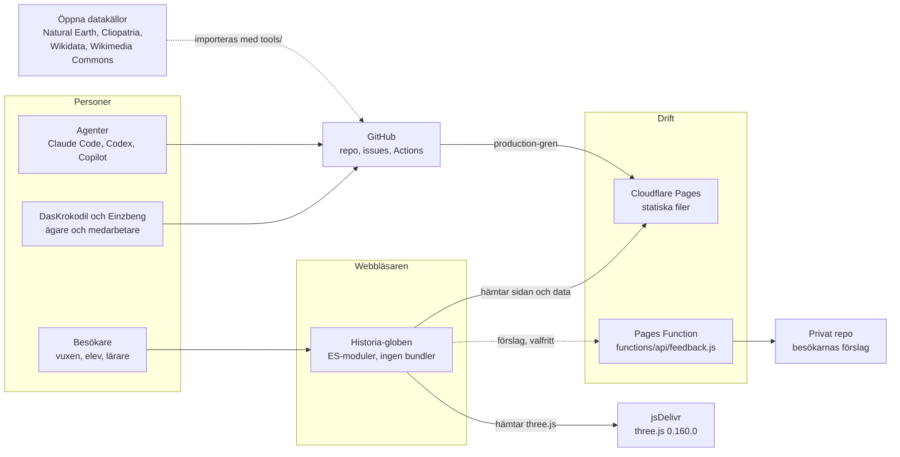
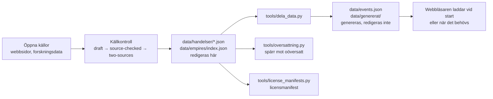
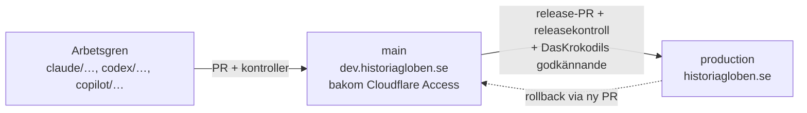

# 04. Arkitekturöversikt

**Status:** utkast 2026-11-08. Det här är en **översikt i bilder** och en bedömning av kvalitetsmål och risker. Detaljerna och de bindande principerna finns i [arkitektur.md](../arkitektur.md), [datamodell.md](../datamodell.md) och [CLAUDE.md](../../CLAUDE.md#arkitektur-beslutad-ändra-inte-utan-att-fråga). Står de i konflikt med den här filen gäller de. Bilderna är Mermaid och visas direkt på GitHub.

## 1. Sammanhang: vilka system och personer rör vid globen?



Det viktiga: sidan är **statiska filer** plus en enda liten serverfunktion. Allt innehåll läses av webbläsaren, och ingen besökardata lämnar den (förutom ett frivilligt förslag).

## 2. Inuti webbläsaren: delarna och vem som äger vad

```mermaid
flowchart TB
  subgraph Tillstånd
    TL[Timeline<br/>äger året]
    ST[state.js<br/>år, fokus, lager, filter]
    URL[url-state.js<br/>adressen]
  end

  subgraph Styrning
    CTRL[controllers/<br/>val, fokus, omritning, uppspelning,<br/>berättelse, adress,<br/>intervall (range.js)]
    REG[layers/registry.js<br/>ritordning, Lager-menyn, tonar]
  end

  subgraph Lager
    LAY[events · areas · religions · wars ·<br/>borders · lines · discovery]
  end

  subgraph Rendering
    BC[baseCanvas 4096×2048<br/>land.json]
    OC[overlayCanvas 4096×2048]
    GL[globe.js<br/>3D-glob + markörer]
    FM[flatmap.js<br/>Platt vy]
  end

  subgraph Gränssnitt
    UI[panel · funfact · tour · quiz · uppdrag ·<br/>lesson · print-sheet · sources · poster]
  end

  DATA[(data/*.json)]

  TL -- change --> CTRL
  CTRL --> ST
  ST --> REG
  REG --> LAY
  LAY -- drawOverlay --> OC
  BC --> GL
  OC --> GL
  BC --> FM
  OC --> FM
  CTRL --> UI
  URL <--> ST
  DATA --> LAY
  DATA --> UI
```

Principer som bilden visar (bindande, se CLAUDE.md): **ett år styr allt**, **allt ritas först på en platt bild** (så samma bild kan visas som karta och på en fysisk glob), **lager har samma gränssnitt** (`update` och `drawOverlay`).

## 3. Från källa till skärm: dataflödet



Kvalitetsspärrarna sitter i flödet, inte i appen: ingen händelse utan källa, ingen ny text utan översättning, och genererade filer checkas in så att sidan inte behöver ett byggsteg.

## 4. Miljöer och leverans



Kontroller: `validate-site` (bygge och validering), `browser-test` (Playwright i Chromium för varje PR; Firefox och WebKit i release-körningen), `production-check` efter publicering, `etikettkontroll`. Se [DEPLOYMENT.md](../DEPLOYMENT.md).

## Kvalitetsmål

Ordnade efter vikt för projektet. "Hur vi säkrar det" är vad som finns idag.

| Kvalitet | Varför det spelar roll här | Hur vi säkrar det idag | Hål (se risker) |
|---|---|---|---|
| **Sanningsenlighet** | Hela värdet är att inget är påhittat | Källpolicy, granskningsnivåer, schema, källkontroll, `validate-site` | Fakta kan inte provas av test; kräver granskare |
| **Begriplighet och underhållbarhet** | Två personer och många agenter | Inget byggsteg, data skild från kod, lagermodulernas gemensamma gränssnitt, kontextkarta | Några centrala filer berörs av nästan alla ärenden (R2) |
| **Prestanda på svag enhet** | Skoldatorer, surfplattor, mobiler | Lättare mobilrendering (#390), data uppdelad och laddad vid behov (#337), skarpt utsnitt bara vid inzoomning | Större datamängd kan slå mot start (prestandarapport 2026-11-07) |
| **Tillgänglighet** | Skolan och lagen; vår egen princip | Tangentbord, ARIA, kontrast, träffytor, lugn rörelse | Ingen skärmläsarattest (R5) |
| **Plattformsbredd** | De flesta läser på mobil och iPad, några på dator; alla vanliga webbläsare (beslut 2026-11-08). Fysisk glob är parkerad | Lättare mobilrendering, ekvirektangulär bild, webbläsartest | Beroende av three.js och WebGL; surfplatta och vilka webbläsarversioner som räknas är inte definierat (R9) |
| **Integritet och säkerhet** | Elever och lärare | Ingen spårning, skarp CSP, origin-kontroll och storleksgräns i formulärfunktionen | Externa tjänsters inställningar kan inte bevisas från repot |
| **Driftsäkerhet och release** | En trasig release i skolan är dyr | no-cache-regler, production-gren, rollback, releasekontroll | Firefox/WebKit-prov var röda vid analysen 2026-11-08 |
| **Internationalisering** | Fem språk | `ui()` och data per språk; spärr mot att oöversatt ökar | Stora kvarvarande oöversatta mängder; nyckeltest ≠ full översättning |

## Arkitekturbeslut vi inte rubbar utan att fråga

Sammanfattning av CLAUDE.md: 1) inget byggsteg, 2) data skild från kod, 3) ett år styr allt, 4) ekvirektangulär rendering, 5) lager som moduler, 6) three.js som enda externa beroende. Beslut som motiverar dem finns i [docs/beslut/](../beslut/README.md) och den frysta [beslut.md](../beslut.md).

## Beslut 1 när den fysiska globen är parkerad

Beslut 1 (allt ritas först på en ekvirektangulär bild) motiverades delvis av en framtida fysisk glob. Frågan från DasKrokodil 2026-11-08: blir något bättre eller sämre om vi släpper det kravet? Den här bedömningen är gjord ur dokumentationen och koden, **inte uppmätt**.

| | Om vi behöll beslut 1 | Om vi släppte det |
|---|---|---|
| **Det som redan hänger på det** | Platt vy, A4-affischen, det skarpa utsnittet vid inzoomning (`globe-detail.js`) och alla lager (`drawOverlay`) använder samma bild. Det fungerar och är testat | Alla lager och Platt vy skulle behöva skrivas om. Stor kostnad utan synlig vinst för besökaren |
| **Möjliga förbättringar** | – | Skarpare linjer och etiketter vid kraftig zoom (vektor eller finare rutor i stället för en bild), lägre minnesanvändning på mobil (i dag används 2048 × 1024 på stående mobil som lösning, #390), och en bättre kartprojektion i Platt vy (Mercator eller liknande i stället för ekvirektangulär, som sträcker polerna) |
| **Möjliga försämringar** | – | Risk för nya buggar i ett fungerande system, sämre jämn prestanda på svaga enheter, och ett längre arbete som tar glädje och tid från ensam redaktör |
| **Vad beslutet kostar oss idag** | Fast upplösning (4096 × 2048) och minnesvikt på mobil; skarpt utsnitt är en omväg | – |

**Bedömning:** behåll beslut 1 som det är. Den fysiska globen är inte längre ett skäl att *kräva* det, men beslutet bär Platt vy, affischen och lagren, och det finns inget uppmätt problem som motiverar en omskrivning. Det som kan förbättras (skarpare zoom, mobilminne, projektion i Platt vy) går att göra **utan** att släppa beslutet, som egna små issues om ett konkret problem visar sig. Ändra regeln först om en mätning visar att den bitmappen är flaskhalsen. **Beslutat 2026-11-08:** beslut 1 består, och förbättringarna görs som små issues löpande när ett konkret problem dyker upp. CLAUDE.md är oförändrad.

## Kända arkitekturrisker

Hämtade ur analyserna, inte nya fynd. Verifiera mot koden innan du agerar på dem.

| # | Risk | Källa | Konsekvens | Möjlig riktning |
|---|---|---|---|---|
| R1 | **Övergångar mellan tillstånd** (adressens asynkrona Fokus, turens sparade tillstånd, lektionslåset, språkbyte) | komplett analys 2026-11-08 | Gamla tillstånd flyttar år eller kamera; hål som inte syns i enkla test | Tillståndskontrakt och övergångsprov, inte omstrukturering |
| R2 | **Centrala filer** (`main.js`, `panel.js`, `css/style.css`) berörs av många ärenden | komplett analys 2026-11-08 | Filkrockar mellan agenter, svårare granskning | Fortsätt dela upp (jfr #402); räkna krockar i kökontroll |
| R3 | **three.js via CDN** | CLAUDE.md, beslut 6 | Beroende av extern leverans och en exakt version | Medvetet val; fäst version; omprövas om skolnät blockerar |
| R4 | **Ingen server för spar-/delningsdata** | avgränsning | Begränsar vissa framtida funktioner (klasser, framsteg) | Medvetet; alla sådana förslag kräver beslut |
| R5 | **Tillgänglighet bevisad bara delvis** | komplett analys; helhetsanalys | Skärmläsare och full tangentbordssekvens ej attesterade | Gör en riktad attest; se [06](06-granskningsperspektiv.md#7-tillgänglighet) |
| R6 | **Webbläsarbredd i test** | komplett analys (Firefox, WebKit röda) | Release utan tre motorer är inte bevisad | Åtgärda rotorsaker per motor |
| R7 | **Datamängd mot prestanda** | prestandastudie 2026-11-07 | Långsam start när massimporten växer | Fortsätt dela och ladda sent |
| R10 | **En beslutsfattare, ingen reserv** | DasKrokodil 2026-11-08 (#918) | Om DasKrokodil är borta kan ingen publicera eller slå ihop | **Accepterad risk**: ingen reservpublicerare utses |
| R9 | **Plattformsstöd bara delvis bevisat** | DasKrokodils krav 2026-11-08; `docs/produkt/05` | Stödmatris beslutad 2026-11-08 (senaste två versionerna av Chrome, Safari iOS/iPadOS, Firefox, Edge; iPad liggande och stående), men surfplattebredder (768–1024 px) har inte provats särskilt | Lägg iPad-bredd och Safari i webbläsartestet (#917) |
| R8 | **Översättningsskuld** | översättningsspärren | Besökare på andra språk ser blandad text | Omgångar, engelska först |

## Att kontrollera vid uppdatering

- [x] Stämmer bilderna med koden? *2026-11-09: controllers får `range.js` (tidsintervallet, #755). Temat är fokus av typen `theme` i samma controller som Fokus (`focus.js`) och ändrar inte lagerlistan.*
- [ ] (kvarstår) Stämmer bilderna med koden? (Pröva särskilt lagerlistan, controllers och miljöerna.)
- [ ] Är risktabellen i takt med senaste analysen? Stäng, flytta eller lägg till.
- [ ] Har ett beslut ändrat en princip? Då ska CLAUDE.md och beslutsfilen ändras först.
- [ ] Har ett nytt beroende eller en ny extern tjänst tillkommit? Det kräver DasKrokodils ok och ska in i bild 1.
