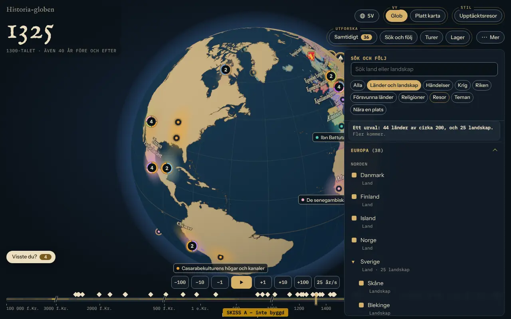
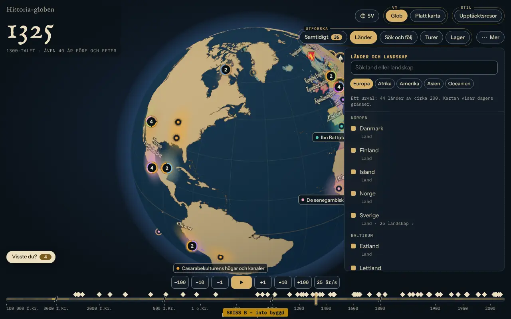
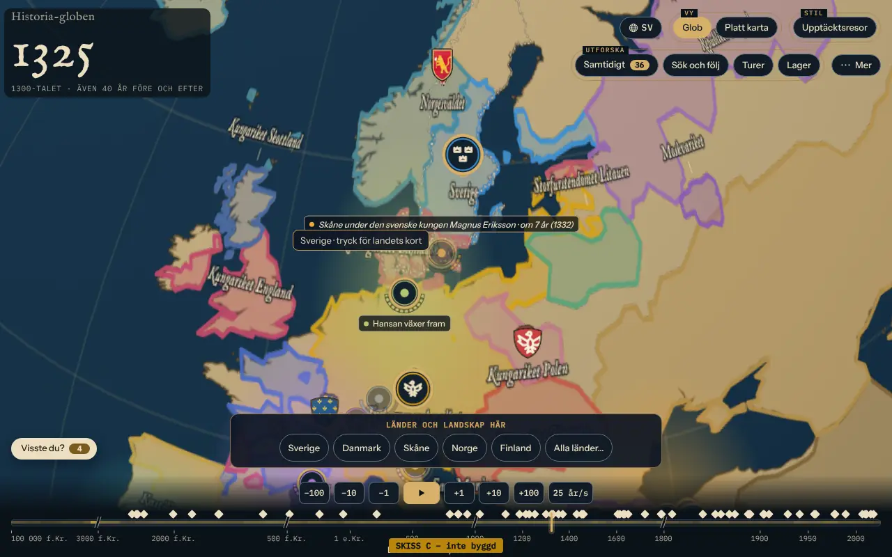
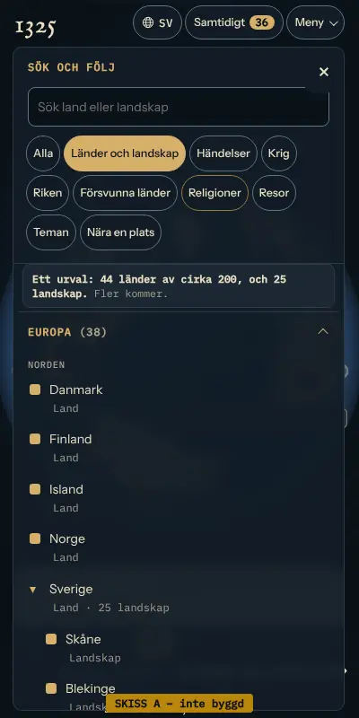
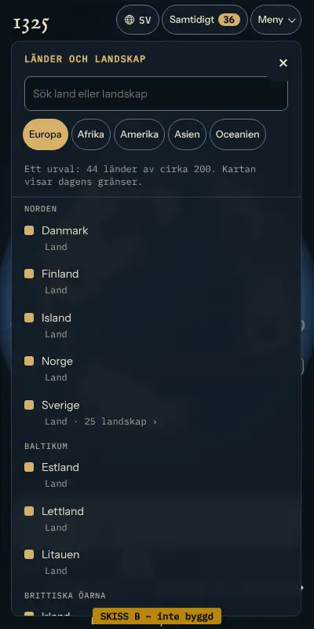
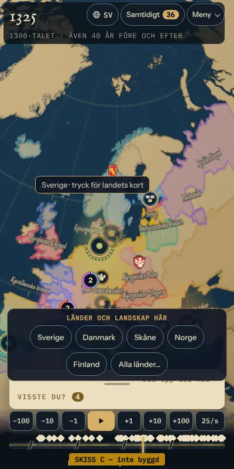

# Länder och regioner: vyn och vägen dit (2026-11-18, #1853)

Första ytgruppen i baslinjen per yta ([beslutet 2026-11-16](../beslut/2026-11-16-ux-genomgang-per-yta-1799.md), #1799), efter [baslinjen 2026-11-16](2026-11-16-baslinje-per-yta.md). Uppgiften: hur en besökare hittar ett land eller landskap, öppnar kortet, kommer till regionvyn på globen och i Platt vy, och tar sig tillbaka. Utlöst av DasKrokodils fynd efter piloten med Skåne, Nya Zeeland och Grönland: *vyn känns bra, men vägen dit känns inte logisk i menyerna*.

**Så gjordes genomgången.** `origin/main` vid commit 71e6d6d, `python3 -m http.server`, Chromium (Playwright, programvaru-WebGL) i dator 1280×800, mobil 400×800 (touch) och liggande telefon 800×360 (touch). Svensk text. Koden lästes för varje väg (fil:rad nedan). De fem frågorna: **1 Förväntan**, **2 Först**, **3 Ointressant** (också: samma ord för olika saker), **4 Tillstånd** (också: öppna en annan yta medan den här är öppen), **5 Läsbarhet och mobil**. Inga filer i koden, datan eller texterna ändrades; skisserna A–C ritades in i den körande sidan och finns bara som skärmbilder.

**Experterna.** Underagenter gick inte att starta i den här körningen (verktyget för underagenter fanns inte i sessionen). Granskningen gjordes därför efter instruktionerna i `.claude/agents/ux-tillganglighet.md` (huvudgranskare), `.claude/agents/larare.md` och `.claude/agents/geograf.md` av samma agent, och avsnitten nedan är märkta efter lins. Det är inte samma sak som en oberoende expertgranskning: dirigenten bör låta `ux-tillganglighet` och `larare` läsa rapporten och skärmbilderna innan alternativet väljs (förslag nedan).

**Konsolfel:** inga, i någon körning (dator, mobil, liggande, skisserna). Inget horisontellt rullningsfel.

Skärmbilder: `https://raw.githubusercontent.com/DasKrokodil/historia-globen/skarmbilder/issue-1853/<fil>.webp` (43 bilder, grenen `skarmbilder`). I tabellerna står bara filnamnet; hela adressen är prefixet ovan.

## Svar i korthet

| Fråga i #1853 | Svar |
|---|---|
| Var förväntar sig en besökare att hitta länder och regioner, och går det? | Troligast på kartan (tryck på landet) eller under ett eget ord som "Länder". Det går, men bara via Sök och följ → flik 9 av 10 "Platser", eller genom att zooma in och träffa en prickad kontur som knappt syns bland rikenas gränser. Ingen knapp eller rubrik i menyerna säger "land". |
| Är namnen konsekventa? | Nej. Samma sak har fyra namn (Platser, Plats, Om platsen, Land/Landskap), "region" betyder världsdel i ordlistan men en inzoomad platskarta i "Regionvy", och knappen i kortet byter namn efter fönstrets storlek ("Visa i regionvyn" / "Visa på Platt karta" för samma Skåne). "Visa händelserna på kartan" finns inte längre (ersatt i #1864). Tabell nedan. |
| Håller listan i Platser för fler länder och 24 landskap? | Nej. I dag 5 platser; milstolpen 6.6.0 planerar 38 länder i Europa, upp till 5 mikrostater, 4 pilotländer och 24 landskap till, alltså upp till cirka 76. Listan är platt och alfabetisk, utan världsdel eller land, så landskap och länder blandas ("Blekinge, Bohuslän, Bosnien och Hercegovina …"). I mobil syns cirka 6 rader, i liggande telefon ingen. Ett landskap hittas bara genom att skriva dess namn. |
| Hör vägen till regionvyn hemma i kortet, i menyn eller på kartan? | I kortet, men med ett namn och ett beteende. Knappen bör finnas kvar i kortet och kartan bör vara genvägen (tryck på platsen), inte menyn. Se Rekommendationen. |
| Konstiga lägen | Att byta fokus eller trycka "Tillbaka till hela tiden" i regionvyn lämnar besökaren i Platt karta utan besked, inte i vyn hen kom från (4.1). Tangentbordsfokus försvinner till sidan när regionvyn öppnas (4.2). År före platsens första händelse fungerar nu (#1786 åtgärdad). Liggande telefon: Platser-listan syns inte alls (5.1), och regionvyn på globen lämnar nästan ingen karta (5.3). |
| Hänger det ihop med Mer/Meny, Stöd, För lärare och turmenyn? | Delvis. Menyn har grupperna Vy, Stil, Utforska, Lär dig, För skolan, Anpassa och Hjälp projektet (#1575); länder ryms naturligt under Utforska men har ingen egen post där. Ingen tur använder i dag platssteget (#1163, #1464): `grep '"place":' data/turer/*.json` ger inget, så turkortets platskort finns bara i koden. |

## Alla vägar in (kontrollerat i koden)

| Väg | Var i koden | Vad händer | Fungerar i dag? |
|---|---|---|---|
| Sök och följ → fliken **Platser** | `js/ui/focusmenu.js:20` (flikarna), `js/focus/place.js:160–167` (gruppen "Platser" med rad "Land · 29 händelser · 5400 f.Kr.–2000 e.Kr."), val → `onPick('place:<id>')` | Fokus på platsen börjar, kortet öppnas, kameran flyger till `view` | Ja. Fliken är nummer 9 av 10 och syns först när platserna laddats (`focusmenu.js:124–131`). |
| Sök och följ → **Alla** (grupp Platser, hopfälld) eller **sökning** | `focusmenu.js:196–290` | Gruppen "Platser (5)" står andra i Alla, hopfälld; en sökning på "skåne" visar platsen först | Ja. Men gruppens antal visar hela gruppen, inte träffarna ("Platser (5)" med en träff, "Riken (366)" vid "norge"): `focusmenu.js:216` sätter `total: sorted.length`. |
| Sök och följ → **Vad hände här?** | `focusmenu.js:155–189`, sökning i `js/place-search.js` | Söker händelseplatser (fritext ur händelsernas `place`) och listar händelser inom 300 km | Ja, men det är **inte** en väg till platskortet: "Skåne" ger 13 ortsträffar ("Skåne", "Lund, Skåne" …) och ingen länk till landskapets kort. |
| Mobilmenyn **Meny** → Utforska → Sök och följ | `js/ui/viewmenu.js:1–6`, `index.html:164–188` | Samma meny som ovan, efter ett extra tryck | Ja. Tre tryck före listan (Meny, Sök och följ, Platser), och listan börjar vid y = 661 av 800 (bild `mobil-04-platser`). |
| **Tryck på platsens kontur** (inzoomat, vanligt läge) | `js/controllers/places.js:54–69`, synlighet `js/controllers/render.js:75–86` (`placeHints`), ritning `js/layers/places.js` | Ett tryck följer platsen; med finger efter 380 ms (dubbeltryck zoomar) | Ja, men bara utan Fokus, tur, lektion och intervall (`places.js:31`), och konturen är en tunn prickad linje bland rikenas färgade gränser (bild `dator-12-konturer-inzoomat`). Bara Hjälp steg 4 (`help.s4t`) berättar om den. |
| **Tangentbord:** Enter på globen eller kartan | `places.js:103–118`, `announceHere` `places.js:121–129` | Följer platsen i mitten; statusraden säger "Skåne: en plats med kort. Tryck Enter …" | Ja. |
| Tryck på platsen **när man följer den** | `places.js:57–61` (#1791) | Öppnar kortet igen | Ja. |
| **Rikeskort** → plats | – | Ingen sådan länk finns. Vägen går bara åt andra hållet: landskortets rad "Följ riket" (`js/focus/place.js:45–55`, `js/main.js:333`) | Nej (ingen väg). |
| **Turkortets platskort** | `js/ui/tour.js:552–562` → `places.openStep` `places.js:164–174`, fältet `place` i `js/tour-format.js:34` | Steget ritar konturen och öppnar kortet utan Fokus, utan knapp till regionvyn | Bara i koden: ingen tur i `data/turer/` har ett `place`-steg i dag. |
| **Adressen** `#f=place:<id>` | `js/url-state.js:57, 113–114, 141`, typen i `js/state.js:91` | Samma som att välja i menyn; en okänd plats ger "Platsen är inte tillgänglig. Välj en annan plats i Sök och följ." | Ja. Regionvyn står inte i adressen: en delad länk öppnar kortet, inte regionvyn. |
| Kortets knapp **Visa i regionvyn** | `js/focus/place.js:17–24, 61`, text `js/controllers/region.js:185–201`, regel `js/region-frame.js` | Liten plats (Skåne, Danmark): Platt vy med regionvyn; stor (Aotearoa, Grönland): globen flyger in (`region.js:397–418`) | Ja. Knappen byter text och resultat efter fönstret (#1692): liggande telefon ger "Visa på Platt karta" för Skåne. |
| Kortets knapp **Visa på Platt karta** (Sverige, eller liten plats i litet fönster) | `places.js:143–154`, `region.js:327–340` | Byter till Platt karta och ramar in platsen, ingen regionvy | Ja. Inget sätt tillbaka till globen utom Vy-knappen. |
| Händelsekortets **Visa på globen** (bara smal skärm) | `js/ui/panel.js:983, 1016`, `js/main.js:428–432` | Fäller ihop arket och flyger till händelsen | Ja; hör inte till platserna men använder ordet "plats" (`detail.showPlaceLabel`). |
| **Vägen tillbaka**: Lämna regionvyn, Escape | `region.js:460–476, 539–560` | Ställer tillbaka vyn och kameran man kom från (#1864) | Ja med knappen och Escape (bild `dator-07-lamnat-regionvy`). Inte när fokus byts eller avslutas (4.1). |
| **Vägen tillbaka**: Tillbaka till hela tiden, Sluta följa platsen | `main.js:341–345`, `region.js:529–535` | Fokus slutar; regionvyn stängs tyst | Delvis: man blir kvar i Platt karta (bild `dator-15-regionvy-tillbaka-hela-tiden`). |

## Kedjan i bilder

| Steg | Dator 1280 px | Mobil 400 px | Liggande 800×360 |
|---|---|---|---|
| Start | `dator-01-start` | `mobil-01-start` | `liggande-00-start` |
| Menyn | (knapparna syns direkt) | `mobil-02-meny` | (knapparna syns direkt) |
| Sök och följ | `dator-02-sok-och-folj` | `mobil-03-sok-och-folj` | – |
| Fliken Platser | `dator-03-platser` | `mobil-04-platser`, `mobil-04b-platser-rullad` | `liggande-04-platser` |
| Sökning | `dator-03b-sok-skane`, `dator-03c-sok-norge` | – | – |
| Vad hände här? | `dator-04-vad-hande-har` | – | – |
| Platskortet (Skåne) | `dator-05-platskort-skane` | `mobil-05-platskort-skane`, `mobil-05b-platskort-knappen` | `liggande-01-platskort-skane`, `liggande-02-knappen` |
| Regionvyn i Platt vy | `dator-06-regionvy-skane` | `mobil-06-regionvy-skane` | `liggande-03-efter-knappen` (blev Platt karta) |
| Lämna regionvyn | `dator-07-lamnat-regionvy` | `mobil-07-lamnat-regionvy` | – |
| Tillbaka till hela tiden | `dator-08-tillbaka-hela-tiden` | – | – |
| Regionvyn på globen (Aotearoa) | `dator-09-regionvy-aotearoa-glob` | `mobil-08-regionvy-aotearoa-glob` | `liggande-05-aotearoa-regionvy` |
| Sverige: Visa på Platt karta | `dator-10-platskort-sverige`, `dator-11-sverige-platt-karta` | – | – |
| Konturerna inzoomat | `dator-12-konturer-inzoomat` | – | – |
| Konstiga lägen | `dator-13` till `dator-19` (se fråga 4) | – | – |

## Namn och ordval (data/ui/sv.json, engelska inom parentes)

| Sak | Namn som används | Var | Problem |
|---|---|---|---|
| Ett kort om ett områdes historia | **Platser** (Places) i fliken och gruppen; **Plats** (Place) överst i kortet; **Om platsen** (About the place) i fokusraden och för skärmläsare; typen **Land / Landskap / Självstyrt område** under namnet | `focus.tab.places`, `place.label`, `place.cardLabel`, `place.type.*` | Fyra ord för samma sak. Besökaren tänker "land" (DasKrokodils egen milstolpe heter "Länder och regioner"), men ordet "land" finns bara i typraden och i fliken **Försvunna länder**, som är riken. En elev som letar efter "länder" trycker troligen på Försvunna länder. |
| Händelser nära en punkt | **Vad hände här?** (fliken, id `Plats` i koden) | `focus.tab.place`, `focusmenu.js:19` | Ligger bredvid Platser och låter som en väg till platsens kort, men söker orter i händelsernas text. #1261 punkt 5 tar upp namnet. |
| Inzoomad karta över platsen | **Regionvy / Regionvyn** (Close-up map) | `regionView.*`, `place.regionMap` | Ordlistan ([13-ordlista.md](../produkt/13-ordlista.md), rad 68) säger att **region** betyder världsdel, "används inte om landskap". Regionvyn för ett landskap bryter mot det, och engelskan säger något annat ("close-up map"). |
| Kortets knapp till kartan | **Visa i regionvyn** eller **Visa på Platt karta** | `place.regionMap`, `place.flatMap` | Samma plats får olika knapp efter fönstrets storlek (Skåne: dator "Visa i regionvyn", liggande telefon "Visa på Platt karta"). Ordlistan (rad 20) säger fortfarande "Visa i Platt karta", och #1853 nämner "Visa händelserna på kartan", som inte finns längre. |
| Vyn | **Platt karta** (knappen), **Platt vy** (dokumentation, `place.flatShown` "Platt karta öppen") | `top.flat` | Ok i gränssnittet; "Platt vy" bara i docs. |
| Att följa | **Sök och följ**, **Följer**, **Sluta följa platsen**, **Tillbaka till hela tiden** | `top.focus`, `focus.label`, `place.exit`, `focus.exit` | Två knappar som gör samma sak när man följer en plats (kortets "Sluta följa platsen" och fokusradens "Tillbaka till hela tiden"). |
| Regionvyns hjälptext | "Bara platsens gräns och händelser visas här. Tryck på en markör eller på platsen för fakta." | `regionView.note`, `regionView.tap` | "Platsen" betyder här ytan på kartan, i kortet hela kortet. |

## Fynd per fråga

Allvar: **Viktigt** (hindrar uppgiften eller vilseleder), **Önskvärt**, **Beslut** (kräver DasKrokodils ja).

### 1 Förväntan: var letar besökaren?

| Nr | Allvar | Fynd | Bild |
|---|---|---|---|
| 1.1 | Viktigt, **Beslut** | Ingen ingång säger "land". Menyernas ord är Vy, Stil, Utforska (Samtidigt, Sök och följ, Turer, Lager) och Mer. Länderna ligger under Sök och följ, flik 9 av 10, under ordet "Platser". En förstagångsbesökare som vill "se Sveriges historia" har inget ord att gå efter, utom sökrutans platshållare "Händelse, krig, rike, land, religion eller resa". | `dator-02-sok-och-folj`, `mobil-02-meny` |
| 1.2 | Viktigt | Sökning är den snabbaste vägen och fungerar ("skåne" ger platsen först), men en sökning på ett land som saknas ("norge") visar bara riken och händelser och inget om att landet inte har något kort än. Täcks av #1261 punkt 3. | `dator-03b-sok-skane`, `dator-03c-sok-norge` |
| 1.3 | Viktigt, **Beslut** | Kartan är där besökaren först letar (DasKrokodils fynd 2026-11-15: "väntade sig att kunna trycka på landet"), men konturen syns bara inzoomat, utan Fokus, och som en tunn prickad linje bland rikenas färgade gränser och etiketter. Inget på kartan säger att ett land har ett kort. | `dator-12-konturer-inzoomat` |
| 1.4 | Önskvärt | "Vad hände här?" ser ut som vägen till platsens kort men ger en lista med orter ("Skåne", "Lund, Skåne", "Ylleshed utanför Landskrona, Skåne" …) och händelser inom 300 km, utan länk till kortet för Skåne. | `dator-04-vad-hande-har` |
| 1.5 | Önskvärt | Rikeskortet har ingen väg till dagens land (Sverige-riket → landet Sverige), fast landskortet har vägen åt andra hållet (#1448). | – |

### 2 Först: vad syns i första synfältet?

| Nr | Allvar | Fynd | Bild |
|---|---|---|---|
| 2.1 | Viktigt | Mobil: efter Meny → Sök och följ → Platser tar huvudet (sök, tio flikar, sortering) 327 px, raden "5 resultat · Filter: Platser", förklaringen om ±180 år och gruppens förklaring resten; första platsen börjar vid y = 661 av 800. Sorteringen "Relevans" gör ingen skillnad för platser (de flesta pågår till i dag) men tar plats. | `mobil-03-sok-och-folj`, `mobil-04-platser` |
| 2.2 | Viktigt | Mobil: i platskortets halva ark ligger "Visa i regionvyn" (y 572–616) under fokusraden (y 596–696); knappen syns till hälften och kräver att arket dras upp. Samma mönster som baslinjen 1.10 och #1693 (liggande), nu i stående mobil. | `mobil-05-platskort-skane`, `mobil-05b-platskort-knappen` |
| 2.3 | Önskvärt | Dator: kortet visar knappen först efter vapen, kredit och fyra rader text (y 434); det är ok i dator men samma ordning skjuter knappen ur bild i mobil. Hör till #1789. | `dator-05-platskort-skane` |

### 3 Ointressant: vad stör, och samma ord för olika saker?

| Nr | Allvar | Fynd |
|---|---|---|
| 3.1 | Viktigt, **Beslut** | "Region" i Regionvy krockar med ordlistans region = världsdel, och med milstolpens "regioner" (delar av ett land). Tre betydelser. |
| 3.2 | Viktigt, **Beslut** | Knappen i kortet heter olika för samma plats beroende på fönstret, och ger olika resultat (regionvy i Platt vy, regionvy på globen, eller bara inramning i Platt karta). Besökaren kan inte förutse vad som händer. Tekniskt korrekt efter #1692 och #1864, men tre beteenden bakom två namn. |
| 3.3 | Önskvärt | Fliken "Platser" har en förklaring på fem rader ("Följ en plats: händelserna på globen som ligger inom platsens dagens gräns … dina kategorier gäller igen när du avslutar") före listan. Det mesta upprepas i kortet. |
| 3.4 | Önskvärt | Två knappar slutar följa platsen ("Sluta följa platsen" i kortet, "Tillbaka till hela tiden" i fokusraden). |
| 3.5 | Önskvärt | Gruppens antal i en sökning visar hela gruppen, inte träffarna ("Platser (5)" ovanför en träff). Kod: `js/ui/focusmenu.js:216`. |

### 4 Tillstånd: konstiga lägen

| Nr | Allvar | Läge | Vad som hände | Bild |
|---|---|---|---|---|
| 4.1 | Viktigt | Regionvyn (Skåne, öppnad från globen) och ett annat fokus väljs i Sök och följ (Skånska kriget) | Regionvyn stängs tyst (`region.js:532–534` anropar `flatMap.leaveRegion()` utan `leave()`), kortet försvinner och besökaren står kvar i **Platt karta**, inte på globen hon kom från. Inget besked på statusraden. #1864 ställer bara tillbaka vyn vid Lämna regionvyn och Escape. | `dator-13-regionvy-sok-krig`, `dator-14-regionvy-efter-krig` |
| 4.2 | Viktigt | Samma, med **Tillbaka till hela tiden** | Samma sak: Platt karta, utzoomad (zoom 1), ingen väg tillbaka till globen utom Vy-knappen. | `dator-15-regionvy-tillbaka-hela-tiden` |
| 4.3 | Viktigt | Tangentbord: Sök och följ → "skåne" → Enter → Tab → Enter på "Visa i regionvyn" | Kortet tar fokus (bra, en Tab till knappen), men efter Enter på knappen hamnar fokus på `<body>`: nästa Tab börjar om från sidans topp. Statusraden säger "Regionvy: Skåne, 6 händelser …" (bra). Första Escape lämnade inte vyn (troligen stängdes kortet först, som i baslinjens Escape-kedja); andra Escape lämnade den och fokus gick till globen. | – |
| 4.4 | Ok | År långt före platsens första händelse | Skåne vid 30 000 f.Kr.: tiden flyttas till 7000 f.Kr. med "Tillbaka till 30 000 f.Kr.", en markör. Aotearoa vid 33 000 f.Kr.: en markör (Rotoiti-utbrottet, som har börjat), inte hela historien. #1786 fungerar. | `dator-17-skane-30000-fkr`, `dator-18-aotearoa-33000-fkr` |
| 4.5 | Önskvärt (lärare) | Skåne år 7000 f.Kr. i regionvyn | Kartan visar dagens kust och dagens ortnamn (Malmö, Helsingborg) runt en händelse år 7000 f.Kr. Raden om dagens gräns står i kortets "Om kartan och källor", inte i regionvyn. Antagande: en elev kan läsa kartan som "så såg det ut då". | `dator-17-skane-30000-fkr` |
| 4.6 | Önskvärt | Regionvyn öppen och Turer öppnas | Turmenyn öppnas ovanpå; att starta en tur stänger vyn (`region.js:5–6`). Inte provat till slut. | `dator-16-regionvy-turmeny` |
| 4.7 | Ok | Lämna regionvyn | Globen och kameran återställs (#1864). Globens kust är suddig i minst 2 s efteråt (programvaru-WebGL, samma som baslinjen 1.17). | `dator-07-lamnat-regionvy`, `mobil-07-lamnat-regionvy` |

### 5 Läsbarhet och mobil

| Nr | Allvar | Fynd | Bild |
|---|---|---|---|
| 5.1 | Viktigt | Liggande telefon (800×360): Sök och följ med Platser är 227 px hög; huvudet tar 157 px och listan 78 px; första platsen börjar vid y = 512, alltså under skärmens kant. Man ser ingen plats utan att rulla i en 78 px hög ruta. | `liggande-04-platser` |
| 5.2 | Önskvärt | Liggande: platskortet för Skåne ligger över årtalet, och knappen säger "Visa på Platt karta" (#1692 fungerar som tänkt). Resultatet är Platt karta nästan helt täckt av fokusraden och reglaget. | `liggande-01-platskort-skane`, `liggande-03-efter-knappen` |
| 5.3 | Viktigt | Liggande: regionvyn på globen (Aotearoa) öppnas, men rutan, kortet och fokusraden (två rader) täcker nästan hela kartan; rutan ligger över "Historia-globen" och årtalet. | `liggande-05-aotearoa-regionvy` |
| 5.4 | Önskvärt | Flikarna i Sök och följ är 27 px höga i dator (40 px i mobil); markörerna och kortets stängknapp som i baslinjen (#1713). | `dator-02-sok-och-folj` |
| 5.5 | Ok | Mobilmenyn har 44–48 px höga knappar och tydliga grupper. Fliken Platser har `aria-pressed` i en `role="group"` med namnet "Visa"; inte flikar för skärmläsare (`role="tablist"`), men konsekvent med resten. | `mobil-02-meny` |

## Listan i Platser när länderna kommer

**Mätt nu:** `data/platser.json` har 5 platser: Grönland (självstyrt område), Nya Zeeland (Aotearoa), Sverige och Danmark (land) och Skåne (landskap, `partOf` "i Sverige"). Alla syns i listan, sorterade efter namn (Relevans ger samma ordning eftersom alla pågår kring de flesta år).

**Planerat i milstolpen Version 6.6.0: Länder och regioner** (issuetitlarna, inga fakta): 38 länder i Europa (#1808–#1845), upp till 5 mikrostater (#1846), 4 pilotländer (#1270–#1273) och 24 landskap (#1848–#1852), alltså upp till cirka 76 platser.

**Vad som händer med dagens lista:**

- Raderna är 54–71 px höga. 76 platser blir cirka 4 400 px. I mobil syns cirka 6 rader åt gången, i liggande telefon ingen (5.1).
- Listan är platt och alfabetisk. Landskapen hamnar mitt bland länderna ("Belgien, Blekinge, Bohuslän, Bosnien och Hercegovina, Bulgarien …"), och raden säger bara "Landskap", inte i vilket land (typraden "Landskap i Sverige" finns i kortet men inte i listan, `focus/place.js:166`).
- Det finns ingen gruppering efter världsdel eller land, och inget sätt att se "alla landskap i Sverige" utom att söka på varje namn. Sökning på "Sverige" ger landet men inte dess landskap: en plats söks bara på sina egna namn (`focus/place.js:166`, `terms: langs(pl.name)`).
- Fliken "Alla" visar gruppen hopfälld med 8 rader och "Visa alla"; för platser är "närmast i tid" ingen hjälp.

**Geograf (lins):** gruppera efter världsdel (ordlistans `REGIONS` i `js/model.js`, samma som Samtidigt-listan), därunder land, därunder landets indelning med den typ platsen har (`type`, `partOf`). Underrubriker inom Europa (Norden, Baltikum …) finns bara i issuetitlarna, inte i datan; de kräver ett fält och en källa innan de används. En plats som `partOf` pekar på bör vara fältets id, inte bara en fras per språk, om landskapen ska kunna listas under sitt land (i dag är `partOf` en text: `{"sv": "i Sverige", …}`). Det är en datamodellfråga: **kräver DasKrokodils ja**.

## Lärarens lins: en elevs väg

Personorna är antaganden ([02-anvandare-och-intressenter.md](../produkt/02-anvandare-och-intressenter.md)); inget är observerat med elever.

- **Åk 4–6** ("Hitta Skåne och se vad som hänt där"): eleven trycker troligen på kartan eller på Meny. I menyn finns inget ord som leder dit; "Sök och följ" är ett vuxenord, och tio flikar med "Försvunna länder" och "Platser" bredvid varandra är svåra att skilja. Läraren behöver ge vägen muntligt eller dela länken `#f=place:skane`. Regionvyn är tydlig när den väl är öppen (siffror i listan och på kartan).
- **Åk 7–9** ("Jämför Sverige och Danmark under 1600-talet"): vägen via sökningen fungerar, men att byta land avslutar det första, och att öppna ett krig från regionvyn lämnar eleven i Platt karta (4.1). Missförstånd att bevaka: dagens gräns och kust på kartan också år 7000 f.Kr. (4.5).
- **Läraren:** turernas platssteg (#1163) används inte i någon tur ännu, så läraren kan inte lägga ett land i en lektion utan adressen. "För lärare" nämner inte länderna.

## Rekommendation till DasKrokodil

Rekommendationen är ett förslag, inget beslut. Alla tre alternativen behåller knappen i kortet; de skiljer sig i hur man hittar landet.

| | A: "Länder och landskap" först i Sök och följ | B: Egen knapp "Länder" i Utforska | C: Kartan först |
|---|---|---|---|
| Dator |  |  |  |
| Mobil |  |  |  |
| Vad | Fliken Platser byter namn till "Länder och landskap", flyttas direkt efter Alla och grupperas efter världsdel → land → landskap (fällda under sitt land), med urvalsraden från #1261 överst. "Vad hände här?" heter "Nära en plats". | En egen knapp "Länder" bredvid Sök och följ (i mobil i gruppen Utforska) öppnar en panel med världsdelar som val, sökning och listan grupperad som i A. Platserna försvinner ur Sök och följ (eller står kvar som sökträffar). | När man zoomar in visar en rad över reglaget "Länder och landskap här" med de platser som syns, och konturen får en etikett vid hovring eller första tryck. Menyn (som A) är reservvägen för tangentbord och skärmläsare. |
| För | Minst ändring; ett ställe att söka allt; följer #1261. | Ordet "land" syns utan att öppna något; en egen panel ger plats åt 76 platser och landskap; samma mönster som Turer och Lager. | Svarar på DasKrokodils egen förväntan (trycka på landet); fungerar också för ett landskap i ett land. |
| Mot | Ordet "land" syns fortfarande först efter Sök och följ; huvudet är lika högt i mobil (2.1). | En knapp till i sidhuvudet (som redan är fullt på dator); två ställen där platser finns. | Mest arbete; ytterligare en ruta på kartan som kan krocka med kort, Samtidigt och regionvyn; hjälper inte den som inte zoomar. |

Skisserna är ritade i den körande sidan och är märkta "SKISS – inte byggd". Ländernas och landskapens namn i dem är hämtade ur milstolpens issuetitlar och visar bara hur listan skalar; inga antal eller årtal är påhittade (de är utelämnade).

**Jag rekommenderar A nu och C senare**, med två ändringar som gäller vilket alternativ som än väljs:

1. **A före Europaomgången:** grupperingen världsdel → land → landskap måste finnas innan cirka 40 länder och 24 landskap läggs till, annars byggs listan om. A är minst ändring och gör länderna synliga som "Länder och landskap" i Sök och följ. B är bättre för ordet "land", men en sjätte knapp i sidhuvudet bör vänta på utvärderingen av piloten (#1274).
2. **C som nästa steg** när fler länder finns: tryck på landet är den förväntan DasKrokodil själv hade, men den kräver att konturen syns bättre och prövas mot regionvyn och Samtidigt.
3. **Ett namn för knappen i kortet** oavsett storlek och vy, till exempel "Visa på kartan", och ett namn för vyn som inte använder "region" (förslag: "Närkarta" eller "Platsens karta"), eftersom region betyder världsdel i ordlistan.
4. **Rätta tillstånden 4.1–4.3 och 5.1** som fel; de kräver inget beslut.

**Förslag på svar:**

- Välj A nu (Länder och landskap i Sök och följ, grupperat), C som uppföljning efter #1274? Förslag: **ja**. *Kräver DasKrokodils ja.*
- Ska fliken heta "Länder och landskap" (eller "Länder och regioner")? Förslag: **"Länder och landskap"** så länge bara Sveriges landskap finns; ordet byts när fler länders indelningar kommer. *Kräver DasKrokodils ja.*
- Ska "Regionvy" byta namn, och knappen heta likadant överallt? Förslag: **ja**, "Visa på kartan" och "Platsens karta" (prövas av `sprak-*` före release). *Kräver DasKrokodils ja.*
- Ska `partOf` bli en länk till landets id, så att landskap kan listas under sitt land? Förslag: **ja**, i samma issue som grupperingen (datamodell). *Kräver DasKrokodils ja.*
- Ska `ux-tillganglighet` och `larare` läsa den här rapporten som riktiga underagenter innan alternativet byggs? Förslag: **ja**, i dirigentens tråd.

## Föreslagna issues (skapas inte av den här genomgången)

Dubbletter söktes bland öppna issues (`gh api search/issues`, orden regionvyn, liggande, Sök och följ, Platser, landskap, kontur, rikeskort, Platt karta, tangentbord fokus).

| Nr | Titel | Etiketter | Kort text | Rekommendation | Finns redan? |
|---|---|---|---|---|---|
| 1 | Sök och följ: Platser grupperade efter världsdel, land och landskap (alternativ A) | `utseende`, `beslut-krävs`, `data` | Gruppering, namnbyte på fliken, landskap under sitt land, `partOf` som id. | A enligt ovan, före Europaomgångens stora del. | Delvis: #1261 (urvalsrad, sökning på saknat land, flikens namn "Plats") ska utökas eller stå bredvid; föreslå att lägga punkterna i #1261 i stället för ett nytt issue. |
| 2 | Ett namn för kortets kartknapp och för regionvyn | `utseende`, `beslut-krävs` | "Visa i regionvyn" / "Visa på Platt karta" för samma plats; "region" = världsdel i ordlistan. Ordlistan (rad 20) säger "Visa i Platt karta". | "Visa på kartan" och "Platsens karta"; uppdatera ordlistan. | Nej. |
| 3 | Regionvyn: byte av fokus och "Tillbaka till hela tiden" ställer inte tillbaka vyn man kom från | `bugg` | 4.1 och 4.2: `region.js:532–534` stänger tyst och lämnar Platt karta. Låt samma återgång som #1864 gälla, med besked. | Fel, utan beslut; kan få `redo`. | Nej. |
| 4 | Regionvyn: tangentbordsfokus försvinner när "Visa i regionvyn" trycks | `bugg`, `accessibility` | 4.3: fokus till `<body>`. Lägg fokus på rutans "Lämna regionvyn" eller på kartan. | Fel; kan få `redo`. | Nej. |
| 5 | Liggande telefon: Sök och följ visar ingen rad i listan | `bugg`, `utseende` | 5.1: huvudet 157 px av 227, första raden vid y = 512 av 360. | Fel (huvudet bör fällas ihop eller rulla med); `beslut-krävs` bara om huvudet ska se annorlunda ut. | Nej (#1667, #1692 och #1693 är stängda och gällde kortet). |
| 6 | Mobil: "Visa i regionvyn" ligger under fokusraden i platskortets halva ark | `utseende` | 2.2, samma mönster som baslinjen 1.10. | Lägg till i #1789 (kortens design) i stället för nytt issue. | Ja i praktiken: #1789. |
| 7 | Liggande telefon: regionvyn på globen lämnar nästan ingen karta | `utseende`, `beslut-krävs` | 5.3. | Undersök ihop med #1713; ett eget issue om #1713 inte tar det. | Delvis: #1713. |
| 8 | Sök och följ: gruppens antal ska visa träffarna under en sökning | `bugg` | 3.5, `focusmenu.js:216`. | Litet fel; `redo`. | Nej. |
| 9 | Kartan: syns det att ett land har ett kort? (alternativ C) | `utseende`, `beslut-krävs`, `idé` | 1.3: konturen syns dåligt bland rikenas gränser; raden "Länder och landskap här". | Efter #1274 och fler länder. | Nej; relaterat #579 (stängt mål), #1161 (stängt). |
| 10 | Rikeskortet: länk till dagens land | `utseende`, `beslut-krävs` | 1.5: bara landskortet länkar till riket. | Låg prioritet; kräver regel för vilka riken som pekar på vilket land. | Nej; motsatt riktning i #1260. |
| 11 | Regionvyn: säg att kust och ortnamn är dagens | `beslut-krävs`, `utseende` | 4.5 (lärarlinsen): raden om dagens gräns står bara i kortets "Om kartan och källor". | Låt `larare` och `geograf` bedöma först. | Nej. |

Två saker kräver bara att dokumentation uppdateras och tas med i issue 2: [13-ordlista.md](../produkt/13-ordlista.md) rad 20 ("Visa i Platt karta") och #1853:s egen text ("Visa händelserna på kartan", som togs bort i #1864).

## Inte provat

Riktig skärmläsare (bara statusraden och fokus lästes ur DOM), Firefox och WebKit, andra språk än svenska, 200 % zoom, surfplatta, Grönland och Danmark i regionvyn, en tur med platssteg (ingen finns), uppspelning genom regionvyn, delad länk till en öppen regionvy (adressen bär den inte), dragning av arket med riktig touch.

## Vad genomgången lärde oss (till frågorna)

- **Vägen dit** missades av baslinjen, som började vid kortet. Fråga 1 ska börja *före* ytan: från startbilden, utan att veta vad ytan heter, hur många tryck och vilka ord leder dit?
- **Samma knapp med olika resultat** (3.2) hittas bara när samma yta provas i flera fönsterstorlekar. Fråga 5 ska alltid ta liggande telefon med, inte bara 400 och 1280 px.
- **Skalning** (listan med 5 mot 76 platser) syns inte i en genomgång av det som finns. Fråga 2 ska fråga *hur ser första synfältet ut när datan har vuxit enligt milstolpen?*
